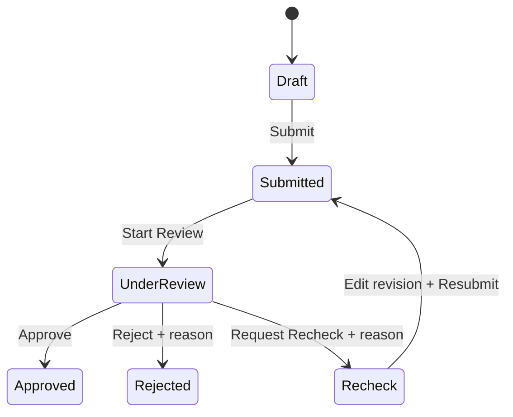
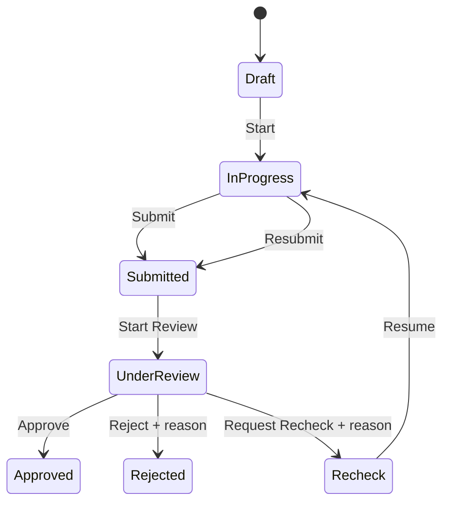
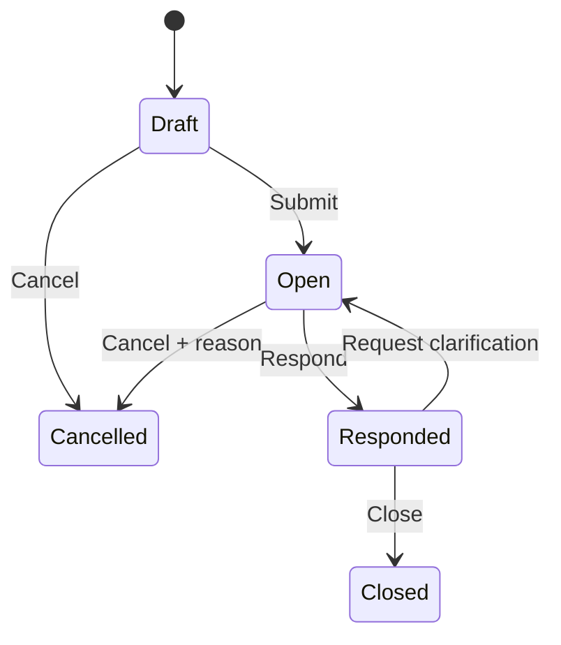

# Phạm vi sản phẩm và Use Case

## 1. Mục đích tài liệu

Tài liệu này thống nhất phạm vi nghiệp vụ, actor, quyền, luồng trạng thái và tiêu chí hoàn thành MVP của hệ thống Construction Inspection Training. Đây là cơ sở để xác nhận yêu cầu trước khi thiết kế chi tiết, khởi tạo solution, viết mã và kiểm thử.

## 2. Tầm nhìn sản phẩm

Hệ thống hỗ trợ quản lý hoạt động kiểm tra, xác nhận và làm rõ thông tin trên các đối tượng xây dựng. `Construction Object` là trung tâm; mỗi đối tượng có thể phát sinh Form Inspection, Checklist, RFI (Request for Information), quy trình xử lý/phê duyệt, lịch sử trạng thái và notification cho người liên quan.

MVP ưu tiên tính đúng đắn nghiệp vụ, khả năng truy vết và kiểm soát quyền ở API. Các hồ sơ đã hoàn tất phải giữ nguyên lịch sử; mọi chuyển trạng thái phải xác định được ai thực hiện, khi nào và với ghi chú nào.

## 3. Kịch bản demo xuyên suốt

1. Inspector chọn Construction Object “Hệ thống điện phòng 301”.
2. Inspector thực hiện Checklist an toàn điện.
3. Một tiêu chí không đạt nên Inspector tạo Inspection liên kết.
4. Inspector điền FormIO và lưu Draft.
5. Inspector Submit Inspection.
6. Reviewer nhận notification và Start Review.
7. Reviewer yêu cầu Recheck, bắt buộc ghi lý do.
8. Inspector sửa dữ liệu, bổ sung bằng chứng và gửi lại bằng revision mới.
9. Reviewer Start Review revision mới và Approve.
10. Khi có thông tin kỹ thuật chưa rõ, Inspector tạo và Submit RFI.
11. Người được giao phản hồi RFI; phản hồi cũ không bị ghi đè.
12. Người tạo xác nhận nội dung và đóng RFI.

## 4. Phạm vi MVP bắt buộc

- Đăng nhập bằng tài khoản được seed sẵn qua ASP.NET Core Identity và JWT Bearer Access Token; xem tài khoản hiện tại.
- Quản lý người dùng và role ở mức cần thiết cho phân quyền MVP.
- Quản lý cây Construction Object.
- Quản lý Form Template và các Form Template Version theo lifecycle `Draft → Published`; lưu FormIO schema dạng JSON hợp lệ. Mỗi template có tối đa một Draft, còn Published version là bất biến.
- Tạo, sửa, lưu Draft, Submit, review, Approve, Reject và Recheck Inspection.
- Tạo Checklist, Checklist Item và ghi nhận `Pass`, `Fail`, `NotApplicable`, `NotChecked`.
- Liên kết một Checklist với một hoặc nhiều Inspection cùng Construction Object.
- Tạo, lưu Draft, Submit, giao người phản hồi, phản hồi, yêu cầu làm rõ thêm, đóng hoặc hủy RFI.
- Quản lý trạng thái bằng Business Process và lưu đầy đủ Process History.
- Lưu Notification trong database.
- Danh sách có pagination, search, filter và sorting.
- Dashboard cơ bản phục vụ theo dõi theo trạng thái và trường hợp quá hạn.
- SLA mặc định 72 giờ từ lúc Submit; lưu `DueAt`/`CompletedAt` và truy vấn hồ sơ quá hạn, chưa gửi nhắc tự động.

## 5. Yêu cầu kỹ thuật

### Backend

- ASP.NET Core Web API theo Clean Architecture với bốn project Domain, Application, Infrastructure và API.
- Target framework thống nhất `net10.0`; chỉ dùng package stable tương thích, không tự dùng preview.
- ASP.NET Core Identity quản lý user/password hash/role/user-role/lockout/security stamp; Web API phát JWT Bearer Access Token. Không tạo bảng auth thủ công trùng với Identity.
- Authentication contract MVP gồm `POST /api/auth/login` và `GET /api/auth/me`; seed role và tài khoản demo Inspector, Reviewer, Manager, Administrator. Không có public registration, email confirmation, forgot password, external IdP hoặc refresh token.
- CQRS qua MediatR; validation qua FluentValidation.
- Entity Framework Core và SQL Server; stored procedure chỉ dành cho truy vấn phức tạp hoặc thống kê khi có căn cứ.
- `ProblemDetails` cho lỗi HTTP; không trả stack trace cho frontend. Resource hoàn toàn ngoài phạm vi xem trả `404`; actor nhìn thấy resource nhưng không được thực hiện action trả `403`.
- Logging có correlation ID xuyên suốt request.
- API tự kiểm tra authentication, role, ownership, assignment và business rule; giao diện ẩn nút không thay thế authorization phía server.
- Các chuyển trạng thái và side effect liên quan chạy trong transaction.
- Thời gian lưu UTC; dữ liệu có khả năng cập nhật đồng thời dùng SQL Server `rowversion`.
- Query danh sách dùng `AsNoTracking`, filter trước, sort theo whitelist, project trực tiếp DTO rồi mới `Skip`/`Take`.

### Frontend

- React và TypeScript.
- Ant Design cho UI; TanStack/React Query cho server state.
- FormIO renderer chỉ hỗ trợ Text Field, Text Area, Number, Select, Radio, Checkbox và Date/Time trong MVP.
- Không cho custom component, script, HTML có script, component thực thi code, file upload, base64 image/file lớn trong JSON.
- `SchemaJson` tối đa 1 MiB và `DataJson` tối đa 2 MiB; application kiểm tra kích thước, SQL Server kiểm tra `ISJSON`.
- Lưu Draft thủ công bằng nút Save Draft; cảnh báo khi rời trang có thay đổi chưa lưu và cập nhật rowVersion sau khi lưu thành công.
- CSS Modules hoặc một convention CSS thống nhất, lựa chọn trước khi khởi tạo.
- Frontend dùng DTO/API contract, không phụ thuộc entity persistence.

Phiên bản framework và package chỉ được chốt sau khi kiểm tra SDK/toolchain thực tế và ma trận tương thích chính thức.

## 6. Phần mở rộng sau MVP

- SignalR realtime; chỉ phát sự kiện sau khi transaction database commit thành công.
- Elsa Workflow đầy đủ cho cả Inspection, Checklist và RFI.
- Docker Compose.
- Cache.
- Upload file chuyên dụng.
- Dashboard nâng cao.
- Load test.
- Quy trình duyệt nhiều cấp.
- Autosave Draft.
- Refresh Token và các luồng hoàn thiện authentication.
- Scheduler/notification nhắc quá hạn tự động.

## 7. Ngoài phạm vi

- Quản lý tài chính công trình, kho vật tư hoặc nhân sự.
- BIM hoặc bản vẽ 3D.
- Chat nội bộ.
- Mobile app.
- Multi-tenant.

## 8. Actor và quyền

### Inspector

- Xem Construction Object được phép truy cập.
- Tạo Inspection; sửa khi trạng thái `Draft` hoặc `Recheck`.
- Thực hiện và Submit Checklist.
- Tạo RFI; xem phản hồi và đóng RFI do mình tạo.
- Xem lịch sử và notification liên quan.
- Không được tự phê duyệt hồ sơ mình tạo.
- Trong MVP được xem các Construction Object đang active cần cho luồng demo.

### Reviewer

- Xem Inspection và Checklist được giao; nhận xử lý bằng Start Review.
- Approve, Reject hoặc yêu cầu Recheck.
- Reject và Recheck bắt buộc nhập lý do.
- Phản hồi RFI khi được giao.
- Không được duyệt hồ sơ do chính mình tạo.
- Trong MVP được xem các Construction Object đang active cần cho luồng demo.

### Manager

- Xem dữ liệu trong phạm vi quản lý.
- Theo dõi hồ sơ theo trạng thái.
- Xem dashboard cơ bản và trường hợp quá hạn.
- Trong MVP được xem toàn bộ Construction Object; chưa có manager scope phức tạp.

### Administrator

- Quản lý user, role, Form Template, dữ liệu nền và Construction Object.
- Không sửa nội dung hồ sơ đã `Approved`.
- Quản lý Construction Object và có thể reassign Reviewer sau Submit khi có quyền phù hợp.

### Quy tắc quyền chung

- `Approved`, `Closed` và `Cancelled` là chỉ đọc.
- Mọi chuyển trạng thái lưu người thực hiện, thời gian UTC và ghi chú.
- Không xóa cứng dữ liệu đã phát sinh nghiệp vụ.
- Quyền truy cập Construction Object và phạm vi quản lý cần được áp dụng nhất quán ở query lẫn command.
- Reviewer chỉ được chọn/gán khi Submit, không gán lúc Create. Sau Submit, chỉ Manager hoặc Administrator có quyền phù hợp mới được reassign và mọi lần reassign phải có ProcessHistory.
- `Rejected` là trạng thái kết thúc, chỉ đọc và không reopen; muốn thực hiện lại phải tạo Inspection mới.
- Inspection Number do server sinh theo `INS-{YEAR}-{SEQUENCE}`, ví dụ `INS-2026-000001`, dùng SQL Server Sequence/cơ chế an toàn đồng thời và unique index; không nhận từ frontend, không dùng `MAX + 1`.

## 9. Danh mục 43 Use Case

### Xác thực

| ID | Use Case | Actor chính | Kết quả mong đợi |
|---|---|---|---|
| UC01 | Đăng nhập | Người dùng | Xác thực tài khoản có sẵn và nhận phiên/token hợp lệ. |
| UC02 | Xem tài khoản hiện tại | Người dùng | Nhận thông tin định danh và role hiện hành. |

### Construction Object

| ID | Use Case | Actor chính | Kết quả mong đợi |
|---|---|---|---|
| UC03 | Xem danh sách | Inspector, Reviewer, Manager, Administrator | Danh sách đúng phạm vi, có phân trang/tìm kiếm/lọc/sắp xếp. |
| UC04 | Xem chi tiết | Actor có quyền | Xem thông tin object, quan hệ cha-con và dữ liệu liên quan được phép. |
| UC05 | Tạo | Administrator | Tạo object, có thể gắn `ParentId`. |
| UC06 | Cập nhật | Administrator | Cập nhật object đang sử dụng và kiểm soát đồng thời. |
| UC07 | Ngừng sử dụng | Administrator | Đánh dấu inactive, không xóa cứng lịch sử. |

### Form Template

| ID | Use Case | Actor chính | Kết quả mong đợi |
|---|---|---|---|
| UC08 | Xem danh sách | Administrator | Danh sách template và version liên quan. |
| UC09 | Tạo từ FormIO schema | Administrator | Tạo template active cùng Draft version 1 có `SchemaJson` hợp lệ; Update Draft và Publish là các hành động con của UC09/UC10. |
| UC10 | Tạo phiên bản mới | Administrator | Tạo Draft version mới khi chưa có Draft hiện hành; số version lấy từ `NextVersionNumber`, không dùng `MAX + 1`; Published version bất biến. |
| UC11 | Ngừng sử dụng | Administrator | Chuyển template `Active → Inactive`, chặn Inspection/version/Draft/Publish mới nhưng bảo toàn toàn bộ Inspection và version lịch sử; không reactivate. |

### Inspection

| ID | Use Case | Actor chính | Kết quả mong đợi |
|---|---|---|---|
| UC12 | Xem danh sách | Actor có quyền | Danh sách đúng phạm vi với pagination/search/filter/sort. |
| UC13 | Xem chi tiết | Actor liên quan | Xem revision hiện tại, process, assignment và dữ liệu cần thiết. |
| UC14 | Tạo | Inspector | Server sinh Number, resolve latest Published version của template active và pin chính xác version; tạo Inspection chưa gán Reviewer, Business Process và revision 1. |
| UC15 | Lưu Draft | Inspector tạo hồ sơ | Cập nhật revision chưa Submit; sau Recheck, lần sửa đầu tạo revision mới. |
| UC16 | Submit | Inspector tạo hồ sơ | Validate FormIO, chọn/gán Reviewer, đặt DueAt theo SLA, chuyển `Submitted`, ghi history/notification. |
| UC17 | Reviewer nhận xử lý | Reviewer được giao | Chuyển `Submitted` sang `UnderReview`. |
| UC18 | Approve | Reviewer đang xử lý | Chuyển `UnderReview` sang `Approved`; cấm tự duyệt. |
| UC19 | Reject | Reviewer đang xử lý | Chuyển `UnderReview` sang `Rejected`, bắt buộc lý do. |
| UC20 | Yêu cầu Recheck | Reviewer đang xử lý | Chuyển `UnderReview` sang `Recheck`, bắt buộc lý do. |
| UC21 | Chỉnh sửa và gửi lại | Inspector tạo hồ sơ | Tạo/sửa revision mới rồi chuyển `Recheck` sang `Submitted`. |
| UC22 | Xem lịch sử | Actor liên quan | Xem toàn bộ Process History theo thời gian. |

### Checklist

| ID | Use Case | Actor chính | Kết quả mong đợi |
|---|---|---|---|
| UC23 | Xem danh sách | Actor có quyền | Danh sách đúng phạm vi với pagination/search/filter/sort. |
| UC24 | Tạo Checklist và item | Inspector | Tạo Checklist Draft cùng các tiêu chí. |
| UC25 | Thực hiện Checklist | Inspector | Chuyển sang `InProgress`, ghi kết quả từng item. |
| UC26 | Liên kết Inspection | Inspector | Tạo liên kết nhiều-nhiều khi cùng Construction Object. |
| UC27 | Submit | Inspector | Chuyển `InProgress` sang `Submitted`, lưu history/notification. |
| UC28 | Approve | Reviewer | Sau Start Review, chuyển `UnderReview` sang `Approved`. |
| UC29 | Reject hoặc Recheck | Reviewer | Chuyển từ `UnderReview`, bắt buộc lý do; Recheck quay về `InProgress`. |
| UC30 | Xem lịch sử | Actor liên quan | Xem toàn bộ lịch sử xử lý Checklist. |

### RFI

| ID | Use Case | Actor chính | Kết quả mong đợi |
|---|---|---|---|
| UC31 | Xem danh sách | Actor có quyền | Danh sách đúng phạm vi với pagination/search/filter/sort. |
| UC32 | Tạo và lưu Draft | Inspector | Tạo RFI ở `Draft` và lưu nội dung. |
| UC33 | Submit | Người tạo | Chuyển `Draft` sang `Open`, ghi history/notification. |
| UC34 | Giao người phản hồi | Actor có quyền giao | Gán người chịu trách nhiệm phản hồi. |
| UC35 | Phản hồi | Người được giao | Thêm RfiResponse mới, chuyển `Open` sang `Responded`. |
| UC36 | Yêu cầu làm rõ thêm | Người tạo | Chuyển `Responded` về `Open`, không ghi đè phản hồi cũ. |
| UC37 | Đóng | Người tạo | Xác nhận phản hồi và chuyển `Responded` sang `Closed`. |
| UC38 | Hủy | Actor có quyền | Chuyển `Draft` hoặc `Open` sang `Cancelled`; hủy từ Open bắt buộc lý do. |
| UC39 | Xem lịch sử | Actor liên quan | Xem Process History và chuỗi phản hồi. |

### Notification và dashboard

| ID | Use Case | Actor chính | Kết quả mong đợi |
|---|---|---|---|
| UC40 | Xem notification | Người dùng | Danh sách notification của chính người dùng. |
| UC41 | Đánh dấu đã đọc | Người nhận | Cập nhật thời điểm đọc của notification. |
| UC42 | Điều hướng đến hồ sơ liên quan | Người nhận | Mở đúng hồ sơ từ Business Process nếu còn quyền. |
| UC43 | Xem dashboard cơ bản | Manager | Thống kê theo trạng thái và trường hợp quá hạn trong phạm vi quản lý. |

## 10. Luồng trạng thái

### Inspection

### Checklist

### RFI

Mọi transition ngoài sơ đồ trả `409 Conflict`. Trạng thái kết thúc `Approved`, `Rejected`, `Closed`, `Cancelled` không được sửa nội dung; riêng `Rejected` được coi là kết thúc trong MVP dù quy tắc chung chỉ nêu rõ ba trạng thái chỉ đọc.

## 11. Notification theo sự kiện

| Sự kiện đã commit | Người nhận | Mục đích |
|---|---|---|
| Inspection/Checklist được Submit | Reviewer được giao | Có hồ sơ mới cần nhận review. |
| Reviewer Start Review | Người tạo | Hồ sơ đang được xử lý. |
| Approve hoặc Reject | Người tạo | Biết kết quả cuối cùng. |
| Request Recheck | Người tạo/Inspector | Sửa hồ sơ theo lý do của Reviewer. |
| Inspection được gửi lại | Reviewer được giao | Review revision mới. |
| RFI được Submit hoặc giao | Người phản hồi | Chuẩn bị phản hồi. |
| RFI được phản hồi | Người tạo | Xem và xác nhận câu trả lời. |
| RFI yêu cầu làm rõ thêm | Người phản hồi | Bổ sung phản hồi mới. |
| RFI Closed hoặc Cancelled | Các bên liên quan | Biết hồ sơ đã kết thúc. |

Notification được lưu trong cùng transaction với transition. SignalR, khi được bổ sung, chỉ phát sau commit. Điều hướng từ notification vẫn phải kiểm tra quyền hiện tại. MVP không có scheduler gửi nhắc quá hạn.

## 12. SLA và hồ sơ quá hạn

- SLA mặc định là 72 giờ và nằm trong cấu hình tập trung.
- Submit Inspection/Checklist đặt `DueAt = SubmittedAt + 72 giờ`.
- RFI cho phép người tạo chỉ định `Rfis.DueAt`; nếu bỏ trống thì dùng SLA mặc định khi Submit/Open.
- Khi quy trình đi vào trạng thái kết thúc, ghi `BusinessProcesses.CompletedAt`.
- Quá hạn khi `CompletedAt IS NULL`, `DueAt IS NOT NULL` và thời gian UTC hiện tại lớn hơn `DueAt`.
- Dashboard chỉ truy vấn/hiển thị; chưa có scheduler nhắc tự động.

## 13. Điều kiện hoàn thành MVP

- UC01–UC43 đã được triển khai và có tiêu chí chấp nhận/kiểm thử tương ứng.
- Ba luồng trạng thái chỉ cho phép transition hợp lệ, ghi đầy đủ Process History và không tự duyệt.
- Inspection bảo toàn đúng revision và `FormTemplateVersionId` đã pin; mọi Published template version đều bất biến, không phụ thuộc đã được sử dụng hay chưa.
- JSON schema/data được kiểm tra tính hợp lệ và dữ liệu FormIO được validate khi Submit.
- API thực thi authorization, ownership/assignment và phạm vi Construction Object.
- Các transition nguyên tử; lỗi rollback cả state, history và notification.
- Danh sách đáp ứng pagination/search/filter/sort an toàn và hiệu quả.
- `rowversion` trả về/nhận lại qua API và conflict trả `409`.
- Error response theo ProblemDetails, có correlation ID ở lỗi không dự kiến.
- Identity + JWT có Login/current-user, seed bốn role/user demo; chưa có đăng ký, email confirmation, quên mật khẩu hoặc refresh token.
- Number sinh phía server bằng sequence an toàn đồng thời; SLA 72 giờ và overdue query hoạt động đúng.
- Manual Save cảnh báo unsaved changes; hai API audit revision chỉ cho phép đọc.
- Có unit test cho business rule và integration test cho API/transaction quan trọng.
- Tài liệu API và hướng dẫn chạy môi trường được cập nhật; chưa yêu cầu các phần mở rộng sau MVP.

## 14. Các quyết định đã chốt và vấn đề còn cần xác nhận

Đã chốt: `net10.0`, Identity + JWT access token, scope Object đơn giản, Reviewer-at-submit, Inspection Number bằng sequence, Rejected kết thúc, SLA 72 giờ, FormIO component/size allowlist, Manual Save, quy tắc 401/403/404, SQL Server local test riêng, API audit revision và Git local không tự commit/push.

Các điểm còn cần xác nhận trước phần chức năng tương ứng:

1. Manager/Administrator cần policy cụ thể nào để được reassign Reviewer và API reassign có nằm trong vertical slice đầu không?
2. RFI assignee được chọn khi Submit hay qua thao tác riêng UC34; ai được quyền giao lại?
3. Nội dung “bằng chứng” không phải file/base64 sẽ dùng URL tham chiếu hay chỉ text/field tiêu chuẩn?
4. Administrator được xem toàn bộ nội dung hồ sơ hay chỉ metadata/cấu hình?
5. Ngừng sử dụng Construction Object chặn tạo hồ sơ mới theo contract UC03–UC07; Form Template inactive đã chốt chặn Inspection/version/Draft/Publish mới ngay lập tức nhưng giữ lịch sử.
6. Actor nào ngoài Inspector được phép tạo Checklist và ai được gán Reviewer cho Checklist?
7. Actor có quyền hủy RFI ngoài người tạo là Reviewer, Manager hay Administrator?
8. Dashboard cơ bản cần chỉ số nào ngoài số lượng theo trạng thái và quá hạn?
9. Có cần localization Việt/Anh và quy ước hiển thị múi giờ nào?
