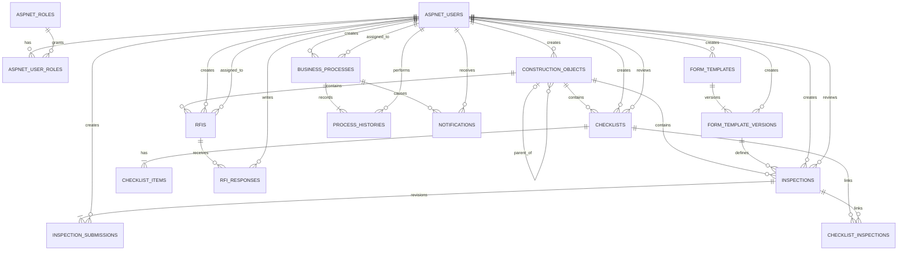

# ERD và thiết kế dữ liệu

## 1. Mục đích và nguyên tắc

Tài liệu mô tả 16 bảng lõi logic của MVP và các bảng hạ tầng do ASP.NET Core Identity quản lý. Ba khái niệm logic Users/Roles/UserRoles được triển khai trực tiếp bằng `AspNetUsers`, `AspNetRoles`, `AspNetUserRoles`; không tạo thêm bộ bảng auth thủ công trùng lặp. Identity có thể cần các bảng chuẩn phụ trợ Claims/Logins/Tokens khi EF mapping được tạo. Kiểu dữ liệu dùng cú pháp SQL Server để làm cơ sở mapping EF Core; đây chưa phải migration hay DDL chính thức.

Các nguyên tắc:

- `ConstructionObjects` là trục liên kết nghiệp vụ và dùng `ParentId` để tạo cây; chưa tạo bảng Project.
- Ba module Inspection, Checklist và RFI dùng chung `BusinessProcesses` và `ProcessHistories`.
- Form template có version bất biến sau khi được sử dụng.
- Inspection giữ toàn bộ revision trong `InspectionSubmissions` và xác định duy nhất revision hiện tại.
- Checklist–Inspection là quan hệ nhiều-nhiều, chỉ được liên kết khi cùng Construction Object.
- RFI response chỉ thêm mới, không ghi đè câu trả lời cũ.
- Thời gian lưu UTC bằng `datetime2`; khóa chính dùng `uniqueidentifier` do ứng dụng sinh.
- Backend target `net10.0`; package chỉ dùng bản stable tương thích.
- Inspection Number do server sinh theo `INS-{YEAR}-{SEQUENCE}` bằng SQL Server Sequence toàn hệ thống, không dùng `MAX + 1`; sequence không reset theo ngày/năm và chấp nhận có khoảng trống khi transaction rollback.
- Business Process lưu SLA bằng `DueAt`/`CompletedAt`; SLA mặc định 72 giờ lấy từ cấu hình.
- Dùng `rowversion` cho aggregate có cập nhật đồng thời; transition chạy trong transaction.
- Không xóa cứng dữ liệu đã phát sinh nghiệp vụ.

## 2. Mermaid ERD

Do Mermaid không biểu diễn tốt polymorphic FK, `BusinessProcesses.EntityType + EntityId` liên kết logic tới đúng một `Inspections`, `Checklists` hoặc `Rfis`; ràng buộc này được bảo vệ bởi application service/transaction và unique index. Không tạo ba nullable FK để giữ mô hình process dùng chung.

## 3. Quy ước cột chung

- Khóa: `uniqueidentifier`, application-generated; không dùng ID có ý nghĩa nghiệp vụ.
- Chuỗi: `nvarchar(n)` với giới hạn cụ thể; nội dung dài/JSON dùng `nvarchar(max)`.
- Thời gian: `datetime2(7)` UTC, hậu tố `At`.
- Người tạo/cập nhật: FK tới `AspNetUsers.Id` khi cần truy vết.
- Cờ hoạt động: `bit`; ngừng sử dụng thay cho xóa.
- `RowVersion rowversion NOT NULL` là concurrency token, không phải thời gian.
- Enum lưu `varchar` có check constraint để database dễ đọc và tránh lệch numeric value.

## 4. Thiết kế 16 bảng

Ký hiệu: PK = primary key, FK = foreign key, NN = NOT NULL, UQ = unique.

### 4.1 `AspNetUsers` (khái niệm logic `Users`)

| Cột | Kiểu | Ràng buộc/ý nghĩa |
|---|---|---|
| Id | uniqueidentifier | PK |
| UserName | nvarchar(256) | NULL theo base Identity; nghiệp vụ seed yêu cầu có giá trị |
| NormalizedUserName | nvarchar(256) | NULL, unique filtered index theo Identity |
| Email | nvarchar(256) | NULL theo base Identity; seed MVP có thể yêu cầu giá trị |
| NormalizedEmail | nvarchar(256) | NULL, index theo Identity |
| EmailConfirmed | bit | NN, default 0; MVP chưa có email confirmation |
| PasswordHash | nvarchar(max) | NULL theo Identity; tài khoản seed dùng password hash |
| SecurityStamp | nvarchar(max) | NULL, Identity quản lý |
| ConcurrencyStamp | nvarchar(max) | NULL, Identity quản lý |
| PhoneNumber | nvarchar(max) | NULL |
| PhoneNumberConfirmed | bit | NN, default 0 |
| TwoFactorEnabled | bit | NN, default 0 |
| LockoutEnd | datetimeoffset | NULL |
| LockoutEnabled | bit | NN |
| AccessFailedCount | int | NN |
| DisplayName | nvarchar(200) | NN |
| IsActive | bit | NN, default 1 |
| CreatedAt | datetime2(7) | NN, UTC |
| UpdatedAt | datetime2(7) | NULL, UTC |
| RowVersion | rowversion | NN, concurrency token bổ sung cho domain update |

Không lưu plain-text password. `ApplicationUser : IdentityUser<Guid>` bổ sung `DisplayName`, `IsActive`, audit fields và `RowVersion`. Login phát JWT Bearer Access Token; chưa có public registration, email confirmation, forgot password, external IdP hoặc refresh token. Seed tài khoản demo cho Inspector, Reviewer, Manager và Administrator; password seed lấy từ cấu hình an toàn, không commit secret.

### 4.2 `AspNetRoles` (khái niệm logic `Roles`)

| Cột | Kiểu | Ràng buộc/ý nghĩa |
|---|---|---|
| Id | uniqueidentifier | PK |
| Name | nvarchar(256) | NULL theo base Identity; seed bốn role bắt buộc có giá trị |
| NormalizedName | nvarchar(256) | NULL, unique filtered index theo Identity |
| ConcurrencyStamp | nvarchar(max) | NULL, Identity quản lý |
| Description | nvarchar(500) | NULL |
| IsActive | bit | NN, default 1 |
| CreatedAt | datetime2(7) | NN |
| RowVersion | rowversion | NN |

### 4.3 `AspNetUserRoles` (khái niệm logic `UserRoles`)

| Cột | Kiểu | Ràng buộc/ý nghĩa |
|---|---|---|
| UserId | uniqueidentifier | PK phần 1, FK → AspNetUsers.Id, NN |
| RoleId | uniqueidentifier | PK phần 2, FK → AspNetRoles.Id, NN |
| AssignedAt | datetime2(7) | NN |
| AssignedByUserId | uniqueidentifier | FK → AspNetUsers.Id, NN |

`ApplicationUserRole : IdentityUserRole<Guid>` có thể bổ sung audit fields. Composite PK `(UserId, RoleId)` ngăn cấp trùng role. Nếu dùng đầy đủ `IdentityDbContext`, các bảng `AspNetUserClaims`, `AspNetRoleClaims`, `AspNetUserLogins`, `AspNetUserTokens` là hạ tầng Identity, không phải bộ domain auth thứ hai.

### 4.4 `ConstructionObjects`

| Cột | Kiểu | Ràng buộc/ý nghĩa |
|---|---|---|
| Id | uniqueidentifier | PK |
| ParentId | uniqueidentifier | NULL, self FK → ConstructionObjects.Id, delete restrict |
| Code | nvarchar(50) | NN, UQ |
| Name | nvarchar(250) | NN |
| Description | nvarchar(2000) | NULL |
| IsActive | bit | NN, default 1 |
| CreatedByUserId | uniqueidentifier | FK → AspNetUsers.Id, NN |
| CreatedAt | datetime2(7) | NN |
| UpdatedAt | datetime2(7) | NULL |
| RowVersion | rowversion | NN |

Application phải chặn self-parent và chu trình tổ tiên. Project có thể được biểu diễn bằng object gốc (`ParentId = NULL`).

### 4.5 `FormTemplates`

| Cột | Kiểu | Ràng buộc/ý nghĩa |
|---|---|---|
| Id | uniqueidentifier | PK |
| Code | nvarchar(50) | NN, UQ |
| Name | nvarchar(250) | NN |
| Description | nvarchar(2000) | NULL |
| IsActive | bit | NN, default 1 |
| CreatedByUserId | uniqueidentifier | FK → AspNetUsers.Id, NN |
| CreatedAt | datetime2(7) | NN |
| UpdatedAt | datetime2(7) | NULL |
| RowVersion | rowversion | NN |

### 4.6 `FormTemplateVersions`

| Cột | Kiểu | Ràng buộc/ý nghĩa |
|---|---|---|
| Id | uniqueidentifier | PK |
| FormTemplateId | uniqueidentifier | FK → FormTemplates.Id, NN |
| VersionNumber | int | NN, > 0 |
| SchemaJson | nvarchar(max) | NN, valid JSON; tối đa 1 MiB ở application |
| CreatedByUserId | uniqueidentifier | FK → AspNetUsers.Id, NN |
| CreatedAt | datetime2(7) | NN |
| RowVersion | rowversion | NN |

UQ `(FormTemplateId, VersionNumber)`. Khi đã có Inspection tham chiếu, schema/version không được update; muốn thay đổi phải thêm version.

### 4.7 `Inspections`

| Cột | Kiểu | Ràng buộc/ý nghĩa |
|---|---|---|
| Id | uniqueidentifier | PK |
| Number | nvarchar(50) | NN, UQ; server sinh `INS-{YEAR}-{SEQUENCE}` |
| ConstructionObjectId | uniqueidentifier | FK → ConstructionObjects.Id, NN |
| FormTemplateVersionId | uniqueidentifier | FK → FormTemplateVersions.Id, NN |
| Title | nvarchar(250) | NN |
| Description | nvarchar(2000) | NULL |
| CreatedByUserId | uniqueidentifier | FK → AspNetUsers.Id, NN |
| ReviewerUserId | uniqueidentifier | FK → AspNetUsers.Id, NULL; chỉ gán khi Submit |
| CurrentSubmissionId | uniqueidentifier | FK logic → InspectionSubmissions.Id, NN sau khi tạo revision 1 |
| CreatedAt | datetime2(7) | NN |
| UpdatedAt | datetime2(7) | NULL |
| RowVersion | rowversion | NN |

`CurrentSubmissionId` phải trỏ tới submission thuộc chính Inspection. Do vòng FK khi insert Inspection + revision 1, có thể cấu hình một phía FK ở database theo chiến lược migration được duyệt; invariant vẫn được kiểm tra trong transaction.

`Number` không nhận từ frontend và không dùng `MAX + 1`. Database có sequence, ví dụ `InspectionNumberSequence`, cấp `NEXT VALUE FOR` an toàn khi đồng thời; application ghép năm UTC tại thời điểm tạo và sequence tối thiểu sáu chữ số. Sequence tăng toàn hệ thống, không reset theo ngày hoặc năm. Unique index trên `Number` là lớp bảo vệ cuối; khoảng trống sequence được chấp nhận.

### 4.8 `InspectionSubmissions`

| Cột | Kiểu | Ràng buộc/ý nghĩa |
|---|---|---|
| Id | uniqueidentifier | PK |
| InspectionId | uniqueidentifier | FK → Inspections.Id, NN |
| RevisionNumber | int | NN, > 0 |
| DataJson | nvarchar(max) | NN, valid JSON; tối đa 2 MiB ở application |
| CreatedByUserId | uniqueidentifier | FK → AspNetUsers.Id, NN |
| CreatedAt | datetime2(7) | NN |
| UpdatedAt | datetime2(7) | NULL; chỉ khi revision chưa Submit |
| SubmittedAt | datetime2(7) | NULL; UTC |
| RowVersion | rowversion | NN |

UQ `(InspectionId, RevisionNumber)`. Revision đã có `SubmittedAt` là bất biến. Revision hiện tại được xác định bởi `Inspections.CurrentSubmissionId`, không suy luận chỉ bằng `MAX(RevisionNumber)`.

### 4.9 `Checklists`

| Cột | Kiểu | Ràng buộc/ý nghĩa |
|---|---|---|
| Id | uniqueidentifier | PK |
| Number | nvarchar(50) | NN, UQ |
| ConstructionObjectId | uniqueidentifier | FK → ConstructionObjects.Id, NN |
| Title | nvarchar(250) | NN |
| Description | nvarchar(2000) | NULL |
| CreatedByUserId | uniqueidentifier | FK → AspNetUsers.Id, NN |
| ReviewerUserId | uniqueidentifier | FK → AspNetUsers.Id, NULL đến khi Submit |
| CreatedAt | datetime2(7) | NN |
| UpdatedAt | datetime2(7) | NULL |
| RowVersion | rowversion | NN |

Trạng thái không lặp ở bảng này; trạng thái chuẩn nằm trong BusinessProcesses.

### 4.10 `ChecklistItems`

| Cột | Kiểu | Ràng buộc/ý nghĩa |
|---|---|---|
| Id | uniqueidentifier | PK |
| ChecklistId | uniqueidentifier | FK → Checklists.Id, NN |
| Sequence | int | NN, > 0 |
| Criterion | nvarchar(1000) | NN |
| Result | varchar(20) | NN, enum ChecklistItemResult, default `NotChecked` |
| Note | nvarchar(2000) | NULL |
| UpdatedAt | datetime2(7) | NULL |
| RowVersion | rowversion | NN |

UQ `(ChecklistId, Sequence)`. Item chỉ sửa được trong trạng thái cho phép của Checklist.

### 4.11 `ChecklistInspections`

| Cột | Kiểu | Ràng buộc/ý nghĩa |
|---|---|---|
| ChecklistId | uniqueidentifier | PK phần 1, FK → Checklists.Id, NN |
| InspectionId | uniqueidentifier | PK phần 2, FK → Inspections.Id, NN |
| LinkedByUserId | uniqueidentifier | FK → AspNetUsers.Id, NN |
| LinkedAt | datetime2(7) | NN |

Application/transaction kiểm tra hai hồ sơ có cùng `ConstructionObjectId`. Composite PK ngăn liên kết trùng.

### 4.12 `Rfis`

| Cột | Kiểu | Ràng buộc/ý nghĩa |
|---|---|---|
| Id | uniqueidentifier | PK |
| Number | nvarchar(50) | NN, UQ |
| ConstructionObjectId | uniqueidentifier | FK → ConstructionObjects.Id, NN |
| Subject | nvarchar(250) | NN |
| Question | nvarchar(max) | NN |
| CreatedByUserId | uniqueidentifier | FK → AspNetUsers.Id, NN |
| AssignedToUserId | uniqueidentifier | FK → AspNetUsers.Id, NULL đến khi giao |
| DueAt | datetime2(7) | NULL; creator chỉ định hoặc dùng SLA mặc định khi Open |
| CreatedAt | datetime2(7) | NN |
| UpdatedAt | datetime2(7) | NULL |
| RowVersion | rowversion | NN |

Trạng thái chuẩn nằm trong BusinessProcesses.

### 4.13 `RfiResponses`

| Cột | Kiểu | Ràng buộc/ý nghĩa |
|---|---|---|
| Id | uniqueidentifier | PK |
| RfiId | uniqueidentifier | FK → Rfis.Id, NN |
| ResponseNumber | int | NN, > 0 |
| ResponseText | nvarchar(max) | NN |
| RespondedByUserId | uniqueidentifier | FK → AspNetUsers.Id, NN |
| RespondedAt | datetime2(7) | NN |
| RowVersion | rowversion | NN; bản ghi vẫn bất biến về nội dung |

UQ `(RfiId, ResponseNumber)`. Mỗi lần phản hồi/làm rõ thêm tạo bản ghi mới; không update câu trả lời cũ.

### 4.14 `BusinessProcesses`

| Cột | Kiểu | Ràng buộc/ý nghĩa |
|---|---|---|
| Id | uniqueidentifier | PK |
| EntityType | varchar(20) | NN, enum ProcessEntityType |
| EntityId | uniqueidentifier | NN, logical FK tới aggregate tương ứng |
| Status | varchar(30) | NN; giá trị phải hợp lệ theo EntityType |
| AssignedToUserId | uniqueidentifier | FK → AspNetUsers.Id, NULL; Reviewer/assignee hiện tại |
| CreatedByUserId | uniqueidentifier | FK → AspNetUsers.Id, NN |
| CreatedAt | datetime2(7) | NN |
| UpdatedAt | datetime2(7) | NULL |
| DueAt | datetime2(7) | NULL; thời hạn xử lý UTC |
| CompletedAt | datetime2(7) | NULL; UTC khi vào trạng thái kết thúc |
| RowVersion | rowversion | NN |

UQ `(EntityType, EntityId)` bảo đảm mỗi aggregate có đúng một process. `Status` là nguồn sự thật duy nhất, không lặp trong ba bảng hồ sơ. Khi Submit Inspection/Checklist, `DueAt = SubmittedAt + DefaultSlaHours` (72 giờ từ cấu hình). Với RFI, process nhận hạn creator chỉ định ở `Rfis.DueAt`, nếu không có thì dùng SLA mặc định. Khi `Approved`, `Rejected`, `Closed` hoặc `Cancelled`, ghi `CompletedAt`; hồ sơ quá hạn khi `CompletedAt IS NULL AND DueAt < UtcNow`.

### 4.15 `ProcessHistories`

| Cột | Kiểu | Ràng buộc/ý nghĩa |
|---|---|---|
| Id | uniqueidentifier | PK |
| BusinessProcessId | uniqueidentifier | FK → BusinessProcesses.Id, NN |
| FromStatus | varchar(30) | NULL cho bản ghi khởi tạo |
| ToStatus | varchar(30) | NN |
| Action | varchar(50) | NN |
| Note | nvarchar(2000) | NULL; NN đối với Reject/Recheck và hủy RFI từ Open |
| PerformedByUserId | uniqueidentifier | FK → AspNetUsers.Id, NN |
| PerformedAt | datetime2(7) | NN |
| SubmissionId | uniqueidentifier | NULL; logical FK revision Inspection đang được xử lý |

History là append-only. `SubmissionId` cho Reviewer biết transition liên quan revision nào; chỉ có giá trị với process Inspection và phải thuộc Inspection tương ứng. Reassign Reviewer sau Submit chỉ do Manager/Administrator có quyền phù hợp thực hiện và phải append action/note/old-new assignee trong history (chi tiết payload có thể nằm trong `Note` ở MVP).

### 4.16 `Notifications`

| Cột | Kiểu | Ràng buộc/ý nghĩa |
|---|---|---|
| Id | uniqueidentifier | PK |
| BusinessProcessId | uniqueidentifier | FK → BusinessProcesses.Id, NN |
| RecipientUserId | uniqueidentifier | FK → AspNetUsers.Id, NN |
| Type | varchar(50) | NN |
| Title | nvarchar(250) | NN |
| Message | nvarchar(1000) | NN |
| CreatedAt | datetime2(7) | NN |
| ReadAt | datetime2(7) | NULL |
| RowVersion | rowversion | NN |

Notification không lưu URL tùy ý; frontend dựng route từ `BusinessProcess.EntityType/EntityId` và API kiểm tra lại quyền.

## 5. Enum và check constraint

| Enum | Giá trị |
|---|---|
| RoleName | `Inspector`, `Reviewer`, `Manager`, `Administrator` |
| ProcessEntityType | `Inspection`, `Checklist`, `Rfi` |
| InspectionStatus | `Draft`, `Submitted`, `UnderReview`, `Approved`, `Recheck`, `Rejected` |
| ChecklistStatus | `Draft`, `InProgress`, `Submitted`, `UnderReview`, `Approved`, `Recheck`, `Rejected` |
| RfiStatus | `Draft`, `Open`, `Responded`, `Closed`, `Cancelled` |
| ChecklistItemResult | `Pass`, `Fail`, `NotApplicable`, `NotChecked` |

Vì `BusinessProcesses.Status` phụ thuộc `EntityType`, application/domain chịu trách nhiệm transition; database nên có check constraint kết hợp `(EntityType, Status)` để chặn trạng thái sai module.

## 6. Quan hệ và invariant

- Một FormTemplate có nhiều FormTemplateVersion; một version có nhiều Inspection.
- Một Construction Object có nhiều con và tối đa một cha.
- Một Construction Object có nhiều Inspection, Checklist và RFI.
- Một Inspection có nhiều InspectionSubmission, đúng một current submission.
- Một Checklist có nhiều ChecklistItem.
- Checklist và Inspection nhiều-nhiều qua ChecklistInspections; bắt buộc cùng object.
- Một RFI có nhiều RfiResponse append-only.
- Mỗi aggregate Inspection/Checklist/RFI có đúng một BusinessProcess; một process có nhiều history và notification.
- AspNetUsers–AspNetRoles nhiều-nhiều qua AspNetUserRoles; Identity quản lý password hash, lockout và security stamp.
- Tất cả FK nghiệp vụ dùng delete restrict/no action, trừ dữ liệu chưa phát sinh và được chính sách sau này cho phép.
- Draft Inspection chưa có Reviewer; Submit mới gán `ReviewerUserId` và `BusinessProcesses.AssignedToUserId`. Reassign sau Submit chỉ do Manager/Administrator có quyền và luôn ghi history.
- MVP chưa có bảng object assignment: Inspector/Reviewer đọc active objects cần cho demo, Manager đọc toàn bộ, Administrator quản lý object.

## 7. Index dự kiến

Ngoài PK/UQ đã nêu:

- Identity indexes chuẩn trên `AspNetUsers.NormalizedUserName`, `AspNetUsers.NormalizedEmail` và `AspNetRoles.NormalizedName`; thêm `(IsActive, DisplayName)`.
- `ConstructionObjects(ParentId, IsActive, Name)`.
- `FormTemplates(IsActive, Name)`; `FormTemplateVersions(FormTemplateId, VersionNumber DESC)`.
- `Inspections(ConstructionObjectId, CreatedAt DESC)`, `(ReviewerUserId, CreatedAt DESC)`, `(CreatedByUserId, CreatedAt DESC)`.
- `InspectionSubmissions(InspectionId, RevisionNumber DESC)` include `SubmittedAt`.
- `Checklists(ConstructionObjectId, CreatedAt DESC)`, `(ReviewerUserId, CreatedAt DESC)`.
- `ChecklistItems(ChecklistId, Sequence)` (đã unique).
- `Rfis(ConstructionObjectId, CreatedAt DESC)`, `(AssignedToUserId, CreatedAt DESC)`.
- `RfiResponses(RfiId, ResponseNumber DESC)`.
- `BusinessProcesses(EntityType, Status, UpdatedAt DESC)`, `(AssignedToUserId, Status, UpdatedAt DESC)` và filtered/index phù hợp cho `(CompletedAt, DueAt)` để truy vấn quá hạn.
- `ProcessHistories(BusinessProcessId, PerformedAt, Id)` để thứ tự ổn định.
- filtered index `Notifications(RecipientUserId, CreatedAt DESC) WHERE ReadAt IS NULL`; thêm index `(RecipientUserId, CreatedAt DESC)` cho toàn bộ danh sách.

Index search text nâng cao/stored procedure chỉ thêm sau khi đo query plan; MVP có thể dùng prefix/contains có kiểm soát trên các trường whitelist.

## 8. RowVersion và concurrency

- API response biểu diễn `rowversion` dưới dạng Base64 `rowVersion`.
- Command cập nhật/transition bắt buộc gửi rowVersion của aggregate/process phù hợp.
- EF Core cấu hình concurrency token; không match trả `409 Conflict` bằng ProblemDetails.
- Submit Inspection đồng thời kiểm tra `Inspections.RowVersion`, current `InspectionSubmissions.RowVersion` và `BusinessProcesses.RowVersion` trong transaction.
- Không dùng rowversion làm thứ tự nghiệp vụ hay timestamp.

## 9. JSON validation

- Database dùng `CHECK (ISJSON(SchemaJson) = 1)` và `CHECK (ISJSON(DataJson) = 1)` để bảo đảm cú pháp JSON.
- Application parse JSON và kiểm tra kích thước UTF-8 serialized: `SchemaJson` tối đa 1,048,576 byte (1 MiB), `DataJson` tối đa 2,097,152 byte (2 MiB), trước khi lưu.
- `SchemaJson` chỉ chấp nhận FormIO Text Field, Text Area, Number, Select, Radio, Checkbox và Date/Time. Từ chối custom component, script, HTML có script, component thực thi code và file upload.
- `DataJson` phải được validate theo đúng `FormTemplateVersionId` của Inspection khi Submit; không cho file, ảnh base64 hoặc payload lớn nhúng trực tiếp.
- Không ghép JSON vào SQL động; tham số hóa toàn bộ query.
- Schema version đã được Inspection tham chiếu là bất biến.
- Thư viện/engine validation cụ thể vẫn cần được kiểm chứng; danh sách component và giới hạn trên đã được chốt.

## 10. Quy tắc xóa và bất biến dữ liệu

- Không hard delete hồ sơ, revision, response, process, history hoặc notification đã phát sinh.
- User, role, Construction Object và Form Template dùng `IsActive`; dữ liệu lịch sử vẫn giữ FK.
- FormTemplateVersion đã dùng, InspectionSubmission đã Submit, RfiResponse và ProcessHistory là bất biến.
- `Approved`, `Rejected`, `Closed`, `Cancelled` là chỉ đọc. Rejected Inspection không reopen/sửa/submit lại; nếu cần làm lại thì tạo Inspection mới, chưa có liên kết hồ sơ cũ trong slice đầu.
- Cascade delete không dùng cho dữ liệu nghiệp vụ; cấu hình `Restrict/NoAction` để tránh mất chuỗi truy vết.

## 11. Transaction boundary

Một command chuyển trạng thái bao gồm trong cùng transaction:

1. Tải aggregate, current data/revision và BusinessProcess cần thiết.
2. Kiểm tra identity, role, ownership/assignment, trạng thái và rowVersion.
3. Kiểm tra invariant/dữ liệu đầu vào.
4. Cập nhật dữ liệu và trạng thái.
5. Append ProcessHistory với actor, UTC time, note và revision liên quan.
6. Tạo Notification cho người liên quan.
7. `SaveChanges` một lần hợp lý và commit.

Bất kỳ lỗi nào rollback toàn bộ. Side effect ngoài database (SignalR ở giai đoạn sau) chỉ chạy sau commit, ưu tiên outbox khi triển khai độ tin cậy cao; outbox chưa nằm trong 16 bảng/MVP nên hiện là quyết định hoãn.

Các transaction đặc biệt:

- Tạo Inspection: Inspection + revision 1 + BusinessProcess Draft + initial history.
- Lần sửa đầu sau Recheck: copy revision cũ thành revision mới, đổi current pointer, rồi lưu data.
- Submit Inspection: submission + process + history + notification + reviewer assignment.
- Liên kết ChecklistInspection: khóa/đọc hai aggregate, xác nhận cùng ConstructionObject rồi insert.
- Respond RFI: append response + transition + history + notification.

## 12. Đối chiếu bảng với 43 Use Case

| Nhóm Use Case | Bảng chính | Bảng hỗ trợ |
|---|---|---|
| UC01–UC02 | AspNetUsers, AspNetRoles, AspNetUserRoles | Các bảng hạ tầng Identity khi framework yêu cầu |
| UC03–UC07 | ConstructionObjects | AspNetUsers |
| UC08–UC11 | FormTemplates, FormTemplateVersions | AspNetUsers |
| UC12–UC22 | Inspections, InspectionSubmissions | ConstructionObjects, FormTemplateVersions, BusinessProcesses, ProcessHistories, Notifications, AspNetUsers |
| UC23–UC30 | Checklists, ChecklistItems, ChecklistInspections | Inspections, ConstructionObjects, BusinessProcesses, ProcessHistories, Notifications, AspNetUsers |
| UC31–UC39 | Rfis, RfiResponses | ConstructionObjects, BusinessProcesses, ProcessHistories, Notifications, AspNetUsers |
| UC40–UC42 | Notifications | BusinessProcesses, AspNetUsers và bảng aggregate theo EntityType |
| UC43 | BusinessProcesses | Inspections, Checklists, Rfis, ConstructionObjects; stored procedure chỉ khi query đo được cần tối ưu |

Chi tiết từng UC:

- UC01–02 dùng ASP.NET Core Identity trên AspNetUsers/AspNetUserRoles/AspNetRoles; Login phát JWT access token, current-user đọc identity/roles.
- UC03–07 đọc/ghi ConstructionObjects và kiểm tra cây/inactive.
- UC08–11 đọc/ghi FormTemplates/FormTemplateVersions và quy tắc version bất biến.
- UC12–16 đọc/ghi Inspection/Submission/Process/History/Notification.
- UC17–21 transition BusinessProcess, append History/Notification và theo dõi SubmissionId.
- UC22 đọc ProcessHistories theo process của Inspection.
- UC23–25 đọc/ghi Checklist/Items/Process.
- UC26 ghi ChecklistInspections sau khi kiểm tra object.
- UC27–29 transition Process, append History/Notification.
- UC30 đọc ProcessHistories theo Checklist.
- UC31–34 đọc/ghi Rfis/Process/History/Notification và assignee.
- UC35–36 append RfiResponses khi phù hợp và transition Process.
- UC37–38 transition Process, append History/Notification.
- UC39 đọc RfiResponses và ProcessHistories.
- UC40–41 đọc/cập nhật Notifications của recipient.
- UC42 dùng Notification → BusinessProcess → aggregate.
- UC43 tổng hợp BusinessProcesses trong scope ConstructionObjects.

## 13. Quyết định đang hoãn

1. Có cần lưu snapshot schema bên InspectionSubmission ngoài FK version hay không.
2. FK vật lý cho polymorphic BusinessProcess và SubmissionId trong ProcessHistory; phương án hiện tại là invariant application + unique index.
3. Có cần temporal table/audit ngoài ProcessHistory hay không.
4. Chiến lược outbox cho side effect sau commit khi bổ sung SignalR.
5. Chính sách retention/archive cho notification và dữ liệu lịch sử.
6. Collation, chuẩn hóa chuỗi tìm kiếm và yêu cầu tiếng Việt không dấu.
7. Stored procedure cụ thể chỉ được chọn sau khi có truy vấn/dashboard và số liệu hiệu năng.
8. Cách lưu chi tiết old/new assignee của reassign: dùng Note có cấu trúc trong MVP hay bổ sung cột metadata JSON.
9. Thư viện validation FormIO phía server đáp ứng đúng allowlist component đã chốt.
