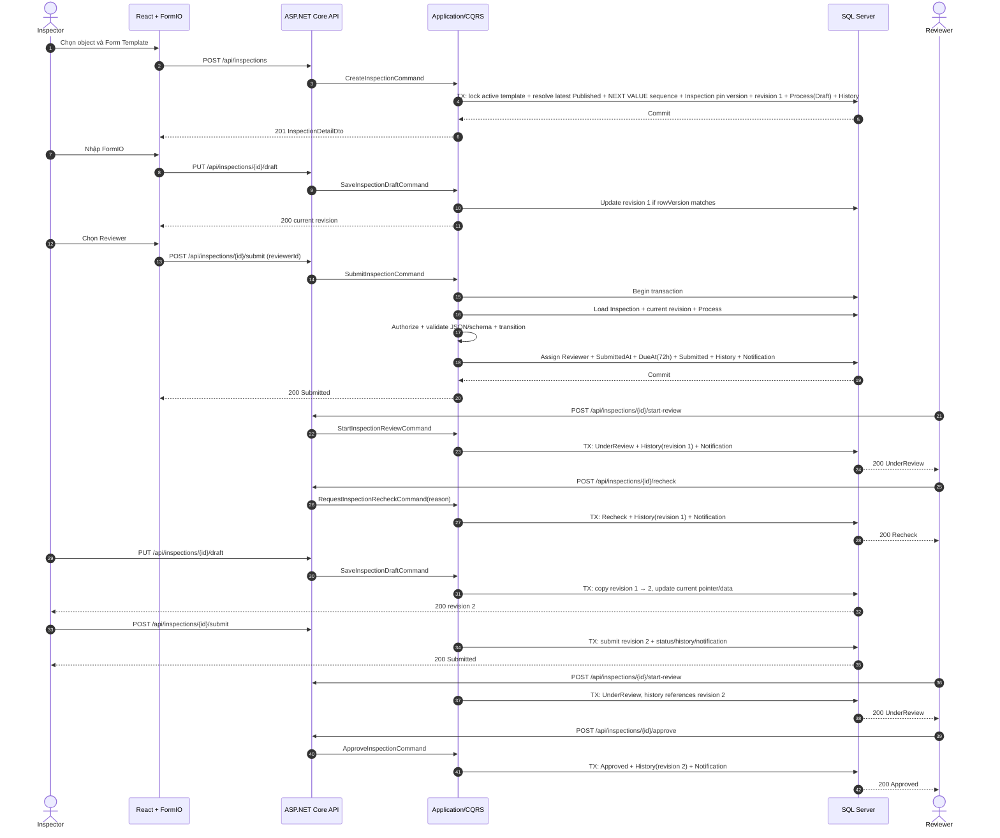

# Thiết kế vertical slice Inspection

## 1. Mục đích và phạm vi

Vertical slice đầu tiên chứng minh một luồng nghiệp vụ hoàn chỉnh từ API, application/domain, persistence đến frontend:

`Tạo Inspection → Lưu FormIO Draft → Submit → Start Review → Recheck → Sửa và gửi lại → Start Review → Approve`

Slice bao gồm 11 API Inspection đã thống nhất, trong đó hai API chỉ đọc phục vụ audit revision. Không triển khai Elsa, SignalR, upload file, dashboard nâng cao hoặc quy trình nhiều cấp trong bước này.

## 2. Kịch bản Inspection

1. Inspector tạo Inspection cho một Construction Object và chọn Form Template; server resolve latest Published version của template active và pin chính xác version đó. Draft chưa gán Reviewer.
2. Hệ thống tạo revision 1 với JSON ban đầu, Business Process `Draft` và history khởi tạo.
3. Inspector lưu Draft nhiều lần trên revision 1.
4. Inspector chọn Reviewer rồi Submit; hệ thống validate dữ liệu theo schema, đặt `SubmittedAt`, `DueAt = SubmittedAt + 72 giờ` từ cấu hình, chuyển sang `Submitted`, ghi history và notification.
5. Reviewer được giao Start Review, chuyển sang `UnderReview`.
6. Reviewer yêu cầu Recheck với lý do bắt buộc.
7. Ở lần sửa đầu tiên sau Recheck, hệ thống copy revision 1 thành revision 2 rồi áp dụng dữ liệu mới; revision 1 giữ nguyên.
8. Inspector Submit revision 2; Reviewer Start Review revision 2.
9. Reviewer Approve; hồ sơ trở thành chỉ đọc.

## 3. Quy tắc nghiệp vụ

- Chỉ Inspector có quyền và có access tới Construction Object mới được tạo Inspection.
- Form Template phải Active và có ít nhất một Published version tại thời điểm tạo. Server resolve Published version có `VersionNumber` lớn nhất và Inspection luôn giữ FK tới đúng version được server pin.
- Inspection Number do server sinh khi Create theo `INS-{YEAR}-{SEQUENCE}` bằng SQL Server Sequence toàn hệ thống; frontend không gửi Number và không dùng `MAX + 1`.
- Draft không có Reviewer. Inspector chọn Reviewer trong request Submit; chỉ khi transaction Submit thành công mới tạo assignment/work/notification.
- Sau Submit, chỉ Manager hoặc Administrator có quyền phù hợp được reassign Reviewer; mọi reassign phải append ProcessHistory.
- Người tạo chỉ sửa hồ sơ của mình khi process là `Draft` hoặc `Recheck`.
- Người tạo không được tự Approve/Reject/Recheck hồ sơ mình tạo, kể cả khi đồng thời có role Reviewer.
- Reviewer chỉ xử lý hồ sơ được giao.
- `Start Review`: `Submitted → UnderReview`.
- `Approve`, `Reject`, `Recheck` chỉ từ `UnderReview`.
- Reject và Recheck bắt buộc lý do không rỗng; độ dài tối đa theo contract.
- `Approved` và `Rejected` là trạng thái kết thúc/chỉ đọc cho Inspection MVP.
- SLA mặc định 72 giờ nằm trong cấu hình tập trung; hoàn tất quy trình ghi `CompletedAt`. Overdue khi chưa hoàn tất và UTC now lớn hơn `DueAt`.
- Transition sai hoặc concurrency conflict trả `409`.
- Mọi transition lưu ProcessHistory với actor, UTC time, note và revision đang xử lý.
- Submit/Start Review/Recheck/Approve/Reject tạo notification tương ứng trong database trong cùng transaction.
- Không serialize entity trực tiếp; API chỉ nhận/trả request/response DTO.
- Resource nằm hoàn toàn ngoài phạm vi xem trả `404`; actor nhìn thấy hồ sơ nhưng không được action trả `403`.
- MVP dùng ASP.NET Core Identity + JWT Bearer; không có public registration, email confirmation, forgot password, external IdP hoặc refresh token.

## 4. Quy tắc revision FormIO

1. Khi tạo Inspection, tạo `InspectionSubmission` revision 1 và gán `CurrentSubmissionId`.
2. Save Draft cập nhật current revision nếu `SubmittedAt IS NULL`.
3. Submit đặt `SubmittedAt` cho current revision; từ đó revision bất biến.
4. Recheck chỉ đổi process và ghi history/notification, chưa tạo revision.
5. Save Draft đầu tiên sau Recheck chạy transaction: copy `DataJson` của revision cũ, tạo revision mới với `RevisionNumber + 1`, áp dụng data mới và đổi `CurrentSubmissionId`.
6. Các lần Save Draft tiếp theo cập nhật revision mới chưa Submit.
7. Resubmit đặt `SubmittedAt` của revision mới và chuyển `Recheck → Submitted`.
8. `ProcessHistories.SubmissionId` lưu revision liên quan để Reviewer biết chính xác bản đang review.
9. API detail mặc định chỉ trả current revision; endpoint audit riêng trả danh sách metadata revision. Dữ liệu revision cũ không bị sửa.
10. JSON phải hợp lệ ở mọi lần lưu. Draft kiểm tra cú pháp, allowlist component và kích thước; Submit validate đầy đủ DataJson theo SchemaJson.
11. Chỉ hỗ trợ Text Field, Text Area, Number, Select, Radio, Checkbox và Date/Time; từ chối custom/script/HTML script/code/file upload/base64 file.
12. `SchemaJson` tối đa 1 MiB, `DataJson` tối đa 2 MiB tính theo UTF-8 serialized bytes; database vẫn dùng `nvarchar(max)` và `ISJSON`.
13. Hai audit API chỉ đọc revision; list trả metadata, detail revision mới trả DataJson. Không có API sửa/xóa revision đã Submit.

## 5. Sequence diagram



## 6. Quy ước API chung

- Base path: `/api/inspections`.
- JSON dùng camelCase; UUID ở dạng chuỗi canonical; thời gian ISO 8601 UTC (`Z`).
- Authentication dùng ASP.NET Core Identity; client gửi JWT Bearer Access Token. Login/current-user thuộc slice authentication, không tính trong 11 API Inspection.
- `rowVersion` là Base64 và bắt buộc cho update/transition. Contract dưới đây dùng rowVersion trong body để rõ ràng và nhất quán.
- Pagination là 1-based. Response danh sách luôn có `items`, `pageNumber`, `pageSize`, `totalCount`, `totalPages`.
- `correlationId` được nhận/tạo ở API, ghi log và trả trong ProblemDetails.
- Authentication trả `401`; action bị cấm trên resource được nhìn thấy trả `403`; resource ngoài scope xem trả `404`.

DTO rút gọn dùng chung:

```json
{
  "id": "4f5c45d6-a52b-47b4-98c4-4890a325ca58",
  "number": "INS-2026-000001",
  "title": "Kiểm tra an toàn điện phòng 301",
  "constructionObjectId": "cbab6f5d-0e7d-41ca-8510-fd8d00ea26e2",
  "formTemplateVersionId": "dbbb9518-ce3b-45df-9c68-13e647a24f66",
  "status": "Draft",
  "createdByUserId": "ee94504e-8ea6-4df4-a15d-64d9f23618be",
  "reviewerUserId": null,
  "currentRevision": {
    "id": "914ac137-b8dc-448b-b99b-de9cdb8349da",
    "revisionNumber": 1,
    "data": { "mainBreakerLabelled": true },
    "submittedAt": null,
    "rowVersion": "AAAAAAAAB9E="
  },
  "rowVersion": "AAAAAAAAB9A=",
  "processRowVersion": "AAAAAAAAB9I="
}
```

## 7. Mười một API contract

### 7.1 `POST /api/inspections` — tạo Inspection

Command: `CreateInspectionCommand`. Role: Inspector.

Request:

```json
{
  "constructionObjectId": "cbab6f5d-0e7d-41ca-8510-fd8d00ea26e2",
  "formTemplateId": "c39c58e4-745a-4cef-b5e2-aa0b52809a02",
  "title": "Kiểm tra an toàn điện phòng 301",
  "description": "Kiểm tra trước nghiệm thu",
  "data": {}
}
```

Response `201 Created`: `InspectionDetailDto` như mẫu chung; header `Location: /api/inspections/{id}`. Server kiểm tra template active, resolve Published version có `VersionNumber` lớn nhất, pin chính xác `FormTemplateVersionId`, sinh `number`, rồi tạo Inspection chưa có Reviewer, revision 1, process Draft và initial history trong một transaction. Không fallback sang Draft hoặc Published version cũ; template không có Published version phù hợp trả `409 inspection.form_template_unavailable`.

### 7.2 `PUT /api/inspections/{id}/draft` — lưu Draft

Command: `SaveInspectionDraftCommand`. Role: Inspector tạo hồ sơ. Status: Draft/Recheck.

Request:

```json
{
  "data": {
    "mainBreakerLabelled": true,
    "earthingResistance": 3.2,
    "remarks": "Đã bổ sung kết quả đo kiểm"
  },
  "inspectionRowVersion": "AAAAAAAAB9A=",
  "submissionRowVersion": "AAAAAAAAB9E=",
  "processRowVersion": "AAAAAAAAB9I="
}
```

Response `200 OK`:

```json
{
  "inspectionId": "4f5c45d6-a52b-47b4-98c4-4890a325ca58",
  "status": "Draft",
  "revisionNumber": 1,
  "data": { "mainBreakerLabelled": true, "earthingResistance": 3.2 },
  "inspectionRowVersion": "AAAAAAAAB9M=",
  "submissionRowVersion": "AAAAAAAAB9Q=",
  "processRowVersion": "AAAAAAAAB9I="
}
```

Nếu là lần sửa đầu sau Recheck, response trả revision mới và rowVersion mới.

### 7.3 `POST /api/inspections/{id}/submit` — Submit/Resubmit

Command: `SubmitInspectionCommand`. Role: Inspector tạo hồ sơ. Status: Draft hoặc Recheck.

Request:

```json
{
  "reviewerUserId": "16fe657a-f87c-47eb-aac8-e99f8e5a9f35",
  "inspectionRowVersion": "AAAAAAAAB9M=",
  "submissionRowVersion": "AAAAAAAAB9Q=",
  "processRowVersion": "AAAAAAAAB9I="
}
```

Response `200 OK`:

```json
{
  "id": "4f5c45d6-a52b-47b4-98c4-4890a325ca58",
  "status": "Submitted",
  "reviewerUserId": "16fe657a-f87c-47eb-aac8-e99f8e5a9f35",
  "currentRevisionNumber": 1,
  "submittedAt": "2026-09-13T04:15:22.381Z",
  "dueAt": "2026-09-16T04:15:22.381Z",
  "completedAt": null,
  "rowVersion": "AAAAAAAAB9U=",
  "processRowVersion": "AAAAAAAAB9Y="
}
```

### 7.4 `POST /api/inspections/{id}/start-review`

Command: `StartInspectionReviewCommand`. Role: assigned Reviewer. Status: Submitted.

Request:

```json
{
  "processRowVersion": "AAAAAAAAB9Y="
}
```

Response `200 OK`:

```json
{
  "id": "4f5c45d6-a52b-47b4-98c4-4890a325ca58",
  "status": "UnderReview",
  "reviewingRevisionNumber": 1,
  "processRowVersion": "AAAAAAAAB9c="
}
```

### 7.5 `POST /api/inspections/{id}/recheck`

Command: `RequestInspectionRecheckCommand`. Role: assigned Reviewer. Status: UnderReview.

Request:

```json
{
  "reason": "Bổ sung kết quả đo điện trở tiếp địa và bằng chứng.",
  "processRowVersion": "AAAAAAAAB9c="
}
```

Response `200 OK` có `status: "Recheck"`, `currentRevisionNumber: 1`, `processRowVersion` mới. Chưa tạo revision 2 tại API này.

### 7.6 `POST /api/inspections/{id}/approve`

Command: `ApproveInspectionCommand`. Role: assigned Reviewer, không phải creator. Status: UnderReview.

Request:

```json
{
  "note": "Đạt yêu cầu sau khi kiểm tra revision 2.",
  "processRowVersion": "AAAAAAAAB+E="
}
```

Response `200 OK` có `status: "Approved"`, `approvedRevisionNumber: 2`, UTC `approvedAt`, `completedAt` và `processRowVersion` mới.

### 7.7 `POST /api/inspections/{id}/reject`

Command: `RejectInspectionCommand`. Role: assigned Reviewer, không phải creator. Status: UnderReview.

Request:

```json
{
  "reason": "Hồ sơ không đáp ứng tiêu chuẩn áp dụng.",
  "processRowVersion": "AAAAAAAAB+E="
}
```

Response `200 OK` có `status: "Rejected"`, `rejectedRevisionNumber`, `completedAt` và `processRowVersion` mới. `reason` bắt buộc; hồ sơ không thể reopen/sửa/submit lại.

### 7.8 `GET /api/inspections`

Query: `GetInspectionsQuery`.

Query string dự kiến:

```text
?pageNumber=1&pageSize=20&search=electric&status=Submitted&constructionObjectId={id}&reviewerUserId={id}&sortBy=createdAt&sortDirection=desc
```

Whitelist `sortBy`: `number`, `title`, `status`, `createdAt`, `updatedAt`; mặc định `createdAt desc`, sau đó `id` để ổn định. `pageSize` mặc định 20, tối đa 100.

Response `200 OK`:

```json
{
  "items": [
    {
      "id": "4f5c45d6-a52b-47b4-98c4-4890a325ca58",
      "number": "INS-2026-000001",
      "title": "Kiểm tra an toàn điện phòng 301",
      "constructionObjectName": "Hệ thống điện phòng 301",
      "status": "Submitted",
      "currentRevisionNumber": 1,
      "reviewerDisplayName": "Nguyễn Reviewer",
      "updatedAt": "2026-09-13T04:15:22.381Z"
    }
  ],
  "pageNumber": 1,
  "pageSize": 20,
  "totalCount": 1,
  "totalPages": 1
}
```

### 7.9 `GET /api/inspections/{id}`

Query: `GetInspectionDetailQuery`.

Response `200 OK`: `InspectionDetailDto`, gồm metadata, current revision data, reviewer/creator summary và process history theo thứ tự. Không trả entity graph hoặc DataJson của revision cũ; hai endpoint audit bên dưới đảm nhiệm việc đó.

```json
{
  "id": "4f5c45d6-a52b-47b4-98c4-4890a325ca58",
  "number": "INS-2026-000001",
  "title": "Kiểm tra an toàn điện phòng 301",
  "status": "Recheck",
  "currentRevision": {
    "id": "914ac137-b8dc-448b-b99b-de9cdb8349da",
    "revisionNumber": 1,
    "data": { "mainBreakerLabelled": true },
    "submittedAt": "2026-09-13T04:15:22.381Z",
    "rowVersion": "AAAAAAAAB9Q="
  },
  "history": [
    { "fromStatus": "UnderReview", "toStatus": "Recheck", "action": "RequestRecheck", "note": "Bổ sung kết quả đo.", "revisionNumber": 1, "performedAt": "2026-09-13T05:00:00Z" }
  ],
  "rowVersion": "AAAAAAAAB9U=",
  "processRowVersion": "AAAAAAAAB9g="
}
```

### 7.10 `GET /api/inspections/{id}/revisions`

Query: `GetInspectionRevisionsQuery`. Quyền: user có quyền xem Inspection; resource ngoài scope trả `404`.

Response `200 OK` chỉ trả metadata, không trả `data`/`DataJson`:

```json
{
  "inspectionId": "4f5c45d6-a52b-47b4-98c4-4890a325ca58",
  "currentRevisionNumber": 2,
  "items": [
    {
      "revisionNumber": 1,
      "createdAt": "2026-09-13T03:30:00Z",
      "submittedAt": "2026-09-13T04:15:22.381Z",
      "createdByUserId": "ee94504e-8ea6-4df4-a15d-64d9f23618be",
      "isCurrent": false
    },
    {
      "revisionNumber": 2,
      "createdAt": "2026-09-13T06:10:00Z",
      "submittedAt": "2026-09-13T06:30:00Z",
      "createdByUserId": "ee94504e-8ea6-4df4-a15d-64d9f23618be",
      "isCurrent": true
    }
  ]
}
```

### 7.11 `GET /api/inspections/{id}/revisions/{revisionNumber}`

Query: `GetInspectionRevisionDetailQuery`. `revisionNumber` là số nguyên dương. Quyền giống detail Inspection; revision không tồn tại hoặc ngoài scope trả `404`.

Response `200 OK`:

```json
{
  "inspectionId": "4f5c45d6-a52b-47b4-98c4-4890a325ca58",
  "revisionNumber": 1,
  "data": {
    "mainBreakerLabelled": true,
    "earthingResistance": 4.8
  },
  "createdAt": "2026-09-13T03:30:00Z",
  "submittedAt": "2026-09-13T04:15:22.381Z",
  "isCurrent": false
}
```

Endpoint chỉ đọc, không trả API update/delete cho revision đã Submit.

## 8. CQRS mapping

| API | Request CQRS | Validator | Kết quả |
|---|---|---|---|
| POST `/api/inspections` | CreateInspectionCommand | CreateInspectionCommandValidator | InspectionDetailDto |
| PUT `/{id}/draft` | SaveInspectionDraftCommand | SaveInspectionDraftCommandValidator | InspectionDraftDto |
| POST `/{id}/submit` | SubmitInspectionCommand | SubmitInspectionCommandValidator | InspectionTransitionDto |
| POST `/{id}/start-review` | StartInspectionReviewCommand | StartInspectionReviewCommandValidator | InspectionTransitionDto |
| POST `/{id}/recheck` | RequestInspectionRecheckCommand | RequestInspectionRecheckCommandValidator | InspectionTransitionDto |
| POST `/{id}/approve` | ApproveInspectionCommand | ApproveInspectionCommandValidator | InspectionTransitionDto |
| POST `/{id}/reject` | RejectInspectionCommand | RejectInspectionCommandValidator | InspectionTransitionDto |
| GET `/api/inspections` | GetInspectionsQuery | GetInspectionsQueryValidator | PagedResult&lt;InspectionListItemDto&gt; |
| GET `/{id}` | GetInspectionDetailQuery | GetInspectionDetailQueryValidator | InspectionDetailDto |
| GET `/{id}/revisions` | GetInspectionRevisionsQuery | GetInspectionRevisionsQueryValidator | InspectionRevisionListDto |
| GET `/{id}/revisions/{revisionNumber}` | GetInspectionRevisionDetailQuery | GetInspectionRevisionDetailQueryValidator | InspectionRevisionDetailDto |

Validator kiểm tra hình dạng/độ dài/range/JSON syntax. Với Create, request nhận `FormTemplateId`, không nhận version ID do client chọn. Handler/domain kiểm tra dữ liệu tồn tại, template active, latest Published version, quyền theo object, ownership, assignment, self-approval, trạng thái, schema và concurrency.

## 9. Trách nhiệm từng layer

### Domain

- Entity/aggregate, enum và transition rule Inspection.
- Invariant revision, read-only, self-approval và reason bắt buộc ở mức phù hợp.
- Không phụ thuộc EF Core, MediatR, HTTP hoặc UI.

### Application

- Command/query, handler, validator, DTO và interface abstraction.
- Orchestrate authorization nghiệp vụ, transaction, mapping lỗi và notification creation.
- Interface cho current user, clock, JSON/FormIO validation, persistence/unit of work.
- Không biết chi tiết SQL Server hoặc controller.

### Infrastructure

- EF Core DbContext/configuration/repository/query implementation, SQL Server transaction.
- ASP.NET Core Identity (`ApplicationUser`/`ApplicationRole`) và JWT Bearer implementation; seed bốn role cùng user demo bằng password hash, secret lấy từ cấu hình an toàn.
- UTC clock, FormIO allowlist/JSON validator implementation và logging sink khi được chọn.
- Mapping rowversion/concurrency và persistence constraint.

### API

- Route, model binding, authentication middleware, correlation ID, ProblemDetails và gọi `ISender`.
- Controller mỏng: không truy cập DbContext, không chứa transition/role logic và không serialize entity.

### Frontend

- Page/list/detail/form, route guard mang tính UX, FormIO renderer và React Query hooks.
- Server vẫn là nguồn sự thật cho quyền/trạng thái; frontend xử lý ProblemDetails/concurrency.

## 9.1 Transaction Create Inspection

Trong một transaction database:

1. Kiểm tra current user là Inspector và Construction Object thuộc scope, đang active.
2. Lock/read Form Template theo thứ tự ổn định; yêu cầu template `Active`.
3. Resolve version `Published` có `VersionNumber` lớn nhất. Không nhận version ID từ client, không fallback sang Draft hoặc Published version cũ; không có version phù hợp trả `409 inspection.form_template_unavailable`.
4. Cấp Inspection Number từ SQL Server Sequence, không dùng `MAX + 1`.
5. Tạo Inspection và pin chính xác `FormTemplateVersionId` vừa resolve; tạo revision 1, BusinessProcess `Draft` và initial ProcessHistory.
6. `SaveChangesAsync` và commit. Bất kỳ lỗi nào rollback toàn bộ; publish version mới hoặc deactivate template sau commit không thay đổi version đã pin.

## 10. Transaction Submit Inspection

Trong một transaction database:

1. Tải Inspection, current InspectionSubmission và BusinessProcess; lấy đủ field để kiểm tra, không tải graph dư thừa.
2. Kiểm tra current user đã đăng nhập, role Inspector, ownership/access, status `Draft` hoặc `Recheck`; Reviewer trong request tồn tại, active, có role phù hợp và không vi phạm rule.
3. So khớp ba rowVersion; mismatch trả `409` và rollback.
4. Parse `DataJson`, validate theo chính `FormTemplateVersion.SchemaJson` và kiểm tra revision chưa Submit.
5. Đặt `SubmittedAt = clock.UtcNow`; lấy `DefaultSlaHours = 72` từ typed configuration và đặt `DueAt`.
6. Chuyển BusinessProcess sang `Submitted`; gán Reviewer và đồng bộ assignment.
7. Append ProcessHistory, `SubmissionId = CurrentSubmissionId`.
8. Tạo Notification cho Reviewer.
9. `SaveChangesAsync` và xử lý `DbUpdateConcurrencyException` thành `409`.
10. Commit; nếu bất kỳ bước nào lỗi thì rollback toàn bộ.

Không gửi SignalR trong transaction. Khi tính năng realtime được bổ sung, chỉ publish sau commit; giải pháp outbox cần quyết định riêng.

## 11. Query strategy

- Bắt đầu từ `AsNoTracking()`.
- Áp dụng scope quyền trước để không rò rỉ dữ liệu.
- Filter `ConstructionObjectId`, status, reviewer và search đã chuẩn hóa.
- Sort chỉ theo whitelist; luôn thêm `Id` làm tie-breaker.
- Tính `CountAsync` trên query đã filter.
- Project trực tiếp sang DTO bằng `Select`; không `Include` toàn bộ submissions/history.
- Sau cùng mới `Skip((pageNumber - 1) * pageSize)` và `Take(pageSize)`.
- Detail dùng các projection nhỏ: header/current revision và history; có thể là nhiều query rõ ràng thay vì cartesian join.
- Revision list chỉ project metadata; revision detail mới project `DataJson` của đúng revision. Cả hai áp dụng scope trước khi kiểm tra revision để không tiết lộ resource.
- Tất cả query hỗ trợ cancellation token. Stored procedure chưa cần cho list/detail đầu tiên; chỉ xem xét sau profiling hoặc cho thống kê phức tạp.

## 12. HTTP error contract

API dùng `application/problem+json` theo ProblemDetails:

```json
{
  "type": "https://httpstatuses.com/409",
  "title": "Inspection state conflict",
  "status": 409,
  "detail": "Inspection must be UnderReview before approval.",
  "instance": "/api/inspections/4f5c45d6-a52b-47b4-98c4-4890a325ca58/approve",
  "code": "inspection.invalid_transition",
  "correlationId": "00-f6c2...-01",
  "errors": null
}
```

| HTTP | Trường hợp |
|---|---|
| 400 | Body/query sai, JSON không hợp lệ, validation lỗi; `errors` chứa field messages. |
| 401 | Chưa xác thực/token không hợp lệ. |
| 403 | Actor nhìn thấy resource nhưng không được action: sai role nghiệp vụ, không phải owner/assignee hoặc tự duyệt. |
| 404 | Resource không tồn tại hoặc tồn tại nhưng hoàn toàn ngoài phạm vi được phép xem. |
| 409 | Transition sai, revision đã Submit, rowVersion mismatch/concurrency conflict. |
| 500 | Lỗi không dự kiến; thông báo chung, có correlation ID, không có stack trace. |

Mã `code` ổn định để frontend xử lý, ví dụ `validation.failed`, `inspection.not_found`, `inspection.forbidden`, `inspection.invalid_transition`, `inspection.concurrency_conflict`, `inspection.form_data_invalid`.

## 13. Frontend flow

- `/inspections`: Ant Design table; filter/search/sort/pagination nằm trong URL; React Query key chứa toàn bộ tham số.
- `/inspections/new`: chọn Construction Object và active Form Template; server tự resolve latest Published version, chưa chọn/gán Reviewer, tạo xong điều hướng detail/edit.
- `/inspections/:id`: header trạng thái, metadata, FormIO renderer, revision metadata, timeline history và action bar theo capability từ trạng thái/current user.
- Draft/Recheck: FormIO editable với nút Manual Save rõ ràng; không autosave. Route guard/browser prompt cảnh báo khi rời trang có thay đổi chưa lưu.
- Save Draft gửi rowVersions mới nhất; thành công phải thay toàn bộ rowVersion cũ trong React Query/form state.
- Submit: mở bước chọn Reviewer, confirm, gửi rowVersions mới nhất, invalidate list/detail/notifications sau thành công.
- Reviewer: Start Review trước khi thấy Approve/Reject/Recheck actions; reason modal bắt buộc cho Reject/Recheck.
- `409 concurrency`: không tự ghi đè; thông báo dữ liệu đã thay đổi và yêu cầu reload. Có thể giữ bản nhập cục bộ để người dùng sao chép sau khi xác nhận.
- `400 form_data_invalid`: map lỗi vào summary và field FormIO nếu server cung cấp path.
- Approved/Rejected: FormIO read-only, không hiện nút Save/Submit.
- Tab Revisions gọi endpoint metadata; chỉ tải DataJson khi user mở một revision cụ thể.
- UI role guard chỉ cải thiện UX; mọi action vẫn dựa trên phản hồi API.

## 14. Unit test

### Domain/application rule

- Create tạo revision 1, process Draft và current pointer chính xác.
- Create từ `FormTemplateId` resolve đúng latest Published của template active và pin `FormTemplateVersionId`; từ chối template inactive, không có Published version, Draft-only và mọi yêu cầu chọn version cũ.
- Save Draft cập nhật revision chưa Submit mà không tạo revision mới.
- Save lần đầu sau Recheck copy revision cũ thành revision N+1; lần sau không tạo thêm.
- Revision cũ và submitted revision không thể sửa.
- Mỗi transition hợp lệ thành công; mọi transition ngoài state machine thất bại.
- Reviewer không thể tự duyệt hồ sơ do mình tạo.
- Chỉ creator sửa/submit; chỉ assigned Reviewer start/review.
- Reject/Recheck thiếu hoặc chỉ có whitespace reason bị từ chối.
- Submit JSON/schema không hợp lệ thất bại trước persistence.
- History chứa đúng actor/time/note/submission revision.
- Notification đúng recipient/type.
- Number dùng giá trị sequence, đúng format/năm UTC, không nhận từ request; unique/concurrency không tạo trùng.
- Submit gán Reviewer và DueAt đúng 72 giờ từ cấu hình; Approved/Rejected ghi CompletedAt.
- FormIO allowlist và giới hạn 1 MiB/2 MiB từ chối payload/component không hỗ trợ.
- Query sortBy ngoài whitelist bị validation error; page size vượt giới hạn bị chặn.

Dùng fake clock/current user và mock abstraction ở Application; không mock domain behavior.

## 15. Integration test

- Chạy với SQL Server tương thích production để kiểm tra transaction, rowversion, constraint và EF mapping; lựa chọn môi trường test cần xác nhận.
- API happy path đầy đủ: Create → Draft → Submit → Start Review → Recheck → Draft revision 2 → Submit → Start Review → Approve.
- Create pin latest Published version; publish version mới hoặc deactivate template sau đó không đổi version/schema của Inspection đã tồn tại.
- Create không fallback sang Draft hay Published version cũ khi latest Published không hợp lệ; trả `409 inspection.form_template_unavailable`.
- Sau Recheck, assert revision 1 không đổi và history review chỉ đúng revision.
- Revision list không trả DataJson; revision detail trả đúng immutable DataJson và áp dụng 404 ngoài scope.
- Hai request Create đồng thời nhận Number khác nhau; chấp nhận gap nhưng không trùng.
- Submit gán Reviewer, tạo DueAt; reassign được ghi history và chỉ Manager/Admin phù hợp được thực hiện.
- Lỗi validation trả đúng 400 ProblemDetails.
- Unauthenticated 401; wrong role/owner/assigned reviewer 403.
- Unknown ID 404; invalid transition 409.
- Hai request dùng cùng rowVersion: một thành công, một 409.
- Gây lỗi khi tạo history/notification để xác nhận toàn bộ Submit rollback, gồm `SubmittedAt` và status.
- List xác nhận scope, filter, stable sort, pagination và không trả dữ liệu ngoài quyền.
- Approved hồ sơ không thể Save Draft/Submit.
- Response không lộ stack trace hoặc password/internal entity field; correlation ID hiện diện trên lỗi 500 mô phỏng.

## 16. Definition of Done

- Contract 11 API và naming khớp tài liệu phạm vi/dữ liệu.
- Migration/schema sau này thể hiện đủ FK, UQ, check constraint, index, rowversion và JSON checks đã duyệt.
- Happy path và nhánh Reject/Recheck hoạt động đúng, transaction/rollback được kiểm chứng.
- API authorization bao phủ role, scope, ownership, assignment và self-approval.
- DTO/projection không lộ entity; list đạt query strategy đã nêu.
- ProblemDetails/correlation logging nhất quán, không lộ stack trace.
- Unit/integration tests quan trọng pass; build/lint/typecheck frontend pass.
- UI hỗ trợ loading/empty/error/concurrency/read-only states và đúng FormIO version.
- Identity/JWT Login/current-user và seed role/user demo hoạt động; không có auth feature ngoài MVP.
- Manual Save/unsaved warning và revision audit endpoints được kiểm thử.
- Tài liệu API được cập nhật theo implementation; không thêm scope ngoài quyết định đã duyệt.
- Code review hoàn tất và không còn lỗi mức nghiêm trọng/cao.

## 17. Thứ tự triển khai đề xuất

1. Ghi nhận các quyết định đã chốt; chỉ xác nhận patch version package stable và connection string database test trước khi restore/chạy test.
2. Khởi tạo solution và project dependency; thiết lập build/test baseline.
3. Xây Domain model/state transition/revision rules cùng unit test.
4. Xây Application contracts, DTO, validators, abstraction và handler skeleton.
5. Thiết kế EF Core mapping/migration cho nhóm bảng cần bởi Inspection cùng auth/object/template/process/notification.
6. Thiết lập API middleware: auth, ProblemDetails, correlation ID, logging.
7. Triển khai Create và Save Draft; integration test revision 1/concurrency.
8. Triển khai Submit transaction; test rollback, schema validation và notification.
9. Triển khai Start Review, Recheck, sửa revision mới, Approve, Reject.
10. Triển khai list/detail projections, filter/sort/pagination và authorization scope.
11. Khởi tạo frontend, API client/React Query shell và các trang list/create/detail.
12. Tích hợp FormIO, action flow, timeline, validation/concurrency UX.
13. Chạy toàn bộ quality gate và demo kịch bản xuyên suốt.

## 18. Điểm kỹ thuật còn cần xác nhận trước khi viết source code

- Tên database test local và cách cung cấp connection string qua User Secrets/environment variable; không ghi secret vào repository.
- Tên/username cho bốn tài khoản seed demo và cách cung cấp initial password an toàn.
- Patch version stable cụ thể của package tương thích `net10.0`, đặc biệt MediatR/FormIO và điều khoản license.
- Thư viện validation FormIO phía server đáp ứng allowlist đã chốt.
- Reassign Reviewer không nằm trong 11 Inspection endpoint của slice đầu; cần contract riêng khi triển khai phần quản trị sau Submit.
- Cách lưu old/new assignee trong ProcessHistory ở MVP.
- Quy tắc hiển thị timezone phía frontend; database và API vẫn UTC.

## 19. Kế hoạch khởi tạo solution (chưa thực hiện)

### 19.1 Target framework và cấu trúc

Target đã chốt là `net10.0` cho toàn bộ backend. Máy hiện có SDK `10.0.300`; khi khởi tạo thêm `global.json` pin `10.0.300` và dùng Central Package Management (`Directory.Packages.props`). Chỉ dùng package stable tương thích, không dùng preview khi có stable.

```text
ConstructionInspectionTraining/
├─ ConstructionInspectionTraining.slnx
├─ global.json
├─ Directory.Build.props
├─ Directory.Packages.props
├─ docs/
├─ src/
│  ├─ ConstructionInspectionTraining.Domain/
│  ├─ ConstructionInspectionTraining.Application/
│  ├─ ConstructionInspectionTraining.Infrastructure/
│  └─ ConstructionInspectionTraining.Api/
├─ tests/
│  ├─ ConstructionInspectionTraining.Domain.UnitTests/
│  ├─ ConstructionInspectionTraining.Application.UnitTests/
│  └─ ConstructionInspectionTraining.Api.IntegrationTests/
└─ frontend/
   ├─ src/
   │  ├─ app/
   │  ├─ api/
   │  ├─ features/auth/
   │  ├─ features/construction-objects/
   │  ├─ features/form-templates/
   │  ├─ features/inspections/
   │  ├─ features/checklists/
   │  ├─ features/rfis/
   │  ├─ features/notifications/
   │  ├─ components/
   │  ├─ routes/
   │  ├─ styles/
   │  └─ types/
   ├─ package.json
   ├─ tsconfig.json
   └─ vite.config.ts
```

Dependency project bắt buộc:

- Domain không tham chiếu project khác.
- Application → Domain.
- Infrastructure → Application + Domain.
- API → Application + Infrastructure; API là composition root.
- Domain.UnitTests → Domain.
- Application.UnitTests → Application + Domain.
- Api.IntegrationTests → API + Infrastructure (và Application khi cần test fixture), không để production project tham chiếu test.

### 19.2 Package dự kiến

Phiên bản dưới đây là dòng tương thích dự kiến, không phải hành động cài đặt. Trước khi restore phải kiểm tra bản stable cụ thể từ NuGet/npm và pin patch version trong lock/central package file.

| Phạm vi | Package/dòng phiên bản | Lý do |
|---|---|---|
| Application | `MediatR` 13.x (hoặc stable tương thích net10 tại thời điểm khởi tạo) | CQRS dispatch; cần duyệt điều khoản/license của version chọn. |
| Application | `FluentValidation` + `FluentValidation.DependencyInjectionExtensions` 12.x | Validation command/query và DI. |
| Infrastructure | `Microsoft.EntityFrameworkCore.SqlServer` 10.0.x | EF Core provider đồng major target framework. |
| Infrastructure/tooling | `Microsoft.EntityFrameworkCore.Design` 10.0.x | Migration/design-time; để `PrivateAssets=all` khi phù hợp. |
| Infrastructure | `Microsoft.AspNetCore.Identity.EntityFrameworkCore` 10.0.x | Identity persistence cho user/role/user-role/lockout/security stamp. |
| API | `Microsoft.AspNetCore.OpenApi` 10.0.x | OpenAPI contract; ASP.NET Core ProblemDetails đã có trong shared framework. |
| API | `Microsoft.AspNetCore.Authentication.JwtBearer` 10.0.x | Xác thực JWT Bearer Access Token. |
| API | `Serilog.AspNetCore` stable hỗ trợ ASP.NET Core 10 + sink đã duyệt | Structured logging/correlation; không thêm sink trước khi biết đích log. |
| Test | `Microsoft.NET.Test.Sdk`, xUnit, runner, `NSubstitute` | Test runner, unit test và test doubles. |
| Test | `FluentAssertions` (sau khi duyệt license) hoặc assertion xUnit | Assertion dễ đọc; cần kiểm tra chính sách license tổ chức. |
| Integration test | `Microsoft.AspNetCore.Mvc.Testing` 10.0.x | Host API in-memory cho integration test. |
| Integration test | `Respawn` stable tương thích (nếu cần) | Reset database test local riêng; không dùng Docker/Testcontainers giai đoạn đầu. |
| Frontend | `react`, `react-dom` 19.x; `typescript` 5.x; `vite` stable hỗ trợ Node 24 | Nền React/TypeScript và build tooling. |
| Frontend | `antd` stable; `@ant-design/icons` cùng dòng tương thích | UI component library. |
| Frontend | `@tanstack/react-query` 5.x | Server state, cache/invalidation. |
| Frontend | `react-router-dom` stable | Routing phía client. |
| Frontend | `@formio/react` + package peer dependency tương thích | FormIO renderer; phải kiểm chứng bảy component tiêu chuẩn đã chốt trước khi pin. |
| Frontend test | Vitest, Testing Library, MSW stable tương thích Vite/React | Unit/component/API mocking. |

Không cần package MediatR/FluentValidation “pipeline” bên thứ ba: tự viết behavior nhỏ trong Application. Chưa thêm Elsa, SignalR client, cache, Docker/Testcontainers hoặc upload package ở vertical slice đầu.

### 19.3 Lệnh dự kiến chạy ở bước tiếp theo

Các lệnh dưới đây chỉ là kế hoạch và chưa được chạy:

```powershell
dotnet new globaljson --sdk-version 10.0.300 --roll-forward latestPatch
dotnet new sln --format slnx -n ConstructionInspectionTraining
dotnet new classlib -n ConstructionInspectionTraining.Domain -o src/ConstructionInspectionTraining.Domain -f net10.0
dotnet new classlib -n ConstructionInspectionTraining.Application -o src/ConstructionInspectionTraining.Application -f net10.0
dotnet new classlib -n ConstructionInspectionTraining.Infrastructure -o src/ConstructionInspectionTraining.Infrastructure -f net10.0
dotnet new webapi -n ConstructionInspectionTraining.Api -o src/ConstructionInspectionTraining.Api -f net10.0 --use-controllers
dotnet new xunit -n ConstructionInspectionTraining.Domain.UnitTests -o tests/ConstructionInspectionTraining.Domain.UnitTests -f net10.0
dotnet new xunit -n ConstructionInspectionTraining.Application.UnitTests -o tests/ConstructionInspectionTraining.Application.UnitTests -f net10.0
dotnet new xunit -n ConstructionInspectionTraining.Api.IntegrationTests -o tests/ConstructionInspectionTraining.Api.IntegrationTests -f net10.0
dotnet sln ConstructionInspectionTraining.slnx add src/*/*.csproj tests/*/*.csproj
dotnet add src/ConstructionInspectionTraining.Application reference src/ConstructionInspectionTraining.Domain
dotnet add src/ConstructionInspectionTraining.Infrastructure reference src/ConstructionInspectionTraining.Application src/ConstructionInspectionTraining.Domain
dotnet add src/ConstructionInspectionTraining.Api reference src/ConstructionInspectionTraining.Application src/ConstructionInspectionTraining.Infrastructure
dotnet restore
dotnet build --no-restore
dotnet test --no-build
npm.cmd create vite@latest frontend -- --template react-ts
cd frontend
npm.cmd install
npm.cmd run build
```

Package add và EF migration commands chỉ soạn sau khi chốt versions/auth/schema; không chạy migration trước khi review model.

### 19.4 File dự kiến tạo và cách kiểm tra

- Root: solution, `global.json`, shared build/package props, `.editorconfig`, `.gitignore`, README.
- Mỗi production project: `.csproj`, marker/composition files; Domain/Application không chứa infrastructure detail.
- API: `Program.cs`, settings mẫu không có secret, controllers/middleware/error handling.
- Tests: test project, fixtures và test theo từng rule/use case.
- Frontend: Vite/TypeScript config, app providers/router/API client và feature folders.

Quality gate sau từng bước:

1. Sau skeleton: `dotnet sln ... list`, `dotnet restore`, `dotnet build`, `dotnet test`.
2. Sau dependency: kiểm tra project references và architecture test, bảo đảm không có tham chiếu ngược.
3. Sau Domain/Application: unit tests cho transition/revision/validator.
4. Sau Infrastructure: review migration SQL, chạy integration tests trên database test riêng.
5. Sau API: OpenAPI, ProblemDetails/auth/concurrency tests.
6. Sau frontend: `npm run lint`, `npm run test`, `npm run build`; smoke test luồng với API.
7. Trước merge: clean clone/restore/build/test, không có secret hoặc generated artifact bị commit.

### 19.5 Thứ tự commit Git đề xuất

Đã được phép khởi tạo Git repository local, `.gitignore` và README tối thiểu ở bước khởi tạo; chưa thực hiện trong lần cập nhật tài liệu này. Không tự commit/push. Sau mỗi giai đoạn chỉ đề xuất commit message và chờ xác nhận; chỉ commit khi build/test thành công:

1. `docs: define product scope data model and inspection slice`
2. `chore: initialize solution and shared build settings`
3. `test: add test project baselines`
4. `feat(domain): add inspection workflow and revision rules`
5. `feat(application): add inspection commands queries and validation`
6. `feat(infrastructure): add persistence and inspection transactions`
7. `feat(api): expose inspection endpoints and problem details`
8. `chore(frontend): initialize react application`
9. `feat(frontend): add inspection list form and review flow`
10. `test: cover inspection vertical slice end to end`

Mỗi commit phải build/test được hoặc ghi rõ quan hệ phụ thuộc khi một thay đổi không thể tách nhỏ hợp lý; không commit secret, database hoặc build output.
