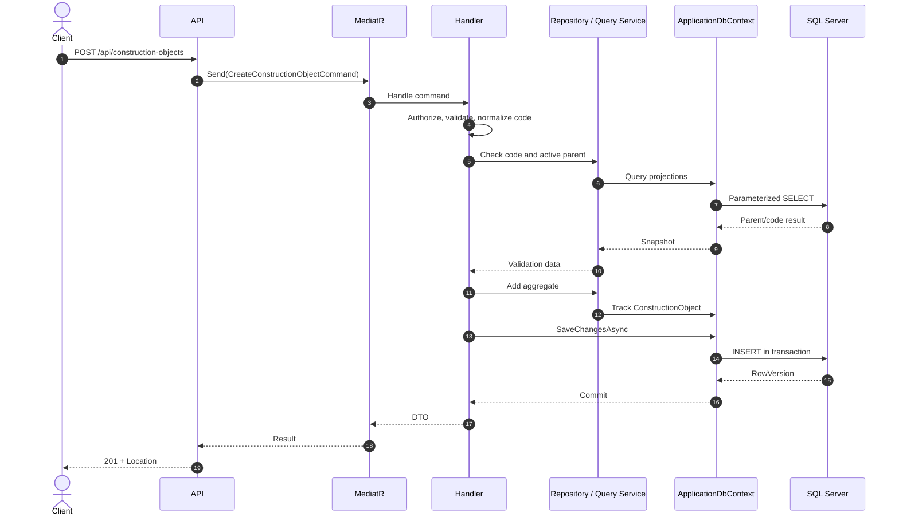
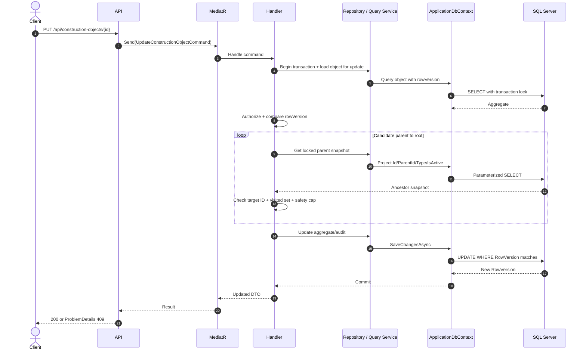
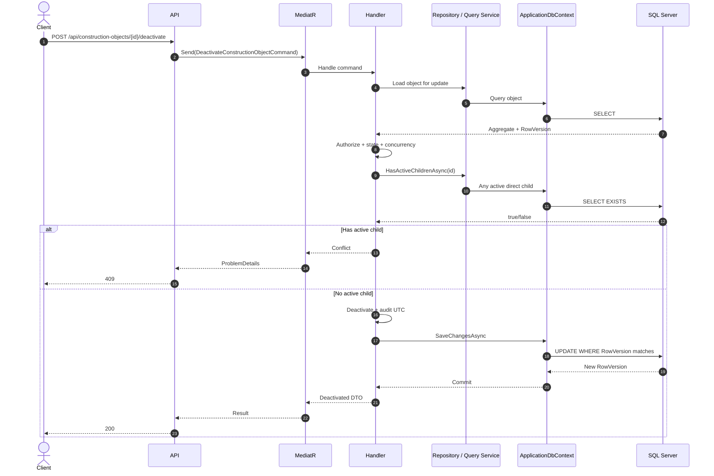

# Thiết kế vertical slice Construction Object

## 1. Mục đích và phạm vi

Construction Object là đối tượng trung tâm để phân loại vị trí/phạm vi xây dựng và là điểm liên kết cho Inspection, Checklist và RFI. Vertical slice này chỉ quản lý cây Construction Object theo UC03–UC07:

```text
Project
└── Building
    └── Floor
        └── Room
            └── Work Item
```

Slice dự kiến cung cấp Create, Read, Update và Deactivate; không có hard delete hoặc API `DELETE`. Inspection, Checklist và RFI chỉ được nhắc đến như quan hệ tương lai, không được tạo trong slice này.

Tài liệu này là thiết kế, chưa tạo Entity, Handler, Controller, EF configuration, migration hoặc thay đổi database.

### 1.1 Đối chiếu tài liệu hiện hành

- `docs/01-product-scope-and-use-cases.md`: triển khai đúng UC03–UC07, giữ nguyên 38 Use Case còn lại và quy tắc scope đơn giản của MVP.
- `docs/02-erd-and-data-design.md`: giữ self-reference, audit FK, soft deactivate, UTC và rowversion; thiết kế này đề xuất bổ sung `ObjectType`, `Location`, `UpdatedById` vào schema tương lai.
- `docs/03-inspection-vertical-slice-design.md`: dùng cùng Clean Architecture, CQRS, DTO, ProblemDetails, Base64 rowVersion, pagination và query projection.
- Tên audit được chốt thống nhất là `CreatedById`/`UpdatedById` trong Domain, API và database. Đây là refinement của tên `CreatedByUserId` trong `docs/02`; EF Configuration tạo FK tới `AspNetUsers.Id` mà Domain không cần navigation Identity.

Không có mâu thuẫn với danh mục 43 Use Case. Chênh lệch schema nêu trên là phần mở rộng chi tiết cho UC03–UC07, không thay đổi hành vi của Use Case khác.

## 2. Actor và quyền

| Actor | Danh sách/chi tiết | Tạo | Cập nhật | Deactivate |
|---|---|---:|---:|---:|
| Inspector | Chỉ Object active | Không | Không | Không |
| Reviewer | Chỉ Object active | Không | Không | Không |
| Manager | Toàn bộ, gồm inactive | Không | Không | Không |
| Administrator | Toàn bộ, gồm inactive | Có | Có | Có |

Quy tắc:

- Chỉ role `ADMINISTRATOR` được tạo, cập nhật và deactivate.
- Inspector và Reviewer không thể dùng query/filter/detail để suy ra Object inactive; Object inactive được xem là ngoài scope và trả `404` ở detail.
- Manager và Administrator xem được cả active/inactive.
- MVP chưa có object assignment, manager scope hoặc bảng phạm vi bổ sung.
- API luôn thực thi quyền; việc giao diện ẩn action không thay thế authorization server-side.

## 3. Mô hình Domain dự kiến

### 3.1 Thuộc tính

| Thuộc tính | Kiểu Domain | Ý nghĩa |
|---|---|---|
| `Id` | `Guid` | Khóa do ứng dụng sinh |
| `ParentId` | `Guid?` | Cha trực tiếp; `null` với node gốc |
| `Code` | `string` | Mã bắt buộc, duy nhất sau normalize |
| `Name` | `string` | Tên bắt buộc |
| `ObjectType` | enum | `Project`, `Building`, `Floor`, `Room`, `WorkItem` |
| `Location` | `string?` | Vị trí/địa chỉ mô tả ngắn |
| `Description` | `string?` | Mô tả nghiệp vụ |
| `IsActive` | `bool` | Mặc định `true`; chỉ chuyển `true → false` trong slice này |
| `CreatedById` | `Guid` | ID user tạo; không navigation tới Identity |
| `CreatedAt` | `DateTime` UTC | Thời điểm tạo |
| `UpdatedById` | `Guid?` | ID user cập nhật/deactivate gần nhất |
| `UpdatedAt` | `DateTime?` UTC | Thời điểm cập nhật/deactivate gần nhất |
| `RowVersion` | `byte[]` | SQL Server concurrency token |

Domain chỉ giữ ID audit. `ApplicationUser`, `IdentityUser` và navigation tới Identity không xuất hiện trong Domain.

### 3.2 ObjectType: enum hay string

Chốt dùng enum Domain `ConstructionObjectType` và serialize/lưu bằng chuỗi ổn định:

```text
Project | Building | Floor | Room | WorkItem
```

Lý do:

- Tập loại đang hữu hạn và trực tiếp quyết định cấu trúc cây.
- Enum giúp validator, rule cha-con, API contract và test không phụ thuộc chuỗi tùy ý.
- Database lưu `varchar(20)` thay vì số để dễ đọc và không bị lệch numeric value khi code thay đổi.
- EF dùng string conversion; database có check constraint cho năm giá trị.

Nhược điểm là thêm loại mới cần sửa code, migration/check constraint và client. MVP không tạo bảng lookup ObjectType và không lưu numeric enum trong database.

### 3.3 Quan hệ loại cha-con

Hierarchy type được chốt như sau:

| Loại node | Parent hợp lệ |
|---|---|
| Project | Không có parent |
| Building | Project |
| Floor | Building |
| Room | Floor |
| WorkItem | Project, Building, Floor hoặc Room |

Không bắt buộc cây phải có đủ năm cấp. `WorkItem` là leaf và không được làm cha của Object khác. `Project` luôn là root. Domain giới hạn tối đa năm cấp, tính Project là cấp 1, bằng constant `MaximumHierarchyDepth = 5`.

## 4. Quy tắc nghiệp vụ

### 4.1 Code và dữ liệu bắt buộc

- `Code` do Administrator nhập, bắt buộc, dài từ 2 đến 100 ký tự và duy nhất toàn hệ thống.
- Server trim, sau đó normalize bằng `ToUpperInvariant()` trước khi kiểm tra uniqueness và lưu.
- Code phải khớp `^[A-Za-z0-9][A-Za-z0-9._-]{1,99}$`: bắt đầu bằng chữ Latin hoặc số; các ký tự còn lại chỉ gồm chữ Latin, số, dấu gạch ngang, gạch dưới và dấu chấm. Không cho whitespace.
- Unique index trên normalized `Code` là lớp bảo vệ cuối cho race condition.
- `Name` bắt buộc, không chỉ gồm whitespace, tối đa 250 ký tự.
- `Location` tối đa 500 ký tự; `Description` tối đa 2.000 ký tự.
- ID phải khác `Guid.Empty`; mọi thời gian lấy từ clock của server và lưu UTC.

Server không sinh Code và không dùng `MAX + 1`. Kiểm tra trùng không phân biệt hoa thường.

### 4.2 Parent và trạng thái active

- Khi tạo node có `ParentId`, parent phải tồn tại, nằm trong phạm vi quản trị và đang active.
- Object inactive không nhận child mới.
- Khi đổi parent, candidate parent phải tồn tại và active.
- Object không thể làm cha của chính nó.
- Đổi parent không được tạo chu trình.
- Construction Object inactive không nhận Inspection, Checklist hoặc RFI mới ở các slice sau; hồ sơ lịch sử vẫn giữ FK và đọc được theo quyền.
- Không hard delete.
- Deactivate bị từ chối khi Object còn ít nhất một direct child active.
- Child inactive không ngăn deactivate; child vẫn giữ nguyên parent để bảo toàn cây lịch sử.
- Object đã có hồ sơ nghiệp vụ vẫn có thể deactivate; không cascade, sửa hoặc xóa hồ sơ cũ.
- Update và Deactivate bắt buộc so khớp `RowVersion`.
- Reactivate chưa thuộc năm endpoint và chưa được phép cho đến khi có quyết định riêng.

### 4.3 Kiểm tra chu trình và tránh đệ quy vô hạn

Khi chuyển Object `X` sang candidate parent `P`:

1. Từ chối ngay nếu `P == X.Id`.
2. Bắt đầu từ `P`, lần lượt đọc `ParentId` của từng ancestor.
3. Dùng `HashSet<Guid> visited`; trước khi đi tiếp phải thêm ID hiện tại vào tập.
4. Nếu gặp `X.Id`, trả `409 construction_object.cycle_detected`.
5. Nếu một ID đã có trong `visited`, dữ liệu hiện tại đã bị cycle/corrupt; fail closed bằng `409 construction_object.tree_invalid`, không tiếp tục lặp.
6. Dừng khi gặp node gốc (`ParentId == null`).
7. Tính depth của candidate lineage cộng node đang chuyển; vượt `MaximumHierarchyDepth = 5` trả `409 construction_object.maximum_depth_exceeded`.
8. Áp dụng safety cap kỹ thuật 32 lần lặp, lớn hơn giới hạn Domain. Vượt cap trả lỗi dữ liệu cây thay vì chạy vô hạn.

MVP ưu tiên query parent-pointer lặp qua abstraction nhỏ vì cây dự kiến nông, dễ test và không load toàn bộ cây. Infrastructure chỉ lấy `Id`, `ParentId`, `ObjectType`, `IsActive`, không materialize descendants hoặc entity graph.

Update parent phải nằm trong transaction. Để ngăn hai thao tác đồng thời cùng vượt qua cycle check, Infrastructure cần khóa phù hợp candidate lineage và node đang chuyển trong cùng transaction (SQL Server `UPDLOCK`/`HOLDLOCK` hoặc isolation tương đương), kiểm tra lại lineage rồi mới save. Thứ tự lấy lock phải ổn định để giảm deadlock; deadlock/transient failure không được biến thành dữ liệu cycle. `RowVersion` vẫn bảo vệ chính aggregate nhưng một mình nó không đủ chống race giữa hai lineage khác nhau.

Không dùng recursion không giới hạn trong Domain, LINQ hoặc SQL. Nếu sau profiling chuyển sang recursive CTE, query phải có visited/path guard và `MAXRECURSION` hữu hạn, đồng thời map trường hợp vượt giới hạn thành lỗi kiểm soát.

## 5. Quy ước API chung

- Base path: `/api/construction-objects`.
- JSON camelCase; GUID canonical; thời gian ISO 8601 UTC (`Z`).
- `rowVersion` là Base64.
- Request update/deactivate gửi rowVersion trong body.
- List pagination 1-based; `pageSize` mặc định 20, tối đa 100.
- Response list dùng `items`, `pageNumber`, `pageSize`, `totalCount`, `totalPages`.
- Controller chỉ map request và gọi `ISender`; không dùng DbContext/repository trực tiếp.
- Lỗi dùng `application/problem+json` và error `code` ổn định.

DTO tóm tắt dự kiến:

```json
{
  "id": "6e20ece6-66ef-4b31-b136-738241ccb17d",
  "parentId": "19cf0641-aa4e-4225-bf5a-0471e4899f78",
  "code": "ROOM-301",
  "name": "Phòng 301",
  "objectType": "Room",
  "location": "Tầng 3",
  "isActive": true,
  "rowVersion": "AAAAAAAAB9A="
}
```

## 6. Năm API contract

### 6.1 `POST /api/construction-objects`

- Actor: Administrator.
- CQRS: `CreateConstructionObjectCommand`.
- Thành công: `201 Created`, có header `Location: /api/construction-objects/{id}`.

Request mẫu:

```json
{
  "parentId": "19cf0641-aa4e-4225-bf5a-0471e4899f78",
  "code": "room-301",
  "name": "Phòng 301",
  "objectType": "Room",
  "location": "Tầng 3, khối A",
  "description": "Phòng kỹ thuật điện"
}
```

Response `201`:

```json
{
  "id": "6e20ece6-66ef-4b31-b136-738241ccb17d",
  "parentId": "19cf0641-aa4e-4225-bf5a-0471e4899f78",
  "code": "ROOM-301",
  "name": "Phòng 301",
  "objectType": "Room",
  "location": "Tầng 3, khối A",
  "description": "Phòng kỹ thuật điện",
  "isActive": true,
  "createdById": "44444444-aaaa-bbbb-cccc-444444444444",
  "createdAt": "2026-09-13T08:30:00Z",
  "updatedById": null,
  "updatedAt": null,
  "rowVersion": "AAAAAAAAB9A="
}
```

Validation và lỗi:

- `400`: code/name/objectType sai shape, độ dài hoặc ký tự Code không hợp lệ.
- `401`: chưa đăng nhập/token sai.
- `403`: không phải Administrator.
- `404`: parent không tồn tại hoặc ngoài scope quản trị.
- `409 construction_object.code_duplicate`: normalized code đã tồn tại.
- `409 construction_object.parent_inactive`: parent inactive.

### 6.2 `GET /api/construction-objects`

- Actor: cả bốn role, áp dụng scope trước filter.
- CQRS: `GetConstructionObjectsQuery`.
- Thành công: `200 OK`.

Query mẫu:

```text
?pageNumber=1&pageSize=20&search=room&objectType=Room&isActive=true&parentId=19cf0641-aa4e-4225-bf5a-0471e4899f78&sortBy=name&sortDirection=asc
```

Tham số:

| Tham số | Quy tắc |
|---|---|
| `pageNumber` | Mặc định 1, tối thiểu 1 |
| `pageSize` | Mặc định 20, từ 1 đến 100 |
| `search` | Tìm có kiểm soát trên code/name/location; giới hạn 200 ký tự |
| `objectType` | Một giá trị hợp lệ |
| `isActive` | Manager/Admin dùng `true`, `false` hoặc bỏ trống; Inspector/Reviewer chỉ active |
| `parentId` | GUID lọc direct children; giá trị rỗng (`parentId=`) lấy root; bỏ hẳn tham số thì không lọc parent |
| `sortBy` | Whitelist: `code`, `name`, `objectType`, `createdAt`, `updatedAt` |
| `sortDirection` | `asc` hoặc `desc` |

Mặc định đề xuất `name asc`, rồi `id asc` để ổn định. Filter scope chạy trước search/filter người dùng. Inspector/Reviewer gửi `isActive=false` nhận `403`; không bỏ qua âm thầm và không trả count của inactive.

Response `200`:

```json
{
  "items": [
    {
      "id": "6e20ece6-66ef-4b31-b136-738241ccb17d",
      "parentId": "19cf0641-aa4e-4225-bf5a-0471e4899f78",
      "code": "ROOM-301",
      "name": "Phòng 301",
      "objectType": "Room",
      "location": "Tầng 3, khối A",
      "isActive": true,
      "rowVersion": "AAAAAAAAB9A="
    }
  ],
  "pageNumber": 1,
  "pageSize": 20,
  "totalCount": 1,
  "totalPages": 1
}
```

Lỗi: `400` cho query/enum/sort ngoài whitelist; `401` chưa xác thực; `403` khi Inspector/Reviewer yêu cầu inactive data.

### 6.3 `GET /api/construction-objects/{id}`

- Actor: cả bốn role theo scope.
- CQRS: `GetConstructionObjectDetailQuery`.
- Thành công: `200 OK`.

Response đề xuất:

```json
{
  "id": "6e20ece6-66ef-4b31-b136-738241ccb17d",
  "parentId": "19cf0641-aa4e-4225-bf5a-0471e4899f78",
  "code": "ROOM-301",
  "name": "Phòng 301",
  "objectType": "Room",
  "location": "Tầng 3, khối A",
  "description": "Phòng kỹ thuật điện",
  "isActive": true,
  "parent": {
    "id": "19cf0641-aa4e-4225-bf5a-0471e4899f78",
    "code": "FL-03",
    "name": "Tầng 3",
    "objectType": "Floor"
  },
  "breadcrumb": [
    { "id": "c307dd15-2dc4-4bf5-826e-a49c58ccb47a", "code": "PRJ-A", "name": "Dự án A", "objectType": "Project" },
    { "id": "c950f384-48e4-47a7-9948-d780ffb3f54f", "code": "BLD-A", "name": "Khối A", "objectType": "Building" },
    { "id": "19cf0641-aa4e-4225-bf5a-0471e4899f78", "code": "FL-03", "name": "Tầng 3", "objectType": "Floor" },
    { "id": "6e20ece6-66ef-4b31-b136-738241ccb17d", "code": "ROOM-301", "name": "Phòng 301", "objectType": "Room" }
  ],
  "hasChildren": true,
  "directChildrenCount": 2,
  "createdById": "44444444-aaaa-bbbb-cccc-444444444444",
  "createdAt": "2026-09-13T08:30:00Z",
  "updatedById": null,
  "updatedAt": null,
  "rowVersion": "AAAAAAAAB9A="
}
```

Detail không nhúng collection children. Client gọi list với `parentId={id}` để lấy direct children có phân trang. Breadcrumb trả đầy đủ từ Project đến chính Object hiện tại, tối đa năm node; mỗi node chỉ có id, code, name và objectType. Traversal dùng visited set và safety cap 32.

Lỗi: `400` ID sai; `401` chưa xác thực; `404` không tồn tại hoặc ngoài scope. Manager/Admin xem được detail inactive; Inspector/Reviewer nhận `404` với cùng ID.

### 6.4 `PUT /api/construction-objects/{id}`

- Actor: Administrator.
- CQRS: `UpdateConstructionObjectCommand`.
- Thành công: `200 OK` với DTO và rowVersion mới.

Request:

```json
{
  "parentId": "19cf0641-aa4e-4225-bf5a-0471e4899f78",
  "code": "room-301",
  "name": "Phòng 301 - Điện",
  "objectType": "Room",
  "location": "Tầng 3, khối A",
  "description": "Cập nhật phạm vi phòng",
  "rowVersion": "AAAAAAAAB9A="
}
```

Response `200`:

```json
{
  "id": "6e20ece6-66ef-4b31-b136-738241ccb17d",
  "parentId": "19cf0641-aa4e-4225-bf5a-0471e4899f78",
  "code": "ROOM-301",
  "name": "Phòng 301 - Điện",
  "objectType": "Room",
  "location": "Tầng 3, khối A",
  "description": "Cập nhật phạm vi phòng",
  "isActive": true,
  "updatedById": "44444444-aaaa-bbbb-cccc-444444444444",
  "updatedAt": "2026-09-13T09:00:00Z",
  "rowVersion": "AAAAAAAAB9E="
}
```

Validation/lỗi:

- `400`: request/rowVersion Base64 sai, required field/length/enum sai.
- `401`: chưa xác thực.
- `403`: không phải Administrator.
- `404`: Object hoặc parent không tồn tại/ngoài scope.
- `409 construction_object.code_duplicate`: code trùng.
- `409 construction_object.parent_inactive`: parent inactive.
- `409 construction_object.self_parent`: tự làm cha.
- `409 construction_object.cycle_detected`: tạo chu trình.
- `409 construction_object.concurrency_conflict`: rowVersion cũ.

Cho phép đổi `ObjectType` chỉ khi Object active, là leaf, chưa có Inspection/Checklist/RFI, type mới hợp lệ với parent, không phá hierarchy, actor là Administrator và rowVersion hợp lệ. Trong slice hiện tại kiểm tra leaf và parent compatibility; khi ba module nghiệp vụ được bổ sung, Handler phải mở rộng kiểm tra related records. Project có child không thể đổi type.

### 6.5 `POST /api/construction-objects/{id}/deactivate`

- Actor: Administrator.
- CQRS: `DeactivateConstructionObjectCommand`.
- Thành công: `200 OK`; không delete.

Request:

```json
{
  "rowVersion": "AAAAAAAAB9E="
}
```

Response `200`:

```json
{
  "id": "6e20ece6-66ef-4b31-b136-738241ccb17d",
  "isActive": false,
  "updatedById": "44444444-aaaa-bbbb-cccc-444444444444",
  "updatedAt": "2026-09-13T09:15:00Z",
  "rowVersion": "AAAAAAAAB9I="
}
```

Lỗi:

- `400`: body/rowVersion sai.
- `401`: chưa xác thực.
- `403`: không phải Administrator.
- `404`: Object không tồn tại/ngoài scope.
- `409 construction_object.active_children_exist`: còn direct child active.
- `409 construction_object.already_inactive`: đã inactive; không coi thao tác lặp là thành công ngầm.
- `409 construction_object.concurrency_conflict`: rowVersion cũ.

Hồ sơ nghiệp vụ đã có không ngăn deactivate và không bị sửa/xóa. Không có endpoint reactivate trong slice này.

## 7. CQRS mapping và trách nhiệm

| Request | Trách nhiệm Handler |
|---|---|
| `CreateConstructionObjectCommand` | Authorize Admin; normalize code; kiểm tra duplicate/parent active/type; tạo aggregate với audit UTC; save và trả DTO |
| `UpdateConstructionObjectCommand` | Authorize; tải aggregate; kiểm tra rowVersion, duplicate, parent/type/cycle; cập nhật audit; save transaction |
| `DeactivateConstructionObjectCommand` | Authorize; kiểm tra active, rowVersion và active child; deactivate/audit; save |
| `GetConstructionObjectsQuery` | Áp dụng scope theo role, validate filter/sort, project trang DTO bằng read service |
| `GetConstructionObjectDetailQuery` | Áp dụng scope trước lookup, project detail và breadcrumb; không trả entity graph |

FluentValidation kiểm tra shape/range/format. Handler/Domain xử lý authorization nghiệp vụ, existence, active state, uniqueness, tree invariant và concurrency. Controller không truy cập `ApplicationDbContext` hoặc chứa business logic.

## 8. Persistence abstraction và query strategy

### 8.1 Application abstractions đề xuất

```text
IConstructionObjectRepository
  GetForUpdateAsync(id)
  CodeExistsAsync(normalizedCode, excludingId?)
  GetParentSnapshotAsync(id)
  HasActiveChildrenAsync(id)
  Add(entity)

IConstructionObjectReadService
  GetPageAsync(criteria, accessScope)
  GetDetailAsync(id, accessScope)
  GetBreadcrumbAsync(id, accessScope)

IUnitOfWork
  ExecuteInTransactionAsync(...)
  SaveChangesAsync(...)
```

Repository chỉ phục vụ Command và trả Domain aggregate/snapshot cần thiết. Read service phục vụ Query và project DTO. Không trả `IQueryable` xuyên layer vì sẽ làm Application phụ thuộc provider/query translation và dễ vô tình bỏ scope.

### 8.2 List query

1. Bắt đầu `AsNoTracking()`.
2. Áp dụng scope: Inspector/Reviewer thêm `IsActive`; Manager/Admin không thêm predicate này.
3. Áp dụng filter `parentId`, `objectType`, `isActive`, search.
4. Sort theo whitelist; thêm `Id` làm tie-breaker.
5. `CountAsync` trên query đã filter.
6. Project trực tiếp `Select` sang list DTO.
7. Sau cùng mới `Skip`/`Take`.

Không `Include` toàn bộ cây và không load toàn bộ records để phân trang trong memory.

### 8.3 Detail, breadcrumb và descendant

- Detail project metadata trực tiếp, không trả Entity.
- Breadcrumb chỉ đọc chuỗi từ root đến Object hiện tại; dùng visited set/safety cap như cycle check.
- Direct children được lấy qua list `parentId` để có pagination.
- Kiểm tra đổi parent đi theo ancestor của candidate parent, không load toàn bộ descendants của node đang chuyển.
- Deactivate chỉ cần query `AnyAsync(child => child.ParentId == id && child.IsActive)`.

Stored procedure/recursive CTE chưa cần cho MVP nếu độ sâu nhỏ. Chỉ thay chiến lược sau profiling hoặc khi quyết định cho phép cây sâu/tùy ý.

## 9. Authorization và ProblemDetails

| HTTP | Trường hợp |
|---|---|
| 400 | Input/query/enum/Base64/length sai |
| 401 | Chưa đăng nhập hoặc token không hợp lệ |
| 403 | Đã nhìn thấy phạm vi nhưng sai role hành động; yêu cầu inactive filter không được phép |
| 404 | Object/parent không tồn tại hoặc ngoài scope |
| 409 | Duplicate code, parent inactive, cycle, active child, invalid state hoặc concurrency |
| 500 | Lỗi không dự kiến; thông báo chung và trace/correlation ID |

ProblemDetails mẫu:

```json
{
  "title": "Construction Object conflict",
  "status": 409,
  "detail": "The requested parent would create a cycle.",
  "code": "construction_object.cycle_detected",
  "traceId": "00-f6c2...-01"
}
```

Không trả stack trace, SQL detail hoặc thông tin giúp actor suy ra Object ngoài scope.

## 10. Database design dự kiến

Table: `ConstructionObjects`.

| Column | SQL Server type | Constraint |
|---|---|---|
| `Id` | `uniqueidentifier` | PK, application-generated |
| `ParentId` | `uniqueidentifier` | NULL, self FK |
| `Code` | `nvarchar(100)` | NOT NULL |
| `Name` | `nvarchar(250)` | NOT NULL |
| `ObjectType` | `varchar(20)` | NOT NULL, check constraint nếu enum được duyệt |
| `Location` | `nvarchar(500)` | NULL |
| `Description` | `nvarchar(2000)` | NULL |
| `IsActive` | `bit` | NOT NULL, default 1 |
| `CreatedById` | `uniqueidentifier` | NOT NULL, FK `AspNetUsers.Id` |
| `CreatedAt` | `datetime2(7)` | NOT NULL, UTC |
| `UpdatedById` | `uniqueidentifier` | NULL, FK `AspNetUsers.Id` |
| `UpdatedAt` | `datetime2(7)` | NULL, UTC |
| `RowVersion` | `rowversion` | NOT NULL, concurrency token |

Keys/indexes:

- PK `PK_ConstructionObjects(Id)`.
- Self FK `FK_ConstructionObjects_ConstructionObjects_ParentId`, `DeleteBehavior.Restrict/NoAction`.
- Audit FKs tới `AspNetUsers`, `DeleteBehavior.Restrict/NoAction`; user inactive vẫn giữ lịch sử.
- Unique index `UX_ConstructionObjects_Code` trên normalized uppercase Code. Collation/index phải bảo đảm semantics uniqueness không lệch với application normalization.
- Index `IX_ConstructionObjects_ParentId`.
- Composite index đề xuất `IX_ConstructionObjects_IsActive_ObjectType`.
- Có thể thêm `(ParentId, IsActive, Name)` sau khi kiểm tra query plan của list children; tránh tạo index trùng không cần thiết.
- Không cascade delete Construction Object, audit user hoặc dữ liệu lịch sử.

Migration dự kiến: `AddConstructionObjects`. Chưa tạo migration ở bước thiết kế này.

## 11. Sequence diagram

### 11.1 Create Construction Object



### 11.2 Update Parent và kiểm tra cycle



### 11.3 Deactivate Construction Object



## 12. Test plan

### 12.1 Domain Unit Tests

- Trim và normalize Code thành uppercase invariant.
- Từ chối Code/Name rỗng; kiểm tra Code dài 2–100 và đúng character allowlist.
- Create đặt active/audit UTC đúng.
- Update thay đổi field được phép, `UpdatedById` và `UpdatedAt` đúng.
- Self-parent bị từ chối ở invariant phù hợp.
- Deactivate chuyển `IsActive` thành false và cập nhật audit.
- Deactivate lặp bị từ chối nếu quy tắc `already_inactive` được duyệt.
- Domain không tham chiếu Identity/Infrastructure.

### 12.2 Application Unit Tests

- Duplicate normalized Code trả conflict.
- Parent không tồn tại trả not found.
- Parent inactive trả conflict.
- Self-parent trả conflict.
- Candidate lineage chứa current object trả cycle conflict.
- Existing corrupt cycle được phát hiện bằng visited set và không lặp vô hạn.
- Depth lớn hơn 5 trả conflict; safety cap 32 hoạt động.
- Active child ngăn deactivate; inactive child không ngăn.
- Inspector/Reviewer/Manager không thể create/update/deactivate.
- Inspector/Reviewer không thể query inactive.
- RowVersion cũ/DbUpdateConcurrency map thành 409.
- SortBy ngoài whitelist và pagination sai bị validation.
- Handler dùng clock/current user/repository/unit of work abstraction đúng.

### 12.3 Integration Tests

- Administrator tạo Object thành công, Code được uppercase và Location header đúng.
- Inspector tạo nhận `403`.
- User chưa đăng nhập nhận `401`.
- List phân trang, filter và stable sort đúng.
- Inspector/Reviewer không nhìn thấy inactive Object và detail trả `404`.
- Manager xem được inactive Object.
- Duplicate Code khác casing trả `409`.
- Hai update dùng cùng rowVersion: một thành công, một `409`.
- Self-parent/cycle trả `409`; concurrent parent moves không tạo cycle.
- Deactivate có active child trả `409`.
- Deactivate có hồ sơ lịch sử không xóa/cascade dữ liệu.
- Không có route/API `DELETE`; request DELETE nhận `405` hoặc `404` theo routing convention đã khóa.
- Response chỉ có DTO, rowVersion Base64 và không lộ Entity/Identity fields.

Integration test database phải là SQL Server test riêng, không dùng `ConstructionInspectionDb` Development và không tự dựng connection string giả.

## 13. Definition of Done dự kiến

- Migration `AddConstructionObjects` được review, có đúng table/FK/index/check/rowversion và không sửa migration cũ.
- Năm endpoint Create, List, Detail, Update, Deactivate đúng contract; không có hard delete, reactivate hoặc tree endpoint.
- Chỉ Administrator có write/deactivate; read scope của bốn role đúng.
- Code normalization/uniqueness đúng cả application và database.
- Parent active, self-parent, cycle detection và concurrent reparenting được kiểm thử.
- Deactivate không cho active child và không làm mất lịch sử.
- Pagination/search/filter/sort whitelist hoạt động, query `AsNoTracking` và project DTO.
- RowVersion round-trip và conflict `409` hoạt động.
- ProblemDetails tuân thủ `400/401/403/404/409/500` và không lộ dữ liệu ngoài scope.
- Domain/Application/Integration tests quan trọng pass; build 0 warning/0 error; vulnerability scan đạt.
- API smoke test cả happy path và authorization đạt.
- Authentication hiện có vẫn pass và không bị thay đổi ngoài tích hợp authorization.
- Không triển khai Inspection, Checklist, RFI hoặc frontend trong slice này.

## 14. Các quyết định đã chốt

1. ObjectType là enum Domain, lưu string; không có lookup table.
2. Project là root; Building dưới Project; Floor dưới Building; Room dưới Floor; WorkItem dưới bất kỳ type không phải WorkItem và luôn là leaf.
3. Administrator nhập Code; server trim, uppercase invariant và kiểm tra unique case-insensitive; không tự sinh Code.
4. Không reactivate trong MVP.
5. Detail trả metadata, parent rút gọn, breadcrumb, `hasChildren`, `directChildrenCount` và rowVersion; children tải qua list.
6. Breadcrumb đầy đủ từ Project đến Object hiện tại, tối đa năm node, có visited set và safety cap 32.
7. Chỉ active child ngăn deactivate parent; không cascade trạng thái.
8. `MaximumHierarchyDepth = 5` là constant, không nằm trong appsettings.
9. Không có tree endpoint; frontend lazy-load qua `parentId`.
10. Chỉ đổi ObjectType khi active, leaf, chưa có hồ sơ, compatible với parent, đúng role và rowVersion.
11. Audit dùng thống nhất `CreatedById`, `CreatedAt`, `UpdatedById`, `UpdatedAt`; FK Identity dùng Restrict/NoAction.
