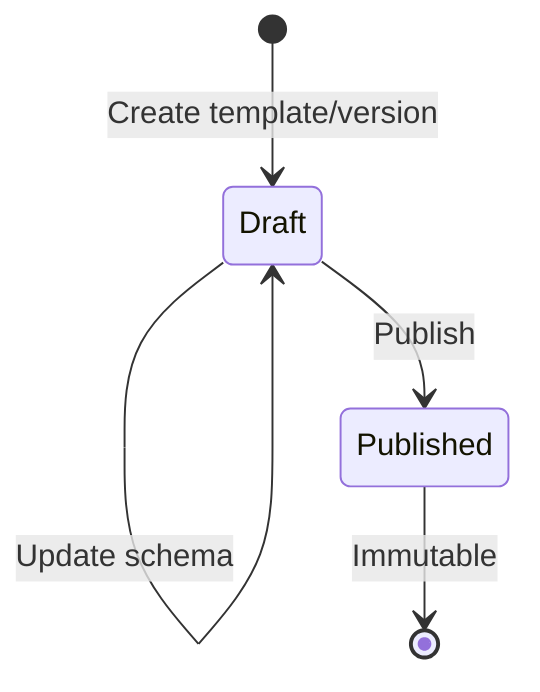
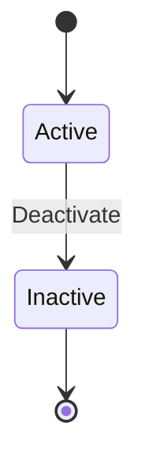
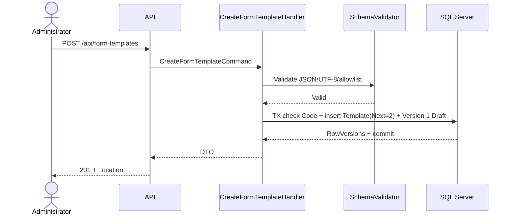
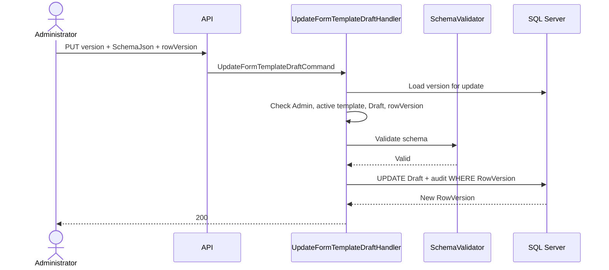
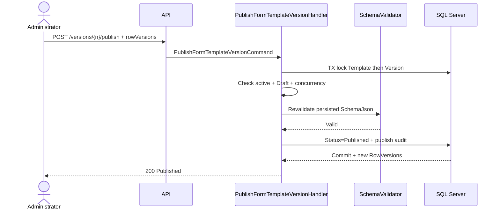
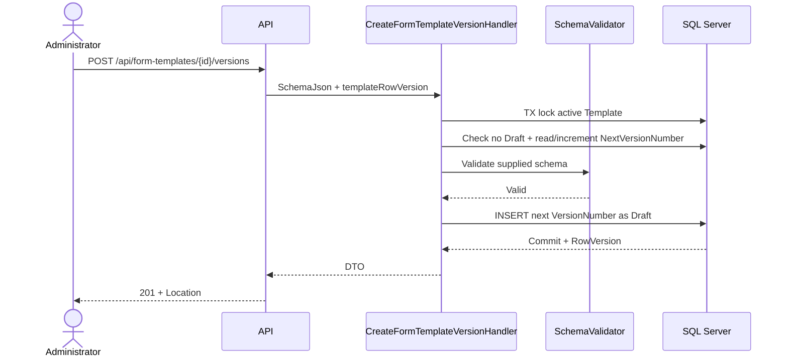

# Thiết kế vertical slice Form Template

## 1. Mục đích, nguồn và phạm vi

Tài liệu này phân tích vertical slice Form Template dựa trên:

- `docs/01-product-scope-and-use-cases.md` cho phạm vi, actor và UC08–UC11.
- `docs/02-erd-and-data-design.md` cho hai bảng `FormTemplates`, `FormTemplateVersions`, quan hệ với Identity và Inspection.
- `docs/03-inspection-vertical-slice-design.md` cho điều kiện chọn version, giới hạn FormIO và quy tắc validate dữ liệu Inspection.
- `docs/04-construction-object-vertical-slice-design.md` cho convention API, DTO, audit, rowVersion, ProblemDetails và query.

Đây chỉ là tài liệu thiết kế. Bước này không tạo source code, package, migration, database, Inspection API hoặc frontend.

### 1.1 Use Case nguồn

| ID | Tên chính xác | Actor chính | Kết quả nguồn yêu cầu |
|---|---|---|---|
| UC08 | Xem danh sách | Administrator | Danh sách template và version liên quan. |
| UC09 | Tạo từ FormIO schema | Administrator | Tạo template cùng version đầu tiên có `SchemaJson` hợp lệ. |
| UC10 | Tạo phiên bản mới | Administrator | Tạo Draft version mới; khi publish, version trở thành bất biến và không bị ghi đè. |
| UC11 | Ngừng sử dụng | Administrator | Đánh dấu template inactive, bảo toàn các Inspection cũ. |

Không có Use Case riêng cho sửa metadata, xóa, reactivate, archive version hoặc clone template. Update Draft và Publish là hai hành động con đã chốt của UC09/UC10, có API contract riêng nhưng không tạo Use Case ID mới.

### 1.2 Trong MVP

- Quản lý metadata Form Template và lịch sử version.
- Lưu, parse và validate FormIO `SchemaJson` theo allowlist.
- Tạo version 1 và các version tiếp theo an toàn khi có request đồng thời.
- Bảo toàn version đã publish/được Inspection tham chiếu.
- Deactivate template bằng trạng thái, không hard delete.
- Cho phép đọc metadata version cũ và schema theo quyền.
- Dùng UTC, audit user ID và SQL Server rowversion.

### 1.3 Ngoài phạm vi

- Không có hard delete, reactivate, rollback hoặc sửa version đã publish.
- Không có visual FormIO builder/frontend trong bước này.
- Không có custom component, script, executable expression, file upload hoặc HTML tùy ý.
- Không tạo Form Template assignment, approval nhiều cấp, workflow engine, notification hoặc SignalR.
- Không triển khai Inspection/Checklist trong slice này.
- Không thêm API CRUD chỉ để sửa/xóa tùy ý.

### 1.4 Phụ thuộc module

- `Inspection` giữ FK tới đúng `FormTemplateVersionId`. Version cũ phải còn đọc được sau khi template inactive.
- Khi tạo Inspection mới, Construction Object phải active theo slice UC03–UC07 và version phải đủ điều kiện sử dụng theo quyết định ở mục 4.5.
- Khi Submit Inspection, `DataJson` được validate bằng chính `SchemaJson` của version đã được server pin khi tạo; không tự chuyển sang version mới hơn.
- `Checklist` hiện không có FK hoặc hành vi nào với Form Template trong docs/01–03. Không tự tạo liên kết Checklist–Template.
- Identity tiếp tục dùng `AspNetUsers`; Domain chỉ giữ scalar user ID, không tạo Domain User/Role hay navigation Identity.

## 2. Domain model cuối cùng

### 2.1 Aggregate boundary

`FormTemplate` là aggregate root. `FormTemplateVersion` thuộc một template và không được chuyển sang template khác.

Các thao tác cần bảo vệ trong aggregate/application transaction:

- Code duy nhất sau trim/normalize uppercase invariant.
- Version number dương, cấp từ `NextVersionNumber` trong phạm vi một template; không dùng `MAX + 1`.
- Tối đa một Draft đang mở cho một template.
- Published version bất biến.
- Template inactive không nhận draft/version/publish mới và không được dùng cho Inspection mới.
- Deactivate không sửa/xóa version hay Inspection lịch sử.

### 2.2 FormTemplate

| Thuộc tính | Kiểu | Quy tắc |
|---|---|---|
| `Id` | `Guid` | Application-generated, khác `Guid.Empty`. |
| `Code` | `string` | Bắt buộc, trim + uppercase invariant, unique toàn hệ thống, tối đa 50 ký tự theo docs/02. |
| `Name` | `string` | Bắt buộc, trim, tối đa 250 ký tự. |
| `Description` | `string?` | Trim/null normalize, tối đa 2.000 ký tự. |
| `Status` | enum | `Active` hoặc `Inactive`; mặc định Active, chỉ có transition Active → Inactive trong UC11. |
| `NextVersionNumber` | `int` | Mặc định 2 sau khi tạo version 1; chỉ tăng trong transaction tạo version. |
| `CreatedByUserId` | `Guid` | Actor tạo, không navigation Identity trong Domain. |
| `CreatedAt` | `DateTime` | UTC. |
| `UpdatedByUserId` | `Guid?` | Actor của lần cập nhật gần nhất; null trước lần cập nhật đầu. |
| `UpdatedAt` | `DateTime?` | UTC. |
| `DeactivatedByUserId` | `Guid?` | Chỉ có giá trị khi inactive. |
| `DeactivatedAt` | `DateTime?` | UTC, chỉ có giá trị khi inactive. |
| `RowVersion` | `byte[]` | SQL Server rowversion, Base64 qua API. |

Code format là 2–50 ký tự, regex `^[A-Za-z0-9][A-Za-z0-9._-]{1,49}$`, lưu uppercase. Giới hạn này giữ nguyên `nvarchar(50)` đã chốt trong docs/02; không mở rộng chỉ để đồng nhất với một module khác.

Created audit luôn có giá trị. Updated audit cùng null trước lần cập nhật đầu, sau đó cùng có giá trị khi counter hoặc trạng thái template thay đổi. Deactivated audit cùng null khi active và cùng có giá trị khi inactive.

### 2.3 FormTemplateVersion

| Thuộc tính | Kiểu | Quy tắc |
|---|---|---|
| `Id` | `Guid` | Application-generated. |
| `FormTemplateId` | `Guid` | Bắt buộc, không đổi. |
| `VersionNumber` | `int` | Bắt đầu từ 1, tăng trong từng template, client không truyền. |
| `Status` | enum | Chỉ `Draft` hoặc `Published`. |
| `SchemaJson` | `string` | JSON hợp lệ, UTF-8 ≤ 1 MiB, đúng allowlist. |
| `CreatedByUserId` | `Guid` | Actor tạo version. |
| `CreatedAt` | `DateTime` | UTC. |
| `UpdatedByUserId` | `Guid?` | Chỉ dùng khi sửa Draft. |
| `UpdatedAt` | `DateTime?` | Chỉ dùng khi sửa Draft. |
| `PublishedByUserId` | `Guid?` | Có giá trị sau Publish. |
| `PublishedAt` | `DateTime?` | UTC, có giá trị sau Publish. |
| `RowVersion` | `byte[]` | Concurrency token. |

Created audit luôn có giá trị. Updated audit cùng null hoặc cùng có giá trị. Published audit cùng null khi Draft và cùng có giá trị khi Published. Domain chỉ giữ scalar `Guid`; không có navigation hay Domain User/Role trùng ASP.NET Core Identity.

## 3. FormIO SchemaJson

### 3.1 Envelope và giới hạn chung

- Root phải là JSON object có property `components` là array.
- `SchemaJson` không null/rỗng và không nhận JSON primitive/array ở root.
- Kích thước kiểm tra trước persistence bằng `Encoding.UTF8.GetByteCount(schemaJson)`; giới hạn tối đa chính xác 1.048.576 byte.
- Parse strict: không comment, không trailing comma; giới hạn JSON parser depth 16.
- Do MVP không cho layout/container component, component depth nghiệp vụ là 1: chỉ `root.components[]`; component con hoặc property `components` bên trong component bị từ chối.
- Tối đa 200 component trên một schema.
- `key` bắt buộc, regex `^[A-Za-z][A-Za-z0-9_]{0,99}$`; duplicate key bị từ chối không phân biệt hoa thường.
- Mỗi component phải có `type`, `key`, `label`; `input` nếu có phải là `true`.
- Chỉ nhận property trong allowlist; unknown property fail closed thay vì bỏ qua.
- Schema được canonicalize khi cần so sánh/hash nhưng phải bảo toàn semantic; API không dựa vào whitespace để xác định thay đổi.

### 3.2 Common property allowlist

| Property | Bắt buộc | Quy tắc |
|---|---:|---|
| `type` | Có | Một trong bảy type tại mục 3.3. |
| `key` | Có | Unique case-insensitive, tối đa 100 ký tự. |
| `label` | Có | String 1–250 ký tự. |
| `description` | Không | String tối đa 1.000 ký tự, plain text. |
| `placeholder` | Không | String tối đa 250 ký tự, plain text. |
| `tooltip` | Không | String tối đa 500 ký tự, plain text. |
| `input` | Không | Nếu có chỉ nhận `true`. |
| `tableView` | Không | Boolean. |
| `hidden` | Không | Boolean tĩnh; không expression. |
| `disabled` | Không | Boolean tĩnh. |
| `defaultValue` | Không | Phải đúng output type của component. |
| `validate` | Không | Object chỉ chứa validation property được liệt kê cho type. |

Chuỗi label/description/placeholder/tooltip là text, không render như trusted HTML.

### 3.3 Bảy nhóm component

| Nhóm | `type` | Property riêng được phép | Bắt buộc | Output dự kiến | Validation hỗ trợ |
|---|---|---|---|---|---|
| Text Field | `textfield` | `prefix`, `suffix`, `spellcheck` | Common fields | JSON string | `required`, `minLength`, `maxLength`; không custom regex ở MVP. |
| Text Area | `textarea` | `rows`, `autoExpand`, `spellcheck` | Common fields | JSON string | `required`, `minLength`, `maxLength`; `rows` 1–20. |
| Number | `number` | `decimalLimit`, `requireDecimal`, `prefix`, `suffix` | Common fields | JSON number | `required`, `min`, `max`, `integer`; min ≤ max, decimalLimit 0–10. |
| Select | `select` | `dataSrc`, `data`, `multiple` | Common fields; `dataSrc="values"`; `data.values` | Primitive hoặc array primitive khi `multiple=true` | `required`; option label/value bắt buộc và value unique. |
| Radio | `radio` | `values`, `inline` | Common fields; `values` | JSON string | `required`; option label/value bắt buộc và value unique. |
| Checkbox | `checkbox` | Không có property động | Common fields | JSON boolean | `required` nghĩa là phải `true`; default chỉ boolean. |
| Date/Time | `datetime` | `format`, `enableDate`, `enableTime` | Common fields; ít nhất một trong enableDate/enableTime không false | ISO 8601 string | `required`, `minDate`, `maxDate` chỉ nhận literal ISO 8601; min ≤ max. |

Giới hạn bổ sung:

- `multiple` chỉ hỗ trợ cho Select và cần được phản ánh khi validate `DataJson`.
- Select chỉ dùng static `data.values`; không dùng URL, resource, custom data source hoặc refresh dependency.
- Option value chỉ nhận string/number/boolean primitive, không object, script hoặc HTML.
- `format` Date/Time chỉ nhận tập format cố định do server định nghĩa; không expression.
- Các numeric bounds phải hữu hạn, không nhận NaN/Infinity.

### 3.4 Property/component bị từ chối

Từ chối mọi component ngoài bảy type trên, bao gồm `container`, `panel`, `columns`, `fieldset`, `table`, `tabs`, `datagrid`, `editgrid`, `file`, `signature`, `content`, `html`, `button`, `resource`, `survey`, `address`, `password` và custom component.

Từ chối mọi property có khả năng thực thi hoặc tải nội dung động, kể cả khi lồng sâu:

```text
custom
customConditional
calculateValue
calculateServer
logic
actions
event
events
evalContext
template
content
html
url
resource
refreshOn
redrawOn
```

Không cho JavaScript, executable expression, HTML tùy ý, `<script>`, event handler, `javascript:` URL, file/base64 payload, remote data source hoặc property không thuộc allowlist. Validator phải duyệt toàn bộ JSON tree, không chỉ component cấp đầu, để tránh property nguy hiểm bị giấu trong object lồng.

## 4. Lifecycle và state transition

### 4.1 Version lifecycle



Quy tắc:

- Khi tạo Form Template, hệ thống tạo Draft version 1 và đặt `NextVersionNumber = 2` trong cùng transaction.
- Draft được Administrator cập nhật nhiều lần; mỗi lần phải gửi đúng version `rowVersion`.
- Publish chuyển chính Draft hiện tại sang Published, không tạo một version number khác.
- Chỉ Draft được publish. Published bất biến hoàn toàn và không quay lại Draft.
- Sửa schema đã Published bắt buộc tạo Draft version mới.
- Một template có thể có nhiều Published version lịch sử nhưng tối đa một Draft tại cùng thời điểm.
- Không có Archived, discard Draft, delete version hoặc rollback version trong MVP.
- Khi đã có Draft, create-version trả `409 form_template.draft_exists`; Administrator tiếp tục cập nhật Draft đó.

### 4.2 Template lifecycle



- Template chỉ chuyển `Active → Inactive`; không reactivate hoặc hard delete.
- Deactivate ghi đồng thời `Status=Inactive`, `DeactivatedAt`, `DeactivatedByUserId`, `UpdatedAt`, `UpdatedByUserId` và rowVersion mới.
- Template inactive không cho tạo Inspection mới, tạo version mới, update Draft hoặc publish Draft.
- Deactivate không đổi trạng thái/version number/schema, không xóa Draft/Published version và không sửa bất kỳ Inspection nào.

### 4.3 Version dành cho Inspection

- Inspection mới chỉ sử dụng Published version có `VersionNumber` lớn nhất của một template active.
- Client không gửi hoặc tự chọn arbitrary old version. Lookup/create contract phía Inspection nhận `FormTemplateId`, resolve latest Published ở server và pin ID version đó.
- Template active nhưng chưa có Published version không đủ điều kiện tạo Inspection.
- Khi publish version mới, Inspection đã tồn tại vẫn pin nguyên `FormTemplateVersionId` cũ.
- Version cũ và schema tương ứng vẫn đọc được qua Inspection/revision đúng scope.
- Không cần cột `IsCurrent`; latest Published được xác định bằng status và version number, có index hỗ trợ.

## 5. Authorization

Quyền trực tiếp của Form Template API theo UC08–UC11:

| Hành động | Inspector | Reviewer | Manager | Administrator |
|---|---:|---:|---:|---:|
| List template metadata | Không | Không | Không | Có |
| Xem version metadata/detail | Không | Không | Không | Có |
| Xem SchemaJson version cũ qua management API | Không | Không | Không | Có |
| Xem schema gắn với Inspection/revision thuộc scope | Có, hồ sơ liên quan | Có, hồ sơ được giao | Có, phạm vi quản lý | Có |
| Tạo template/version 1 | Không | Không | Không | Có |
| Sửa Draft | Không | Không | Không | Có |
| Publish | Không | Không | Không | Có |
| Tạo version mới | Không | Không | Không | Có |
| Deactivate | Không | Không | Không | Có |

Inspector cần metadata/schema đủ điều kiện trong UC14 để render/validate Inspection, nhưng quyền đó nên đi qua Inspection application contract hoặc một lookup contract được duyệt cùng Inspection, không tự mở management API UC08 cho Inspector trong slice này. Reviewer xem schema gắn với revision thông qua Inspection detail/audit, không qua management endpoint. Manager chưa được docs/01 cấp quyền quản trị Form Template.

- Chưa xác thực: `401`.
- Đã xác thực nhưng sai role đối với resource có thể biết: `403`.
- Template/version không tồn tại hoặc hoàn toàn ngoài scope: `404`.
- Mọi command vẫn kiểm tra role trong Application; attribute API không phải lớp bảo vệ duy nhất.

## 6. API contract MVP

MVP có đúng tám endpoint Form Template. Update Draft và Publish là hành động con của UC09/UC10, không tạo Use Case ID mới.

Mọi lỗi dùng `application/problem+json` và contract ProblemDetails hiện có. `401 authentication_required`, `403 forbidden`, `404 form_template.not_found` hoặc `form_template.version_not_found` là mã chung; validation trả `400 validation_failed` cùng lỗi theo field. Các mã `409` đặc thù được nêu tại từng write endpoint. Resource hoàn toàn ngoài scope phải được che bằng `404`, dù actor đã xác thực.

### 6.1 `GET /api/form-templates`

- UC: UC08. Role: Administrator.
- Query: pageNumber 1-based, pageSize 1–100, search tối đa 200, `status`, sort whitelist `code|name|createdAt|updatedAt`, direction `asc|desc`.
- Response chỉ metadata: id, code, name, description rút gọn, status, latestPublishedVersionNumber, draftVersionNumber, rowVersion; không trả SchemaJson.
- `200`; input sai `400`; auth `401/403`.
- Query `AsNoTracking`, filter rồi sort ổn định với Id tie-breaker, projection, sau đó Skip/Take.

### 6.2 `GET /api/form-templates/{id}/versions`

- UC: UC08. Role: Administrator.
- Trả template header và trang version metadata: id, versionNumber, status, created/published audit, isReferenced, rowVersion.
- Query pagination bắt buộc; sort whitelist `versionNumber|createdAt|publishedAt`.
- Không trả SchemaJson.
- `200`, `400`, `401`, `403`, `404`.

### 6.3 `GET /api/form-templates/{id}/versions/{versionNumber}`

- UC: UC08. Role: Administrator.
- Đây là read endpoint duy nhất trong management slice được trả `SchemaJson` đầy đủ.
- Response: template/version metadata, SchemaJson, UTF-8 byte count, status, audit và rowVersion.
- `200`, `400` nếu versionNumber ≤ 0, `401`, `403`, `404`.
- Version lịch sử vẫn đọc được khi template inactive.

### 6.4 `POST /api/form-templates`

- UC: UC09. Role: Administrator.
- Request: `code`, `name`, `description`, `schemaJson`.
- Transaction tạo FormTemplate active, Draft version 1 và đặt `NextVersionNumber = 2`.
- Validate code/name/description, JSON, UTF-8 ≤ 1 MiB, allowlist, key uniqueness/depth/count.
- Response `201 Created`, Location trỏ version detail, trả template + version 1 gồm SchemaJson và rowVersions.
- Lỗi: `400 form_template.schema_invalid|schema_too_large`; `409 form_template.code_duplicate`; `401/403`.

### 6.5 `PUT /api/form-templates/{id}/versions/{versionNumber}`

- Hành động con phục vụ authoring Draft của UC09/UC10.
- Role: Administrator. Request: `schemaJson`, `rowVersion`.
- Chỉ sửa đúng Draft của template active; không đổi version number/template ID.
- Response `200` với SchemaJson, byte count, audit và rowVersion mới.
- `400` schema/Base64 sai; `404`; `409 form_template.version_published|template_inactive|concurrency_conflict`.

### 6.6 `POST /api/form-templates/{id}/versions/{versionNumber}/publish`

- Hành động con của UC09/UC10.
- Role: Administrator. Request: `templateRowVersion`, `versionRowVersion`.
- Revalidate toàn bộ schema trong transaction; chuyển chính version từ Draft sang Published.
- Response `200` với published metadata và rowVersions mới.
- `400`, `404`, `409 form_template.invalid_transition|template_inactive|concurrency_conflict`.
- Publish lặp bị từ chối `409`, không trả thành công ngầm.

### 6.7 `POST /api/form-templates/{id}/versions`

- UC: UC10. Role: Administrator.
- Request: `schemaJson`, `templateRowVersion`.
- Server lấy version number từ `NextVersionNumber`; client không truyền.
- Transaction tăng `NextVersionNumber` và tạo Draft mới; gap được chấp nhận, số đã cấp không được tái sử dụng.
- Response `201 Created`, Location version detail.
- `400`; `404`; `409 form_template.template_inactive|draft_exists|concurrency_conflict`.

### 6.8 `POST /api/form-templates/{id}/deactivate`

- UC: UC11. Role: Administrator.
- Request: `rowVersion`.
- Response `200`: id, status=`Inactive`, updatedByUserId, updatedAt, deactivatedByUserId, deactivatedAt, rowVersion.
- Không sửa version/Inspection cũ; chặn tạo/publish version và tạo Inspection mới.
- `400`, `404`, `409 form_template.already_inactive|concurrency_conflict`.

Không có API DELETE, reactivate, update Published version hoặc tree/bulk endpoint.

## 7. Database design

### 7.1 FormTemplates

| Column | SQL Server type | Constraint |
|---|---|---|
| `Id` | `uniqueidentifier` | PK, application-generated. |
| `Code` | `nvarchar(50)` | NN, normalized uppercase, UQ; giữ nguyên docs/02. |
| `Name` | `nvarchar(250)` | NN. |
| `Description` | `nvarchar(2000)` | NULL. |
| `Status` | `varchar(20)` | NN, CHECK Active/Inactive, default Active. |
| `NextVersionNumber` | `int` | NN, default/initial value 2, CHECK > 1. |
| `CreatedByUserId` | `uniqueidentifier` | NN, FK AspNetUsers, NoAction. |
| `CreatedAt` | `datetime2(7)` | NN, UTC. |
| `UpdatedByUserId` | `uniqueidentifier` | NULL, FK AspNetUsers, NoAction. |
| `UpdatedAt` | `datetime2(7)` | NULL, UTC. |
| `DeactivatedByUserId` | `uniqueidentifier` | NULL, FK AspNetUsers, NoAction. |
| `DeactivatedAt` | `datetime2(7)` | NULL, UTC. |
| `RowVersion` | `rowversion` | NN, concurrency token. |

Constraints/indexes: PK, unique `UX_FormTemplates_Code`, `IX_FormTemplates_Status_Name`, audit FK indexes, CHECK Updated audit cùng null/cùng có giá trị, và CHECK bảo đảm Active có Deactivated audit cùng null còn Inactive có cả hai giá trị.

### 7.2 FormTemplateVersions

| Column | SQL Server type | Constraint |
|---|---|---|
| `Id` | `uniqueidentifier` | PK. |
| `FormTemplateId` | `uniqueidentifier` | NN, FK FormTemplates, NoAction. |
| `VersionNumber` | `int` | NN, CHECK > 0. |
| `Status` | `varchar(20)` | NN, CHECK Draft/Published. |
| `SchemaJson` | `nvarchar(max)` | NN, CHECK `ISJSON([SchemaJson]) = 1`; app limit 1 MiB UTF-8. |
| `CreatedByUserId` | `uniqueidentifier` | NN, FK AspNetUsers, NoAction. |
| `CreatedAt` | `datetime2(7)` | NN. |
| `UpdatedByUserId` | `uniqueidentifier` | NULL, Draft audit. |
| `UpdatedAt` | `datetime2(7)` | NULL. |
| `PublishedByUserId` | `uniqueidentifier` | NULL, FK AspNetUsers, NoAction. |
| `PublishedAt` | `datetime2(7)` | NULL. |
| `RowVersion` | `rowversion` | NN. |

Constraints/indexes:

- UQ `(FormTemplateId, VersionNumber)`.
- CHECK version number > 0.
- CHECK status/audit consistency: Draft không có publish audit; Published có publish audit.
- CHECK Updated audit cùng null hoặc cùng có giá trị.
- Filtered unique index `UX_FormTemplateVersions_OneDraft` trên `FormTemplateId WHERE Status='Draft'` để tối đa một Draft.
- Index `(FormTemplateId, VersionNumber DESC)` phục vụ history/latest.
- Index `(FormTemplateId, Status, VersionNumber DESC)` phục vụ chọn Published version.
- Tất cả FK `Restrict/NoAction`; không cascade delete.

Published immutability được bảo vệ bởi Domain/Application và việc không có update route cho Published. Database FK bảo toàn version được Inspection tham chiếu. MVP không dùng trigger; integration tests phải chứng minh repository không phát UPDATE schema của Published version.

## 8. CQRS, transaction và concurrency

| Endpoint | CQRS request |
|---|---|
| GET templates | `GetFormTemplatesQuery` |
| GET version metadata | `GetFormTemplateVersionsQuery` |
| GET version schema | `GetFormTemplateVersionDetailQuery` |
| POST template | `CreateFormTemplateCommand` |
| PUT Draft | `UpdateFormTemplateDraftCommand` |
| POST Publish | `PublishFormTemplateVersionCommand` |
| POST new version | `CreateFormTemplateVersionCommand` |
| POST deactivate | `DeactivateFormTemplateCommand` |

### 8.1 Abstractions

- `IFormTemplateRepository`: aggregate writes, locked template/version snapshots, duplicate code/reference checks.
- `IFormTemplateReadService`: `AsNoTracking` projections cho list/version/detail; không trả IQueryable qua layer.
- `IFormIoSchemaValidator`: syntax, UTF-8 size, allowlist, duplicate key, depth/count và dangerous-property validation.
- `IUnitOfWork`: transaction + SaveChanges; tái sử dụng abstraction hiện có nếu semantics phù hợp.
- `ICurrentUser`, `IClock`: audit role/user và UTC.

### 8.2 Version number an toàn

Không truy vấn `MAX(VersionNumber) + 1`. Create-version thực hiện:

1. Begin SQL transaction.
2. Load template row bằng `UPDLOCK, HOLDLOCK`; kiểm tra active, client `templateRowVersion` và không có Draft.
3. Lấy `allocatedVersionNumber = NextVersionNumber`, sau đó tăng `NextVersionNumber` lên một trong cùng tracked aggregate/transaction.
4. Validate schema và insert Draft với số đã cấp.
5. Save; EF rowversion là optimistic concurrency guard, UQ `(FormTemplateId, VersionNumber)` là lớp bảo vệ cuối.
6. Commit. Lỗi validation/persistence rollback cả counter và Draft; version number đã quan sát/cấp thành công không bao giờ được tái sử dụng. Gap được chấp nhận.

`UPDLOCK, HOLDLOCK` serialize việc cấp số theo từng template, không khóa toàn hệ thống. Hai request dùng cùng template rowVersion: request lấy lock trước thành công và tạo rowVersion mới; request sau trả `409 form_template.concurrency_conflict` hoặc `form_template.draft_exists` theo trạng thái nhìn thấy sau lock. Không retry ngầm bằng rowVersion cũ.

### 8.3 Transaction boundaries

- Create template: template + version 1 trong một transaction.
- Update Draft: lock/load version, compare rowVersion, validate schema, update audit, save.
- Publish: lock template rồi version theo thứ tự ổn định; compare cả hai rowVersion; revalidate schema; transition + audit; save một transaction.
- Create new version: lock template, bảo đảm active/không có Draft, cấp số từ `NextVersionNumber`, tăng counter, validate schema và insert trong một transaction.
- Deactivate: lock template, compare rowVersion, chuyển inactive và ghi Updated/Deactivated audit; không update versions.

`DbUpdateConcurrencyException` map `409 form_template.concurrency_conflict`. Unique code/version collision map error code riêng. Validation input map `400`; state transition map `409`.

## 9. Sequence diagrams

### 9.1 Create Draft



### 9.2 Update Draft



### 9.3 Publish Version



### 9.4 Tạo version mới từ template đã publish



## 10. Test plan

### 10.1 Domain unit tests

- Tạo template/version hợp lệ; normalize code và audit đúng.
- Tạo template luôn có Draft version 1 và `NextVersionNumber = 2`.
- Từ chối code/name/schema identity rỗng và ID empty.
- VersionNumber phải dương, không đổi TemplateId/VersionNumber.
- Chỉ Draft được update; Published bất biến và không quay lại Draft.
- Publish Draft hợp lệ; publish lặp bị từ chối.
- Template inactive không update/deactivate lặp/tạo version mới.
- Deactivate không xóa hoặc đổi version.

### 10.2 Application unit tests

- Duplicate normalized code.
- Tạo template atomically tạo version 1.
- Cấp số từ `NextVersionNumber`, tăng counter trong transaction và không gọi MAX.
- Hai create-version đồng thời: một thành công, một state/concurrency conflict; không tạo hai Draft hoặc trùng số.
- Template missing/inactive; Draft đang tồn tại.
- Wrong role bị `403`; missing/out-of-scope `404`.
- RowVersion cũ trả `409` cho update/publish/deactivate/create-version.
- Pagination/search/sort whitelist validation.
- Audit lấy đúng current user/clock.
- Audit Created/Updated/Published/Deactivated đúng nullability theo lifecycle.
- Published version không gọi repository update schema.
- Lookup Inspection chỉ resolve latest Published của template active và từ chối template chưa publish/inactive.

### 10.3 Schema validation tests

- Mỗi type trong bảy nhóm có case hợp lệ và output type đúng.
- JSON invalid, root/envelope sai, unknown component/property.
- Duplicate key cùng case và khác case.
- Component count 200 pass, 201 fail; component nesting > 1 fail; JSON depth vượt 16 fail.
- Schema đúng 1.048.576 UTF-8 bytes pass và lớn hơn 1 byte fail nếu envelope hợp lệ.
- Chuỗi Unicode nhiều byte chứng minh không dùng `string.Length`.
- Script/customConditional/calculateValue/logic/HTML/file/base64/remote URL bị từ chối kể cả khi lồng sâu.
- Select/radio duplicate option; invalid default/output; number/date range sai.

### 10.4 SQL Server integration tests

- Dùng `ConstructionInspectionIntegrationTestDb` với safety guard; không reset Development database.
- Đủ endpoint/status 200/201/400/401/403/404/409.
- UQ code và `(FormTemplateId, VersionNumber)` hoạt động thật.
- CHECK status/version/ISJSON và FK NoAction hoạt động.
- Filtered unique index chặn Draft thứ hai kể cả khi bypass Application.
- Hai create-version đồng thời: chỉ một thành công, request còn lại `409`, counter không tăng hai lần và không có số trùng.
- Sau khi publish rồi tạo version kế tiếp, số lấy đúng từ counter; không tái sử dụng số đã cấp và chấp nhận gap.
- Hai write cùng rowVersion: một thành công, một `409`.
- Transaction create template/version và publish rollback toàn bộ khi gây lỗi.
- Published SchemaJson không đổi; deactivate giữ version/Inspection FK.
- Deactivate ghi đủ audit và chặn create/update/publish/Inspection mới nhưng không cản lịch sử cũ.
- List projection/pagination/filter/stable sort và endpoint metadata không lộ SchemaJson.
- Chỉ version-detail/Inspection contract được duyệt trả SchemaJson.
- Regression: toàn bộ Authentication và Construction Object tests vẫn pass.

## 11. Definition of Done

- Lifecycle Draft → Published, latest-Published selection và quy tắc deactivate đã được triển khai đúng contract.
- UC08–UC11 được ánh xạ đầy đủ, không thêm use case ngoài quyết định.
- Domain không phụ thuộc Infrastructure/Identity và bảo vệ lifecycle invariant.
- FormIO validator đạt bảy-type allowlist, UTF-8 1 MiB, duplicate key, depth/count và dangerous-property tests.
- API role/scope, DTO, ProblemDetails và rowVersion nhất quán với các slice hiện có.
- Read query `AsNoTracking`, filter/sort whitelist, projection và pagination.
- Version number an toàn đồng thời; migration có UQ/CHECK/FK/index/rowversion đúng.
- Migration và SQL script được review trước apply, không thay đổi Identity/ConstructionObjects ngoài FK được duyệt.
- SQL Server integration tests chứng minh transaction, constraint, concurrency và immutability.
- Authentication và Construction Object regression tests pass.
- Restore/build/test/vulnerability/diff/secret scan đạt; không có warning/error nghiêm trọng.
- Không hard delete, không mất schema/version/Inspection lịch sử và không lộ secret.

## 12. Đối chiếu nhất quán

### 12.1 Hoàn toàn thống nhất

- UC08–UC11 và Administrator là actor quản trị.
- Một FormTemplate có nhiều FormTemplateVersion; Inspection giữ FK tới đúng version.
- SchemaJson là JSON, `nvarchar(max)`, giới hạn 1 MiB UTF-8, SQL `ISJSON`.
- Chỉ bảy nhóm FormIO chuẩn; cấm custom/script/HTML script/file upload/base64 payload.
- Published version không bị ghi đè; thay đổi schema sau publish phải tạo Draft version mới.
- Template dùng status Active/Inactive; deactivate bảo toàn Inspection cũ.
- UTC, rowversion, DTO, CQRS, ProblemDetails, NoAction và SQL Server test database riêng.

### 12.2 Nội dung đã đồng bộ vào docs/01

- UC09 nói rõ tạo template cùng **Draft version 1**, không phải version dùng ngay.
- UC10 nói rõ tạo Draft version mới; Update Draft và Publish là hành động con, không thêm UC ID.
- Published bất biến, một Draft tối đa và deactivate chặn mọi hành động mới đã được ghi nhận.
- Điều kiện tạo Inspection là latest Published của template active.

### 12.3 Nội dung đã đồng bộ vào docs/02

- `FormTemplates` có `Status`, `NextVersionNumber`, Updated/Deactivated audit và constraint lifecycle.
- `FormTemplateVersions` có `Status`, Updated/Published audit và constraint lifecycle.
- Có filtered unique index một Draft/template và index `(FormTemplateId, Status, VersionNumber DESC)`.
- Quy tắc bất biến áp dụng ngay khi Published.
- Cấp số dùng counter trong transaction, không dùng MAX; semantic FormIO validation vẫn thuộc Application contract của tài liệu này.

### 12.4 Nội dung đã đồng bộ vào docs/03

- UC14 không cho client chọn `FormTemplateVersionId` tùy ý. Server resolve latest Published của template active; request/response, transaction, tests và frontend flow đã đổi tương ứng.
- Điều kiện exact là template active, có ít nhất một Published version và chọn version number lớn nhất.
- Giữ invariant Inspection pin chính xác `FormTemplateVersionId`; publish/deactivate sau đó không đổi hồ sơ cũ.
- Revision/detail lịch sử phải đọc schema của version đã pin, không tự chuyển sang latest.

Các đồng bộ trên được thực hiện trong cùng checkpoint tài liệu; không có source/migration/database nào được thay đổi.

## 13. Contract cuối cùng đã chốt

- Version lifecycle duy nhất: `Draft → Published`; template lifecycle duy nhất: `Active → Inactive`.
- Một template tối đa một Draft; Published bất biến; không archive/delete/rollback/reactivate.
- Inspection mới dùng latest Published của template active; Inspection cũ pin đúng version lịch sử.
- Version number lấy từ `NextVersionNumber`, tăng trong transaction có template row lock và rowversion; không dùng MAX.
- Audit Created/Updated/Published/Deactivated dùng UTC và scalar user `Guid` đúng lifecycle.
- FormIO dùng đúng bảy component, 1 MiB UTF-8, tối đa 200 component, JSON depth 16, component depth 1 và fail-closed allowlist.
- Deactivate chặn ngay mọi write/new-use nhưng giữ nguyên toàn bộ version và Inspection lịch sử.
- Form Template MVP có đúng tám endpoint tại mục 6.
