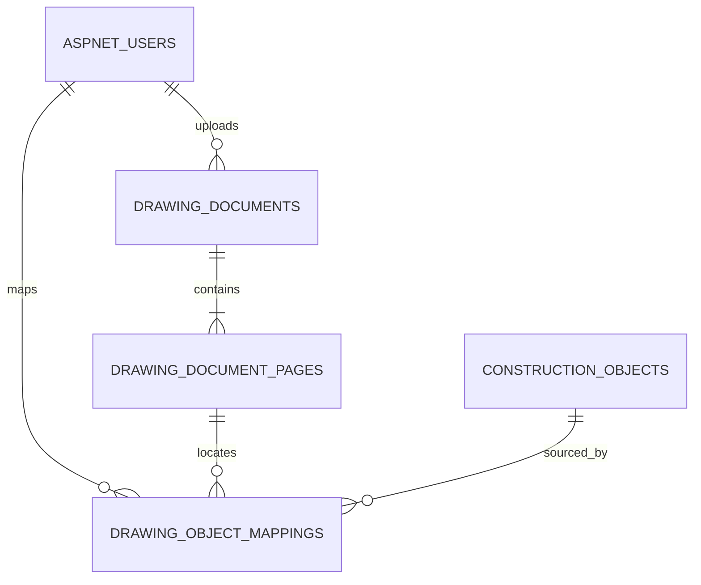
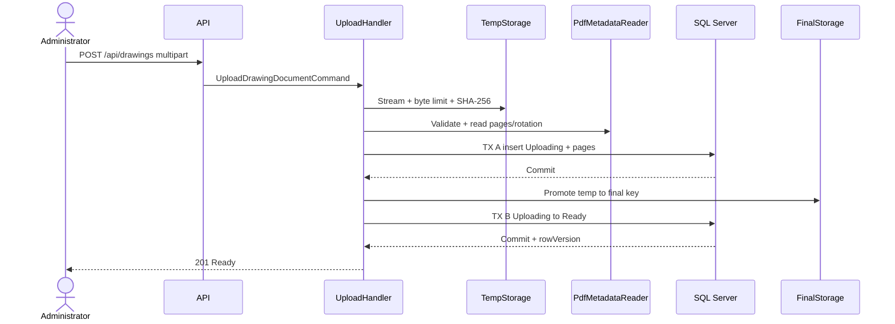
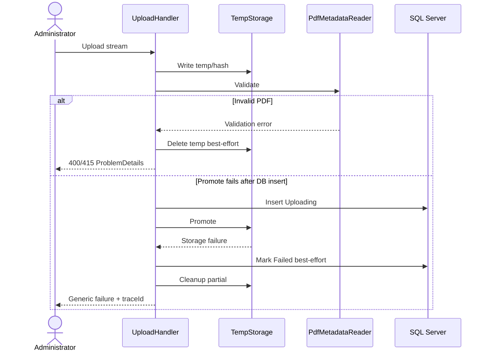
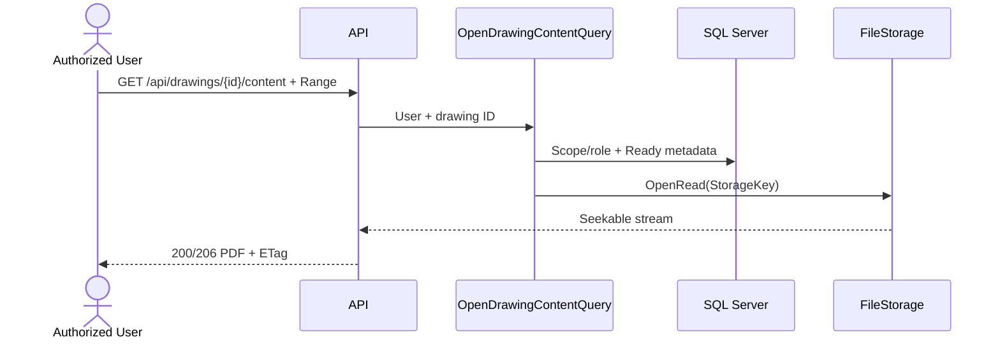
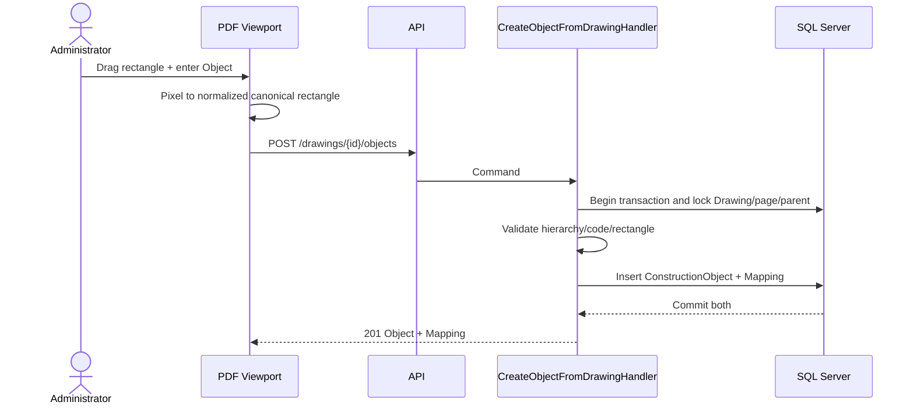
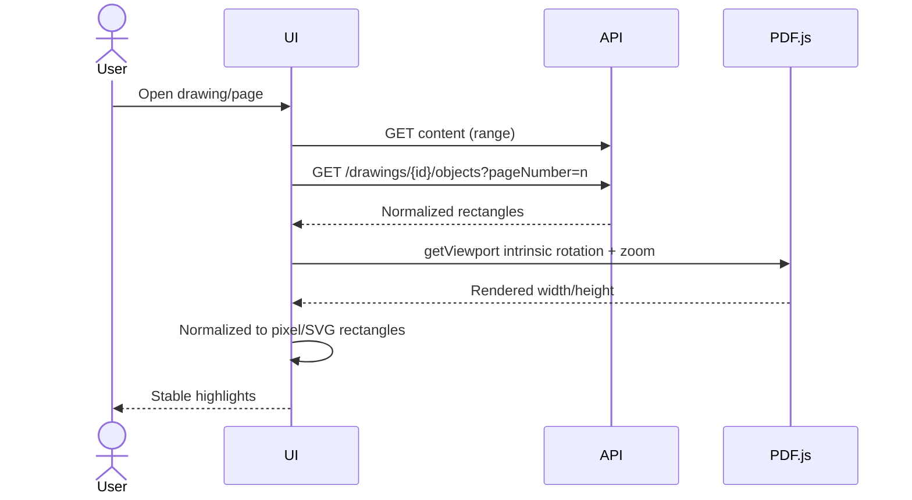
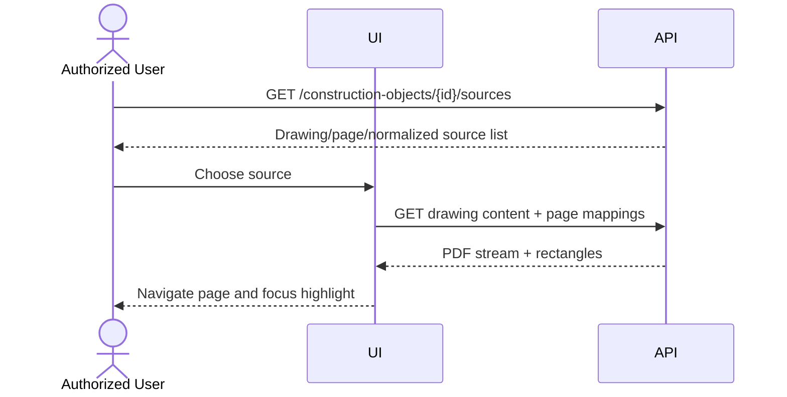

# Thiết kế Drawing Document, PDF Viewport và Object Mapping

> Trạng thái: các quyết định quản lý ngày 2026-10-07 là nguồn sự thật cuối cùng. Slice 1 chỉ gồm upload PDF, object storage, SQL metadata, list/detail và frontend tương ứng. Viewport, content endpoint và mapping chưa được triển khai.

## 1. Mục đích và trạng thái tài liệu

Tài liệu này đề xuất vertical slice nhỏ nhưng đầy đủ:

`Upload PDF → mở viewport → chọn trang → khoanh rectangle → nhập Construction Object → tạo Object + Mapping atomically → reload → highlight → truy ngược từ Object về nguồn`.

Tài liệu này ghi contract đã được quản lý chốt và kế hoạch triển khai theo vertical slice. Slice 1 đã được cho phép triển khai đồng thời backend/frontend; các phase viewport và mapping chỉ là thiết kế tiếp theo, không thuộc Slice 1.

Nguồn đối chiếu:

- `docs/01-product-scope-and-use-cases.md`: MVP, actor, HTTP/error và giới hạn PDF/FormIO hiện có.
- `docs/02-erd-and-data-design.md`: 16 bảng lõi hiện tại, SQL Server, audit, rowversion và delete behavior.
- `docs/03-inspection-vertical-slice-design.md`: Inspection pin dữ liệu nguồn, authorization và transaction convention.
- `docs/04-construction-object-vertical-slice-design.md`: UC03–UC07, hierarchy, DTO, API và concurrency.
- `docs/05-form-template-vertical-slice-design.md`: tài liệu untracked tại thời điểm baseline; chỉ được đọc, không sửa/commit trong lượt này.
- Source tại commit `81aead8`: implementation Authentication và Construction Object thực tế.

## 2. Baseline và phát hiện từ source

### 2.1 Baseline

- HEAD: `81aead8 feat(objects): implement Construction Object vertical slice`.
- Worktree đầu lượt chỉ có `docs/05-form-template-vertical-slice-design.md` untracked.
- .NET SDK: `10.0.300`; `dotnet-ef`: `10.0.12`.
- Restore thành công; build thành công với 0 warning, 0 error.
- Domain tests: 24/24 pass.
- Application tests: 31/31 pass.
- Integration tests: 5/8 pass; 3 Construction Object tests không kết nối được SQL Server do môi trường báo server yêu cầu encryption nhưng máy không hỗ trợ. Không sửa connection/certificate/source trong lượt thiết kế.
- Migration list bằng `--no-connect` không chạy được vì design-time factory yêu cầu environment variable `ConnectionStrings__DefaultConnection`; không đọc hoặc in secret để vượt lỗi.

### 2.2 Source hiện hành ảnh hưởng thiết kế

- `ConstructionObject` đã bảo vệ code/name, immutable `ObjectType`, inactive update và audit; hierarchy database-dependent nằm ở Application.
- Create Object hiện là `POST /api/construction-objects`, Administrator-only, chạy trong `IUnitOfWork.ExecuteInTransactionAsync`.
- `IUnitOfWork` đủ hình dạng để Object + Mapping cùng database commit/rollback, nhưng `EfUnitOfWork` hiện map unique/concurrency error cố định sang mã Construction Object; implementation Drawing sau này phải tổng quát hóa mapping lỗi mà không làm regression.
- Repository dùng `UPDLOCK, HOLDLOCK` cho write/hierarchy validation.
- Read authorization hiện không có Project membership hoặc Object assignment. Inspector/Reviewer đọc mọi active Construction Object; Manager/Administrator đọc cả inactive. Đây là role-based global visibility, không phải resource scope.
- `ICurrentUser` chỉ cung cấp `UserId`, roles; JWT không mang project/object assignment.
- `ApplicationDbContext` mới có `ConstructionObjects`; migration hiện tại chỉ gồm Identity và Construction Objects.
- Integration fixture có safety guard bắt buộc database tên `ConstructionInspectionIntegrationTestDb`, sau đó mới `EnsureDeleted/Migrate`.
- API chưa cấu hình multipart/request limit riêng, chưa có file storage, PDF reader hoặc frontend.

## 3. Phạm vi

### 3.1 Slice 1 được triển khai

- Upload đúng một PDF mỗi request, validate server-side và trích xuất page metadata.
- Lưu PDF vào object storage tương thích S3 qua `IObjectStorage`; local/training dùng MinIO.
- SQL Server chỉ lưu metadata và storage key, không lưu binary PDF.
- Đăng nhập frontend, upload PDF, danh sách Drawing và chi tiết metadata.
- Đúng ba API: `POST /api/drawings`, `GET /api/drawings`, `GET /api/drawings/{id}`.
- List/detail/stream PDF qua authenticated API.
- Render PDF bằng PDF.js/react-pdf, chọn rectangle bằng SVG overlay.
- Tạo Construction Object và một Drawing Object Mapping trong cùng SQL transaction.
- Một Object có thể có nhiều source mappings; đọc mapping theo drawing/page và theo object.
- Preserve legacy Construction Object không có mapping.
- Temp/final compensation và reconciliation tối thiểu.
- Pagination/filter/sort, ProblemDetails, audit, rowversion và security tests.

### 3.2 Ngoài Slice 1

- Revit, APS, IFC/BIM, OCR, AI detection/auto naming.
- Polygon/freehand, measurement, full annotation hoặc complex drawing revision management.
- Cloud object-storage implementation; chỉ giữ abstraction để thay thế sau.
- Antivirus service implementation; deployment production phải bổ sung malware scanning.
- Mapping update/delete, Drawing deactivate, direct-object endpoint removal cho tới khi ADR được xác nhận.
- Public/static PDF URL, realtime collaboration, WebSocket.
- Inspection/Form Template/Checklist/RFI/Elsa source.
- Distributed transaction giữa SQL Server và object storage.
- PDF viewport, PDF.js và content/range endpoint.
- `DrawingObjectMapping`, annotation Rectangle/Square/Circle và tạo Object từ vùng khoanh.

## 4. Domain model

### 4.1 Aggregate boundary

`DrawingDocument` là aggregate root cho metadata upload và danh sách `DrawingDocumentPage`. Binary không thuộc Domain và không nằm trong SQL Server.

`DrawingObjectMapping` là thiết kế phase sau, liên kết giữa một Drawing page và một `ConstructionObject`. Một ConstructionObject có thể có nhiều mapping trên nhiều trang, nhiều Drawing, hoặc nhiều vùng trên cùng một trang. Domain chỉ giữ scalar IDs; không phụ thuộc EF Core, ASP.NET, object-storage SDK, PDF library hoặc Identity entity. Slice 1 chưa tạo entity hoặc migration mapping.

Việc tạo Construction Object + Mapping là application transaction xuyên hai aggregate trong cùng database. Đây là ngoại lệ orchestration hợp lệ vì use case phải bảo đảm không để lại Object mới không có source.

### 4.2 DrawingDocument

| Property | Type | Rule |
|---|---|---|
| `Id` | `Guid` | Application-generated. |
| `OriginalFileName` | `string` | Display-only, basename đã sanitize, tối đa 260; không dùng làm path. |
| `StorageKey` | `string` | Server-generated, tối đa 500, unique; không nhận từ client. |
| `ContentType` | `string` | Canonical `application/pdf`, không tin raw client value. |
| `FileSize` | `long` | > 0 và ≤ configured maximum. |
| `Sha256` | `byte[32]` | Tính server-side khi stream. API có thể biểu diễn lowercase hex. |
| `PageCount` | `int` | > 0, lấy từ parser backend. |
| `Status` | enum | `Uploading`, `Ready`, `Failed`. |
| `FailureCode` | `string?` | Stable internal category, không chứa path/exception/secret. |
| `UploadRequestId` | `Guid?` | Candidate idempotency key theo uploader. |
| `CreatedAt` | `DateTime` | UTC, luôn có. |
| `CreatedByUserId` | `Guid` | Scalar actor ID. |
| `UpdatedAt` | `DateTime?` | UTC khi status thay đổi. |
| `UpdatedByUserId` | `Guid?` | Actor/system identity theo convention được duyệt. |
| `RowVersion` | `byte[]` | SQL Server rowversion. |

Không có Deactivated fields trong MVP proposal vì deactivate Drawing được đề xuất Phase sau. Nếu quản lý đưa deactivate vào MVP, bổ sung `Inactive` hoặc `IsActive` cùng `DeactivatedAt/ByUserId`; không hard delete file/metadata đang được mapping tham chiếu.

### 4.3 DrawingDocumentPage

Page metadata cần một entity riêng vì width, height và intrinsic rotation khác nhau theo page.

| Property | Type | Rule |
|---|---|---|
| `DrawingDocumentId` | `Guid` | Composite PK/FK part. |
| `PageNumber` | `int` | Composite PK part, 1-based. |
| `DisplayWidthPoints` | `decimal` | > 0; width sau intrinsic rotation/crop convention. |
| `DisplayHeightPoints` | `decimal` | > 0; height sau intrinsic rotation/crop convention. |
| `IntrinsicRotation` | `short` | Chỉ 0, 90, 180, 270. |

Page rows được tạo từ `IPdfMetadataReader`; client không gửi các giá trị này. Số page rows phải bằng `DrawingDocument.PageCount` khi chuyển `Ready`.

### 4.4 DrawingObjectMapping

| Property | Type | Rule |
|---|---|---|
| `Id` | `Guid` | PK, application-generated. |
| `DrawingDocumentId` | `Guid` | Thuộc đúng một Drawing. |
| `PageNumber` | `int` | Thuộc đúng một page metadata, 1-based. |
| `ConstructionObjectId` | `Guid` | Thuộc đúng một Construction Object. |
| `X` | `decimal` | Normalized [0,1], top-left canonical display space. |
| `Y` | `decimal` | Normalized [0,1], top-left canonical display space. |
| `Width` | `decimal` | > 0 và ≤ 1. |
| `Height` | `decimal` | > 0 và ≤ 1. |
| `CreatedAt` | `DateTime` | UTC. |
| `CreatedByUserId` | `Guid` | Scalar actor ID. |
| `RowVersion` | `byte[]` | Concurrency/read token; update chưa thuộc MVP. |

Không lưu `PageRotation` trên Mapping. Intrinsic rotation thuộc page metadata; rectangle luôn ở canonical rotation-applied space. Lưu rotation lặp trên từng Mapping tạo nguy cơ stale/double rotation.

### 4.5 Mapping cardinality và invariants

- Mỗi Mapping thuộc đúng một Drawing, một page, một Object và một rectangle.
- Proposal: một Object có nhiều Mapping trên nhiều Drawing/page.
- Proposal: một Object có nhiều rectangle khác nhau trên cùng page.
- Một rectangle record chỉ trỏ tới một Object.
- Exact duplicate rectangle trên cùng drawing/page bị chặn; overlap một phần được phép.
- Không có unique `(ConstructionObjectId, DrawingDocumentId, PageNumber)`.
- Drawing phải `Ready`; page phải tồn tại; Construction Object và parent phải active tại thời điểm tạo.
- Object hierarchy, normalized code và duplicate code tái sử dụng rule/repository hiện có.
- Shape phase sau gồm `Rectangle`, `Square` và `Circle`. Square là Rectangle có Width = Height; Circle dùng normalized bounding box. Shape invariant sẽ do Domain bảo vệ; page existence/readiness và cross-aggregate rule do Application kiểm tra trong transaction. Slice 1 chưa triển khai shape.

## 5. ERD và database proposal



### 5.1 DrawingDocuments

| Column | SQL Server type | Null/default/constraint |
|---|---|---|
| `Id` | `uniqueidentifier` | PK, NN. |
| `OriginalFileName` | `nvarchar(260)` | NN. |
| `StorageKey` | `nvarchar(500)` | NN, UQ. |
| `ContentType` | `varchar(100)` | NN, CHECK `application/pdf`. |
| `FileSize` | `bigint` | NN, CHECK > 0; application enforces configured max. |
| `Sha256` | `binary(32)` | NN. |
| `PageCount` | `int` | NN, CHECK > 0. |
| `Status` | `varchar(20)` | NN, CHECK Uploading/Ready/Failed. |
| `FailureCode` | `nvarchar(100)` | NULL; only Failed may have value. |
| `UploadRequestId` | `uniqueidentifier` | NULL. |
| `CreatedAt` | `datetime2(7)` | NN, UTC. |
| `CreatedByUserId` | `uniqueidentifier` | NN, FK AspNetUsers, NoAction. |
| `UpdatedAt` | `datetime2(7)` | NULL, UTC. |
| `UpdatedByUserId` | `uniqueidentifier` | NULL, FK AspNetUsers, NoAction. |
| `RowVersion` | `rowversion` | NN. |

Indexes:

- `UX_DrawingDocuments_StorageKey` unique.
- `IX_DrawingDocuments_Sha256` non-unique for duplicate detection.
- `IX_DrawingDocuments_Status_CreatedAt` for reconciliation/list.
- Candidate filtered unique `(CreatedByUserId, UploadRequestId) WHERE UploadRequestId IS NOT NULL` for idempotency.
- Audit FK indexes.

### 5.2 DrawingDocumentPages

| Column | SQL Server type | Null/default/constraint |
|---|---|---|
| `DrawingDocumentId` | `uniqueidentifier` | Composite PK, FK DrawingDocuments, NoAction. |
| `PageNumber` | `int` | Composite PK, CHECK >= 1. |
| `DisplayWidthPoints` | `decimal(14,4)` | NN, CHECK > 0. |
| `DisplayHeightPoints` | `decimal(14,4)` | NN, CHECK > 0. |
| `IntrinsicRotation` | `smallint` | NN, CHECK IN (0,90,180,270). |

Application validates count/contiguous page numbers 1..PageCount before Ready. A SQL CHECK cannot compare PageNumber with parent PageCount. The page table plus composite Mapping FK lets the database reject mappings to nonexistent pages without a cross-table CHECK.

### 5.3 DrawingObjectMappings

| Column | SQL Server type | Null/default/constraint |
|---|---|---|
| `Id` | `uniqueidentifier` | PK, NN. |
| `DrawingDocumentId` | `uniqueidentifier` | NN, composite FK part. |
| `PageNumber` | `int` | NN, composite FK part. |
| `ConstructionObjectId` | `uniqueidentifier` | NN, FK ConstructionObjects, NoAction. |
| `X` | `decimal(9,8)` | NN, CHECK 0..1. |
| `Y` | `decimal(9,8)` | NN, CHECK 0..1. |
| `Width` | `decimal(9,8)` | NN, CHECK >0..1. |
| `Height` | `decimal(9,8)` | NN, CHECK >0..1. |
| `CreatedAt` | `datetime2(7)` | NN, UTC. |
| `CreatedByUserId` | `uniqueidentifier` | NN, FK AspNetUsers, NoAction. |
| `RowVersion` | `rowversion` | NN. |

Constraints/indexes:

- Composite FK `(DrawingDocumentId, PageNumber)` → DrawingDocumentPages, NoAction.
- CHECK `X + Width <= 1` và `Y + Height <= 1`.
- Unique exact region `(DrawingDocumentId, PageNumber, X, Y, Width, Height)` để một exact rectangle không map hai Object; không cấm overlap.
- Index `(DrawingDocumentId, PageNumber)` INCLUDE Object/rectangle fields cho viewport.
- Index `(ConstructionObjectId, CreatedAt, Id)` cho source navigation.
- Không cascade delete Drawing, page, Object hoặc mapping lịch sử.

`decimal(9,8)` cho bước 10^-8, đủ ổn định khi serialize/round-trip normalized coordinate và tránh bất định index/equality của `float`. Frontend gửi decimal string/JSON number; server round theo MidpointRounding policy duy nhất trước validation/persistence.

## 6. Coordinate convention

### 6.1 Canonical space

- `X`, `Y`, `Width`, `Height` đều normalized [0,1].
- Origin top-left; X tăng sang phải, Y tăng xuống dưới.
- Không lưu screen/CSS/canvas device pixels, zoom hoặc devicePixelRatio.
- Canonical page là visible page sau khi áp dụng intrinsic PDF page rotation đúng một lần.
- Rectangle phải có Width/Height > 0; `X + Width <= 1`, `Y + Height <= 1`.

### 6.2 Pixel ↔ normalized

Pointer phải được tính tương đối với content box của page/SVG overlay, không dùng page coordinates toàn cửa sổ:

```text
normalizedX      = pixelX      / renderedPageWidth
normalizedY      = pixelY      / renderedPageHeight
normalizedWidth  = pixelWidth  / renderedPageWidth
normalizedHeight = pixelHeight / renderedPageHeight

pixelX      = normalizedX      * renderedPageWidth
pixelY      = normalizedY      * renderedPageHeight
pixelWidth  = normalizedWidth  * renderedPageWidth
pixelHeight = normalizedHeight * renderedPageHeight
```

Clamp chỉ dùng cho pointer preview. Submit không âm thầm sửa rectangle invalid; server validate và trả 400. SVG overlay nên dùng cùng page wrapper và `viewBox="0 0 1 1"`, `preserveAspectRatio="none"`; canvas/SVG CSS size phải giống viewport logical size. HiDPI chỉ tăng canvas backing store, không đổi overlay logical coordinates.

### 6.3 Rotation 0/90/180/270

PDF.js `page.getViewport({ scale, rotation })` tạo viewport có scale/rotation và mặc định chuyển origin PDF bottom-left sang canvas top-left. Nếu bỏ `rotation`, API dùng intrinsic `page.rotate`. MVP dùng:

```text
canonicalRotation = page.rotate = backend IntrinsicRotation
viewerExtraRotation = 0
```

Canvas và SVG dùng cùng `getViewport({ scale, rotation: page.rotate })`; không CSS-rotate riêng overlay. Như vậy trang intrinsic 90°/270° đã có width/height đổi chỗ trước khi normalize, và reload ở zoom/kích thước khác chỉ nhân lại normalized values.

Viewer rotation tùy ý không thuộc MVP. Nếu bổ sung sau, transform rectangle canonical → viewer-extra-rotation như sau:

| Extra clockwise rotation | x' | y' | w' | h' |
|---:|---|---|---|---|
| 0 | x | y | w | h |
| 90 | `1-(y+h)` | x | h | w |
| 180 | `1-(x+w)` | `1-(y+h)` | w | h |
| 270 | y | `1-(x+w)` | h | w |

Khi lưu rectangle vẽ dưới extra rotation, áp dụng inverse rotation trước khi persist. Không cộng intrinsic rotation lần hai. Mapping không lưu PageRotation; page metadata là nguồn sự thật duy nhất.

## 7. File storage và upload validation

### 7.1 Storage abstraction

Application contracts dự kiến:

- `IDrawingFileStorage`: create temp, promote, open read, exists, delete temp/final, enumerate orphan candidates.
- `IPdfMetadataReader`: validate structure và trả page count + per-page display size/intrinsic rotation.
- `IDrawingDocumentRepository`/`IDrawingReadService`.
- `IDrawingObjectMappingRepository`.
- `IUnitOfWork`, `ICurrentUser`, `IClock` tái sử dụng sau khi tổng quát lỗi phù hợp.

Contract là `IObjectStorage`, không lộ type của MinIO SDK ra Application. Các operation tối thiểu: upload stream, copy/read stream, delete để compensation và kiểm tra tồn tại. Infrastructure dùng MinIO cho local/training và có thể thay bằng dịch vụ S3-compatible mà không đổi Application contract.

Configuration chỉ đến từ Options/User Secrets/environment variables: `ObjectStorage:Endpoint`, `ObjectStorage:AccessKey`, `ObjectStorage:SecretKey`, `ObjectStorage:BucketName`, `ObjectStorage:UseSsl`. Không ghi giá trị thật vào source/log/report. Storage key do server sinh theo dạng `drawings/{yyyy}/{MM}/{drawingId}/{random}.pdf`; không dùng client filename làm path. Không fallback sang `wwwroot`, local filesystem final hoặc SQL binary khi MinIO thiếu cấu hình.

`multipart/form-data` là encoding của một HTTP request browser gửi tới API. S3 Multipart Upload là cơ chế storage SDK chia object thành nhiều part; hai khái niệm không đồng nghĩa. Slice 1 dùng một browser request `multipart/form-data`, không client chunk/resume. SDK có thể tự chọn single PUT hoặc multipart nội bộ; với giới hạn 50 MiB, implementation không ép client biết cơ chế này.

Object storage sau này chỉ thay implementation, không thay Domain/API identifier. Client không nhận physical path hoặc pre-signed/public URL trong MVP.

### 7.2 Validation pipeline

1. Chỉ nhận một multipart file part; reject empty/multiple/unexpected sections.
2. Enforce host/multipart limit và đếm bytes khi stream; content max proposal 50 MiB = 52,428,800 bytes.
3. Original extension `.pdf` và client Content-Type là tín hiệu phụ; mismatch trả 415 nhưng không đủ để accept.
4. Sniff `%PDF-` magic header theo policy parser; không chỉ đổi extension.
5. Ghi temp bằng server key, đồng thời tính SHA-256 incremental; không buffer toàn file trong RAM.
6. Parser mở toàn bộ cấu trúc, page tree, count, dimensions và rotation; corrupt/truncated/fake/zero-page bị reject.
7. Reject encrypted/password-protected PDF trong MVP proposal vì API/PDF.js không có password workflow.
8. Giới hạn page count proposal 2,000, dimensions hữu hạn/dương, parsing có cancellation/timeout/resource guard.
9. Không extract/execute embedded files, JavaScript, launch actions hoặc external resources.
10. Không log bytes, full local path, JWT, secret hoặc connection string; log document ID, safe error code, byte count, elapsed time và trace ID.

413 dùng cho vượt byte limit; 415 cho media/signature/unsupported encrypted type; 400 `drawing.pdf_invalid` cho cấu trúc hỏng. Antivirus là production hardening/future work, không tuyên bố parser thay thế malware scanning.

### 7.3 PDF library candidates (snapshot 2026-10-01)

| Candidate | License/maintenance | Platform | Metadata fit | Trade-off |
|---|---|---|---|---|
| PDFsharp Core 6.2.4 | MIT; stable release có target net10 | Windows/Linux/macOS | Đọc existing PDF, page collection/size/rotation | API mature, license đơn giản; parser có tài liệu thừa nhận một số malformed PDF không mở được, cần corpus/security tests. |
| PdfPig 0.1.16 | Apache-2.0; active nhưng pre-1.0 | Pure managed .NET 6+/Standard | `NumberOfPages`, page width/height/rotation rõ | Nhẹ, phù hợp read metadata; public API có thể đổi giữa minor vì chưa 1.0. Width/height hiện là visible rotation-applied, phải khóa adapter tests. |
| iText 9.7.0 | AGPL hoặc commercial | .NET cross-platform | Parser/metadata mạnh, enterprise support | License là blocker nếu ứng dụng không đáp ứng AGPL; commercial cost/complexity cao cho training MVP. |

Quyết định Slice 1: pin `PDFsharp 6.2.4` stable, MIT, target trực tiếp `net10.0`, nằm sau `IPdfMetadataReader`. Encrypted/password-protected và PDF hỏng bị từ chối; frontend không cung cấp password workflow. MinIO client pin `7.0.0` stable, Apache-2.0, hỗ trợ .NET 10. MinIO server là phần mềm AGPLv3 nên môi trường triển khai phải tự review nghĩa vụ license; Slice 1 không tự tải/chạy server. Tham khảo: [PDFsharp 6.2.4](https://www.nuget.org/packages/PdfSharp/6.2.4), [PDFsharp encryption](https://docs.pdfsharp.net/PDFsharp/Topics/PDF-Features/Encryption.html), [MinIO .NET SDK](https://github.com/minio/minio-dotnet), [Minio 7.0.0](https://www.nuget.org/packages/Minio/7.0.0).

## 8. Upload consistency, compensation và reconciliation

Filesystem và SQL không có ACID transaction chung. Workflow proposal:

1. Stream request vào temp; count bytes + SHA-256.
2. Validate PDF và đọc toàn bộ page metadata.
3. Detect SHA duplicate và idempotency request.
4. SQL transaction A: insert DrawingDocument `Uploading` + all DrawingDocumentPages; commit.
5. Promote temp → final storage key.
6. SQL transaction B: lock document, verify rowVersion/file exists, transition `Uploading → Ready`; commit.
7. Chỉ trả 201 sau Ready; content endpoint không phục vụ Uploading/Failed.

Failure matrix:

| Failure | Durable state | Compensation/recovery |
|---|---|---|
| Temp write/size fail | Không metadata | Delete temp best-effort; trả 413/500. |
| Validation/metadata fail | Không metadata | Delete temp; trả 400/415. |
| DB insert fail | Không metadata | Delete temp; không promote. |
| Promote fail sau transaction A | Uploading | Delete temp/final partial, transition Failed best-effort; reconciliation xử lý nếu update fail. |
| Ready update fail sau promote | Uploading + final file | Reconciliation kiểm tra hash/size rồi retry Ready hoặc quarantine/delete. |
| Crash trước DB insert | Temp orphan | Cleanup temp quá TTL. |
| Crash sau DB insert trước promote | Uploading, temp có thể còn | Reconcile theo age và temp/storage key. |
| File có nhưng metadata không có | Final orphan | Scan storage key không tồn tại DB; quarantine rồi delete sau grace period. |
| Metadata Ready nhưng file thiếu/hash sai | Inconsistent | Content trả 409/503 generic; mark Failed/quarantine qua reconciliation và alert. |

Reconciliation MVP không cần queue/workflow engine: một scoped maintenance service/command chạy theo explicit schedule hoặc startup-safe pass, chỉ xử lý record/orphan quá TTL, có bounded batch và audit log. Không xóa file mới chỉ vì clock race. Temp cleanup và orphan cleanup phải giới hạn dưới configured storage root.

`UploadRequestId`/`Idempotency-Key` là follow-up, không thuộc Slice 1. Retry ở Slice 1 có thể tạo metadata và physical object mới; SHA warning giúp nhận biết nhưng không chặn.

## 9. Duplicate PDF policy

Các lựa chọn:

1. Global reject theo SHA: tiết kiệm storage nhưng sai khi cùng binary cần ownership/audit khác và chưa có Project scope.
2. Reuse physical file, metadata riêng: tiết kiệm storage nhưng cần blob/ref-count entity và lifecycle phức tạp.
3. Allow complete duplicate: đơn giản, audit độc lập, tốn storage.
4. Allow + warning: giống 3 nhưng giúp Administrator nhận biết.

Quyết định Slice 1: allow duplicate metadata + physical object riêng, non-unique SHA index và trả `duplicateWarning=true`. Không global unique SHA. Không có Project membership để định nghĩa scope duplicate. Reuse physical blob là future optimization sau khi có ownership/ref-count model.

## 10. Authorization và security boundary

### 10.1 Authorization gap từ source

Repository không có Project membership, Object assignment hoặc Inspection source. Construction Object hierarchy không phải permission model. JWT/current-user chỉ có user ID + global roles. Vì vậy không thể thực thi câu “Inspector/Reviewer chỉ xem drawing trong scope” mà không tự phát minh dữ liệu scope.

Hành vi tạm thời an toàn proposal:

| Action | Inspector | Reviewer | Manager | Administrator |
|---|---:|---:|---:|---:|
| Upload drawing | Không | Không | Không | Có |
| List/detail drawing metadata | Không | Không | Có, global read tạm thời | Có |
| Content/mapping/highlight | Ngoài Slice 1 | Ngoài Slice 1 | Ngoài Slice 1 | Ngoài Slice 1 |
| Tạo Object + Mapping | Ngoài Slice 1 | Ngoài Slice 1 | Ngoài Slice 1 | Ngoài Slice 1 |
| Update Mapping | Không thuộc MVP | Không thuộc MVP | Không thuộc MVP | Không thuộc MVP |
| Deactivate Drawing | Không thuộc MVP | Không thuộc MVP | Không thuộc MVP | Không thuộc MVP |

Inspector/Reviewer tiếp tục quyền Construction Object hiện có nhưng chưa được mở PDF content. Khi Inspection assignment hoặc Project membership được triển khai, policy read Drawing phải đi qua một scope service dùng chung; lúc đó resource ngoài scope trả 404.

### 10.2 HTTP/security rules

- Không token/invalid token: 401.
- Authenticated wrong role cho action/list có thể biết: 403.
- Unknown hoặc out-of-scope resource: 404.
- Validation/PDF corrupt/rectangle invalid: 400.
- Rowversion/state/idempotency/duplicate rectangle conflict: 409.
- File content vượt giới hạn: 413.
- Unsupported media/signature/encryption: 415.
- Không có content endpoint trong Slice 1; list/detail không trả storage key, endpoint hoặc credential.
- Object storage dùng least privilege; original filename chỉ là display metadata.
- CSP/worker policy cho PDF.js là follow-up khi viewport được duyệt.
- Rate limit/concurrent upload limit và disk free-space guard cần có trước production.

## 11. Legacy Construction Object

Không sửa/xóa Object hiện có không có Mapping. Chúng được xem là `Unmapped` theo read-model derived state (`sourcesCount == 0`), không thêm enum/status vào ConstructionObjects.

Transition proposal:

- Existing Object và API GET/PUT/deactivate giữ nguyên để tránh regression.
- UI mới chỉ tạo Object qua drawing flow.
- `POST /api/construction-objects` hiện vẫn tồn tại trong giai đoạn chuyển tiếp nhưng đánh dấu deprecated trong OpenAPI/documentation sau khi quản lý xác nhận.
- Chưa bắt buộc backfill Mapping cho legacy Object; có thể thêm “attach source to existing Object” ở phase sau, không nằm trong ba endpoint Slice 1.
- Quyết định disable/hạn chế direct create là breaking authorization/API change và phải được quản lý xác nhận trước implementation.

Điều này tạo một enforcement gap tạm thời: Administrator vẫn có thể gọi endpoint cũ để tạo unmapped Object. Không được âm thầm đổi hành vi endpoint cũ trong slice Drawing.

## 12. API contract proposal

Slice 1 có đúng **3 endpoint** mới. Tất cả yêu cầu JWT và dùng ProblemDetails hiện hành; controller mỏng, không truy cập DbContext/object storage trực tiếp.

### 12.1 `POST /api/drawings`

- Role: Administrator.
- Content: `multipart/form-data`, đúng một part `file`; Slice 1 chưa có `Idempotency-Key`.
- Không nhận PageCount/size/rotation/storage key từ client.
- Success `201 Created`, Location `/api/drawings/{id}`; trả `{ drawing: metadata Ready, duplicateWarning }`.
- Validation: pipeline mục 7; application file max 50 MiB proposal, host limit cao hơn một ít cho multipart overhead.
- Errors: 400 `drawing.pdf_invalid`; 409 `drawing.idempotency_conflict`; 413 `drawing.file_too_large`; 415 `drawing.unsupported_media_type|drawing.encrypted_not_supported`; 401/403/500.

Response rút gọn:

```json
{
  "drawing": {
    "id": "4e88495c-d54f-4a69-a0ca-c565365cbd21",
    "originalFileName": "mat-bang-tang-3.pdf",
    "contentType": "application/pdf",
    "fileSize": 1245088,
    "sha256": "lowercase-hex-digest",
    "pageCount": 8,
    "status": "Ready",
    "rowVersion": "base64-rowversion"
  },
  "duplicateWarning": false
}
```

### 12.2 `GET /api/drawings`

- Roles: Administrator, Manager theo interim policy.
- Query: `pageNumber`, `pageSize` 1..100, `search`, `sortBy=filename|createdAt|fileSize|pageCount|status`, `sortDirection`.
- Stable sort thêm Id; `AsNoTracking`, scope/filter, count, projection, Skip/Take.
- Response metadata only, không binary/page rows đầy đủ.
- Success 200; 400 `validation.failed`; 401/403.

### 12.3 `GET /api/drawings/{id}`

- Roles: Administrator, Manager theo interim policy.
- Trả metadata gồm SHA/page count/status/audit/rowVersion; không trả storage key/path, credential hoặc PDF binary.
- Success 200; 401/403/404 `drawing.not_found`.

### 12.4 Future contract — ngoài Slice 1

- `GET /api/drawings/{id}/content`, mapping endpoints và object-source endpoint chưa được triển khai. Chúng phải được review lại cùng viewport/scope authorization trước phase sau.
- Bật range processing: 200 full hoặc 206 partial; invalid range 416 theo HTTP framework.
- Strong ETag từ SHA-256, Last-Modified từ Ready/updated time, `Cache-Control: private, max-age=300, must-revalidate`, `Accept-Ranges: bytes`.
- Authorize trước `OpenRead`; conditional/range vẫn không bypass permission.
- Errors: 401/403/404; 409 `drawing.not_ready`; 500/503 generic nếu storage inconsistency.

### 12.5 Future — `GET /api/drawings/{id}/objects` (không triển khai Slice 1)

- Roles: Administrator, Manager theo interim policy.
- Query: optional `pageNumber`, pagination 1..500 rectangles/page request, stable sort pageNumber/createdAt/Id.
- Trả mapping ID, page number, normalized rectangle, compact Object metadata (`id`, code, name, type, active), rowVersion.
- Không trả entity graph.
- 200; 400 invalid page; 401/403/404.

### 12.6 Future — `POST /api/drawings/{id}/objects` (không triển khai Slice 1)

- Role: Administrator.
- Atomic SQL transaction tạo ConstructionObject + DrawingObjectMapping.
- Request:

```json
{
  "pageNumber": 3,
  "rectangle": { "x": 0.125, "y": 0.22, "width": 0.18, "height": 0.09 },
  "object": {
    "parentId": "46af569f-2d61-48ad-8bc5-358dfe8cc06f",
    "code": "WI-ELEC-301",
    "name": "He thong dien phong 301",
    "objectType": "WorkItem",
    "location": "Tang 3",
    "description": null
  }
}
```

- Server tái sử dụng Construction Object normalization/hierarchy/duplicate rules, kiểm tra Drawing Ready, page row tồn tại và rectangle invariant.
- Success `201 Created`; Location Object detail; response gồm Object detail + mapping + drawing/page link.
- Errors: 400 `drawing_mapping.rectangle_invalid`; 404 drawing/page/parent; 409 drawing not ready, duplicate rectangle, code duplicate, hierarchy/state conflict; 401/403.
- Không yêu cầu drawing rowVersion vì use case không mutate Drawing; row locks/FK/unique index bảo vệ race.

### 12.7 Future — `GET /api/construction-objects/{id}/sources` (không triển khai Slice 1)

- Roles: Administrator, Manager theo interim policy.
- Pagination; trả mọi mapping với drawing metadata, pageNumber, rectangle và navigation URL logic; không physical path.
- Một Object không có source trả 200 với empty list và `isLegacyUnmapped=true`.
- 401/403/404 `construction_object.not_found`.

Không có content, mapping, source, Mapping PUT/DELETE, Drawing deactivate, attach-existing-object hoặc direct legacy endpoint replacement trong Slice 1.

### 12.8 Error contract

| HTTP | Stable code examples |
|---:|---|
| 400 | `validation.failed`, `drawing.pdf_invalid`, `drawing_mapping.rectangle_invalid` |
| 401 | Authentication challenge hiện hành; nên đồng bộ code `authentication.required` ở follow-up. |
| 403 | `authorization.forbidden` |
| 404 | `drawing.not_found`, `drawing.page_not_found`, `construction_object.not_found` |
| 409 | `drawing.not_ready`, `drawing.idempotency_conflict`, `drawing_mapping.duplicate`, existing Construction Object conflict codes |
| 413 | `drawing.file_too_large` |
| 415 | `drawing.unsupported_media_type`, `drawing.encrypted_not_supported` |
| 500/503 | Generic title/detail + traceId; không lộ path/parser exception. |

Global exception handling sau này cần title/module-neutral thay vì hard-code “Construction Object conflict”.

## 13. CQRS và layering

| Endpoint | Request |
|---|---|
| POST drawings | `UploadDrawingCommand` |
| GET drawings | `GetDrawingListQuery` |
| GET drawing detail | `GetDrawingDetailQuery` |

Responsibilities:

- Domain: Drawing status transitions và metadata invariants; không phụ thuộc MinIO/PDF/EF/ASP.NET.
- Application: CQRS/DTO/validators, role decision, storage/PDF/staging abstractions và compensation workflow.
- Infrastructure: EF configuration/repositories/read projections, MinIO adapter, streaming staging/hash và PDF adapter.
- API: multipart binding, request limits, JWT roles, HTTP/ProblemDetails; no business logic.
- Frontend: login/auth state, upload progress, list/detail metadata và query invalidation; không PDF render/canvas.

## 14. Transaction boundaries

### 14.1 Object + Mapping atomic transaction

1. Require Administrator.
2. Begin `IUnitOfWork.ExecuteInTransactionAsync`.
3. Lock/read Drawing and page; require Ready.
4. Check normalized Object code and hierarchy using existing repository locking.
5. Validate/round rectangle and exact duplicate.
6. Construct/add ConstructionObject.
7. Construct/add DrawingObjectMapping referencing new Object ID.
8. SaveChanges once where practical; commit.
9. Project response after commit.

Any FK/unique/concurrency failure rolls back both records. No orphan Object or Mapping may remain.

### 14.2 Upload

Upload dùng SQL state + object-storage compensation ở mục 8. Đây không phải distributed/ACID transaction giữa SQL Server và MinIO. Browser gửi một multipart/form-data request; staging stream trên server cho phép hash/validate/upload mà không buffer toàn file trong RAM.

## 15. Sequence diagrams

### 15.1 Upload PDF thành công



### 15.2 Upload fail và compensation



### 15.3 Mở authenticated PDF



### 15.4 Khoanh vùng tạo Object + Mapping



### 15.5 Reload và render highlights



### 15.6 Object → drawing source



## 16. Frontend proposal

Stack proposal: React, TypeScript, Vite, TanStack Query, `pdfjs-dist` directly or `react-pdf`, SVG overlay. Package/version phải review stable/peer dependencies trước install.

Flow:

1. Login; route guard chỉ là UX, server vẫn authorize.
2. Drawing list có loading/error/empty/pagination.
3. Admin upload: progress, 413/415, duplicate warning và retry thủ công; resumable/idempotency là follow-up.
4. Viewer tải metadata trước, rồi authenticated content URL/fetch compatible PDF.js range requests.
5. Page/zoom/fit controls; MVP không có user rotation ngoài intrinsic.
6. “Select region” mode dùng pointer events trên SVG; keyboard Escape cancel.
7. Preview rectangle, min visual size và unsaved warning khi đổi page/route.
8. Form chọn type/parent hợp lệ theo linear hierarchy; client filter chỉ UX.
9. Submit; server atomically tạo Object + Mapping.
10. On success clear draft, invalidate drawing mappings/Object queries và focus highlight.
11. On error giữ rectangle/form; 409 hiển thị reload/resolve, không silently overwrite.
12. Click highlight mở Object summary; link detail/source navigation.
13. Reload/resize/zoom refetch or reuse normalized mappings, không drift.

Accessibility tối thiểu: page/zoom controls có label, visible focus, keyboard-accessible highlight list song song với graphical overlay, color + border/pattern không chỉ dựa màu, announce upload/errors, target size phù hợp.

## 17. Test strategy

### 17.1 Domain

- Rectangle valid tại boundaries.
- Width/Height = 0, âm, >1.
- X/Y âm hoặc >1.
- X+Width/Y+Height vượt 1.
- PageNumber <1; invalid rotation/dimensions/status transition.
- Mapping identity/audit empty.

### 17.2 Application

- Empty, oversized, wrong extension/content type/signature, truncated/corrupt/encrypted PDF.
- PageCount/dimensions/rotation chỉ từ metadata reader, không request.
- SHA-256 và storage key server-side.
- Duplicate SHA policy, idempotency same/different hash.
- Authorization matrix và interim no-scope behavior.
- Reuse all Construction Object hierarchy/code/active-parent rules.
- Object + Mapping success/rollback; duplicate exact rectangle conflict.
- Drawing not Ready/page missing.
- Legacy Object returns empty sources.
- Range query authorizes before storage access.

### 17.3 SQL Server integration

- Test database safety guard giữ nguyên và mở rộng; không dùng Development DB.
- FK composite page, Object FK, NoAction, coordinate/status/rotation checks.
- Exact rectangle unique; multiple different mappings same Object/page allowed.
- Object + Mapping rollback on each constraint failure.
- Rowversion conflict and stable ProblemDetails.
- Endpoint status 200/201/206/400/401/403/404/409/413/415.
- Authentication + existing Construction Object regression.

### 17.4 File storage/PDF adapter integration

- Dùng temporary test root duy nhất, safety guard path, cleanup sau test.
- Stream limit, temp write, hash, promote, open range-capable stream.
- Cleanup validation/DB/promote failures; crash-state reconciliation and orphan quarantine.
- Corpus: 0/90/180/270, mixed dimensions, crop box, corrupt, truncated, encrypted, many pages.
- Không ghi production path hoặc file thật.

### 17.5 Frontend

- Pixel↔normalized round-trip tolerance.
- Zoom/fit/resize/devicePixelRatio không lệch.
- Intrinsic 0/90/180/270 và không double rotation.
- Reload giữ đúng highlight.
- Submit error giữ unsaved rectangle/form.
- Range/content auth error, loading/empty/accessibility states.

Baseline environment issue về SQL encryption phải được giải quyết ngoài slice trước khi integration quality gate có thể pass; không nới safety guard hoặc dùng Development DB để né lỗi.

## 18. Security considerations

- Treat PDF là untrusted binary; parser chạy bounded resources, cancellation và timeout.
- 50 MiB application limit phải đồng bộ Kestrel/IIS/FormOptions; host limit không được vô hạn.
- Không dùng `IFormFile.FileName` làm storage path; strip path, encode khi display.
- Dedicated no-execute root, path canonicalization, server key và least-privilege account.
- Không public `wwwroot`; content luôn qua authorization.
- SHA-256 dùng integrity/duplicate detection, không phải malware guarantee.
- Không mở embedded attachment/JavaScript/launch action hoặc remote resource.
- Generic client error; detailed parser/storage exception chỉ structured log đã redaction.
- Range request giới hạn hợp lệ; stream seekable/disposal đúng; ETag không lộ secret.
- Quota/rate/concurrent-upload limits và free-space monitoring trước production.

## 19. Rollout proposal

1. Review ADR, đặc biệt authorization, legacy endpoint, duplicate SHA, size và mapping cardinality.
2. Documentation follow-up được phê duyệt; chọn/spike PDF library bằng corpus.
3. Domain/Application contracts + unit tests.
4. EF model/migration review; MinIO adapter + fake-storage tests.
5. Upload/list/detail/content API + compensation/reconciliation integration tests.
6. Atomic Object + Mapping endpoints + regression tests.
7. Frontend shell, authenticated PDF range loading, SVG mapping flow.
8. Full quality gate, failure drills, security/secret/diff review; chỉ sau đó mới commit theo checkpoint được phép.

## 20. Documentation follow-up

Không sửa docs/01–05 trong lượt này. Sau khi ADR được xác nhận:

- docs/01: bổ sung Drawing/PDF/Object-source vào MVP và actor; không tự gán UC ID trước review.
- docs/02: thêm DrawingDocuments, DrawingDocumentPages, DrawingObjectMappings; cập nhật “16 bảng lõi” và ERD/index/transaction/storage boundary.
- docs/03: nếu Inspection hiển thị/navigate drawing source, ghi rõ chỉ qua pinned Object/source authorization; không đổi Inspection schema khi chưa cần.
- docs/04: bổ sung source-backed create flow, legacy/unmapped policy và deprecation decision cho direct POST; không thay invariant hierarchy.
- docs/05: không có dependency trực tiếp; chỉ cần cross-reference nếu Form Template/Inspection UI điều hướng tới drawing.
- README: sau implementation mới thêm storage root, file permissions, size limit, PDF package và runbook reconciliation; không ghi secret/path thật.
- Global error docs/source: bỏ title Conflict hard-code Construction Object khi module mới được triển khai.

## 21. Architecture Decision Log

| Decision | Options considered | Final choice | Reason | Trade-off | Status |
|---|---|---|---|---|---|
| Số mapping/Object | Một duy nhất; nhiều | Nhiều | Object có thể xuất hiện trên nhiều drawing/page | UI/source list phức tạp hơn | Yes |
| Mapping thuộc drawing/page | Logical fields; FK page thật | Đúng một DrawingDocumentPage qua composite FK | DB chặn page không tồn tại | Thêm bảng page metadata | No |
| Nhiều rectangle cùng Object/page | Cấm; cho phép | Cho phép nếu tọa độ khác | Phản ánh nhiều vị trí trên cùng bản vẽ | Cần pagination/highlight rõ | Yes |
| Exact duplicate rectangle | Cho phép; unique theo exact coordinates | Unique drawing/page/x/y/w/h | Một vùng chỉ trỏ một Object, chống retry duplicate | Rounding policy phải ổn định | Yes |
| Legacy Object không source | Xóa; bắt backfill; giữ Unmapped | Giữ derived `Unmapped`, không xóa | Không phá dữ liệu/API cũ | Enforcement source chưa tuyệt đối | Yes |
| Direct create Object hiện tại | Giữ; deprecate; disable ngay | Giữ tạm + deprecate sau xác nhận | Tránh breaking regression | Admin vẫn tạo unmapped được | Yes |
| Duplicate PDF SHA | Global reject; reuse blob; allow; allow+warn | Allow file riêng + warning, SHA index non-unique | Chưa có scope/ownership/ref-count | Tốn disk | Yes |
| PDF storage | SQL varbinary; local filesystem; S3-compatible | `IObjectStorage`; MinIO local/training, thay được bằng S3-compatible | Không phình DB, không khóa Application vào vendor | Cần vận hành bucket/credential riêng | Confirmed |
| Temp/final compensation | Final trước DB; DB trước final; Uploading state | Temp → DB Uploading → promote → Ready + reconcile | Quan sát/recover mọi crash window | Hai DB transaction, transient states | Yes |
| PDF page reader | PDFsharp; PdfPig; iText | PDFsharp 6.2.4 sau `IPdfMetadataReader` | Stable/MIT/net10.0 và đủ metadata Slice 1 | Cần corpus hardening thêm | Confirmed |
| Coordinate convention | Pixel; raw PDF; normalized display | Normalized top-left sau intrinsic rotation | Zoom/resize độc lập, hợp PDF.js viewport | Cần convention nghiêm ngặt | No |
| Page rotation convention | Raw unrotated; intrinsic-applied | Intrinsic-applied canonical space | Frontend mapping đơn giản, tránh bottom-left conversion | User rotation phải inverse-transform | Yes |
| Lưu PageRotation trong Mapping | Có; không | Không; lưu một lần trên DrawingDocumentPage | Tránh stale/double rotation | Mapping phụ thuộc page metadata | No |
| Decimal precision | float; decimal(9,8); decimal rộng hơn | `decimal(9,8)` | Deterministic constraint/index, đủ precision | Phải round client consistently | No |
| Authorization scope source | Project; assignment; Inspection; role global | Chưa có scope; không giả định | Source xác nhận không có membership/assignment | Chưa đáp ứng desired Inspector/Reviewer read | Yes |
| Interim authorization | Cho mọi role; Admin-only; Admin+Manager read | Admin write, Admin+Manager global read; Inspector/Reviewer deny PDF | Fail closed, phù hợp quyền Manager hiện có | Hạn chế demo actor | Yes |
| Max PDF size | 25; 50; 100 MiB | 50 MiB content + multipart overhead | Hợp training drawing, kiểm soát memory/disk | Có thể thiếu cho bản vẽ lớn | Yes |
| Max page count | Không limit; 500; 2,000 | 2,000 | Guard parser/UI resource | Có thể reject bộ drawing lớn | Yes |
| Encrypted PDF | Password flow; reject | Reject MVP | Không có secure password/render workflow | User phải upload bản không mã hóa | Yes |
| Drawing deactivate | MVP; phase sau | Phase sau | Không cần cho happy path, tránh file lifecycle mới | Chưa có cách ẩn drawing lỗi thời | Yes |
| Mapping edit | Update; delete/recreate; create-only | Future phase, chưa thuộc Slice 1 | Giữ đúng ba endpoint hiện tại | Chưa có mapping để sửa | Confirmed |
| Authenticated content/range | Download whole; range public; auth range | Authenticated stream + range + private ETag cache | PDF.js seek hiệu quả mà vẫn authorize | Mỗi range request chịu auth/storage cost | No |
| Upload idempotency | Không; SHA-only; Idempotency-Key | Không trong Slice 1; SHA allow+warning | Giữ slice nhỏ, duplicate vẫn có audit độc lập | Retry có thể tạo duplicate | Confirmed |

## 22. Definition of Done cho tài liệu

- Phạm vi, actor, authorization gap và legacy behavior được chỉ rõ.
- Domain/ERD/database/storage/upload/coordinate/rotation contracts đủ để review.
- Bảy API, CQRS/layering, transaction và error mapping được mô tả.
- Sáu sequence diagrams bao phủ success/failure/read/write/navigation.
- Security, tests, rollout, documentation follow-up và ADR đầy đủ.
- Mọi proposal thiếu xác nhận có cờ ADR `Yes`; không biến thành business decision đã chốt.
- Markdown fences/Mermaid/trailing whitespace/diff check đạt.
- Chỉ docs/06 thay đổi ngoài docs/05 untracked có trước; không stage/commit/push.
- Không thay đổi source/package/migration/database/frontend hoặc secret.
