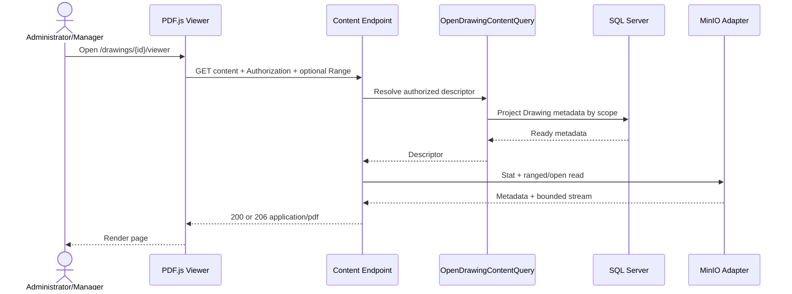
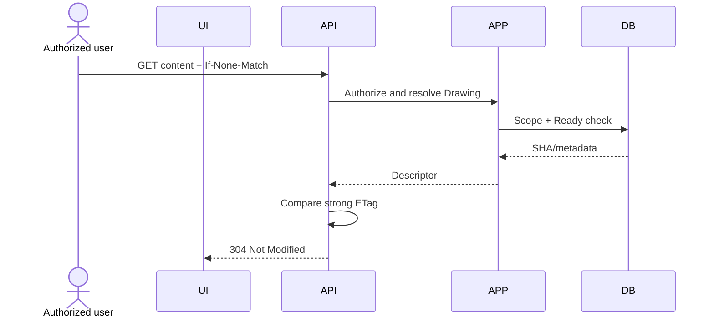
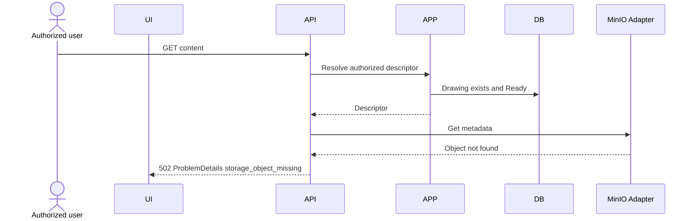

# Thiết kế vertical slice PDF Content và Viewer

## 1. Mục đích và nguồn sự thật

Slice 2 bổ sung khả năng đọc PDF đã upload ở Drawing Slice 1 qua API có xác thực và hiển thị bằng PDF.js:

```text
Drawing Detail
→ Open Viewer
→ API kiểm tra JWT và quyền
→ API đọc private object từ MinIO
→ HTTP 200/206 application/pdf
→ PDF.js render
→ page navigation / zoom / fit / view rotation
```

Nguồn đối chiếu:

- `docs/01-product-scope-and-use-cases.md`: actor, JWT, ProblemDetails và quy tắc 401/403/404.
- `docs/02-erd-and-data-design.md`: SQL Server, audit, rowversion và dữ liệu lịch sử.
- `docs/03-inspection-vertical-slice-design.md`: authorization và transaction/query convention.
- `docs/04-construction-object-vertical-slice-design.md`: role/scope hiện có và DTO convention.
- `docs/05-form-template-vertical-slice-design.md`: không có dependency trực tiếp trong Slice 2.
- `docs/06-drawing-document-and-viewport-design.md`: Drawing Slice 1 đã triển khai tại `d254a22`; Slice 2 không gồm mapping.
- Source Drawing Slice 1: `DrawingDocuments`, `IObjectStorage`, MinIO adapter và frontend login/list/detail hiện hành.

Đây chỉ là tài liệu thiết kế. Lượt này không sửa source, package, migration, database hoặc frontend implementation.

## 2. Phạm vi

### 2.1 Trong Slice 2

- Thêm đúng một backend endpoint: `GET /api/drawings/{id}/content`.
- Chỉ đọc Drawing trạng thái `Ready`.
- Proxy PDF từ private MinIO qua API; không public/presigned URL.
- Hỗ trợ HTTP byte range đủ cho PDF.js tải hiệu quả.
- ETag, conditional request và private cache policy.
- Xử lý metadata tồn tại nhưng object bị thiếu hoặc storage unavailable.
- Frontend route `/drawings/:id/viewer` dùng PDF.js/pdfjs-dist.
- Page navigation, zoom, fit width, fit page và view rotation 0/90/180/270.
- Loading/error/401/403/404/409/502 states, keyboard cơ bản và responsive laptop 1366–1440 px.
- Backend, integration và frontend tests; regression Authentication, Construction Object và Drawing Slice 1.

### 2.2 Ngoài Slice 2

- `DrawingDocumentPage` hoặc persisted page dimensions/rotation.
- `DrawingObjectMapping`, rectangle/circle/polygon hoặc SVG annotation overlay.
- Tạo Construction Object từ bản vẽ, source navigation hoặc legacy mapping.
- OCR/AI recognition, measurement, annotation hoặc collaboration.
- Update/delete/deactivate PDF.
- Multipart S3 upload, browser chunk/resume hoặc public/presigned URL.
- Form Template, Inspection, Checklist hoặc RFI implementation.
- Download audit table, new database table hoặc migration.
- Inspector/Reviewer assignment/scope model.

## 3. Baseline và invariant

- Slice 1 có đúng ba endpoint upload/list/detail; Slice 2 nâng tổng Drawing endpoint lên bốn.
- SQL Server chỉ lưu metadata; PDF binary tiếp tục nằm trong private MinIO bucket.
- `StorageKey` unique và không được trả cho client.
- `Sha256` non-unique; dùng làm strong ETag representation identifier cho chính metadata record/object hiện hành.
- Chỉ `Ready` được stream. `Uploading` và `Failed` không được mở.
- Administrator và Manager được đọc Drawing toàn cục theo interim role policy hiện hành.
- Inspector và Reviewer tiếp tục bị từ chối cho đến khi có assignment/scope model được duyệt.
- GET content không thay đổi Drawing, không tạo transaction database và không sửa trạng thái khi storage lỗi.
- Raw PDF, JWT, storage key, MinIO endpoint và credential không được ghi log.

## 4. Authorization và disclosure boundary

| Actor | Drawing metadata | PDF content/Viewer |
|---|---:|---:|
| Anonymous/invalid token | 401 | 401 |
| Inspector | 403 | 403 |
| Reviewer | 403 | 403 |
| Manager | Có, global read tạm thời | Có, global read tạm thời |
| Administrator | Có | Có |

Thứ tự xử lý bắt buộc:

1. JWT authentication.
2. Role authorization Administrator/Manager.
3. Query Drawing metadata theo scope.
4. Kiểm tra trạng thái `Ready`.
5. Chỉ sau đó mới gọi object storage.
6. Conditional/range processing không được chạy trước authorization.

Quy tắc HTTP:

- Chưa xác thực hoặc token không hợp lệ: `401`.
- Đã xác thực nhưng sai role: `403`.
- ID không tồn tại hoặc resource ngoài scope tương lai: `404`.
- Drawing tồn tại nhưng chưa `Ready`: `409 drawing.not_ready`.
- Object thiếu hoặc MinIO trả upstream/storage failure đã phân loại: `502`.
- Lỗi application/API không dự kiến: `500` generic với trace ID.

Không trả 404 để che trạng thái `Uploading/Failed` cho Administrator/Manager vì hai role đã có quyền xem metadata đó. Nếu resource scope được thêm sau này, scope phải áp dụng trước existence/state để tránh disclosure.

## 5. API contract

### 5.1 `GET /api/drawings/{id}/content`

- Authentication: JWT Bearer.
- Roles: `Administrator`, `Manager`.
- Request body: không có.
- Query string: không có.
- Success:
  - `200 OK` cho full representation.
  - `206 Partial Content` cho một byte range hợp lệ.
  - `304 Not Modified` khi conditional request hợp lệ sau authorization.
- Content-Type: `application/pdf`.
- Content-Disposition: `inline` với filename đã sanitize và encode an toàn.
- `Accept-Ranges: bytes`.
- Không trả StorageKey, MinIO URL hoặc credential trong header/body.

Response header cuối cùng:

```http
Content-Type: application/pdf
Content-Disposition: inline; filename="drawing.pdf"; filename*=UTF-8''drawing.pdf
Accept-Ranges: bytes
ETag: "sha256-lowercase-hex"
Last-Modified: <HTTP-date>
Cache-Control: private, max-age=0, must-revalidate
Content-Length: <full-or-range-length>
```

Với `206` bổ sung:

```http
Content-Range: bytes <start>-<end>/<total-length>
```

### 5.2 Filename an toàn

- Dùng `OriginalFileName` đã basename-normalize từ Slice 1.
- Loại CR/LF, control character và path separator còn sót trước khi dựng header.
- Nếu tên rỗng/không hợp lệ sau sanitize, fallback `drawing-{id}.pdf`.
- Dùng framework typed header hoặc `FileDownloadName`; không nối raw string vào `Content-Disposition`.
- `inline` là presentation hint, không làm PDF public.

### 5.3 ProblemDetails

| HTTP | Stable code | Trường hợp |
|---:|---|---|
| 400 | `validation.failed` | GUID/request header sai shape mà framework phân loại 400. |
| 401 | `authentication.required` | Không có/invalid/expired token. |
| 403 | `authorization.forbidden` | Inspector/Reviewer hoặc role không được phép. |
| 404 | `drawing.not_found` | Drawing không tồn tại hoặc ngoài scope. |
| 409 | `drawing.not_ready` | Status là Uploading hoặc Failed. |
| 416 | `drawing.range_not_satisfiable` | Byte range sai/ngoài file; trả `Content-Range: bytes */<length>`. |
| 500 | `server.unexpected_error` | Lỗi nội bộ không dự kiến; không lộ exception/storage key. |
| 502 | `drawing.storage_object_missing` | SQL metadata tồn tại nhưng object không có. |
| 502 | `drawing.storage_unavailable` | MinIO timeout/upstream/network failure sau khi đã authorize. |

Không gửi ProblemDetails sau khi response body đã bắt đầu. Nếu storage stream fail giữa response, abort connection, log safe failure category + drawing ID + trace ID và để client hiển thị lỗi tải; không cố nối JSON vào PDF response.

## 6. CQRS và layering

### 6.1 Application query

```text
OpenDrawingContentQuery(drawingId)
→ DrawingContentDescriptor
```

`DrawingContentDescriptor` chỉ chứa dữ liệu cần cho transport:

- Drawing ID.
- Private storage key dùng nội bộ server.
- Safe original filename.
- Content type canonical.
- File size từ database.
- SHA-256 ETag source.
- Created timestamp dùng làm Last-Modified fallback.

Handler chịu trách nhiệm:

- Require authenticated Administrator/Manager.
- Query metadata theo scope bằng projection/read service.
- Trả 404 trước khi lộ state nếu ngoài scope.
- Require `Ready`; nếu không trả state conflict.
- Không mở storage stream và không parse Range trong Application handler.

### 6.2 Storage abstraction

Mở rộng `IObjectStorage` bằng contract provider-neutral, không để MinIO type đi vào Application/API:

```text
GetMetadataAsync(key, cancellationToken)
OpenReadAsync(key, offset, length, cancellationToken)
```

Metadata tối thiểu:

- Object length.
- Last modified UTC nếu provider cung cấp.
- Object exists/missing classification.

`OpenReadAsync` phải trả disposable async stream chỉ cho đúng range được yêu cầu; không tải full object vào `byte[]` hoặc `MemoryStream`. MinIO adapter dùng ranged GET/offset-length API của SDK. API chịu trách nhiệm dispose stream khi request hoàn tất/abort.

### 6.3 API transport service

Controller vẫn mỏng:

1. Send `OpenDrawingContentQuery`.
2. Chuyển descriptor + request headers cho một `IDrawingContentResultFactory`/custom `IResult` ở API layer.
3. API layer parse conditional/range headers, mở storage range và ghi response stream.

Range/ETag/Content-Disposition là HTTP transport logic nên không đưa vào Domain. Authorization/state remain trong Application; MinIO implementation remain trong Infrastructure.

Không dùng controller để query DbContext hoặc tự gọi MinIO client trực tiếp.

## 7. Streaming và resource safety

- Không gọi `ReadToEnd`, `ToArray`, `CopyTo MemoryStream` hoặc bind PDF vào `byte[]`.
- Copy bằng bounded buffer, ví dụ 64–128 KiB; không buffer toàn PDF.
- Tôn trọng `HttpContext.RequestAborted` xuyên query, metadata call, ranged GET và copy loop.
- Dispose storage response/stream trong mọi nhánh success, cancellation và exception.
- Set status/headers trước khi copy; không set Content-Length khác số byte thực tế của range.
- Giới hạn file vẫn là 50 MiB từ upload Slice 1; không tạo limit content riêng lớn hơn metadata.
- Nếu object metadata length khác `DrawingDocuments.FileSize`, fail closed `502 drawing.storage_inconsistent` trước khi bắt đầu body và ghi cảnh báo đã redaction.
- Một request chỉ mở tối đa một storage stream.
- Không retry sau khi response headers/body đã bắt đầu. Trước response chỉ cho phép tối đa một bounded retry khi lỗi được phân loại chắc chắn là transient và implementation không tăng scope đáng kể; nếu không chắc chắn thì không retry và chỉ log an toàn.

## 8. HTTP Range design

### 8.1 Phạm vi hỗ trợ

Slice 2 hỗ trợ một byte range mỗi request:

- `bytes=start-end`.
- `bytes=start-`.
- `bytes=-suffixLength`.

PDF.js thường gửi single-range requests. Multipart/byteranges không cần trong Slice 2; request chứa nhiều range trả `416 drawing.multiple_ranges_not_supported` với `Content-Range: bytes */<length>` và không mở storage stream.

### 8.2 Quy tắc normalize

- Không có `Range`: full `200`.
- Start >= length, end < start, suffix <= 0 hoặc syntax sai: `416`.
- End vượt cuối file: clamp về `length - 1` theo HTTP range semantics.
- Suffix lớn hơn file: trả toàn file dưới `206` với start 0.
- Range hợp lệ: `206`, Content-Length = `end - start + 1`.
- Chỉ unit `bytes` được hỗ trợ.

### 8.3 If-Range

- `If-Range` khớp strong ETag hoặc Last-Modified hợp lệ: honor Range.
- Không khớp/weak validator: bỏ qua Range và trả full `200`.
- Authorization/state/storage checks vẫn chạy trước response.

### 8.4 Lý do hỗ trợ ngay Slice 2

- PDF.js có thể cần đọc header/xref/chunk mà không tải lại toàn bộ file.
- File tối đa 50 MiB đủ lớn để full-download mỗi lần gây lãng phí.
- MinIO hỗ trợ ranged object read tự nhiên.
- Hoãn Range sẽ tạo contract tạm thời và phải sửa loader/tests ngay ở slice kế tiếp.

Trade-off là phải tự kiểm tra range semantics, CORS exposed headers, stream disposal và storage offset-length chính xác.

## 9. ETag, Last-Modified và cache

### 9.1 ETag

- Strong ETag dùng quoted lowercase SHA-256, ví dụ `"<64-hex>"`.
- SHA không phải secret nhưng không dùng làm authorization hoặc storage key.
- So sánh `If-None-Match` theo HTTP entity-tag rules, không so chuỗi tùy tiện.
- Authorization và state check xảy ra trước khi trả `304`.

### 9.2 Last-Modified

- Ưu tiên timestamp từ MinIO object metadata.
- Nếu provider không có, dùng Drawing `CreatedAt` đã truncate tới whole seconds cho HTTP-date.
- `If-None-Match` có precedence trên `If-Modified-Since`.
- Không dùng rowversion làm thời gian.

### 9.3 Cache policy

Cache policy đã chốt:

```http
Cache-Control: private, max-age=0, must-revalidate
```

Lý do:

- Cho browser giữ private representation nhưng buộc revalidate trước reuse.
- Revalidation luôn qua JWT/role check; không trả 304 trước authorization.
- Tránh `public` cache hoặc shared proxy lưu PDF.
- Không chọn `no-store` vì sẽ vô hiệu phần lớn lợi ích ETag/range cache, nhưng đây là trade-off bảo mật cần quản lý xác nhận.

Frontend phải destroy PDF.js document và clear in-memory source khi logout. HTTP cache là browser-managed; server không dựa vào frontend cleanup để bảo vệ quyền.

## 10. Missing object và storage failure

### 10.1 Metadata có nhưng object thiếu

- `GetMetadataAsync` map MinIO not-found thành typed `ObjectStorageObjectNotFoundException`.
- API trả `502 drawing.storage_object_missing`, không trả 404 Drawing vì SQL resource vẫn tồn tại.
- Không trả storage key/bucket/endpoint trong ProblemDetails.
- Log drawing ID, trace ID và failure category; storage key chỉ được hash/redact nếu vận hành thật sự cần correlation.
- GET không tự chuyển status sang Failed. Reconciliation/repair là command vận hành riêng ngoài Slice 2.

### 10.2 MinIO unavailable

- Timeout, DNS/network, auth-to-storage hoặc provider 5xx map `502 drawing.storage_unavailable`.
- Client cancellation không map 500/502; dừng copy và kết thúc request.
- Configuration thiếu phải fail fast lúc startup như Slice 1, không fallback filesystem/SQL binary.
- Không retry vô hạn; circuit breaker/rate limiting là production hardening sau khi có số liệu.

### 10.3 Stream fail sau khi response bắt đầu

- Abort response/connection.
- Dispose stream.
- Log safe category + bytes sent + drawing ID + trace ID.
- Frontend hiển thị retry action; không tự loop retry liên tục.

## 11. Frontend route và component boundary

### 11.1 Route

```text
/drawings/:id/viewer
```

Drawing Detail có action “Mở PDF”. Route guard dùng auth state hiện hành cho UX; API vẫn là nguồn authorization.

Page component của Slice 2:

```text
DrawingViewerPage
├─ ViewerHeader (filename, back-to-detail)
├─ PdfToolbar
│  ├─ Previous / Next
│  ├─ Current page / total pages
│  ├─ Zoom out / Zoom in
│  ├─ Fit width / Fit page
│  └─ Rotate view
├─ PdfViewport
└─ ViewerStatus (loading/error/accessibility announcements)
```

Không thêm mapping sidebar, region selection, annotation layer hoặc Object form.

### 11.2 PDF.js worker với Vite

Package/version chỉ được pin sau khi kiểm tra stable/peer compatibility ở lượt implementation. Cấu hình worker của Slice 2:

```ts
import { GlobalWorkerOptions } from 'pdfjs-dist'

GlobalWorkerOptions.workerSrc = new URL(
  'pdfjs-dist/build/pdf.worker.min.mjs',
  import.meta.url,
).toString()
```

Không dùng CDN worker để tránh CSP/version drift. Main package và worker phải cùng version. Production build phải kiểm tra worker asset được emit và không fallback fake worker.

### 11.3 Authenticated loading strategy

Slice 2 dùng PDF.js direct authenticated URL:

```ts
getDocument({
  url: `${apiBaseUrl}/api/drawings/${id}/content`,
  httpHeaders: { Authorization: `Bearer ${token}` },
  withCredentials: false,
  disableRange: false,
  disableStream: false,
  rangeChunkSize: 256 * 1024,
})
```

- JWT ở header, không query string, route state, log hoặc document title.
- Token lấy từ in-memory auth provider hiện hành; không thêm localStorage/sessionStorage chỉ cho Viewer.
- PDF.js built-in network stream quản lý range; chưa cần custom `PDFDataRangeTransport`.
- CORS phải allow `Authorization`, `Range`, `If-Range`, `If-None-Match` và expose `Accept-Ranges`, `Content-Range`, `Content-Length`, `ETag`, `Last-Modified`, `Content-Disposition`.

### 11.4 Không dùng Blob fallback trong Slice 2

Blob URL yêu cầu tải full PDF trước khi PDF.js parse và làm mất lợi ích Range. Slice 2 chỉ dùng direct authenticated API URL với `httpHeaders`. Compatibility spike phải xác nhận strategy này trước implementation frontend.

Nếu spike hoặc runtime test chứng minh direct URL không hoạt động, dừng và báo bằng chứng trước khi bổ sung Blob fallback; không tự chuyển strategy. Khi direct URL hoạt động, production code không được gọi `URL.createObjectURL`/`URL.revokeObjectURL` và không có Blob URL lifecycle cần duy trì.

## 12. Viewer state và interaction

### 12.1 Page navigation

- Page number 1-based trong UI.
- Previous disabled tại page 1; Next disabled tại page cuối.
- Input page nếu có phải clamp/validate 1..pageCount khi commit, không trong từng keystroke.
- Đổi page cancel render task cũ trước khi render page mới.
- Không persist current page lên server và không đưa page vào query string trong Slice 2; page chỉ là component state.

### 12.2 Zoom và fit

Modes:

- Numeric zoom: 25%–400%, bước 25%.
- Fit width: scale theo available viewport width.
- Fit page: min(width scale, height scale).

ResizeObserver tính lại scale khi đang ở fit mode. Numeric zoom không bị tự thay đổi khi resize. Canvas backing store nhân `devicePixelRatio`, còn CSS logical size giữ đúng layout để tránh mờ.

### 12.3 View rotation

- Rotation chỉ là client view state: 0/90/180/270 clockwise.
- Không update Drawing, không migration và không lưu server.
- Khi đổi page, giữ extra rotation trong phiên Viewer; reload route reset 0 trừ khi sau này duyệt URL state.
- Render bằng PDF.js viewport `rotation = (page.rotate + viewRotation) % 360`; không CSS rotate canvas.
- Slice 2 không có mapping nên chưa cần inverse-transform coordinate.

### 12.4 Render lifecycle

- Giữ reference tới `PDFLoadingTask`, `PDFDocumentProxy`, `PDFPageProxy` và `RenderTask`.
- Cancel render task khi page/zoom/rotation thay đổi trước khi bắt đầu render mới.
- Destroy document/loading task khi unmount/logout/drawing ID đổi.
- Ignore expected PDF.js cancellation exception; không nuốt lỗi khác.
- Dùng request sequence/generation ID để response cũ không overwrite state mới.

## 13. Responsive và accessibility

- Layout ưu tiên laptop 1366–1440 px; toolbar wrap có kiểm soát, viewport dùng phần chiều cao còn lại.
- Canvas luôn nằm trong scroll container; không làm toàn page tràn ngang do zoom.
- Mỗi toolbar button có accessible name, tooltip và visible focus.
- Page indicator dùng `aria-live="polite"`; loading/error dùng status/alert phù hợp.
- Keyboard khi focus không nằm trong input/dialog:
  - `PageUp`/`ArrowLeft`: previous page.
  - `PageDown`/`ArrowRight`: next page.
  - `+`/`=` và `-`: zoom.
  - `0`: fit page.
  - `Shift+0`: fit width.
  - `r`: rotate clockwise.
- Không hijack browser shortcuts có Ctrl/Meta/Alt.
- Toolbar dùng semantic button, disabled state thật và target size hợp lý.
- Error state luôn có text, không chỉ màu/icon, và có Retry/Back to detail.

## 14. Error UX

| API/PDF state | UI behavior |
|---|---|
| Initial loading | Skeleton/spinner + “Đang tải PDF”, toolbar disabled. |
| 401 | Clear auth state theo flow hiện hành và điều hướng login; không loop retry. |
| 403 | Trang access denied, link quay lại Drawing list. |
| 404 | Not found state, không tiết lộ storage detail. |
| 409 | “Bản vẽ chưa sẵn sàng để xem”; link quay lại detail/status. |
| 416 | PDF.js request lỗi; hiển thị retry và log client category không có token. |
| 502 missing object | “Không thể lấy tệp từ kho lưu trữ”; retry thủ công/contact admin. |
| 500/502 unavailable | Generic load failure + trace ID nếu ProblemDetails cung cấp. |
| PDF.js parse/render error | “PDF không thể hiển thị”; không show raw exception. |

Frontend không log Authorization header, raw token, PDF bytes, Blob URL hoặc full ProblemDetails chứa nội bộ. Telemetry nếu có chỉ dùng drawing ID, safe category, page number và trace ID.

## 15. Sequence diagrams

### 15.1 Full hoặc ranged load



### 15.2 Conditional request



### 15.3 Missing MinIO object



## 16. Test strategy

### 16.1 Application unit tests

- Anonymous fails before read service/storage.
- Inspector/Reviewer receive forbidden; Administrator/Manager succeed.
- Unknown/out-of-scope Drawing returns not found.
- Uploading/Failed return `drawing.not_ready`; storage is never opened.
- Ready returns descriptor without exposing storage key in DTO/API serialization.

### 16.2 API/streaming tests

- Full GET returns 200, application/pdf, inline safe filename and exact Content-Length.
- Response begins streaming from a guarded/counting stream; test fails if implementation attempts to buffer/read entire stream before response copy.
- Valid ranges: start-end, open-ended và suffix return exact 206 bytes/headers.
- End beyond length clamps correctly.
- Invalid, unsatisfiable and multiple range return 416 without opening content stream.
- `If-Range` match → 206; mismatch → full 200.
- `If-None-Match` match → 304 only after authorization.
- ETag quoting/comparison, Last-Modified precision and private cache headers.
- Stream disposed on success, cancellation and pre-body exception.
- Cancellation stops storage read; no 500 log noise for client abort.
- Filename with quotes, Unicode, CR/LF/path input cannot inject header.
- Object length mismatch returns 502 before body.

### 16.3 Storage adapter integration tests

- Ranged MinIO read returns exactly requested bytes without full buffering.
- Missing object maps typed not-found exception.
- Provider timeout/unavailable maps typed upstream exception.
- Stream/callback disposal works when client cancels.
- Test bucket/config is isolated; never delete Development bucket broadly.

### 16.4 Authorization/error integration tests

- No token 401.
- Inspector/Reviewer 403.
- Administrator/Manager 200/206.
- Unknown ID 404.
- Uploading/Failed 409.
- Metadata exists + missing object 502.
- Unexpected API error 500 generic; no stack/storage key/credential.
- Conditional requests cannot bypass expired/invalid JWT.

### 16.5 Frontend tests

- Route loads filename and PDF.js document with Authorization header, never token in URL.
- Worker configuration resolves emitted Vite asset.
- Loading, 401, 403, 404, 409, 416, 500 và 502 states.
- Previous/Next boundaries and direct page input.
- Zoom min/max/step; fit width/page recompute on resize.
- View rotation cycles 0/90/180/270 and is not persisted server-side.
- Render task cancelled on page/zoom/rotation change and unmount.
- PDF document/loading task destroyed on unmount/logout/ID change.
- Direct URL path không tạo Blob URL; test xác nhận `URL.createObjectURL` không được gọi.
- Keyboard shortcuts ignore input fields/modifier keys and toolbar has accessible names/focus.
- Retry creates one new loading task, không retry loop.

### 16.6 Regression

- Authentication login/current-user.
- Construction Object full suite.
- Drawing Slice 1 upload/list/detail, 50 MiB/PDF validation, duplicate warning và compensation.
- Frontend login/upload/list/detail.
- No new migration or pending EF model changes.

## 17. Observability và security

Structured log fields được phép:

- Trace/correlation ID.
- Drawing ID.
- Actor user ID nếu policy logging hiện hành cho phép.
- Outcome/status code.
- Requested normalized range start/end, bytes sent và elapsed time.
- Safe storage failure category.

Không log:

- Authorization header/JWT.
- Raw PDF hoặc byte sample.
- StorageKey, bucket credential hoặc MinIO URL.
- Connection string.
- Raw provider exception gửi về client.

Các guard bổ sung:

- Response header chống MIME sniffing: `X-Content-Type-Options: nosniff`.
- CSP frontend cho worker `worker-src 'self'`; không dùng CDN.
- Không render embedded HTML; PDF.js text/annotation layer chỉ bật nếu được review, và external link/action phải bị hạn chế.
- Không thực thi embedded JavaScript/launch action.
- Slice 2 không xây per-user/global concurrency counter. Request cancellation và stream disposal là bắt buộc; rate limiting/concurrency cap thuộc production hardening tương lai.

## 18. Implementation order

1. Chạy compatibility spike cho stable `pdfjs-dist`: direct URL + Authorization, range header propagation và Vite worker production build; nếu thất bại thì dừng và báo bằng chứng.
2. Pin phiên bản `pdfjs-dist` stable/peer-compatible đã qua spike.
3. Thêm storage metadata/range abstraction và adapter tests.
4. Thêm `OpenDrawingContentQuery` + authorization/state tests.
5. Thêm API content result, Range/ETag/cache/error integration tests.
6. Thêm PDF.js worker/Vite configuration và Viewer route/components.
7. Thêm frontend interaction/error/accessibility/cleanup tests.
8. Smoke test bằng MinIO private object; kiểm tra 200/206/304/401/403/404/409/416/502.
9. Chạy toàn bộ backend/frontend regression, vulnerability scan, secret/artifact hygiene và `git diff --check`.

Không tạo migration trừ khi implementation review phát hiện nhu cầu thật; theo thiết kế hiện tại không cần migration.

## 19. Architecture Decision Log

| Decision | Options considered | Final choice | Reason | Trade-off | Status |
|---|---|---|---|---|---|
| PDF delivery | API proxy stream; presigned URL; public MinIO URL | API authenticated proxy stream | Giữ JWT/role check trên mọi request, không lộ storage endpoint/credential | API chịu bandwidth và mỗi range chịu auth/storage cost | No — đã chốt trong scope |
| HTTP Range trong Slice 2 | Full response only; single range; multipart ranges | Hỗ trợ single byte range ngay Slice 2 | PDF.js tải hiệu quả, MinIO hỗ trợ ranged GET, tránh contract tạm | Phải tự kiểm thử 206/416/If-Range và disposal | No — đã chốt |
| PDF.js source | Full Blob URL; direct URL + auth headers; custom `PDFDataRangeTransport` | Direct URL + Authorization headers và PDF.js built-in range | Giữ Range, ít custom transport code, token không nằm trong URL | Phụ thuộc CORS/PDF.js behavior và phải spike trước implementation | No — đã chốt |
| Blob fallback | Không fallback; fallback full Blob | Không triển khai mặc định; spike thất bại thì dừng và xin quyết định mới | Tránh full-download/memory overhead và cleanup code thừa | Không có fallback nếu direct strategy lỗi runtime | No — đã chốt |
| ETag source | MinIO ETag; rowversion; SHA-256 | Strong ETag từ SHA-256 | Stable theo bytes, đã có trong SQL, không lệ thuộc multipart-provider ETag | Cần quote/compare đúng; hash lộ được nhưng không phải secret | Final |
| Cache policy | `no-store`; private revalidate; private short max-age | `private, max-age=0, must-revalidate` | Giữ ETag benefit nhưng bắt authorization/revalidation | Browser giữ private bytes | No — đã chốt |
| Last-Modified | Bỏ; CreatedAt; MinIO last-modified | Dùng MinIO timestamp nếu abstraction cung cấp an toàn; fallback CreatedAt và không mở rộng SDK quá mức | Hỗ trợ validator mà giữ scope tối thiểu | Timestamp provider có thể không được dùng nếu abstraction phức tạp | No — đã chốt |
| Missing MinIO object | 404; 409; 500; 502 | 502 `drawing.storage_object_missing` | Drawing tồn tại nhưng upstream representation hỏng/thiếu | Client phải phân biệt resource-not-found và storage inconsistency | No — đã chốt |
| View rotation | Persist server; query string; component state | Client view state 0/90/180/270, không persist | Slice 2 chỉ xem; không cần DB/migration | Reload reset rotation | Final |
| Page state | Component only; query string | Component state trong Slice 2 | Scope nhỏ, tránh URL contract sớm | Deep link page chưa có | No — đã chốt |
| Inspector/Reviewer | Cho global read; assignment scope giả định; deny | Tiếp tục 403 đến khi có scope model | Fail closed, khớp source hiện tại | Demo actor không mở được PDF | No — đã chốt interim |
| Multiple byte ranges | Multipart support; reject | Không hỗ trợ; trả 416 | PDF.js không cần multipart trong use case chính | Một số download client có thể không tương thích | No — đã chốt |
| Concurrent viewer/download | Không giới hạn; app counter; platform rate limiter sau | Không xây counter trong Slice 2; bắt buộc cancellation/disposal, rate limiting là hardening tương lai | Giữ slice nhỏ và tránh limiter semantics chưa có dữ liệu | Chưa có protection chuyên biệt ngoài host/storage limits | No — đã chốt |
| Storage retry | Không retry; bounded pre-body retry; unlimited retry | Tối đa một bounded retry chỉ cho transient chắc chắn trước response; không chắc thì không retry; không retry khi streaming | Tránh duplicate bytes/hanging response | Một số transient failure cần user retry | No — đã chốt |
| Database change | Persist page/view/cache data; không migration | Không migration trong Slice 2 | Metadata hiện có đủ content/viewer | Không deep-link/persist viewer preference | Final |

## 20. Definition of Done cho thiết kế

- Slice 2 chỉ có một content endpoint và một PDF.js Viewer; không có mapping/shape/Object creation.
- Contract 200/206/304/401/403/404/409/416/500/502 rõ ràng.
- Streaming/range không buffer toàn PDF và có cancellation/disposal plan.
- ETag/Last-Modified/private cache authorize trước conditional response.
- Missing object/storage failure không lộ storage detail và không mutate trong GET.
- Viewer có page/zoom/fit/view rotation, responsive/accessibility và cleanup lifecycle.
- JWT không ở URL/log/storage; MinIO vẫn private.
- Test strategy bao phủ streaming, range, auth, missing object, UI controls, direct authenticated URL, resource cleanup và regression.
- ADR nêu rõ mọi quyết định còn cần quản lý xác nhận trước implementation.
- Không có source/package/migration/database/frontend implementation trong lượt thiết kế.
