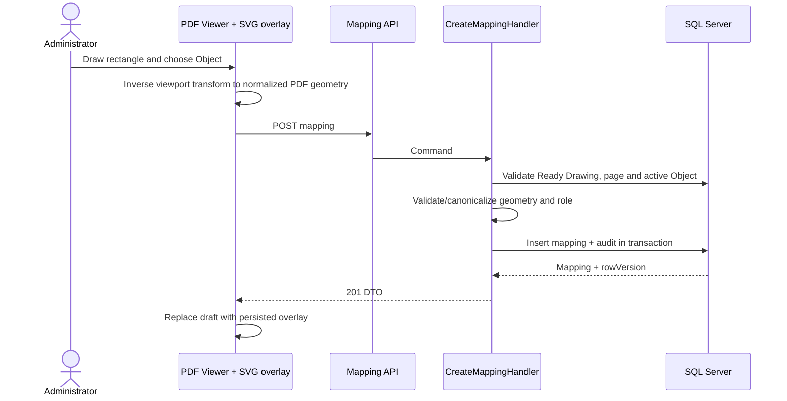
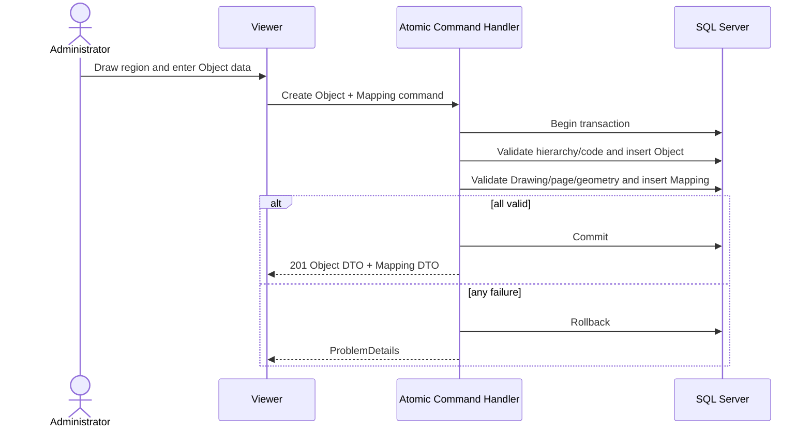
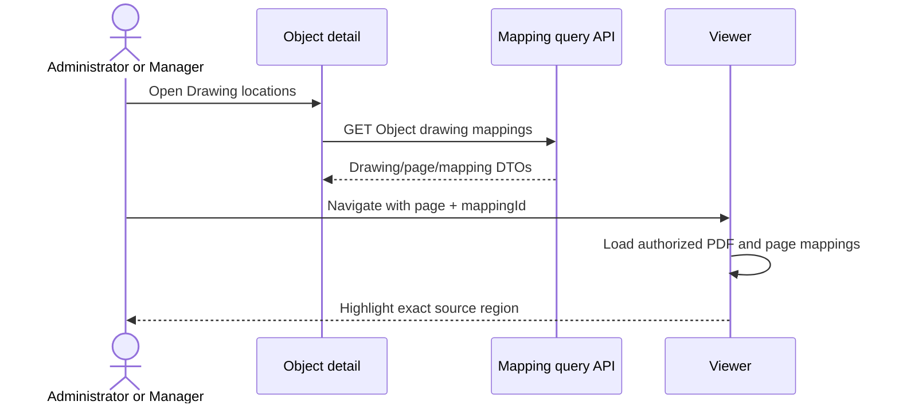

# Thiết kế vertical slice Drawing Object Mapping

## 1. Mục đích và phạm vi

Slice 3 cho phép người dùng có quyền mở Drawing Viewer, chọn một trang PDF, khoanh một vùng hình chữ nhật, liên kết vùng đó với một Construction Object và điều hướng ngược từ Construction Object về đúng Drawing, trang và vùng đã đánh dấu.

Tài liệu này là contract cuối đã được quản lý xác nhận cho Drawing Slice 3.

Phạm vi MVP:

- Chỉ hỗ trợ shape `Rectangle`.
- Lưu tọa độ chuẩn hóa trong không gian trang PDF chuẩn, không lưu pixel canvas.
- Một mapping liên kết đúng một Drawing, một trang và một Construction Object.
- Administrator quản lý mapping; Manager được xem; Inspector và Reviewer tiếp tục bị từ chối cho đến khi có assignment/scope model.
- Administrator có thể tạo Construction Object và mapping trong một transaction SQL duy nhất.
- Mapping được soft-deactivate, không hard delete.
- Không có annotation, comment, OCR, AI recognition, realtime collaboration hoặc public storage URL.

## 2. Baseline và ranh giới với các slice trước

- Drawing Slice 1 đã cung cấp upload/list/detail và metadata `PageCount`, `Status`, `Sha256`.
- Drawing Slice 2 đã cung cấp PDF Viewer và authenticated content endpoint có Range.
- Construction Object đã có hierarchy bắt buộc `Project → Building → Floor → Room → WorkItem`, ObjectType bất biến, rowversion và deactivate.
- Mapping chỉ tham chiếu Drawing đã tồn tại; thao tác mapping không ghi hoặc thay đổi object trong MinIO.
- Content endpoint của Slice 2 không đổi contract và không trả mapping data.
- Slice 3 không mở quyền Drawing cho Inspector/Reviewer khi chưa có assignment/scope model.

## 3. Shape và hệ tọa độ

### 3.1 Shape MVP

Slice 3 chỉ hỗ trợ `Rectangle`.

Rectangle đủ cho use case khoanh vùng phòng, hạng mục hoặc khu vực kiểm tra và cho phép hoàn thiện đầy đủ validation, resize, move, concurrency và accessibility trong một slice. Polygon làm tăng đáng kể độ phức tạp của thao tác điểm, hit-testing, validation self-intersection và accessibility; để lại cho slice sau. Circle và Line cũng ngoài phạm vi.

`ShapeType` vẫn được lưu bằng chuỗi ổn định `Rectangle` để contract có thể mở rộng có chủ đích sau migration/review.

### 3.2 Không gian tọa độ chuẩn

Không lưu pixel viewport. Tọa độ được lưu trong **không gian PDF page chuẩn hóa**, dựa trên page box mà PDF.js dùng cho trang:

- Miền giá trị: `0..1`.
- Origin: góc trái dưới của trang PDF chuẩn.
- Trục X tăng sang phải.
- Trục Y tăng lên trên.
- Không phụ thuộc zoom, device pixel ratio, fit mode, kích thước browser hoặc view rotation.
- Rectangle lưu `Left`, `Bottom`, `Right`, `Top`.
- Server round từng giá trị về 6 chữ số thập phân trước validation, duplicate check và persistence.

Điều kiện:

```text
0 <= Left < Right <= 1
0 <= Bottom < Top <= 1
```

Không đặt minimum size ngoài invariant strict inequality. Rectangle có width hoặc height bằng zero sau khi round bị từ chối.

### 3.3 Contract transformation

Khi người dùng vẽ trên overlay:

1. Chuyển tọa độ pointer từ client space sang CSS pixel của PDF viewport.
2. Dùng `PDFPageViewport.convertToPdfPoint` trên viewport đang render để inverse-transform từng góc về PDF point.
3. Chuẩn hóa PDF point theo page box thành `0..1`.
4. Lấy min/max của bốn góc thành `Left`, `Bottom`, `Right`, `Top`.
5. Client có thể hiển thị preview đã round, nhưng server luôn round lại về 6 chữ số trước validation và persistence.

Khi render mapping:

1. Denormalize bốn góc từ `0..1` về PDF point.
2. Dùng `PDFPageViewport.convertToViewportPoint` của viewport hiện tại.
3. Tính SVG rectangle từ min/max của bốn điểm đã transform.

Viewport rotation phải là:

```text
(page.rotate + viewRotation) % 360
```

Nhờ dùng transform của PDF.js, cùng mapping vẫn đúng khi zoom, fit width, fit page, resize, intrinsic page rotation hoặc view rotation 0/90/180/270.

## 4. Data model đề xuất

### 4.1 Không tạo DrawingDocumentPage

Không cần bảng `DrawingDocumentPage` trong MVP vì Drawing đã có `PageCount`, còn page chưa có metadata/lifecycle riêng. `PageNumber` nằm trực tiếp trên mapping và được kiểm tra `1..DrawingDocument.PageCount`.

Chỉ cân nhắc bảng page trong tương lai nếu cần OCR status, thumbnail, page label, page-level permission hoặc processing lifecycle.

### 4.2 DrawingObjectMapping

| Column | Kiểu | Quy tắc |
|---|---|---|
| `Id` | `uniqueidentifier` | PK, server sinh |
| `DrawingDocumentId` | `uniqueidentifier` | FK `DrawingDocuments`, `ON DELETE NO ACTION` |
| `PageNumber` | `int` | 1-based, bắt buộc |
| `ConstructionObjectId` | `uniqueidentifier` | FK `ConstructionObjects`, `ON DELETE NO ACTION` |
| `ShapeType` | `varchar(20)` | `Rectangle` trong MVP |
| `Left` | `decimal(9,6)` | 0 <= Left < Right |
| `Bottom` | `decimal(9,6)` | 0 <= Bottom < Top |
| `Right` | `decimal(9,6)` | Left < Right <= 1 |
| `Top` | `decimal(9,6)` | Bottom < Top <= 1 |
| `Status` | `varchar(20)` | `Active` khi tạo; sau đó chỉ có thể thành `Inactive` |
| `CreatedAt` | `datetime2` | UTC, bắt buộc |
| `CreatedByUserId` | `uniqueidentifier` | scalar Identity user ID |
| `UpdatedAt` | `datetime2` | nullable trước update đầu |
| `UpdatedByUserId` | `uniqueidentifier` | nullable trước update đầu |
| `DeactivatedAt` | `datetime2` | nullable khi active |
| `DeactivatedByUserId` | `uniqueidentifier` | nullable khi active |
| `RowVersion` | `rowversion` | optimistic concurrency |

Không tạo Domain navigation tới ASP.NET Core Identity.

### 4.3 Typed columns thay cho GeometryJson

MVP dùng typed rectangle columns, không dùng `GeometryJson`:

- Validation và check constraint rõ ràng.
- Không cần JSON parser/schema chỉ để lưu bốn số.
- Dễ tạo DTO, compare duplicate và test bounds.
- Tránh unknown property/shape payload.

Trade-off: thêm Polygon sau này cần migration hoặc một geometry model mới. Không chuyển sớm sang JSON chỉ để dự đoán scope chưa được duyệt.

### 4.4 Quan hệ, duplicate và lifecycle

- Một Construction Object được phép có nhiều mapping trên nhiều Drawing/page/vùng.
- Một mapping chỉ liên kết một Construction Object.
- Các mapping có thể overlap; overlap không đồng nghĩa duplicate.
- Duplicate active mapping được định nghĩa là cùng `DrawingDocumentId`, `PageNumber`, `ConstructionObjectId`, `ShapeType` và cùng bốn giá trị geometry canonical.
- Duplicate active mapping trả `409 drawing_mapping.duplicate`.
- Filtered unique index trên `(DrawingDocumentId, PageNumber, ConstructionObjectId, Left, Bottom, Right, Top)` với `WHERE Status = 'Active'` bảo vệ exact duplicate sau khi round.
- Near duplicate có ít nhất một giá trị canonical khác thì không bị unique rule chặn. Unique index không phát hiện các vùng gần giống nhau.
- Deactivate là soft delete và yêu cầu rowVersion; không có reactivate trong MVP.
- Drawing/Construction Object không cascade-delete mapping.
- Construction Object bị inactive sau khi mapping tồn tại không làm mất mapping. Mapping lịch sử vẫn đọc được với cờ Object inactive, nhưng không được cập nhật/reassign sang một Object inactive.
- Chỉ Drawing `Ready` và Construction Object active được dùng để tạo mapping mới.

### 4.5 Index đề xuất

- `IX_DrawingObjectMappings_DrawingDocumentId_PageNumber_Status` phục vụ overlay theo trang và capacity check.
- `IX_DrawingObjectMappings_ConstructionObjectId_Status` phục vụ source navigation.
- Filtered unique index bảo vệ duplicate active mapping.
- FK đều `NO ACTION`; không cascade xóa lịch sử.

## 5. Authorization

### 5.1 Role matrix

| Capability | Administrator | Manager | Inspector | Reviewer |
|---|---:|---:|---:|---:|
| Xem Drawing/mapping | Có | Có | Không | Không |
| Tạo mapping với Object có sẵn | Có | Không | Không | Không |
| Update geometry | Có | Không | Không | Không |
| Reassign Object | Có | Không | Không | Không |
| Deactivate mapping | Có | Không | Không | Không |
| Tạo Object + mapping | Có | Không | Không | Không |

Đây là lựa chọn fail-closed phù hợp quyền hiện có: Administrator đang là role duy nhất được tạo/cập nhật Construction Object; Manager chỉ đọc Drawing và Construction Object. Việc mở write cho Manager hoặc quyền có scope cho Inspector/Reviewer cần quyết định quản lý và assignment model riêng.

Frontend ẩn capability theo role chỉ để cải thiện UX; API luôn kiểm tra role, Drawing state và Object state.

### 5.2 Visibility khi Object inactive

- Administrator/Manager vẫn thấy mapping lịch sử tới Object inactive và badge `Inactive`.
- Inspector/Reviewer vẫn nhận `403` ở API mapping trong MVP.
- Mapping detail không trả dữ liệu Identity ngoài scalar audit IDs cần thiết.

## 6. API và CQRS contract

Tất cả response dùng DTO; không trả Entity. `rowVersion` là Base64. Geometry response đã canonicalize.

### 6.1 List mappings của một trang

```http
GET /api/drawings/{drawingId}/mappings?pageNumber={pageNumber}
```

- Query: `GetDrawingPageMappingsQuery`.
- Role: Administrator, Manager.
- Trả các active mapping của đúng trang, tối đa 500 item.
- Không gọi MinIO; chỉ đọc SQL bằng `AsNoTracking` và projection.

Response `200`:

```json
{
  "drawingId": "guid",
  "pageNumber": 3,
  "items": [
    {
      "id": "guid",
      "constructionObject": {
        "id": "guid",
        "code": "ROOM-301",
        "name": "Phòng 301",
        "objectType": "Room",
        "isActive": true
      },
      "shapeType": "Rectangle",
      "geometry": { "left": 0.125, "bottom": 0.2, "right": 0.375, "top": 0.35 },
      "rowVersion": "base64"
    }
  ]
}
```

Lỗi:

- `400 drawing_mapping.invalid_page`.
- `401` chưa xác thực.
- `403 authorization.forbidden`.
- `404 drawing.not_found`.
- `409 drawing.not_ready` nếu Drawing tồn tại nhưng không Ready.

### 6.2 Create mapping với Object có sẵn

```http
POST /api/drawings/{drawingId}/mappings
```

- Command: `CreateDrawingObjectMappingCommand`.
- Role: Administrator.
- Transaction: một SQL transaction cho insert mapping.

Request:

```json
{
  "pageNumber": 3,
  "constructionObjectId": "guid",
  "shapeType": "Rectangle",
  "geometry": { "left": 0.125, "bottom": 0.2, "right": 0.375, "top": 0.35 }
}
```

Thành công: `201 Created` với mapping DTO và Location tới resource mapping.

Validation:

- Drawing tồn tại và Ready.
- Page trong `1..PageCount`.
- Object tồn tại và active.
- Shape đúng `Rectangle`; unknown property/type bị từ chối.
- Geometry finite, canonical, đủ kích thước và nằm trong bounds.
- Page chưa đạt maximum active mappings.
- Không trùng active mapping.

Idempotency MVP dựa trên duplicate invariant; retry cùng payload sau khi request đầu đã commit nhận `409 drawing_mapping.duplicate`, không tạo thêm row. Không tuyên bố POST là idempotent và không tự thêm idempotency-key framework trong slice này.

### 6.3 Update geometry hoặc linked Object

```http
PUT /api/drawing-object-mappings/{id}
```

- Command: `UpdateDrawingObjectMappingCommand`.
- Role: Administrator.
- Cho phép move/resize rectangle và reassign sang Object active khác.
- Không cho đổi DrawingDocumentId, PageNumber hoặc ShapeType trong MVP. Muốn chuyển trang phải deactivate và tạo mapping mới để tránh nhầm coordinate context.

Request:

```json
{
  "constructionObjectId": "guid",
  "geometry": { "left": 0.15, "bottom": 0.2, "right": 0.38, "top": 0.37 },
  "rowVersion": "base64"
}
```

Thành công: `200 OK` với rowVersion mới.

Lỗi đặc thù:

- `404 drawing_mapping.not_found`.
- `409 drawing_mapping.inactive`.
- `409 drawing_mapping.concurrency_conflict`.
- `409 construction_object.inactive`.
- `409 drawing_mapping.duplicate`.

### 6.4 Deactivate mapping

```http
POST /api/drawing-object-mappings/{id}/deactivate
```

- Command: `DeactivateDrawingObjectMappingCommand`.
- Role: Administrator.
- Body: `{ "rowVersion": "base64" }`.
- Thành công: `200 OK` với `isActive=false`, audit và rowVersion mới.
- Không hard delete, không reactivate.
- Lặp lại hoặc rowVersion cũ trả `409`.

### 6.5 Source navigation từ Construction Object

```http
GET /api/construction-objects/{constructionObjectId}/drawing-mappings
```

- Query: `GetConstructionObjectDrawingMappingsQuery`.
- Role: Administrator, Manager.
- Pagination mặc định 20, tối đa 100; sort `createdAt desc, id asc`.
- Trả Drawing ID/name/status, page number, geometry, mapping ID và rowVersion.
- Frontend tạo route `/drawings/{drawingId}/viewer?page={pageNumber}&mapping={mappingId}`.
- API không trả JWT, MinIO URL, StorageKey hoặc một frontend absolute URL.

Nếu Mapping/Drawing không còn được phép mở, viewer trả error state thay vì bỏ qua authorization.

### 6.6 Atomic create Construction Object + Mapping

```http
POST /api/drawings/{drawingId}/mappings/with-construction-object
```

- Command: `CreateConstructionObjectWithDrawingMappingCommand`.
- Role: Administrator.
- Request chứa contract tạo Construction Object hiện hành cộng `pageNumber`, `shapeType`, `geometry`.
- Handler tái sử dụng Domain rules/hierarchy validation của Construction Object; không gọi HTTP endpoint nội bộ.
- Tạo Object và Mapping trong cùng một EF/SQL transaction và một `SaveChanges` boundary có kiểm soát.
- Bất kỳ validation/concurrency/database failure nào rollback cả hai; không có compensation MinIO vì không ghi object storage.
- Thành công: `201 Created` trả cả Object DTO và Mapping DTO.
- Duplicate Object Code, invalid hierarchy, invalid page/geometry hoặc page capacity làm toàn transaction thất bại.

## 7. ProblemDetails và status code

| HTTP | Error code tiêu biểu | Ý nghĩa |
|---:|---|---|
| 400 | `drawing_mapping.invalid_geometry` | Geometry/type/payload không hợp lệ |
| 400 | `drawing_mapping.invalid_page` | PageNumber ngoài phạm vi |
| 401 | authentication challenge | Chưa xác thực/token hết hạn |
| 403 | `authorization.forbidden` | Role không có capability |
| 404 | `drawing.not_found` | Drawing không tồn tại/ngoài scope |
| 404 | `drawing_mapping.not_found` | Mapping không tồn tại/ngoài scope |
| 404 | `construction_object.not_found` | Object không tồn tại/ngoài scope |
| 409 | `drawing.not_ready` | Drawing không Ready |
| 409 | `construction_object.inactive` | Object không active cho write mới |
| 409 | `drawing_mapping.duplicate` | Mapping active trùng canonical geometry |
| 409 | `drawing_mapping.inactive` | Mapping đã deactivate |
| 409 | `drawing_mapping.concurrency_conflict` | RowVersion cũ |
| 409 | `drawing_mapping.page_capacity_reached` | Trang đạt giới hạn mapping |

ProblemDetails không chứa StorageKey, MinIO endpoint, provider exception, SQL detail hoặc credential.

## 8. Transaction và consistency

### 8.1 Invariant bắt buộc

- Drawing phải tồn tại và `Ready` khi create mapping.
- `PageNumber` phải nằm trong `1..Drawing.PageCount`.
- Construction Object phải tồn tại và active khi create/reassign.
- Geometry phải finite, canonical, nằm hoàn toàn trong page bounds.
- Mapping update/deactivate phải so khớp rowVersion.
- Duplicate và capacity phải được bảo vệ ở Application và constraint/index phù hợp tại database.
- Audit user lấy từ current authenticated user; thời gian UTC lấy qua `IClock`.

### 8.2 Concurrency

- SQL `rowversion` bảo vệ update geometry, reassign và deactivate.
- API nhận Base64 rowVersion và map `DbUpdateConcurrencyException` thành `409 drawing_mapping.concurrency_conflict`.
- Response thành công luôn trả rowVersion mới để frontend thay state.
- Frontend khi nhận 409 giữ draft geometry cục bộ, tải lại mapping mới và yêu cầu người dùng quyết định; không tự ghi đè.
- Mỗi create mapping và atomic Object + Mapping mở SQL transaction, lấy transaction-owned exclusive `sp_getapplock` theo khóa `DrawingMapping:{drawingId}:{pageNumber}`, rồi mới đếm active mapping và insert. Các create trên cùng Drawing/page được serialize; trang khác không bị khóa chung.
- Capacity check dùng index `(DrawingDocumentId, PageNumber, Status)` và chỉ đếm `Active`. Khi đã có 500 row, trả `409 drawing_mapping.page_capacity_reached` trước insert.
- Filtered unique index vẫn là lớp bảo vệ cuối cho concurrent exact duplicate. Unique violation được map thành `409 drawing_mapping.duplicate`, không trả SQL exception.
- Update trên cùng page không tăng count. Không có reactivate trong MVP.

### 8.3 Atomic Object + Mapping

Construction Object và Mapping cùng ở SQL Server nên dùng local database transaction, không distributed transaction. Transaction không gọi MinIO. Nếu rollback, cả Object và Mapping đều không tồn tại; không có filesystem/object-storage compensation.

## 9. Frontend Viewer integration

### 9.1 Layering

```text
PdfViewport
└─ PageSurface (position: relative; CSS size = PDF viewport)
   ├─ PDF canvas (bitmap backing store dùng devicePixelRatio)
   └─ SVG overlay (absolute inset 0; cùng logical width/height)
```

Chọn SVG thay vì overlay canvas vì Rectangle/handle/hit target dễ thao tác, hỗ trợ focus/ARIA tốt hơn và không cần tự repaint toàn bộ overlay khi selection đổi. PDF vẫn render trên canvas của PDF.js.

### 9.2 Modes

- `View`: xem/highlight/select mapping.
- `Draw rectangle`: pointer down → drag preview → pointer up; chưa ghi server cho đến Save.
- `Edit`: Administrator move/resize mapping đã chọn; Save gửi rowVersion.
- `Cancel`: bỏ draft local và trở về dữ liệu server.

Manager chỉ có `View`. Inspector/Reviewer không tải Viewer/mapping theo scope hiện tại.

### 9.3 Object selector

- Search/lazy-load Construction Object active bằng API hiện hành.
- Hiển thị Code, Name, ObjectType và breadcrumb để tránh chọn nhầm.
- Không tải toàn bộ tree vào browser.
- Chỉ Administrator thấy action “Tạo Construction Object”.
- Modal create Object áp dụng hierarchy tuyến tính hiện hành; Save dùng atomic Object+Mapping endpoint.

### 9.4 Source navigation

Object detail hiển thị danh sách “Vị trí trên Drawing”. Chọn item điều hướng tới:

```text
/drawings/{drawingId}/viewer?page={pageNumber}&mapping={mappingId}
```

Viewer validate page/mapping, chuyển đúng trang, đợi PDF và mapping load xong rồi highlight/scroll vùng vào view. Query string chỉ chứa ID/page, không chứa JWT hoặc storage data.

### 9.5 State và lỗi

- Loading PDF và loading mappings là hai state riêng.
- Empty page: PDF vẫn xem được, overlay báo chưa có mapping.
- Permission/not found/conflict dùng text rõ ràng và action quay lại.
- Save pending khóa nút Save cho cùng draft nhưng không khóa zoom/navigation đọc.
- Chuyển trang khi có draft chưa lưu phải xác nhận Cancel/Stay.
- Không retry save tự động sau 409.
- Mapping API failure không làm PDF content request loop.

### 9.6 Keyboard và accessibility

- Toolbar/control có semantic button, label và visible focus.
- `Escape` hủy drawing/edit draft.
- `Enter` chọn mapping đang focus.
- Overlay item có accessible name gồm Object code/name và page.
- Keyboard shortcut Viewer không chạy khi focus nằm trong input, select, textarea, button, link hoặc dialog; không chiếm Ctrl/Meta/Alt shortcut.
- Drag/resize không phải con đường duy nhất: sidebar edit cung cấp bốn normalized values có validation cho Administrator.
- Layout ưu tiên laptop 1366–1440 px; mapping panel có thể collapse để giữ vùng PDF đủ rộng.

## 10. Performance và giới hạn

- Tối đa **500 active mappings trên một Drawing page** trong MVP.
- List overlay trả toàn bộ mapping của một page để tránh pagination làm thiếu shape; index page bắt buộc.
- Object source list có pagination.
- Chỉ render overlay của trang hiện tại.
- Memoize transformation theo mapping rowVersion + viewport transform.
- Pointer-move chỉ cập nhật draft local qua `requestAnimationFrame`; không gọi API liên tục.
- Không gọi MinIO khi list/create/update/deactivate mapping; MinIO chỉ được content endpoint gọi để render PDF.
- Nếu thực tế cần vượt 500, cần đo browser render/hit-test và thiết kế spatial indexing/virtualization trước khi tăng limit.

## 11. CQRS và kiến trúc

Commands:

- `CreateDrawingObjectMappingCommand`.
- `UpdateDrawingObjectMappingCommand`.
- `DeactivateDrawingObjectMappingCommand`.
- `CreateConstructionObjectWithDrawingMappingCommand`.

Queries:

- `GetDrawingPageMappingsQuery`.
- `GetConstructionObjectDrawingMappingsQuery`.

Controller chỉ bind request và gửi MediatR. Domain giữ invariant geometry/lifecycle thuần; Application kiểm tra authorization, Drawing/Object existence và orchestration; Infrastructure thực thi EF query/repository. Query chỉ `AsNoTracking` và projection DTO.

## 12. Sequence chính

### 12.1 Create mapping với Object có sẵn



### 12.2 Atomic create Object + Mapping



### 12.3 Open source from Object



## 13. Test strategy

### 13.1 Domain unit tests

- Rectangle canonicalization và bounds.
- Reject NaN/Infinity, zero/negative/tiny size và out-of-page geometry.
- Create audit và active state.
- Update/deactivate lifecycle.
- Deactivate lặp bị từ chối.

### 13.2 Application unit tests

- Role matrix cho từng query/command.
- Drawing không Ready, invalid page, Object missing/inactive.
- Duplicate và page capacity.
- Update/reassign/deactivate với rowVersion.
- Atomic Object+Mapping dùng cùng transaction/UoW và rollback khi một phần thất bại.
- Mapping query không gọi object storage.

### 13.3 Integration tests

- FK `NO ACTION`, check constraints, filtered unique index và rowversion.
- List page chỉ trả mapping active đúng Drawing/page.
- Administrator write; Manager read-only; Inspector/Reviewer 403; anonymous 401.
- Hai update cùng rowVersion: một thành công, một 409.
- Soft deactivate bảo toàn row/audit và cho phép tạo lại mapping đã deactivate nếu contract duplicate cho phép.
- Construction Object + Mapping atomic: không để lại orphan khi mapping invalid.
- Deactivate Object/Drawing state change không cascade xóa mapping.
- Không có MinIO call trong metadata mapping API.

Integration fixture tiếp tục dùng database riêng có safety guard; không reset Development database.

### 13.4 Frontend/unit/component tests

- Forward/inverse coordinate transform tại zoom 25%, 100%, 400%; fit width/page; resize và DPR.
- Intrinsic page rotation kết hợp view rotation 0/90/180/270.
- Rectangle overlay giữ đúng vị trí sau page/zoom/rotation change.
- Draw, cancel, save, move, resize và selection.
- Previous/Next boundary và unsaved-draft guard.
- Deep link page/mapping highlight và invalid query state.
- Object selector search, inactive filtering và atomic create flow.
- Keyboard không hijack input/control/modifier; Escape/Enter behavior.
- Loading/empty/401/403/404/409/error states.
- Cleanup pointer listeners, ResizeObserver và render task khi unmount.

### 13.5 Regression

- Authentication login/current user.
- Construction Object hierarchy, immutable ObjectType, update/deactivate concurrency.
- Drawing upload/list/detail, duplicate warning, compensation và authorization.
- Drawing content 200/206/304/416, private cache, cancellation và Viewer controls.
- Không có migration ngoài migration Slice 3 đã được review/cho phép ở lượt implementation.

## 14. Implementation order đề xuất

1. Dùng các ADR đã được quản lý xác nhận trong tài liệu này làm contract cuối.
2. Chốt schema/constraints/index và review migration plan trước khi apply.
3. Viết Domain geometry/lifecycle và unit tests.
4. Viết Application commands/queries/authorization/concurrency tests.
5. Viết EF configuration/repository/query service và migration khi được yêu cầu riêng.
6. Viết API contracts và integration tests.
7. Tách coordinate-transform module thuần TypeScript và test rotation/zoom trước UI.
8. Thêm SVG overlay, modes, Object selector và source navigation.
9. Chạy regression, database review, browser smoke, security/hygiene gate.

## 15. Architecture Decision Log

| Decision | Options considered | Final decision | Reason | Trade-off | Requires manager confirmation? |
|---|---|---|---|---|---|
| Shape MVP | Rectangle; Rectangle + Polygon | Rectangle only | Phạm vi nhỏ nhưng hoàn chỉnh, testable và accessible | Polygon cần slice sau | No |
| Coordinate storage | Viewport pixel; normalized page; raw PDF points | Normalized PDF page coordinates 0..1, origin trái dưới; round 6 decimals | Độc lập zoom/fit/DPR/page size | Cần transform chính xác và rounding contract | No |
| Geometry persistence | GeometryJson; typed columns | `Left/Bottom/Right/Top decimal(9,6)` | Constraint/validation/duplicate rõ ràng | Shape khác sau này cần migration/model mới | No |
| DrawingDocumentPage | Có bảng page; dùng PageNumber trực tiếp | Không tạo bảng page | Page chưa có lifecycle/metadata riêng | Thêm page metadata sau sẽ cần schema mới | No |
| Một Object nhiều mapping | Cấm; cho phép | Cho phép | Một Object có thể xuất hiện nhiều vùng/Drawing | Source list có thể dài, cần pagination | No |
| Một vùng nhiều Object | Nhiều Object trong một row; nhiều row overlap; cấm | Một row chỉ một Object; overlap giữa rows được phép | Model đơn giản, audit/concurrency độc lập | Có thể cần UX cảnh báo vùng trùng | No |
| Duplicate | Chỉ app check; DB unique; cho phép mọi duplicate | App check + filtered unique index trên exact canonical mapping | Chống race, vẫn cho overlap/near duplicate hợp lệ | Near duplicate không bị bắt | No |
| Delete lifecycle | Hard delete; soft deactivate | Soft deactivate, không reactivate | Bảo toàn audit/source history | Cần filter/index active | No |
| Object/Drawing inactive | Cascade delete; deactivate mapping; giữ lịch sử | Giữ mapping; chặn create/reassign tới Object inactive và hiển thị trạng thái hiện tại | Không mất truy vết | UI phải xử lý historical inactive target | No |
| Atomic Object + Mapping | Hai API; orchestration client; một command transaction | Một command/endpoint SQL transaction, Admin only | Không tạo orphan và tái sử dụng Domain rules | Handler phức tạp hơn create riêng | No |
| Authorization gap | Mở global; giả lập assignment; fail closed | Admin write, Manager read, Inspector/Reviewer deny | Khớp quyền hiện có và tránh data leak | Chưa phục vụ field roles cho tới khi có scope | No |
| Mapping update | Immutable; last-write-wins; optimistic concurrency | Cho move/resize/reassign với rowversion; không đổi Drawing/page | Sửa sai mà chống lost update | UI phải xử lý 409/reload | No |
| Rotation | Lưu rotated pixel; lưu view rotation; transform PDF canonical | Không persist view rotation; kết hợp intrinsic rotation và view rotation khi transform | Geometry ổn định qua mọi viewport | Cần test intrinsic + view rotation | No |
| Overlay technology | Canvas; SVG; HTML div | SVG overlay trên PDF canvas | Hit target, resize handle và accessibility tốt | Nhiều shape cần giới hạn/render optimization | No |
| Max mapping/page | Không giới hạn; 200; 500; 1000 | 500 active mappings/page, serialize create theo Drawing/page | Đủ MVP và đặt performance ceiling rõ | Cần quyết định lại nếu bản vẽ dày đặc | No |
| Create idempotency | Idempotency key; duplicate conflict; không guard | Duplicate conflict trong MVP | Không thêm framework/column khi chưa có nhu cầu retry replay | Retry sau commit trả 409 thay vì replay 201 | No |

## 16. Quyết định roadmap sau Slice 3

Sau Drawing Object Mapping, triển khai **Form Template trước, Inspection sau**. Inspection phụ thuộc latest Published Form Template Version nên không bắt đầu Inspection trước khi Form Template implementation ổn định. Quyết định này đã được quản lý xác nhận; không còn câu hỏi ADR mở trong tài liệu này.

## 17. Definition of Done cho thiết kế

- Shape và coordinate contract không phụ thuộc canvas size/zoom/rotation.
- Data model, FK, lifecycle, audit, rowversion, duplicate và capacity rõ ràng.
- Role matrix fail-closed và nêu rõ assignment gap.
- Endpoint tối thiểu có request/response, status/error, transaction và concurrency.
- Atomic Object+Mapping không dùng distributed transaction hoặc MinIO compensation.
- Viewer overlay, edit flow, source navigation, accessibility và performance có contract.
- Test strategy bao phủ geometry, transforms, role, lifecycle, concurrency, atomicity và regression.
- Không có source/package/migration/database implementation trong lượt thiết kế.
