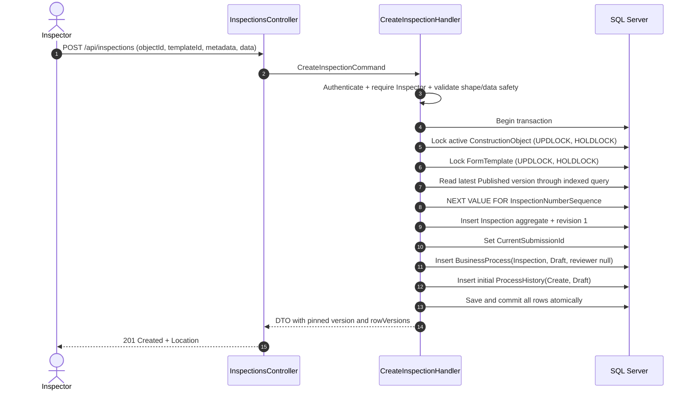
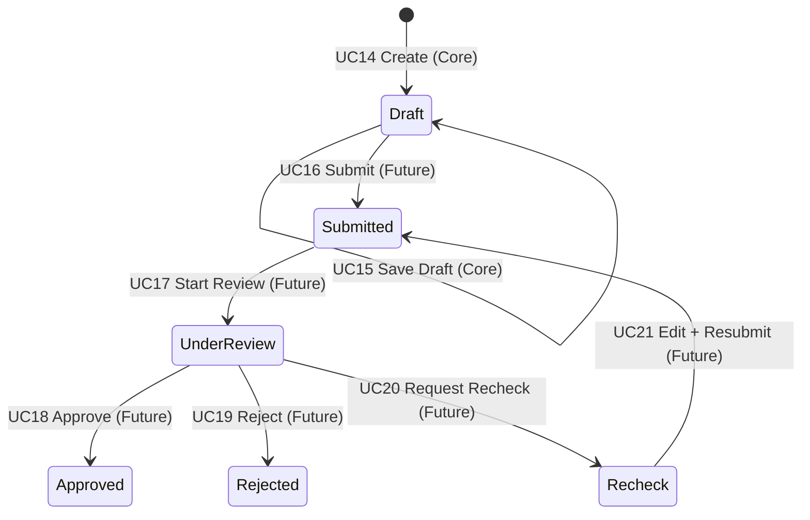
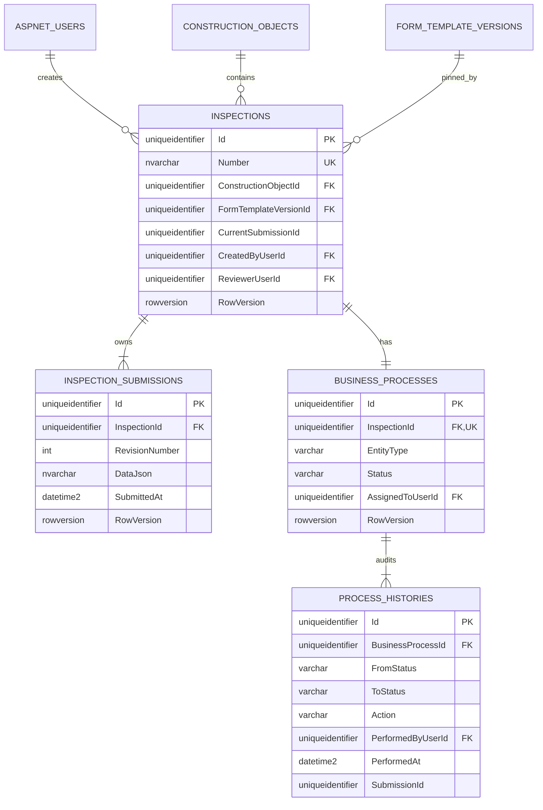

# Thiết kế Inspection Core backend/data

## 1. Trạng thái tài liệu

- Mục tiêu: chốt contract backend/data tối thiểu cho Inspection Core trước khi viết source.
- Nguồn đối chiếu: `docs/01` đến `docs/08`, `AGENTS.md`, `README.md` và source hiện tại của Authentication, Construction Object, Form Template, Drawing Mapping, persistence, ProblemDetails và integration tests.
- Baseline lúc lập tài liệu: `78e571cd15cfccd9de7e0e2715ab1c0e7806a101`.
- Tài liệu này không cho phép tự tạo migration, sửa database, package, source hay frontend.
- Bốn ADR ở cuối tài liệu đã được quản lý chấp nhận; không còn blocker trước implementation.

## 2. Kết luận phạm vi

Inspection Core chỉ bao gồm:

1. UC12 — xem danh sách Inspection.
2. UC13 — xem chi tiết Inspection và current Draft revision.
3. UC14 — tạo Inspection ở trạng thái `Draft` cùng revision 1.
4. UC15 — lưu current Draft revision nhiều lần bằng optimistic concurrency.

Core có đúng bốn endpoint nghiệp vụ UC12–UC15:

| Method | Route | CQRS | Use case |
|---|---|---|---|
| `GET` | `/api/inspections` | `GetInspectionsQuery` | UC12 |
| `GET` | `/api/inspections/{id}` | `GetInspectionDetailQuery` | UC13 |
| `POST` | `/api/inspections` | `CreateInspectionCommand` | UC14 |
| `PUT` | `/api/inspections/{id}/draft` | `SaveInspectionDraftCommand` | UC15 |

Frontend tạo Inspection dùng thêm đúng một support query, không phải use case hay transition mới:

| Method | Route | CQRS | Mục đích |
|---|---|---|---|
| `GET` | `/api/inspections/form-template-options` | `GetFormTemplateOptionsQuery` | Tra cứu template khả dụng cho form tạo Inspection |

Đây không phải Form Template management endpoint và không mở quyền tám management endpoint hiện hữu cho Inspector. Route tĩnh `form-template-options` không xung đột với detail vì route detail giữ constraint `{id:guid}`. Construction Object không có support endpoint mới: Inspector dùng `GET /api/construction-objects` hiện có với `search`, paging và active scope do server áp dụng.

Không nằm trong checkpoint Core:

- Submit, chọn/gán/reassign Reviewer.
- Start Review, Approve, Reject, Recheck hoặc resubmit.
- Process History API, revision-history API và notification.
- SLA, overdue, dashboard hoặc reporting.
- Attachment, file upload hoặc tích hợp MinIO.
- Frontend Inspection.
- Checklist, RFI, Elsa, scheduler hoặc workflow engine.
- Thay đổi Form Template, Construction Object, Drawing hoặc Drawing Mapping.

Không có endpoint delete, deactivate, metadata update hay chọn arbitrary template version. `Title` và `Description` được tạo một lần vì contract hiện tại không định nghĩa command cập nhật hai field này.

## 3. Đối chiếu UC12–UC22

| ID | Tên | Actor theo tài liệu | Tiền điều kiện chính | Input | Transition | Output/API | Authorization | Phạm vi |
|---|---|---|---|---|---|---|---|---|
| UC12 | Xem danh sách | Actor có quyền | Đã xác thực | paging, search, status, object, reviewer, sort | Không | `GET /api/inspections` → page metadata | Áp scope trước projection | **Core** |
| UC13 | Xem chi tiết | Actor liên quan | Inspection trong scope | `id` | Không | `GET /api/inspections/{id}` → metadata + current revision | Ngoài scope trả `404` | **Core** |
| UC14 | Tạo | Inspector | Object active; template active có Published version | object ID, template ID, title, description, data | Tạo `Draft` | `POST /api/inspections` → `201` + detail | Chỉ Inspector, access object | **Core** |
| UC15 | Lưu Draft | Inspector tạo hồ sơ | Owner; `Draft`; revision chưa submit; rowVersion đúng | data + các rowVersion cần thiết | Không đổi status | `PUT /api/inspections/{id}/draft` → current Draft | Chỉ creator | **Core**; nhánh Recheck để future |
| UC16 | Submit | Inspector tạo hồ sơ | Draft/Recheck hợp lệ; data đầy đủ; Reviewer hợp lệ | reviewer ID + rowVersions | `Draft/Recheck → Submitted` | `/submit` | Chỉ creator | Future workflow |
| UC17 | Nhận xử lý | Reviewer được giao | `Submitted` | process rowVersion | `Submitted → UnderReview` | `/start-review` | Assigned Reviewer | Future workflow |
| UC18 | Approve | Reviewer đang xử lý | `UnderReview`; cấm tự duyệt | note + process rowVersion | `UnderReview → Approved` | `/approve` | Assigned Reviewer, not creator | Future workflow |
| UC19 | Reject | Reviewer đang xử lý | `UnderReview`; reason bắt buộc | reason + process rowVersion | `UnderReview → Rejected` | `/reject` | Assigned Reviewer, not creator | Future workflow |
| UC20 | Recheck | Reviewer đang xử lý | `UnderReview`; reason bắt buộc | reason + process rowVersion | `UnderReview → Recheck` | `/recheck` | Assigned Reviewer, not creator | Future workflow |
| UC21 | Chỉnh sửa/gửi lại | Inspector tạo hồ sơ | `Recheck`; current submitted revision bất biến | data, rồi submit request | `Recheck → Submitted` | draft + submit endpoints | Chỉ creator | Future workflow |
| UC22 | Xem lịch sử | Actor liên quan | Inspection trong scope | inspection ID/revision number | Không | history và revision-read APIs | Giống quyền detail | Future workflow |

UC15 trong Core chỉ hỗ trợ `Draft`. Logic “lần sửa đầu sau Recheck tạo revision mới” thuộc UC21 và không được cài sớm trong checkpoint này.

### 3.1 Bảng mâu thuẫn/khoảng trống sau reconciliation

| Chủ đề | Nguồn A | Nguồn B/phạm vi mới | Contract đề xuất | Trạng thái |
|---|---|---|---|---|
| Process khi Create | `docs/01–03`: UC14 tạo BusinessProcess và initial ProcessHistory; status chỉ nằm ở process | Checkpoint Core không triển khai workflow transition/history API | Tạo process + initial history như data foundation, chưa mở workflow/history API | **Accepted — ADR-INS-001** |
| Administrator đọc Inspection | `docs/01`: để ngỏ full content hay metadata/configuration | Quyết định quản lý mới | Administrator được list metadata và đọc full detail/DataJson | **Accepted — ADR-INS-002** |
| Idempotent Create | Docs không có idempotency key | Quyết định quản lý mới | Mỗi POST hợp lệ tạo một Inspection; frontend tương lai chống double submit | **Accepted — ADR-INS-003** |
| Schema snapshot | `docs/02` để ngỏ snapshot | Published version bất biến và không hard delete | Chỉ pin FK `FormTemplateVersionId`, không snapshot | **Accepted — ADR-INS-004** |

Không phát hiện mâu thuẫn về actor Create, input Create, active object/template, version pinning, Reviewer-at-Submit, sequence hoặc Draft revision: các điểm này nhất quán giữa `docs/01–05`.

### 3.2 Đối chiếu source hiện tại

- `ICurrentUser` cung cấp `UserId`, role và `IsInRole`; role chuẩn là Inspector, Reviewer, Manager, Administrator.
- Command/query dùng MediatR, FluentValidation, DTO; Controller hiện tại không chứa business logic.
- Repository ghi dùng SQL Server `UPDLOCK, HOLDLOCK`; `IUnitOfWork` dùng EF execution strategy và local database transaction.
- `rowversion` được API biểu diễn Base64; stale token map `409 Conflict`.
- ProblemDetails hiện map 400/401/403/404/409/413/500 với stable `code` và `traceId`; Inspection phải mở rộng theo cùng pattern.
- Form Template có filtered/indexed latest-version path và Published version bất biến; validator schema hiện hỗ trợ đúng bảy component.
- Construction Object có active/inactive và locking repository; read scope hiện chưa phải Inspection scope.
- Drawing Mapping chỉ cho Administrator/Manager và không phải nguồn tạo Inspection.
- Integration factory chỉ cho phép mutation khi Initial Catalog đúng `ConstructionInspectionIntegrationTestDb`, dùng assembly-level non-parallelization và reset lock trong process.

## 4. Các quyết định cố định

### 4.1 Template resolution và pin version

- Request create nhận `FormTemplateId`; không nhận `FormTemplateVersionId` hoặc version number.
- Server khóa/đọc template, yêu cầu `Active`, rồi lấy Published version có `VersionNumber` lớn nhất.
- Không có Published version thì trả `409 inspection.form_template_unavailable`.
- Không fallback sang Draft hoặc một Published version cũ khi version mới nhất không thể dùng.
- Inspection chỉ lưu FK `FormTemplateVersionId`. Không thêm `FormTemplateId`, vì có thể suy ra qua version và việc lưu cả hai tạo nguy cơ lệch dữ liệu.
- Published version đã bất biến. Publish version mới hoặc deactivate template sau commit không thay đổi version đã pin của Inspection cũ.
- Mọi lần validate và render dữ liệu Inspection phải dùng chính version đã pin, không resolve lại “latest”.

### 4.2 Construction Object

- Request create nhận `ConstructionObjectId`.
- Object phải tồn tại, active và nằm trong access scope của Inspector.
- Một Construction Object có thể có nhiều Inspection; không có duplicate guard theo object/template/title.
- Inactive object chặn Inspection mới nhưng không phá lịch sử Inspection đã tồn tại.
- Không yêu cầu object phải có Drawing Mapping. Docs không định nghĩa FK này và Inspector hiện không có capability đọc Drawing Mapping.

### 4.3 Reviewer

- `ReviewerUserId` luôn `NULL` trong Core.
- Create không nhận Reviewer.
- Reviewer chỉ được chọn tại Submit trong checkpoint workflow sau.
- Reassign chỉ dành cho Manager/Administrator trong Future Workflow và luôn phải append Process History.

### 4.4 Inspection Number

- Format: `INS-{UTC_YEAR}-{SEQUENCE}`, ví dụ `INS-2026-000001`.
- Dùng một SQL Server sequence toàn hệ thống, đề xuất tên `InspectionNumberSequence`, kiểu `bigint`, bắt đầu từ 1, tăng 1.
- Sequence không reset theo năm. Phần số được pad tối thiểu sáu chữ số; giá trị lớn hơn sáu chữ số không bị cắt.
- Năm lấy từ cùng một `IClock.UtcNow` dùng cho audit của Create.
- Không nhận number từ client và tuyệt đối không dùng `MAX + 1`.
- Có unique index trên `Inspections.Number`.
- Gap do rollback, retry hoặc request lỗi được chấp nhận; không tái sử dụng số.

### 4.5 Idempotency và duplicate

ADR-INS-003 chấp nhận MVP không có idempotency key hoặc business uniqueness ngoài `Number`. Vì vậy:

- Hai request create hợp lệ tạo hai Inspection độc lập, kể cả payload giống nhau.
- Retry ở client sau timeout có thể tạo duplicate business record.
- Không tự thêm unique constraint theo object/template/title/data.
- Frontend ở phase tương lai phải disable submit trong lúc request đang chạy và chống double click; đây là UX mitigation, không thay đổi server contract.
- Đây là accepted MVP tradeoff, không phải missing implementation hoặc blocker.

## 5. Mô hình Domain đề xuất

### 5.1 Aggregate `Inspection`

`Inspection` là aggregate root chịu trách nhiệm:

- identity, number, object và pinned template version;
- metadata bất biến trong Core;
- creator/audit;
- con trỏ tới current submission;
- bảo đảm chỉ owner được sửa Draft và current revision thuộc chính Inspection.

Field theo contract hiện có:

| Field | Kiểu | Null | Quy tắc |
|---|---|---:|---|
| `Id` | `Guid` | Không | PK, server sinh |
| `Number` | `string` | Không | max 50, unique, server sinh |
| `ConstructionObjectId` | `Guid` | Không | FK `NoAction` |
| `FormTemplateVersionId` | `Guid` | Không | FK `NoAction`, bất biến |
| `Title` | `string` | Không | trim, 1–250 ký tự |
| `Description` | `string?` | Có | trim; empty thành null; max 2.000 |
| `CreatedByUserId` | `Guid` | Không | creator/owner, FK `NoAction` |
| `ReviewerUserId` | `Guid?` | Có | Core luôn null |
| `CurrentSubmissionId` | `Guid?` ở storage | Tạm thời | phải có trước commit Create |
| `CreatedAt` | `DateTime` | Không | UTC |
| `UpdatedAt` | `DateTime?` | Có | UTC khi Draft được lưu |
| `RowVersion` | `byte[]` | Không | SQL `rowversion` |

Không tự thêm `UpdatedByUserId`: ERD hiện tại không định nghĩa field này. Trong Core, chỉ creator được update nên actor có thể suy từ `CreatedByUserId`; nếu audit yêu cầu actor từng lần lưu thì cần quyết định schema riêng.

### 5.2 Entity `InspectionSubmission`

Revision 1 được tạo cùng Inspection và là revision duy nhất trong Core.

| Field | Kiểu | Null | Quy tắc |
|---|---|---:|---|
| `Id` | `Guid` | Không | PK |
| `InspectionId` | `Guid` | Không | FK `NoAction` |
| `RevisionNumber` | `int` | Không | Core luôn 1; `> 0` |
| `DataJson` | `string` | Không | JSON object canonical, tối đa 2 MiB UTF-8 |
| `CreatedByUserId` | `Guid` | Không | creator, FK `NoAction` |
| `CreatedAt` | `DateTime` | Không | UTC |
| `UpdatedAt` | `DateTime?` | Có | UTC khi Save Draft |
| `SubmittedAt` | `DateTime?` | Có | Core luôn null |
| `RowVersion` | `byte[]` | Không | SQL `rowversion` |

Invariant:

- Unique `(InspectionId, RevisionNumber)`.
- `CurrentSubmissionId` phải trỏ tới submission của chính Inspection.
- Submission có `SubmittedAt` không được sửa; dù Core chưa có Submit, invariant phải nằm trong Domain để không tạo nợ kỹ thuật.
- Không hard delete Inspection hoặc submission.

### 5.3 `BusinessProcess` và `ProcessHistory` — Accepted

`BusinessProcesses.Status` là nguồn sự thật duy nhất cho trạng thái Inspection. Core tạo data foundation ngay để giữ atomic contract UC14 và tránh thêm `Inspections.Status` tạm rồi backfill/xóa ở workflow sau.

Khi Create thành công:

- Có đúng một `BusinessProcess` cho Inspection, `EntityType = Inspection`, `Status = Draft`.
- `AssignedToUserId`/Reviewer là null; `DueAt`, `CompletedAt` và `UpdatedAt` đều null.
- Có một initial `ProcessHistory`: `FromStatus = NULL`, `ToStatus = Draft`, `Action = Create`, actor và UTC timestamp trùng với actor/time của Create.
- Initial history tham chiếu BusinessProcess và revision 1 qua `SubmissionId`.
- Process history là append-only: application không cung cấp update/delete method hoặc API; database dùng `NoAction`, không cascade delete.
- Core không có transition API, notification, SLA, history-read API, Elsa hoặc workflow engine.
- Save Draft không append history vì không có status transition.

`BusinessProcess` tối thiểu cho Inspection Core:

| Field | Kiểu | Null | Quy tắc |
|---|---|---:|---|
| `Id` | `Guid` | Không | PK |
| `InspectionId` | `Guid` | Không | FK trực tiếp tới Inspection, unique, `NoAction` |
| `EntityType` | enum/string | Không | `Inspection` |
| `Status` | enum/string | Không | Core chỉ `Draft` |
| `AssignedToUserId` | `Guid?` | Có | null tại Create |
| `CreatedByUserId` | `Guid` | Không | actor tạo Inspection |
| `CreatedAt` | `DateTime` | Không | UTC |
| `UpdatedAt` | `DateTime?` | Có | null tại Create |
| `DueAt` | `DateTime?` | Có | null trước Submit |
| `CompletedAt` | `DateTime?` | Có | null trước terminal state |
| `RowVersion` | `byte[]` | Không | SQL `rowversion` |

`ProcessHistory` dùng đúng các field đã có trong `docs/02`: `Id`, `BusinessProcessId`, `FromStatus`, `ToStatus`, `Action`, `Note`, `PerformedByUserId`, `PerformedAt`, `SubmissionId`. Không thêm audit/update/delete fields cho record bất biến.

## 6. Ràng buộc và index database

### 6.1 `Inspections`

- PK `Id`.
- UQ `UX_Inspections_Number(Number)`.
- Index `IX_Inspections_ConstructionObjectId_CreatedAt(ConstructionObjectId, CreatedAt DESC)`.
- Index `IX_Inspections_CreatedByUserId_CreatedAt(CreatedByUserId, CreatedAt DESC)`.
- Index `IX_Inspections_ReviewerUserId_CreatedAt(ReviewerUserId, CreatedAt DESC)` để sẵn cho workflow; reviewer null trong Core.
- Index `IX_Inspections_FormTemplateVersionId(FormTemplateVersionId)`.
- FKs tới object, version và Identity users đều `NoAction`.
- `RowVersion` là concurrency token.

### 6.2 `InspectionSubmissions`

- PK `Id`.
- UQ `UX_InspectionSubmissions_InspectionId_RevisionNumber`.
- Index `(InspectionId, RevisionNumber DESC)` include `SubmittedAt` nếu execution plan cho thấy cần.
- `CHECK (RevisionNumber > 0)`.
- `CHECK (ISJSON(DataJson) = 1)`.
- FK `InspectionId` và audit user dùng `NoAction`.
- `RowVersion` là concurrency token.

### 6.3 Current submission circular reference

SQL Server không có deferred FK. Trình tự create hợp lệ là:

1. Tạo `Inspection` với storage value `CurrentSubmissionId = NULL`.
2. Tạo revision 1 tham chiếu Inspection.
3. Gán `Inspection.CurrentSubmissionId = revision.Id`.
4. Save trong cùng transaction và không commit nếu pointer còn null.

Physical FK `Inspections.CurrentSubmissionId → InspectionSubmissions.Id` bảo đảm submission tồn tại, nhưng không tự chứng minh submission đó thuộc cùng Inspection. Application/domain phải kiểm tra invariant này. Không dùng cascade delete.

### 6.4 Process tables

- UQ `BusinessProcesses(InspectionId)` bảo đảm quan hệ một-một với Inspection.
- FK `BusinessProcesses.InspectionId → Inspections.Id` dùng `NoAction`.
- Check `(EntityType, Status)` chỉ chấp nhận cặp `Inspection/Draft` trong Core; mở rộng có review khi workflow được triển khai.
- `AssignedToUserId IS NULL`, `DueAt IS NULL`, `CompletedAt IS NULL` tại Create được bảo vệ ở Domain/Application; Reviewer chỉ được gán khi Submit future.
- `ProcessHistories.BusinessProcessId` và các FK actor/submission dùng `NoAction`.
- `ProcessHistories` append-only, index `(BusinessProcessId, PerformedAt, Id)`; không hard delete hoặc update history.

## 7. Create transaction và xử lý race

Transaction boundary bắt buộc:

1. Xác thực và authorize actor là Inspector.
2. Validate Construction Object tồn tại trong scope.
3. Mở SQL transaction, lock object và revalidate active state.
4. Lock/validate Form Template đang Active.
5. Resolve latest Published version server-side; không fallback.
6. Cấp number bằng `NEXT VALUE FOR InspectionNumberSequence`.
7. Insert Inspection aggregate, gồm revision 1 và current pointer.
8. Insert BusinessProcess ở `EntityType = Inspection`, `Status = Draft`, Reviewer null.
9. Insert initial ProcessHistory với actor/audit chính xác.
10. Commit toàn bộ SQL rows; lỗi ở bất kỳ insert nào rollback tất cả.
11. Project và trả response DTO sau commit.



Lock order bắt buộc trong mọi code path liên quan: Construction Object → Form Template → selected Form Template Version → Inspection. Các handler deactivate/publish hiện có đã khóa aggregate root; Inspection Create phải giữ template lock cho tới commit để serialize với Publish/Deactivate.

Transaction chỉ chứa SQL work. Inspection aggregate (gồm revision 1), BusinessProcess Draft và initial ProcessHistory cùng commit hoặc cùng rollback. Không gọi external service, MinIO hoặc object storage khi transaction đang mở.

Race semantics:

- Create và deactivate object/template: request lấy lock trước là linearization point; request sau re-read state dưới lock. Create không được commit với state inactive đã thắng trước đó.
- Create và publish version mới: nếu Create giữ template lock trước, nó pin latest Published tại thời điểm đó; publish mới có hiệu lực cho Create sau. Nếu Publish commit trước, Create phải pin version mới.
- Không đọc latest Published ngoài transaction rồi dùng lại trong transaction.
- Query latest dùng index `(FormTemplateId, Status, VersionNumber DESC)` và `TOP(1) ORDER BY VersionNumber DESC`.
- SQL execution-strategy retry có thể tiêu thụ thêm sequence values; gap được chấp nhận.
- Tất cả thay đổi là một local SQL transaction. Không có MinIO call và không mô tả distributed transaction.

## 8. Save Draft transaction

1. Authenticate và yêu cầu role Inspector.
2. Trong transaction, khóa Inspection rồi current submission theo thứ tự ổn định.
3. Áp scope/ownership trước khi trả dữ liệu; actor ngoài scope nhận `404`, actor thấy resource nhưng không được action nhận `403` theo policy đã chốt.
4. Yêu cầu status `Draft` và `SubmittedAt IS NULL`.
5. Decode và so khớp `inspectionRowVersion`, `submissionRowVersion` và `processRowVersion` như contract `docs/03`.
6. Parse/canonicalize `data`, kiểm tra safety validation.
7. Update `DataJson`, `Inspection.UpdatedAt` và `Submission.UpdatedAt` bằng cùng UTC timestamp.
8. Save và commit; `DbUpdateConcurrencyException` map thành `409 inspection.concurrency_conflict`.

Core không tạo revision mới ở Save Draft. Nhánh tạo revision N+1 chỉ được thêm cùng UC20/UC21.

## 9. FormIO `DataJson`

### 9.1 Reuse schema validation

Source hiện có `IFormIoSchemaValidator`/`FormIoSchemaValidator` xác thực và canonicalize bảy component của Published schema. Inspection không copy hoặc fork allowlist này.

Thiết kế Application bổ sung abstraction `IFormIoDataValidator` nhận:

- pinned `SchemaJson`;
- request `data` ở dạng JSON object;
- validation mode `Draft` hoặc `Submit`.

Parser/model schema dùng chung với validator Form Template phải được tách ở mức nhỏ nhất để hai validator hiểu cùng component/type/options; không đưa EF/HTTP vào validator.

### 9.2 Safety validation áp dụng ngay ở Draft

- Root bắt buộc là JSON object.
- JSON hợp lệ, không comment/trailing comma và giới hạn depth 16.
- Serialized canonical JSON tối đa 2.097.152 UTF-8 bytes; không dùng số ký tự .NET để đo size.
- Reject duplicate property name không phân biệt hoa thường.
- Reject key không tồn tại trong pinned schema; key phải khớp canonical schema key.
- Reject object/nested payload, file, base64 file, data URL, script/executable expression hoặc arbitrary HTML.
- Chỉ nhận JSON primitive/array phù hợp loại component.
- Canonicalize bằng `System.Text.Json` trước persistence; database vẫn có `ISJSON`.

### 9.3 Type validation

| Component | Data value cho phép |
|---|---|
| Text Field, Text Area | string; giới hạn `minLength/maxLength` chỉ bắt buộc đầy đủ ở Submit |
| Number | finite JSON number; integer/min/max theo schema |
| Select single | primitive nằm trong static `data.values` |
| Select multiple | array primitive, mỗi giá trị nằm trong static options; không duplicate |
| Radio | string/value nằm trong static `values` |
| Checkbox | boolean |
| Date/Time | ISO 8601 string phù hợp config enableDate/enableTime và min/max |

Draft được phép thiếu required field và để value null/empty để hỗ trợ nhập dở. Nếu một field đã có non-null value thì kiểu, option allowlist và giới hạn an toàn vẫn phải hợp lệ. Submit trong future checkpoint mới yêu cầu đầy đủ `required` và toàn bộ semantic validation.

Không snapshot `SchemaJson` vào Inspection/Submission. Published version bất biến, không được update/delete, FK dùng `NoAction` và pinned `FormTemplateVersionId` đã đủ làm audit source. Cách này tránh duplicate schema data và nguy cơ snapshot lệch version. Save Draft luôn load schema qua chính pinned FK; không resolve latest version lại cho Inspection cũ.

## 10. State boundary



Core chỉ triển khai node `Draft` và self-transition Save. Không tạo “placeholder” transition handlers cho future states.

## 11. ER boundary



Reviewer/`AssignedToUserId` là null tại Create. Không có FK tới Drawing Mapping hoặc bảng `DrawingDocumentPage`.

## 12. Authorization matrix

Các rule chắc chắn từ tài liệu:

- Anonymous: `401` cho mọi endpoint.
- Create: chỉ Inspector.
- Save Draft: chỉ Inspector đã tạo Inspection.
- Reviewer chưa được gán trước Submit, nên không có Draft assignment trong Core.
- Access scope phải được áp dụng trước projection; resource hoàn toàn ngoài scope trả `404`.

Matrix authorization cuối:

| Capability | Anonymous | Inspector | Reviewer | Manager | Administrator |
|---|---|---|---|---|---|
| Create | `401` | Có, object active trong scope | `403` | `403` | `403` |
| Save Draft | `401` | Có, chỉ own Draft | `403` | `403` | `403` |
| List | `401` | Own Inspection | Chỉ assigned; Core chưa có assigned Draft nên kết quả không chứa Draft | Tất cả trong scope quản lý hiện hành | Tất cả Inspection; list chỉ metadata |
| Detail/DataJson | `401` | Own Inspection | Chỉ assigned; Core chưa có assigned Draft nên ngoài scope trả `404` | Tất cả trong scope quản lý hiện hành | Full detail và DataJson |
| Read history | `401` | Không có endpoint Core | Không có endpoint Core | Không có endpoint Core | Không có endpoint Core |
| Form Template creation options | `401` | Có | `403` | `403` | `403` |

`docs/01` nói Manager xem dữ liệu trong phạm vi quản lý; MVP chưa có object-assignment table nên phạm vi Manager hiện là toàn bộ Construction Objects. Administrator được phép list và đọc full detail/DataJson theo ADR-INS-002. List DTO không trả DataJson; detail DTO mới trả DataJson. Không log DataJson và không đưa DataJson vào URL. Backend authorization là lớp bảo vệ cuối.

Sau Submit, Reviewer chỉ thấy assigned Inspection; reassign và quyền Manager/Administrator thuộc workflow future.

## 13. API contract Core

### 13.1 `POST /api/inspections`

Role: Inspector.

Request:

```json
{
  "constructionObjectId": "cbab6f5d-0e7d-41ca-8510-fd8d00ea26e2",
  "formTemplateId": "c39c58e4-745a-4cef-b5e2-aa0b52809a02",
  "title": "Kiểm tra an toàn điện phòng 301",
  "description": "Kiểm tra trước nghiệm thu",
  "data": {}
}
```

Không chấp nhận `number`, `formTemplateVersionId`, `versionNumber`, `reviewerUserId`, `status` hoặc audit field từ client.

Thành công: `201 Created`, `Location: /api/inspections/{id}` và detail DTO. Response gồm pinned template/version metadata cần render, current revision 1, status Draft và rowVersions. Schema có thể được trả trong detail theo mục 13.4 để frontend tương lai không phải gọi management API Administrator-only.

### 13.2 `PUT /api/inspections/{id}/draft`

Role: creator Inspector.

Request:

```json
{
  "data": {
    "mainBreakerLabelled": true
  },
  "inspectionRowVersion": "AAAAAAAAB9A=",
  "submissionRowVersion": "AAAAAAAAB9E=",
  "processRowVersion": "AAAAAAAAB9I="
}
```

Thành công: `200 OK`, trả current revision data, `updatedAt` và toàn bộ rowVersion mới. Không tự retry khi conflict.

### 13.3 `GET /api/inspections`

Query:

- `pageNumber` mặc định 1.
- `pageSize` mặc định 20, tối đa 100.
- `search` trên normalized Number/Title.
- `status`, `constructionObjectId`, `reviewerUserId` giữ contract chung; trong Core status chỉ `Draft`, reviewer filter chỉ có null nên UI chưa cần dùng.
- `sortBy`: `number`, `title`, `status`, `createdAt`, `updatedAt`.
- `sortDirection`: `asc|desc`.

Query dùng `AsNoTracking`, filter scope trước, whitelist sort, tie-breaker `Id`, count sau filter và projection trực tiếp DTO. List không trả `DataJson` hoặc `SchemaJson`.

### 13.4 `GET /api/inspections/{id}`

Trả:

- Inspection ID/number/title/description/status.
- Construction Object summary.
- Form Template ID/code/name cùng pinned version ID/number.
- Pinned `SchemaJson` và current `DataJson` để client render đúng lịch sử.
- creator summary; Reviewer null trong Core.
- current revision number/timestamps.
- `inspectionRowVersion`, `submissionRowVersion` và `processRowVersion` nếu process thuộc Core.
- capability flags có thể được projection từ server, nhưng không thay thế authorization ở command.

Không trả entity graph, Identity internals, template Draft, version khác, Process History hoặc revision cũ trong Core.

### 13.5 `GET /api/inspections/form-template-options`

Role: chỉ Inspector. Anonymous nhận `401`; Reviewer, Manager và Administrator nhận `403`.

Query:

- `pageNumber` mặc định 1.
- `pageSize` mặc định 20, tối đa 100.
- `search` tùy chọn trên `Code` hoặc `Name`, tối đa 250 ký tự.

Response là `PagedResult` và mỗi item chỉ có `formTemplateId`, `code`, `name`, `latestPublishedVersionNumber`. Query chỉ trả template `Active` có ít nhất một version `Published`; Draft-only và template Inactive bị loại. Version number là Published lớn nhất, không lấy Draft và không cho client chọn version cũ. Query dùng `AsNoTracking`, một projection SQL không N+1, thứ tự ổn định `Name`, `Code`, `Id`, paging và truyền `CancellationToken` tới EF Core. Không trả `SchemaJson`, DataJson, Draft, rowVersion, audit hoặc version history.

### 13.6 Cancellation và response chung

- Cả bốn endpoint nghiệp vụ và support query nhận `CancellationToken` từ ASP.NET Core và truyền xuyên Controller → MediatR → repository/read service → EF Core.
- Query/list/detail dừng ngay khi request bị hủy; không retry ở Application.
- Command chỉ rollback trước commit. Nếu client ngắt kết nối sau commit, dữ liệu đã commit vẫn là kết quả chuẩn; client phải GET để đối soát, không tự POST lại vì contract chưa idempotent.
- `OperationCanceledException` do request abort không được đổi thành business ProblemDetails 500 và không log như lỗi server nghiêm trọng.
- Success JSON dùng camelCase, UUID canonical, timestamp ISO 8601 UTC `Z`; mọi response update trả rowVersion mới.

## 14. Error contract

Giữ `application/problem+json`, `traceId` và exception mapping hiện tại. Không lộ stack trace, SQL, JWT hoặc secret.

| HTTP | Code đề xuất | Trường hợp |
|---:|---|---|
| 400 | `validation.failed` | body/query/rowVersion format sai |
| 400 | `inspection.form_data_invalid` | JSON/type/key/option/date không hợp lệ |
| 413 | `inspection.form_data_too_large` | canonical DataJson vượt 2 MiB UTF-8 |
| 401 | auth middleware | thiếu/sai token |
| 403 | `authorization.forbidden` | role/action không được phép trên resource nhìn thấy |
| 404 | `inspection.not_found` | không tồn tại hoặc ngoài read scope |
| 404 | `construction_object.not_found` | object không tồn tại/ngoài create scope |
| 404 | `form_template.not_found` | template ID không tồn tại |
| 409 | `inspection.construction_object_inactive` | object đã inactive |
| 409 | `inspection.form_template_unavailable` | template inactive hoặc không có latest Published usable |
| 409 | `inspection.invalid_state` | Save khi không còn Draft |
| 409 | `inspection.revision_immutable` | revision đã submit |
| 409 | `inspection.concurrency_conflict` | bất kỳ rowVersion stale/DB concurrency |
| 500 | generic | lỗi ngoài dự kiến |

Việc trả `404` hay `409` cho template inactive phải thống nhất ở code. Contract Inspection hiện nói unavailable `409`; giữ mã đó để không tiết lộ version lifecycle và khác biệt với template không tồn tại.

## 15. Mapping theo kiến trúc hiện tại

### Domain

- `Inspection`, `InspectionSubmission`, rules/exceptions.
- Không phụ thuộc EF Core, MediatR, Identity, JSON HTTP hoặc Infrastructure.
- State transition future không được cài trong Controller.

### Application

- Commands/queries, validators, handlers, DTO/projection criteria.
- `IInspectionRepository`, `IInspectionReadService`, sequence abstraction và `IFormIoDataValidator`.
- Authorization dùng `ICurrentUser` và `ApplicationRoles` hiện có.
- Transaction qua `IUnitOfWork`; clock qua `IClock`.

### Infrastructure

- EF configurations, repository locks, read service và SQL sequence allocation.
- `ApplicationDbContext` DbSets.
- Map unique/concurrency exceptions thành stable ConflictException codes.
- Không gọi MinIO hoặc Drawing services.

### API

- `InspectionsController` chỉ model binding, response status/Location và `ISender`.
- `[Authorize]` làm coarse gate; ownership/scope nằm ở Application.
- Không trả Entity trực tiếp.

## 16. Test strategy

### 16.1 Domain unit tests

- Create chuẩn hóa metadata và giữ pinned IDs.
- Invalid ID/title/description/actor bị từ chối.
- Revision 1 đúng owner, UTC audit và chưa submit.
- BusinessProcess ban đầu đúng `Inspection/Draft`, Reviewer/assignee null.
- Initial ProcessHistory đúng `FromStatus=NULL`, `ToStatus=Draft`, action, actor, submission và UTC audit.
- ProcessHistory không có update/delete behavior và không thể thay đổi sau create.
- Current submission thuộc đúng Inspection.
- Save Draft chỉ khi mutable; submitted revision bất biến.
- Không có hard-delete behavior.
- Number formatter dùng UTC year, pad tối thiểu sáu chữ số và không nhận client number.

### 16.2 Application unit tests

- Chỉ Inspector create; wrong role `403`.
- Chỉ creator Save Draft.
- Request không có version/reviewer field.
- Active object + active template resolve đúng highest Published version.
- Inactive/missing object, inactive template, Draft-only/no Published bị từ chối đúng code.
- Không fallback xuống Published version cũ.
- Publish/deactivate sau create không làm đổi pinned version.
- Create chuẩn bị đủ Inspection/revision 1, BusinessProcess Draft và initial ProcessHistory trong một unit of work.
- Administrator được list và đọc full detail/DataJson; list DTO không chứa DataJson.
- Reviewer null tại Create và request không thể inject Reviewer.
- Save Draft load schema qua pinned `FormTemplateVersionId`, kể cả khi template có Published version mới.
- Không tạo hoặc persistence `SchemaJson` snapshot trên Inspection/submission.
- Data validator kiểm tra root, depth, UTF-8 2 MiB, unknown/duplicate key, bảy type, option/date/range và payload nguy hiểm.
- Draft cho phép thiếu required nhưng không cho value sai kiểu.
- Handler dùng transaction và không persistence khi validation thất bại.
- Query validation cho paging/sort/filter.
- Support query chỉ cho Inspector; forward paging/search đã trim và cancellation; role khác bị từ chối trước read service.

### 16.3 Integration tests

Chỉ dùng `ConnectionStrings:IntegrationTestConnection`. Factory phải giữ safety guard exact database name `ConstructionInspectionIntegrationTestDb`, assembly serialization và reset lock hiện có. Không dùng Development database.

- Migration/constraint/index/sequence tồn tại đúng thiết kế.
- Create trả 201/Location, revision 1, Draft, null Reviewer và pin latest Published; database có đủ Inspection, BusinessProcess Draft và initial ProcessHistory.
- Initial history có đúng actor, UTC timestamp, from/to status, action và revision reference.
- ProcessHistory append-only; không có API/repository update/delete và FK không cascade.
- Unique `BusinessProcesses.InspectionId` ngăn process thứ hai cho cùng Inspection.
- Mọi business/audit FK dùng `NoAction`; delete principal không cascade xóa history.
- Tạo nhiều Inspection cho cùng object/template được phép.
- Hai Create đồng thời có number khác nhau; gap được phép.
- Race create/publish pin version theo commit/lock order.
- Race create/deactivate object/template không tạo record vi phạm state.
- Save nhiều lần update cùng revision, không tạo revision 2.
- Hai Save cùng rowVersion: đúng một thành công, request còn lại 409.
- Rollback toàn bộ Inspection/revision/process/history nếu bất kỳ insert nào lỗi.
- Pinned schema/data detail đúng sau khi publish version mới hoặc deactivate template.
- Save Draft sau khi publish version mới vẫn validate bằng schema đã pin, không dùng latest.
- Schema không được snapshot vào Inspection hoặc submission.
- Administrator list được metadata và detail được full DataJson; list response không có DataJson.
- Role/read-scope matrix cuối; 401/403/404 không rò resource.
- List paging/filter/stable sort/projection không trả DataJson.
- 2 MiB dùng UTF-8 bytes, gồm test ký tự đa byte.
- Không có SQL binary/file hoặc object-storage call.
- Regression Authentication, Construction Object, Drawing và Form Template vẫn pass.
- Support query trả đúng latest Published của template Active, loại Draft-only/Inactive, có stable paging/search và không lộ field ngoài bốn field DTO.
- Role matrix của support query là Inspector `200`, anonymous `401`, Reviewer/Manager/Administrator `403`.
- Inspector dùng Construction Object list hiện có và chỉ thấy object active phù hợp để tạo Inspection; không thêm endpoint Construction Object.

## 17. Migration strategy sau khi được cho phép

Tên migration đề xuất: `AddInspectionCore`.

Migration chỉ được tạo khi có checkpoint implementation cho phép rõ ràng. Nội dung dự kiến:

1. Tạo SQL sequence `InspectionNumberSequence`.
2. Tạo `Inspections`.
3. Tạo `InspectionSubmissions`.
4. Thêm FK current submission theo chiến lược circular reference đã review.
5. Tạo constraints/indexes đã liệt kê.
6. Tạo `BusinessProcesses` và `ProcessHistories` tối thiểu, gồm unique `BusinessProcesses.InspectionId`, status constraint, audit FK/index và append-only application contract.

Trước apply:

- Review migration C# và idempotent SQL script.
- Xác nhận không alter/drop bảng Authentication, Construction Objects, Drawing hoặc Form Template ngoài việc thêm FK tham chiếu không phá vỡ.
- `dotnet ef migrations has-pending-model-changes` phải sạch sau migration.
- Apply Development DB chỉ khi được yêu cầu rõ; integration DB do test fixture migrate/reset an toàn.
- Không tạo database script hoặc migration trong checkpoint tài liệu này.

## 18. Quality gate cho implementation tương lai

- `dotnet tool restore`, restore, build và format verify.
- Domain, Application và integration tests; integration chạy ít nhất hai lần nếu có concurrency/race finding.
- NuGet vulnerability scan.
- EF pending-model check và migration list/status.
- Runtime smoke: login, `/api/auth/me`, create/list/detail/save Inspection và regression APIs hiện có.
- `git diff --check`, secret scan, tracked artifact scan.
- Không có secret, raw JWT, `bin/`, `obj/`, test output hoặc database artifact.
- Không sửa frontend/package lock trong backend/data checkpoint.

## 19. Các kết luận không còn mơ hồ

- Core endpoint count: **4**.
- Create nhận Template ID, không nhận Version ID.
- Pinned FK là nguồn schema của Inspection cũ.
- `FormTemplateId` không lặp trong `Inspections`.
- Drawing Mapping không bắt buộc và không được pin.
- Reviewer null cho tới Submit.
- `INS-{YEAR}-{SEQUENCE}` dùng SQL sequence toàn cục, không reset, không `MAX + 1`.
- Một object có nhiều Inspection; payload giống nhau không phải duplicate error.
- Core Save chỉ update revision 1 Draft; revision workflow là future.
- Không snapshot schema; Published version + FK `NoAction` bảo toàn lịch sử.
- Không có MinIO/storage transaction.
- Không có delete/deactivate Inspection.

## 20. ADR đã Accepted và blocker

| ADR | Quyết định Accepted | Lý do | Accepted tradeoff | Ảnh hưởng migration/API/frontend |
|---|---|---|---|---|
| ADR-INS-001 Process foundation | Tạo BusinessProcess Draft + initial ProcessHistory cùng UC14; chưa có workflow/history API | Giữ status source duy nhất và atomic contract của `docs/01–03` | Migration Core có thêm hai bảng nền tảng dù workflow chưa chạy | Migration thêm process/history; API giữ `processRowVersion`; detail chưa trả timeline; frontend Core chỉ hiển thị Draft |
| ADR-INS-002 Administrator read scope | Administrator list metadata và đọc full detail/DataJson của mọi Inspection | Hỗ trợ vận hành và thống nhất quyền quản trị hệ thống | Quyền đọc nội dung rộng; phải bảo vệ bằng backend và không log DataJson | Không đổi schema; query policy/capability và tests phải bao phủ exposure |
| ADR-INS-003 Idempotent Create | MVP không có idempotency key; mỗi POST hợp lệ tạo record mới | Giữ contract nhỏ, SQL sequence vẫn bảo đảm number unique | Retry/double click có thể tạo hai Inspection | Không thêm idempotency store/header; frontend future phải disable/chống double submit |
| ADR-INS-004 Schema pinning | Pin immutable `FormTemplateVersionId`, không snapshot `SchemaJson` | Tránh duplicate schema data; Published version bất biến và không hard delete | Phụ thuộc tính toàn vẹn lâu dài của Form Template tables | Migration nhỏ hơn; detail/validator join pinned version; không resolve latest cho Inspection cũ |

Không còn blocker trước implementation. Việc cho phép tạo source/migration vẫn phải được yêu cầu rõ ở checkpoint tiếp theo.
