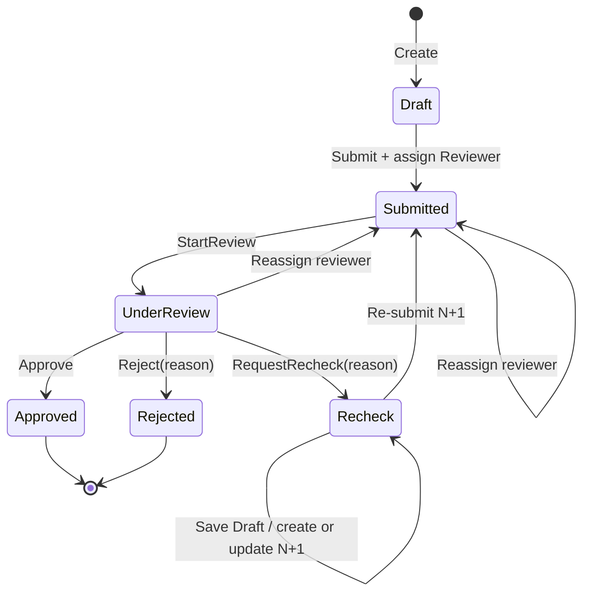
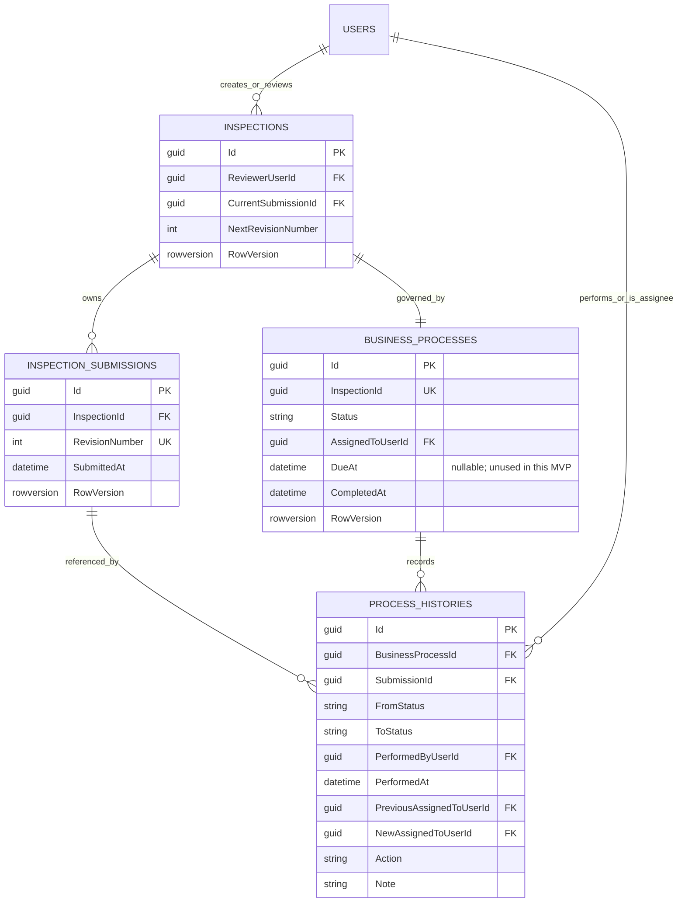
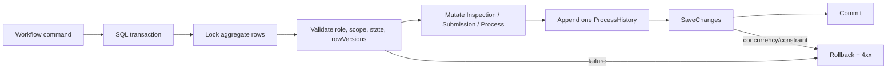

# Inspection Submission and Review Workflow Design (UC16–UC22)

## 1. Mục đích và phạm vi

Tài liệu này chốt contract thiết kế cho vòng đời Inspection sau checkpoint Inspection Core/Draft. Phạm vi gồm:

- UC16: Inspector submit Inspection và chọn Reviewer.
- UC17: Reviewer được giao bắt đầu review.
- UC18: Reviewer approve.
- UC19: Reviewer reject với lý do.
- UC20: Reviewer yêu cầu recheck với lý do.
- UC21: Inspector sửa sau Recheck bằng revision mới và submit lại.
- UC22: đọc Process History và revision history.
- Manager/Administrator reassign Reviewer sau khi Inspection đã submit.

Ngoài phạm vi:

- Attachment, annotation hoặc Drawing mapping mới.
- Thay đổi Form Template hoặc Inspection Draft đã hoàn thành.
- Notification, email, Elsa hoặc workflow engine khác.
- Reporting/dashboard nâng cao, hard delete và deployment.
- Triển khai source, package, migration hoặc database trong checkpoint thiết kế này.

## 2. Baseline đã xác minh

- Baseline source: commit `8bcb832a903fd6e2935788203fb1a7e55ca135dd`.
- Bốn endpoint Inspection Core được giữ nguyên:
  - `GET /api/inspections`
  - `GET /api/inspections/{id}`
  - `POST /api/inspections`
  - `PUT /api/inspections/{id}/draft`
- Endpoint hỗ trợ hiện có: `GET /api/inspections/form-template-options`.
- `Inspection` pin `FormTemplateVersionId`; `InspectionSubmission` giữ `DataJson` và `RevisionNumber`.
- `BusinessProcess` là quan hệ một-một với `Inspection`, dùng trực tiếp `InspectionId` và có `Status`, `AssignedToUserId`, `DueAt`, `CompletedAt`, `RowVersion`.
- `ProcessHistory` đã có actor, thời điểm, from/to status, action, note và submission.
- `Inspections`, `InspectionSubmissions` và `BusinessProcesses` đều có `rowversion` phù hợp cho optimistic concurrency.
- Unique index `(InspectionId, RevisionNumber)` đã tồn tại.
- `AddInspectionCore` đã được apply vào Development database.

### 2.1 Mâu thuẫn và khoảng trống được hòa giải

| Nội dung | Tài liệu cũ | Implementation hiện tại | Contract tài liệu này |
|---|---|---|---|
| Process target | `docs/02` còn mô tả generic `EntityId` | `BusinessProcesses.InspectionId` trực tiếp | Dùng model trực tiếp hiện tại; không đổi sang polymorphic |
| Trạng thái DB | Docs cho phép toàn bộ workflow | CHECK constraint hiện chỉ cho `Draft` | Migration sau phải mở constraint theo state machine đã chốt |
| History action | Docs mô tả các transition | CHECK constraint hiện chỉ cho `Create` | Migration sau phải mở allowlist action |
| SLA/Notification | `docs/01–03` từng đưa `DueAt`, SLA và notification vào Submit transaction | `DueAt` nullable đã có; không có table/service Notification | Hoãn SLA và notification khỏi MVP workflow này; giữ `DueAt = null`, không thêm schema notification |
| Reassign API | Nghiệp vụ yêu cầu nhưng `docs/03` chưa có contract endpoint | Chưa có endpoint | Bổ sung một action endpoint riêng |
| Reviewer audit | Tài liệu yêu cầu biết Reviewer trước/sau | `ProcessHistory` chưa có cột tương ứng | Đề xuất hai cột nullable có cấu trúc; không nhét GUID vào `Note` |
| Detail/history | Tài liệu cũ có lúc ngụ ý detail chứa history | Detail Core chỉ trả current revision | Giữ detail Core ổn định; dùng endpoint history/revisions phân trang |

## 3. Quy tắc nghiệp vụ đã hòa giải

1. Inspector tạo Inspection và là người duy nhất sửa dữ liệu Draft/Recheck của Inspection đó.
2. Reviewer do Inspector chọn tại lần Submit đầu tiên. Reviewer phải được kiểm tra trong chính transaction Submit.
3. Inspection không có trạng thái chờ phân công: Submit chỉ thành công khi Reviewer hợp lệ đã được gán.
4. Reviewer phải tồn tại, có `ApplicationUser.IsActive = true`, có role `Reviewer`, và không được là creator của Inspection. Identity hiện đã dùng `IsActive` ở login và profile lookup nên không cần thay đổi Identity schema.
5. Submit luôn validate toàn bộ required field bằng đúng pinned `FormTemplateVersionId`. Không resolve latest version và client không được gửi/đổi template version.
6. Việc template bị deactivate sau khi Inspection được tạo không cản Save/Submit/review của Inspection đã pin version.
7. Revision đã submit là bất biến. `Approved` và `Rejected` là terminal, read-only.
8. `Rejected` không quay về Draft/Recheck. Nếu cần làm lại, Inspector tạo Inspection mới.
9. `Recheck` không tự tạo revision. Lần Save đầu tiên sau Recheck copy `DataJson` của current submitted revision thành revision mới lấy từ `Inspection.NextRevisionNumber`, sau đó áp dữ liệu Inspector vừa lưu; các Save tiếp theo cập nhật revision chưa submit đó.
10. Re-submit từ Recheck chỉ hợp lệ sau khi đã có current revision mới chưa submit.
11. Không dùng `MAX(RevisionNumber) + 1`, không dùng revision number từ client. Revision mới lấy từ `Inspection.NextRevisionNumber` trong transaction đã khóa Inspection/current submission/process; counter được tăng trong cùng transaction và unique index là lớp bảo vệ cuối.
12. Inspection mới tạo revision 1 và khởi tạo `NextRevisionNumber = 2`.
13. Reviewer phải thực hiện `StartReview` trước khi ra quyết định.
14. Chỉ Reviewer đang được gán mới được Start Review, Approve, Reject hoặc Recheck.
15. Nếu Reviewer có `IsActive = false` hoặc mất role Reviewer, các action review bị từ chối; Manager/Administrator phải reassign cho Reviewer hợp lệ.
16. Không transition nào tự retry. Request dùng rowVersion cũ trả `409 Conflict`.
17. Mỗi workflow transition tạo đúng một `ProcessHistory` trong cùng SQL transaction với các thay đổi liên quan. Save Draft thông thường không tạo history; lần Save đầu sau Recheck tạo action `CreateRevision`.
18. Process/revision/history không bị hard delete.
19. SLA, `DueAt`, Notification, email và in-app notification là future scope. Các workflow command trong MVP này để `DueAt = null` và không tạo notification side effect.

## 4. State machine



Reassign ở `Submitted` giữ nguyên `Submitted`. Reassign ở `UnderReview` chuyển về `Submitted`; Reviewer mới phải chủ động `StartReview`. Không được reassign `Approved`, `Rejected`, `Draft` hoặc `Recheck`.

## 5. Authorization và object-level scope

| Khả năng | Inspector | Reviewer | Manager | Administrator |
|---|---:|---:|---:|---:|
| List/detail | Chỉ Inspection do mình tạo | Chỉ Inspection được giao | Tất cả | Tất cả |
| Save Draft/Recheck | Chỉ creator | Không | Không | Không |
| Submit/re-submit | Chỉ creator | Không | Không | Không |
| Reviewer lookup | Có, để Submit | Không | Có, để reassign | Có, để reassign |
| Start Review | Không | Chỉ assignee | Không | Không |
| Approve/Reject/Recheck | Không | Chỉ assignee | Không | Không |
| Reassign Reviewer | Không | Không | Có | Có |
| Process History | Theo read scope | Theo read scope | Tất cả | Tất cả |
| Revision history/detail | Theo read scope | Theo read scope | Tất cả | Tất cả |

- Anonymous luôn nhận `401`.
- User có role nhưng ngoài object scope nhận `404` theo convention chống lộ sự tồn tại đang dùng bởi query scope; user đúng scope nhưng sai action/state nhận `403` hoặc `409` như mục 10.
- Manager/Administrator chỉ giám sát và reassign; không được sửa `DataJson` hoặc thay Reviewer bằng cách sửa trực tiếp entity.
- Response reviewer lookup chỉ có `userId` và `displayName`; không trả password hash, security stamp, lockout data hoặc Identity internals.

## 6. API contract tối thiểu

Tài liệu đề xuất **10 endpoint mới**. Bốn endpoint Core và `form-template-options` không đổi.

### 6.1 Reviewer lookup

`GET /api/inspections/reviewer-options?pageNumber=1&pageSize=20&search=`

- Role: Inspector, Manager, Administrator.
- Response `200`: `PagedResult<ReviewerOptionDto>`.
- Chỉ trả user tồn tại, có `ApplicationUser.IsActive = true` và đang có role Reviewer.
- `401/403`; query không mở transaction.

```json
{
  "items": [
    { "userId": "00000000-0000-0000-0000-000000000000", "displayName": "Review User" }
  ],
  "pageNumber": 1,
  "pageSize": 20,
  "totalCount": 1,
  "totalPages": 1
}
```

### 6.2 Submit hoặc re-submit

`POST /api/inspections/{id}/submit`

- Role: Inspector, đồng thời phải là creator.
- Pre-state: `Draft`; hoặc `Recheck` khi current revision mới chưa submit.
- Post-state: `Submitted`.
- Request:

```json
{
  "reviewerUserId": "00000000-0000-0000-0000-000000000000",
  "inspectionRowVersion": "base64",
  "submissionRowVersion": "base64",
  "processRowVersion": "base64"
}
```

- Lần đầu: reviewer phải có `IsActive = true`, có role Reviewer và khác creator; gán cả `Inspection.ReviewerUserId` và `BusinessProcess.AssignedToUserId`.
- Re-submit: reviewer id phải bằng assignee hiện tại; Inspector không được dùng re-submit để tự reassign.
- Validate full FormIO data bằng pinned schema, đánh dấu revision `SubmittedAt`, giữ `DueAt = null`, cập nhật process và tạo history action `Submit` cho cả lần đầu lẫn re-submit.
- Response `200`: `InspectionWorkflowResultDto`.
- Errors: `400` malformed/required data; `401`; `403` không phải creator; `404`; `409` state, stale rowVersion, reviewer không còn hợp lệ hoặc duplicate submit.
- Transaction khóa và cập nhật Inspection + current Submission + BusinessProcess + ProcessHistory + reviewer assignment một cách atomic.

### 6.3 Start Review

`POST /api/inspections/{id}/start-review`

```json
{ "processRowVersion": "base64" }
```

- Role/object scope: Reviewer đang được gán, có `IsActive = true` và còn role Reviewer.
- `Submitted` → `UnderReview`; history action `StartReview` tham chiếu current submission.
- Response `200`: `InspectionWorkflowResultDto`.
- `400/401/403/404/409`; transaction cập nhật BusinessProcess + ProcessHistory.

### 6.4 Approve

`POST /api/inspections/{id}/approve`

```json
{ "comment": "Optional review comment", "processRowVersion": "base64" }
```

- Role/object scope: Reviewer đang được gán; không self-review.
- `UnderReview` → `Approved`; đặt `CompletedAt`; history action `Approve`.
- Comment optional, trim, tối đa 2.000 ký tự.
- Response `200`: `InspectionWorkflowResultDto`.
- `400/401/403/404/409`; transaction cập nhật BusinessProcess + ProcessHistory.

### 6.5 Reject

`POST /api/inspections/{id}/reject`

```json
{ "reason": "Required rejection reason", "processRowVersion": "base64" }
```

- Role/object scope: Reviewer đang được gán; không self-review.
- `UnderReview` → `Rejected`; đặt `CompletedAt`; history action `Reject`.
- Reason bắt buộc sau trim, tối đa 2.000 ký tự.
- Response `200`: `InspectionWorkflowResultDto`.
- `400/401/403/404/409`; transaction cập nhật BusinessProcess + ProcessHistory.

### 6.6 Request Recheck

`POST /api/inspections/{id}/recheck`

```json
{ "reason": "Required recheck reason", "processRowVersion": "base64" }
```

- Role/object scope: Reviewer đang được gán; không self-review.
- `UnderReview` → `Recheck`; xóa `CompletedAt` nếu có; history action `RequestRecheck` tham chiếu revision vừa review.
- Reason bắt buộc sau trim, tối đa 2.000 ký tự.
- Không tạo revision tại endpoint này.
- Response `200`: `InspectionWorkflowResultDto`.
- `400/401/403/404/409`; transaction cập nhật BusinessProcess + ProcessHistory.

### 6.7 Reassign Reviewer

`POST /api/inspections/{id}/reassign-reviewer`

```json
{
  "reviewerUserId": "00000000-0000-0000-0000-000000000000",
  "reason": "Required reassignment reason",
  "inspectionRowVersion": "base64",
  "processRowVersion": "base64"
}
```

- Role: Manager hoặc Administrator.
- Pre-state: `Submitted` hoặc `UnderReview`.
- `Submitted` giữ nguyên `Submitted`; `UnderReview` chuyển về `Submitted` để Reviewer mới phải Start Review.
- Reviewer mới phải có `IsActive = true`, có role Reviewer, khác creator và khác assignee hiện tại.
- Reason bắt buộc, tối đa 2.000 ký tự.
- Cập nhật `Inspection.ReviewerUserId`, `BusinessProcess.AssignedToUserId`, hai rowVersion và history action `ReassignReviewer` có reviewer trước/sau.
- Response `200`: `InspectionWorkflowResultDto`.
- `400/401/403/404/409`; transaction cập nhật Inspection + BusinessProcess + ProcessHistory.

### 6.8 Process History

`GET /api/inspections/{id}/history?pageNumber=1&pageSize=20`

- Role/object scope: mọi role theo bảng read scope.
- Response `200`: `PagedResult<ProcessHistoryDto>`.
- Thứ tự ổn định: `PerformedAt DESC, Id DESC`.
- `401/403/404`; không mở write transaction.

```json
{
  "id": "00000000-0000-0000-0000-000000000000",
  "action": "ReassignReviewer",
  "fromStatus": "Submitted",
  "toStatus": "Submitted",
  "actorUserId": "00000000-0000-0000-0000-000000000000",
  "previousReviewerUserId": "00000000-0000-0000-0000-000000000000",
  "newReviewerUserId": "00000000-0000-0000-0000-000000000000",
  "reason": "Workload balancing",
  "createdAt": "2026-10-18T10:00:00Z",
  "submissionId": "00000000-0000-0000-0000-000000000000"
}
```

### 6.9 Revision history và detail

`GET /api/inspections/{id}/revisions?pageNumber=1&pageSize=20`

- Response `200`: metadata phân trang, thứ tự `RevisionNumber DESC`.
- Không trả `DataJson` trong list.

`GET /api/inspections/{id}/revisions/{revisionNumber}`

- Response `200`: revision metadata + `DataJson` + pinned template metadata/schema cần để render read-only.
- Cùng object-level read scope với Inspection detail.
- `401/403/404`; không mở write transaction.

```json
{
  "inspectionId": "00000000-0000-0000-0000-000000000000",
  "revisionNumber": 2,
  "data": {},
  "createdByUserId": "00000000-0000-0000-0000-000000000000",
  "createdAt": "2026-10-18T10:00:00Z",
  "updatedAt": null,
  "submittedAt": "2026-10-18T11:00:00Z",
  "isCurrent": true
}
```

### 6.10 Workflow response chung

```json
{
  "inspectionId": "00000000-0000-0000-0000-000000000000",
  "status": "Submitted",
  "reviewerUserId": "00000000-0000-0000-0000-000000000000",
  "currentRevisionNumber": 2,
  "completedAt": null,
  "inspectionRowVersion": "base64",
  "submissionRowVersion": "base64",
  "processRowVersion": "base64"
}
```

Token nào không bị thay đổi trong command vẫn được trả để client giữ một concurrency snapshot đầy đủ; server không nhận hoặc trả entity trực tiếp.

### 6.11 Ma trận contract, concurrency và transaction

| Route | Request DTO | Role/scope | Source → result | RowVersion bắt buộc | History | Transaction |
|---|---|---|---|---|---|---|
| `GET /reviewer-options` | query page/search | Inspector, Manager, Administrator | N/A | Không | Không | Read-only |
| `POST /{id}/submit` | `SubmitInspectionRequest` | Creator Inspector | Draft/Recheck → Submitted | Inspection + current Submission + Process | `Submit` | Inspection + Submission + Process + assignment + history |
| `POST /{id}/start-review` | `StartReviewRequest` | Assigned Reviewer | Submitted → UnderReview | Process | `StartReview` | Process + history; khóa current submitted revision để tham chiếu |
| `POST /{id}/approve` | `ApproveInspectionRequest` | Assigned Reviewer | UnderReview → Approved | Process | `Approve` | Process + history; khóa current submitted revision |
| `POST /{id}/reject` | `RejectInspectionRequest` | Assigned Reviewer | UnderReview → Rejected | Process | `Reject` | Process + history; khóa current submitted revision |
| `POST /{id}/recheck` | `RequestInspectionRecheckRequest` | Assigned Reviewer | UnderReview → Recheck | Process | `RequestRecheck` | Process + history; khóa current submitted revision |
| `POST /{id}/reassign-reviewer` | `ReassignInspectionReviewerRequest` | Manager, Administrator | Submitted → Submitted; UnderReview → Submitted | Inspection + Process | `ReassignReviewer` | Inspection + Process + assignment + history |
| `GET /{id}/history` | query page | Read scope | N/A | Không | Không | Read-only |
| `GET /{id}/revisions` | query page | Read scope | N/A | Không | Không | Read-only |
| `GET /{id}/revisions/{revisionNumber}` | route values | Read scope | N/A | Không | Không | Read-only |

Mười endpoint đều trả `401` khi anonymous. Command trả `400` cho DTO/validation lỗi, `403` khi resource nhìn thấy nhưng actor không được action, `404` khi không tồn tại/ngoài scope và `409` cho sai state hoặc stale concurrency. Query trả `400` cho pagination sai, `403` cho role không được phép và `404` cho resource không tồn tại/ngoài scope; query không phát sinh `409`.

## 7. Submit/review sequence

```mermaid
sequenceDiagram
    actor I as Inspector
    participant API
    participant App as Application handler
    participant ID as Identity
    participant DB as SQL Server
    actor R as Reviewer

    I->>API: POST /inspections/{id}/submit + 3 rowVersions
    API->>App: SubmitInspectionCommand
    App->>DB: BEGIN; lock Inspection, current Submission, Process
    App->>ID: Check Reviewer exists, IsActive + role
    App->>DB: Read pinned schema; validate complete DataJson
    App->>DB: Mark submitted; assign; transition; append history
    App->>DB: COMMIT
    API-->>I: 200 + workflow snapshot
    R->>API: POST /inspections/{id}/start-review
    API->>App: StartReviewCommand
    App->>DB: Atomic transition + history
    API-->>R: 200 UnderReview
    R->>API: POST approve/reject/recheck + processRowVersion
    API->>App: Decision command
    App->>DB: Atomic transition + history
    API-->>R: 200 final/recheck state
    opt Decision was Recheck
        I->>API: PUT /inspections/{id}/draft + 3 rowVersions
        API->>App: SaveInspectionDraftCommand
        App->>DB: Lock aggregate; allocate NextRevisionNumber
        App->>DB: Copy data; insert N+1; increment counter; history
        API-->>I: 200 editable revision snapshot
        I->>API: POST /inspections/{id}/submit + 3 rowVersions
        App->>DB: Atomic Recheck to Submitted + Submit history
        API-->>I: 200 Submitted
    end
```

## 8. Data model và migration proposal

### 8.1 Quan hệ dữ liệu



Mỗi history lưu from/to status, actor, comment/reason, reviewer trước/sau khi phù hợp, timestamp UTC và submission liên quan. Schema hiện tại dùng tên `PerformedByUserId` và `PerformedAt`; API map hai trường này thành `actorUserId` và `createdAt`, không thêm cột trùng nghĩa. `ReassignReviewer` từ Submitted có from/to đều Submitted; từ UnderReview có `UnderReview → Submitted`. `Submit` lần đầu ghi previous reviewer null/new reviewer đã gán; các action không đổi assignment để hai reviewer audit column là `NULL`.

### 8.2 Migration là bắt buộc ở checkpoint triển khai sau

Không thể triển khai workflow chỉ bằng source vì CHECK constraints hiện tại chặn mọi status/action ngoài `Draft`/`Create`.

Migration đề xuất tối thiểu:

1. Thêm `Inspections.NextRevisionNumber int NOT NULL`, backfill toàn bộ Inspection Core hiện tại thành `2`, và thêm `CK_Inspections_NextRevisionNumber` với `[NextRevisionNumber] >= 2`.
2. Thay `CK_BusinessProcesses_Status` bằng allowlist:
   `Draft`, `Submitted`, `UnderReview`, `Approved`, `Recheck`, `Rejected`.
3. Thay `CK_ProcessHistories_ToStatus` bằng cùng allowlist và cho `FromStatus` null chỉ ở history `Create`.
4. Thay `CK_ProcessHistories_Action` bằng allowlist tối thiểu:
   `Create`, `Submit`, `StartReview`, `Approve`, `Reject`, `RequestRecheck`, `ReassignReviewer`, `CreateRevision`.
5. Không thêm `SaveDraft` vào allowlist: không ghi history cho mỗi lần lưu để tránh timeline nhiễu.
6. Thêm nullable `PreviousAssignedToUserId uniqueidentifier` và `NewAssignedToUserId uniqueidentifier` vào `ProcessHistories`.
7. Thêm FK từ hai cột tới `AspNetUsers(Id)`, `ON DELETE NO ACTION` để lịch sử không bị cascade. EF tạo index FK cần thiết; không cần index nghiệp vụ bổ sung khi chưa có bằng chứng từ execution plan.

Backfill:

- Các Inspection hiện có đều `Draft`; giữ nguyên.
- Mỗi Inspection Core hiện tại có revision 1 nên backfill `NextRevisionNumber = 2`.
- History `Create` hiện có giữ nguyên; hai cột mới là `NULL`.
- Không tự gán Reviewer hoặc tạo history giả.

Inspection mới tạo revision 1 và đặt `NextRevisionNumber = 2`. `Inspection.RowVersion` hiện có cùng row lock bảo vệ counter, nên không cần rowVersion hoặc index riêng cho `NextRevisionNumber`. Unique index `(InspectionId, RevisionNumber)` tiếp tục là lớp bảo vệ cuối; runtime không query `MAX` và không nhận revision number từ client.

Không tạo bảng Notification, SLA hoặc calendar. Cột nullable `BusinessProcesses.DueAt` đã tồn tại nên migration không alter/drop cột này; workflow MVP để giá trị `NULL`.

Migration không alter/drop bảng hoặc cột ngoài bốn aggregate table Inspection workflow và các FK tới Identity đã nêu; không thay đổi dữ liệu Drawing, Construction Object, Form Template hoặc Identity user/role.

### 8.3 Rollout và rollback

- Tạo migration riêng sau khi source/model và manager decisions đã chốt.
- Review migration và idempotent SQL script; xác nhận chỉ thay constraint/cột/index/FK nêu trên.
- Apply IntegrationTest DB trước, chạy migration/backfill assertions, rồi mới Development DB.
- Rollback chỉ an toàn khi chưa có row dùng status/action mới. Nếu đã có, migration Down phải dừng có chủ đích thay vì làm mất history hoặc ép status.

## 9. Transaction và concurrency



- Submit/re-submit gửi và kiểm tra cả ba rowVersion vì nó tác động/khóa cả Inspection, Submission và Process.
- Start Review/Approve/Reject/Recheck chỉ gửi Process rowVersion. Submitted revision là bất biến và `CurrentSubmissionId` không thể đổi trong `Submitted`/`UnderReview`; transaction vẫn đọc/khóa current submission để gắn history đúng revision. Reassign hoặc transition cạnh tranh đều đổi Process rowVersion nên request cũ nhận `409`.
- Reassign gửi Inspection + Process rowVersion vì cập nhật assignment ở cả hai bảng.
- Save sau Recheck tiếp tục dùng Inspection + current Submission + Process rowVersion. Inspection rowVersion bảo vệ `NextRevisionNumber` và `CurrentSubmissionId`.
- Repository lấy aggregate bằng `UPDLOCK, HOLDLOCK` trong transaction. EF concurrency token vẫn là lớp kiểm tra optimistic cuối.
- Không tự retry một command sau lỗi concurrency. Client giữ nội dung, reload snapshot theo lựa chọn người dùng và submit lại có chủ đích.
- Hai Submit đồng thời: một transaction thắng; transaction còn lại nhận `409` do state/rowVersion.
- Hai Start Review đồng thời: một transition thắng; request còn lại nhận `409`.
- Approve/Reject hoặc Request Recheck/Approve đồng thời: một transition thắng; action còn lại nhận `409`.
- Reassign cạnh tranh với decision: cùng tranh Process rowVersion; chỉ một command commit. Nếu reassign thắng từ UnderReview, status trở về Submitted.
- Re-submit cạnh tranh với reassign: cả hai kiểm tra Inspection và Process rowVersion; chỉ một command commit.
- Hai first-save sau Recheck: khóa cùng aggregate và kiểm tra ba token; chỉ một request tạo revision, request còn lại nhận `409`, không tạo revision thứ hai.
- Tạo revision sau Recheck: khóa Inspection, đọc `NextRevisionNumber`, insert revision với số đó, tăng counter, cập nhật `CurrentSubmissionId` và append `CreateRevision` trong cùng transaction. Không query `MAX`.

### 9.1 Mở rộng contract Save Draft hiện có

Giữ nguyên route Core `PUT /api/inspections/{id}/draft` và request gồm `DataJson`, Inspection rowVersion, current Submission rowVersion và Process rowVersion.

- `Draft`: validate pinned schema ở draft mode rồi cập nhật current revision chưa submit; không ghi ProcessHistory.
- `Recheck` khi current revision vẫn là revision đã submit: khóa aggregate, lấy số từ `NextRevisionNumber`, copy `DataJson` revision đã submit, áp dữ liệu request, tạo revision mới chưa submit, tăng counter, đổi `CurrentSubmissionId`, cập nhật Inspection và ghi `CreateRevision`.
- `Recheck` khi current revision đã là revision mới chưa submit: cập nhật revision đó; không tăng counter và không ghi thêm history.
- `Submitted`, `UnderReview`, `Approved`, `Rejected`: trả `409`, không Save Draft.
- Revision mới giữ nguyên pinned `FormTemplateVersionId` ở Inspection; không resolve template mới và không thay `ConstructionObjectId`.
- Transaction first-save gồm Inspection + old/new Submission + Process read guard + ProcessHistory. Bất kỳ lỗi nào rollback counter, pointer, revision và history.

## 10. Validation và error mapping

| Điều kiện | Kết quả |
|---|---|
| JSON/DTO/token base64 sai, reason rỗng/quá dài | `400 Bad Request` |
| FormIO thiếu required hoặc sai kiểu theo pinned schema | `400 Bad Request` với field errors an toàn |
| Chưa xác thực/token hết hạn | `401 Unauthorized` |
| Đúng object scope nhưng role/action không được phép | `403 Forbidden` |
| Không tồn tại hoặc nằm ngoài read scope | `404 Not Found` theo convention hiện tại |
| Sai state, stale rowVersion, double action, reviewer invalidated | `409 Conflict` |
| Lỗi bất ngờ | `500` ProblemDetails chung; không lộ stack trace/SQL/secret |

Mã lỗi ổn định đề xuất: `inspection.invalid_state`, `inspection.stale_version`, `inspection.form_data_invalid`, `inspection.reviewer_invalid`, `inspection.self_review_forbidden`, `inspection.revision_immutable`, `inspection.reason_required`.

## 11. Backend design

- Domain chứa transition methods và invariant; không đặt business logic trong Controller.
- Mỗi action là một MediatR Command; history/revision/history detail là Query.
- Controller chỉ map request/response DTO và HTTP status.
- `IInspectionRepository` tải aggregate có lock và thêm revision/history; `IInspectionReadService` phục vụ projection phân trang.
- Mở rộng Identity abstraction bằng query tối thiểu kiểm tra `ApplicationUser.IsActive`/role và reviewer options; không đưa `UserManager` vào Application/Domain.
- `FormIoDataValidator` có chế độ submit kiểm tra required, dùng schema của pinned version.
- `Inspection.NextRevisionNumber` là counter server-side; Domain cấp số và tăng counter đúng một lần khi tạo revision sau Recheck.
- Tất cả thời gian lấy qua `IClock`, lưu UTC.
- History append-only; submission đã submit không có update path.
- Không tạo notification side effect và không tính SLA/`DueAt` trong UC16–UC22 của MVP này.

## 12. Frontend design tối thiểu

### Inspector

- Draft/Recheck editor hiển thị validation required và Reviewer picker khi Submit.
- Submit có confirmation, double-submit guard và giữ nguyên form khi lỗi `409`.
- Sau Recheck, lần Save đầu tạo revision mới qua contract Save mở rộng; UI hiển thị revision hiện tại.
- Rejected/Approved và submitted revision là read-only.

### Reviewer

- List chỉ hiện Inspection được assign; detail render pinned schema + submitted data read-only.
- `Start Review` chỉ hiện ở Submitted.
- Approve/Reject/Recheck chỉ hiện ở UnderReview; Reject/Recheck bắt buộc reason.
- Mọi decision có confirmation và khóa nút trong khi request đang chạy.

### Manager/Administrator

- List/detail/history/revisions toàn cục.
- Reassign dialog có reviewer lookup và reason; không có editor DataJson. Nếu reassign từ UnderReview thành công, UI hiển thị Submitted và Reviewer mới phải Start Review.

### UX chung

- Có loading, empty, validation, 401, 403, 404, 409 và generic error states.
- `409` không xóa dữ liệu đang nhập; cung cấp `Reload latest` rõ ràng, không tự retry.
- Focus chuyển tới lỗi đầu tiên/modal title; dialog dùng keyboard, focus trap và restore focus.
- Status không chỉ phân biệt bằng màu; layout hoạt động ở 1366–1440 px, không overflow bất thường.
- Cancel GET cũ khi đổi route/revision; cleanup effect và không tạo request loop.
- JWT chỉ ở Authorization header theo cơ chế hiện tại, không ở URL. Không render raw HTML/script từ title, reason, option hoặc FormIO data.

## 13. Security

- Mọi endpoint workflow yêu cầu JWT và kiểm tra role lẫn object-level scope ở Application.
- Không tin reviewer/status/template/submission id do client suy diễn ngoài DTO contract.
- Reviewer lookup trả projection tối thiểu, không trả dữ liệu Identity nội bộ.
- Log chỉ action/id/trace id phù hợp; không log JWT, signing key, password, DataJson nhạy cảm hoặc connection string.
- Pinned schema/data được parse và render bằng component allowlist đã chốt; không cho executable expression, HTML tùy ý hoặc remote data source.
- Database FK dùng `NO ACTION`; không cascade làm mất revision/history.

## 14. Test strategy

### Domain unit tests

- Mọi transition hợp lệ và mọi cạnh state machine không hợp lệ.
- Submitted revision bất biến; Approved/Rejected terminal.
- Reject/Recheck thiếu reason bị từ chối.
- Self-review bị từ chối.
- Inspection mới tạo revision 1 với `NextRevisionNumber = 2`.
- First Save after Recheck cấp số từ counter, copy submitted DataJson, tăng counter và tạo đúng một revision; Save sau đó cập nhật cùng draft revision.

### Application unit tests

- Submit hợp lệ; thiếu required; pinned schema; template bị inactive sau Create vẫn submit được.
- Reviewer tồn tại, `IsActive = true`, role đúng; invalid/inactive/role removed/self-review bị từ chối.
- Re-submit không đổi Reviewer trái phép.
- Object-level authorization cho bốn role.
- History action/from/to/submission/reviewer trước-sau/reason đúng.
- Stale từng rowVersion trả conflict; handler không retry.
- Save Draft thông thường không tạo history; first-save sau Recheck tạo đúng một `CreateRevision`.

### Integration tests trên database riêng

- Atomic Submit bao gồm submission/process/assignment/history.
- Duplicate/concurrent Submit chỉ một request thành công.
- Concurrent Start Review; Approve/Reject; Recheck/Approve; reassign/decision; re-submit/reassign: mỗi cặp chỉ một command thành công, command còn lại `409`.
- Reviewer chỉ đọc/xử lý Inspection được assign.
- Reassign cập nhật hai assignment và audit đúng, rollback toàn bộ khi lỗi.
- Hai first-save sau Recheck chỉ tạo một revision từ `NextRevisionNumber`; request còn lại `409`; counter/pointer/history atomic và không dùng `MAX`.
- History pagination/order ổn định; old revisions đọc được và không sửa được.
- Anonymous `401`; role/action `403`; ngoài scope `404` theo convention.
- Migration mở constraints, giữ nguyên Draft/history cũ, backfill `NextRevisionNumber = 2` và reviewer audit null.

### Frontend tests

- Visibility/action theo role và status.
- Required validation, confirmation, double-click guard.
- 409 giữ dữ liệu và reload có chủ đích.
- Revision switch/read-only, browser Back/Forward/deep link.
- Loading/empty/error/accessibility/cancellation/cleanup.

## 15. Runtime smoke plan

1. Inspector login, mở Draft, thử Submit thiếu required → `400` và field error.
2. Chọn Reviewer hợp lệ, Submit → `200`, trạng thái Submitted, history/assignment đúng.
3. Gửi lại cùng snapshot → `409`.
4. Reviewer khác không thấy/không mở được Inspection; assignee mở được.
5. Assignee Start Review → UnderReview.
6. Chạy riêng ba nhánh trên các Inspection khác nhau: Approve, Reject(reason), Recheck(reason).
7. Với Recheck: Inspector Save tạo revision N+1, submit lại, Reviewer review; revision cũ vẫn đọc và bất biến.
8. Manager/Admin reassign ở Submitted và UnderReview; nhánh UnderReview quay về Submitted. Reviewer cũ mất quyền action, Reviewer mới phải Start Review.
9. Kiểm tra Process History, pagination/order, actor/reviewer/reason/revision.
10. Kiểm tra anonymous/role/object scope, stale token và concurrent decision.
11. Regression Login, `/api/auth/me`, Construction Object, Drawing, Form Template và bốn endpoint Inspection Core.

## 16. ADR decisions

### 16.1 Đã chốt từ tài liệu và baseline

- **WF-001:** State machine là Draft → Submitted → UnderReview → Approved/Rejected/Recheck; Recheck → Submitted sau revision mới.
- **WF-002:** Inspector chọn Reviewer trong transaction Submit; không có waiting-for-assignment state.
- **WF-003:** Start Review là transition bắt buộc trước decision.
- **WF-004:** Rejected và Approved terminal; submitted revisions bất biến.
- **WF-005:** Recheck tạo revision mới ở lần Save đầu, không tạo tại action Recheck.
- **WF-006:** Validation dùng pinned template version dù template sau đó inactive.
- **WF-007:** Manager/Administrator mới được reassign sau Submit; mọi workflow transition, reassign và CreateRevision append history.
- **WF-008:** Reassign ở Submitted giữ nguyên status; reassign ở UnderReview quay về Submitted; reason bắt buộc và reassign terminal state bị cấm.
- **WF-009:** Giữ model `BusinessProcess.InspectionId` hiện tại và giữ bốn Core endpoints.
- **WF-010:** Mười endpoint mới là tập tối thiểu cho workflow, reviewer lookup và history/revisions.
- **WF-011:** Dùng `Inspections.NextRevisionNumber`, optimistic concurrency + SQL transaction/locks; stale trả 409, không auto-retry, không `MAX + 1`.
- **WF-012:** Reviewer eligibility dùng `ApplicationUser.IsActive` và role hiện có; không thay đổi Identity schema.
- **WF-013:** Không ghi history cho mỗi Save Draft; first-save sau Recheck ghi `CreateRevision`.
- **WF-014:** Hoãn SLA, `DueAt`, notification/email/in-app notification khỏi workflow MVP này. Cột `DueAt` hiện có giữ nullable và không bị alter.

### 16.2 Trạng thái quyết định quản lý

Các câu hỏi chặn implementation trước đây đã được quản lý trả lời trong checkpoint này:

- Reassign chỉ ở Submitted/UnderReview và UnderReview quay về Submitted.
- SLA/`DueAt` và notification được hoãn sang future scope.
- Reviewer audit dùng hai cột nullable có cấu trúc và FK `NO ACTION`.
- Re-submit giữ Reviewer hiện tại; chỉ Manager/Administrator được reassign.
- Revision allocation dùng `NextRevisionNumber` server-side.

Không còn open question nghiệp vụ bắt buộc cho phạm vi UC16–UC22. Việc triển khai vẫn phải bắt đầu bằng checkpoint source riêng và chỉ tạo migration khi được yêu cầu rõ ràng.

## 17. Implementation checkpoints đề xuất

1. Dùng docs/10 làm contract cuối cho UC16–UC22; lập riêng thay đổi đồng bộ docs/01–03 vì các tài liệu cũ còn SLA/Notification 72 giờ.
2. Domain transitions, revision creation và unit tests.
3. Application commands/queries, authorization, validation, DTOs và unit tests.
4. Infrastructure repository/read service/Identity projection/configuration.
5. Tạo migration riêng sau khi được cho phép; review SQL, apply IntegrationTest DB, chạy migration tests rồi mới Development DB.
6. API endpoints và integration tests, gồm concurrency hai request.
7. Frontend workflow theo role/state và frontend tests.
8. Runtime smoke, regression, security/secret/artifact scan và toàn bộ quality gate.
9. Chỉ commit theo checkpoint khi được cho phép riêng; không push hoặc tạo remote.
