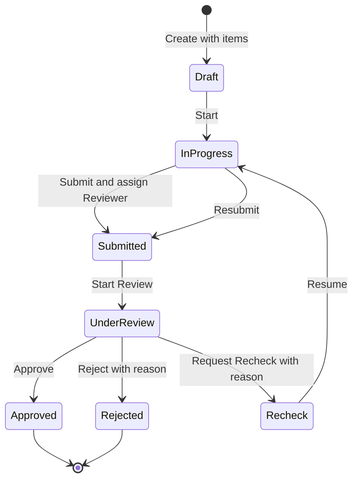
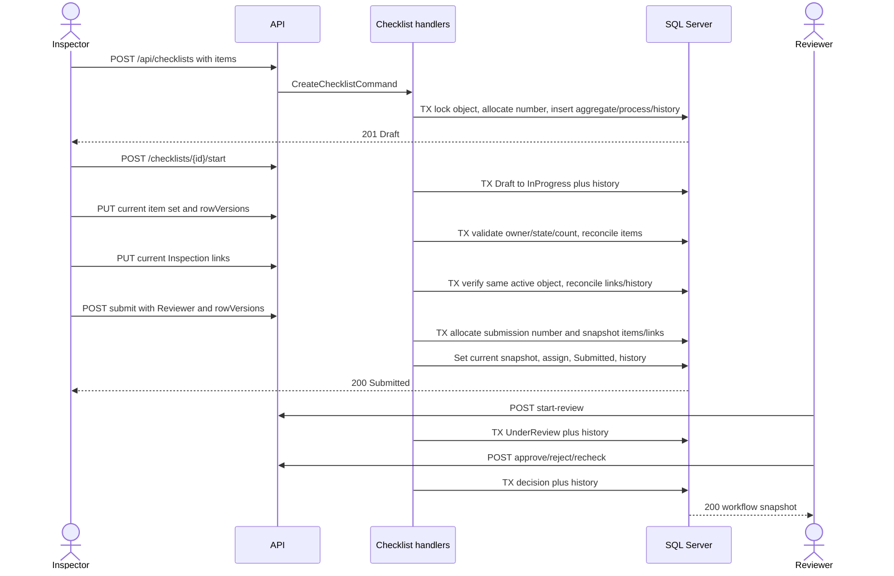
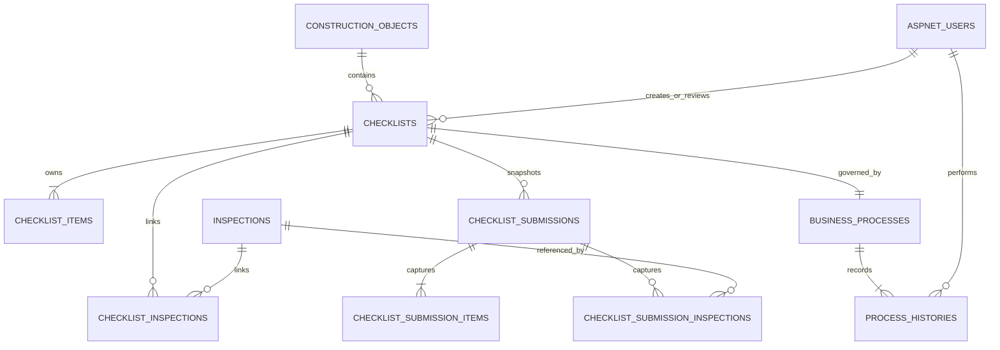

# Thiết kế Checklist vertical slice UC23–UC30

## 1. Trạng thái tài liệu và baseline

Tài liệu này thiết kế đầy đủ Checklist vertical slice cho đúng tám Use Case UC23–UC30. Đây là checkpoint tài liệu để quản lý review; chưa cho phép sửa source, package, migration, database hoặc frontend.

Baseline đã xác minh:

- HEAD: `52aacf6347b222ac702317f236af77a5a0fd04cc`.
- Working tree và staging sạch trước khi tạo tài liệu này.
- Không có Git remote.
- Migration mới nhất là `AddInspectionWorkflow`.
- `dotnet ef migrations has-pending-model-changes` xác nhận model hiện tại không có thay đổi chưa được migration ghi nhận.
- Không có source, entity, `DbSet`, Controller, route, migration hoặc test Checklist. Ngoài tài liệu, từ “Checklist” chỉ xuất hiện trong phần mô tả README.

Nguồn đã đọc và đối chiếu:

- `AGENTS.md`, `README.md`.
- `docs/01-product-scope-and-use-cases.md` đến `docs/05-form-template-vertical-slice-design.md`.
- `docs/09-inspection-core-vertical-slice-design.md` đến `docs/11-product-readiness-scope-audit-and-demo-plan.md`.
- Domain/Application/Infrastructure/API của Inspection và Form Template.
- `BusinessProcess`, `ProcessHistory`, EF configuration và migrations hiện tại.
- Construction Object, Drawing Object Mapping, authorization, ProblemDetails và CQRS conventions.
- Frontend router, navigation, API client, role/state guard, Inspection list/detail/editor và conflict UX.

`docs/06–08` được đối chiếu qua source và audit `docs/11` cho quan hệ Drawing/Mapping. Checklist không được tự phụ thuộc Drawing chỉ vì các slice đó đã tồn tại.

### 1.1 Finding quan trọng từ baseline

`docs/02` mô tả `BusinessProcesses` bằng `EntityType + EntityId` dùng chung cho Inspection, Checklist và RFI. Implementation hiện tại đã chọn mô hình chuyên biệt cho Inspection:

- `BusinessProcess.InspectionId` là FK bắt buộc và unique.
- `BusinessProcess.Status` có kiểu `InspectionStatus`.
- `ProcessHistory.FromStatus/ToStatus` có kiểu `InspectionStatus`.
- `ProcessHistory.SubmissionId` tham chiếu `InspectionSubmissions`.
- `ProcessEntityType` chỉ có `Inspection`.

Vì vậy Checklist không thể “dùng lại ngay” process hiện tại. Muốn giữ nguyên yêu cầu dùng chung trong docs/01–02 phải tổng quát hóa có migration kiểm soát; không được ép Checklist vào `InspectionId` hoặc tái sử dụng `InspectionSubmission`.

## 2. Traceability UC23–UC30

| UC | Tên chính xác | Actor | Mục tiêu và precondition | Main flow | Alternate/error flow | Postcondition và dữ liệu | Authorization/quan hệ | Finding |
|---|---|---|---|---|---|---|---|---|
| UC23 | Xem danh sách | Actor có quyền | Đã xác thực, có read scope | Lọc, tìm kiếm, sắp xếp, phân trang Checklist | Query sai `400`; anonymous `401`; role sai `403` | Chỉ đọc metadata; không đổi dữ liệu | Inspector own, Reviewer assigned, Manager scope; Administrator cần ADR | Docs không định nghĩa cụ thể Administrator read scope |
| UC24 | Tạo Checklist và item | Inspector | Construction Object tồn tại, active và trong scope; có ít nhất một item hợp lệ | Server tạo Checklist `Draft`, items, process và initial history atomically | Object missing/out-of-scope `404`; inactive/state/duplicate number `409`; payload sai `400` | Ghi Checklist, ChecklistItems, BusinessProcess, ProcessHistory | Chỉ Inspector; creator là owner | Item nguồn thủ công theo UC; không có Checklist Template hoặc Form Template FK |
| UC25 | Thực hiện Checklist | Inspector | Creator; Checklist `Draft` để Start hoặc `InProgress`/`Recheck` để ghi kết quả | Start, sau đó cập nhật từng item bằng rowVersion | Sai owner `403`; ngoài scope `404`; state/token cũ `409` | Ghi result/note/audit item; process chuyển `InProgress` khi Start/Resume | Chỉ creator chỉnh item | Required/comment/reorder và snapshot chưa được docs chốt |
| UC26 | Liên kết Inspection | Inspector | Creator; Checklist và Inspection nhìn thấy được, cùng Construction Object | Tạo một quan hệ many-to-many, server kiểm tra hai aggregate | Khác object hoặc state không hợp lệ `409`; trùng link `409`; ngoài scope `404` | Ghi ChecklistInspections với actor/time | Chỉ creator trong trạng thái mutable | Docs không yêu cầu unlink; không có delete endpoint |
| UC27 | Submit | Inspector | Creator; process `InProgress`; item completion hợp lệ; Reviewer hợp lệ | Khóa aggregate/items, validate, gán Reviewer, chuyển `Submitted`, append history | Thiếu kết quả `400`; Reviewer/state/concurrency sai `409`; sai quyền `403` | Process/assignment/history commit cùng transaction | Creator submit; dùng reviewer lookup hiện có | Docs/01 yêu cầu notification/SLA nhưng docs/10 và implementation đã defer |
| UC28 | Approve | Reviewer | Assigned active Reviewer; đã Start Review; không self-review | `Submitted → UnderReview`, sau đó `UnderReview → Approved` | Reviewer không hợp lệ `403/409`; stale/state sai `409` | Terminal, read-only, history đầy đủ | Chỉ assignee; Start Review là action con bắt buộc | UC28 chỉ nêu Approve “sau Start Review”; endpoint Start Review vẫn cần riêng |
| UC29 | Reject hoặc Recheck | Reviewer | Assigned active Reviewer, `UnderReview`, không self-review | Reject hoặc Request Recheck với lý do | Lý do rỗng `400`; state/concurrency `409` | Reject terminal; Recheck cho creator tiếp tục | Chỉ assignee | Bảng UC nói Recheck quay về InProgress, sơ đồ lại có state Recheck rồi Resume |
| UC30 | Xem lịch sử | Actor liên quan | Checklist nằm trong read scope | Đọc ProcessHistory theo thứ tự ổn định, phân trang | Anonymous `401`; ngoài scope `404` | Không ghi dữ liệu; history append-only | Cùng read scope với detail | Docs không chốt lịch sử snapshot giá trị item theo từng lần Submit |

### 2.1 Mâu thuẫn đã được hòa giải

| Chủ đề | Nguồn nói gì | Implementation ảnh hưởng thế nào | Contract cuối | Trạng thái |
|---|---|---|---|---|
| Shared process | docs/01–02: Inspection/Checklist/RFI dùng chung process/history | Process hiện chỉ hỗ trợ Inspection | Tổng quát hóa hai bảng hiện tại bằng physical nullable FKs và exact-one-owner constraint; giữ transition riêng theo aggregate | Accepted |
| SLA/Notification | docs/01–03: Submit Checklist đặt `DueAt` 72h và tạo notification | docs/10 WF-014 và source đã defer SLA/Notification; không có bảng Notification | Checklist giữ `DueAt = null`; không SLA, notification, reminder, email, job hoặc placeholder schema | Accepted; docs/10 là contract cuối |
| Recheck | Sơ đồ docs/01 có `UnderReview → Recheck → InProgress`; bảng UC29 nói Recheck quay về InProgress | Chưa có source Checklist | Giữ state `Recheck`; creator phải Resume rõ ràng để vào `InProgress` | Accepted |
| Item revision | Docs chỉ có mutable ChecklistItems và ProcessHistory | Sửa sau Recheck sẽ làm mất dữ liệu Reviewer đã xem | Mỗi Submit tạo immutable ChecklistSubmission cùng item/link snapshots | Accepted |
| Administrator | docs/01 chưa cấp rõ quyền đọc Checklist | Inspection có ADR riêng cho Admin full-read | Administrator list/full-read/history/submissions nhưng không mutate/workflow | Accepted |
| Number | docs/02 có Number unique nhưng không format/counter | Inspection dùng sequence riêng | `CHK-{UTC_YEAR}-{SEQUENCE}` qua `ChecklistNumberSequence`, không `MAX + 1` | Accepted |
| Required/Fail note | Enum result có sẵn nhưng rule comment chưa có | Không có source Checklist | `NotChecked` cấm khi Submit; Fail và NotApplicable bắt buộc Note | Accepted |
| Maximum item count | Docs không nêu | Cần payload/query/concurrency boundary | Tối đa 200 current items, kiểm tra trong transaction | Accepted |

## 3. Bản chất Checklist

### 3.1 Aggregate boundary

Đề xuất `Checklist` là aggregate root riêng, thuộc đúng một `ConstructionObject`.

- Một Construction Object có thể có nhiều Checklist.
- Một Checklist có nhiều ChecklistItem.
- Một Checklist có thể liên kết không, một hoặc nhiều Inspection.
- Một Inspection có thể được liên kết với không, một hoặc nhiều Checklist.
- Quan hệ Checklist–Inspection là many-to-many và bắt buộc cùng `ConstructionObjectId`.
- Checklist không thuộc aggregate Inspection và không thuộc aggregate Construction Object; hai đối tượng chỉ là principal/reference.

### 3.2 Thời điểm và nguồn tạo item

UC24 yêu cầu Inspector “Tạo Checklist và item”. Docs/02 định nghĩa trực tiếp `ChecklistItems.Criterion`; docs/05 khẳng định chưa có FK/hành vi Checklist–Form Template. Vì vậy contract hiện có dẫn đến:

- Checklist được tạo ở `Draft` cùng toàn bộ item do Inspector nhập thủ công.
- Không lấy item từ Form Template.
- Không tạo Checklist Template mới trong UC23–UC30.
- Không dùng `SchemaJson`/`DataJson` cho item có cấu trúc cố định.
- Không pin FormTemplateVersion.

Nếu sản phẩm cần reusable Checklist Template, đó là use case/schema riêng và không được lén thêm vào slice này.

### 3.3 Drawing, evidence và object storage

- Checklist không phụ thuộc `DrawingDocuments` hoặc `DrawingObjectMappings`.
- Không yêu cầu Drawing/page/mapping deep link trong UC23–UC30.
- Không có attachment/evidence API, binary hoặc MinIO call.
- Không lưu StorageKey/presigned URL/token vào Checklist.
- Không có distributed transaction với object storage.

### 3.4 Workflow và history

Checklist dùng BusinessProcess/ProcessHistory chung theo docs/01–02, nhưng phải tổng quát hóa model hiện tại trước. Checklist có workflow riêng và không gọi method/enum Inspection chỉ vì tên trạng thái giống nhau.

ProcessHistory là bắt buộc và append-only. Mỗi Submit/Resubmit tạo một immutable `ChecklistSubmission` cùng snapshot items và Inspection links. History của một lần Submit phải tham chiếu đúng snapshot đó; lịch sử không được dựng lại từ current items hoặc current links.

## 4. Lifecycle và state machine



Mọi transition ngoài sơ đồ trả `409 checklist.invalid_state`. Không tự retry business command.

| Status | Ai tạo/sửa | Ai đọc | Action hợp lệ | Bất biến/terminal |
|---|---|---|---|---|
| `Draft` | Creator Inspector sửa cấu trúc/current items trước first Submit | Creator, Manager, Administrator | Update items/links, Start | Chưa có submission snapshot |
| `InProgress` | Creator cập nhật result/note và link Inspection | Theo read scope | Update item, link, Submit | Không Reviewer decision |
| `Submitted` | Không sửa item/link | Creator, assigned Reviewer, Manager, Administrator | Start Review | Current submission snapshot bất biến |
| `UnderReview` | Không sửa item | Theo read scope | Approve, Reject, Recheck | Chỉ assignee action |
| `Recheck` | Chưa sửa trực tiếp; creator Resume | Theo read scope | Resume về InProgress | Lý do review giữ trong history |
| `Approved` | Không ai sửa | Theo read scope | Không | Terminal, read-only |
| `Rejected` | Không ai sửa | Theo read scope | Không | Terminal, read-only; tạo Checklist mới nếu làm lại |

Không có Cancelled, Inactive, soft deactivate, reactivate hoặc hard delete trong UC23–UC30. Không cung cấp `DELETE` endpoint. Dữ liệu đã phát sinh không bị cascade delete.

### 4.1 History action tối thiểu

```text
Create
Start
LinkInspection
Submit
StartReview
Approve
Reject
RequestRecheck
Resume
```

`UpdateItems` không append ProcessHistory cho mỗi lần lưu để tránh timeline nhiễu; current-item audit giữ actor/time. `UpdateInspectionLinks` append history khi tập link thực sự đổi. Mỗi `Submit` history tham chiếu chính xác `ChecklistSubmissionId` vừa commit.

## 5. Checklist item contract

### 5.1 Cấu trúc đề xuất

| Field | Kiểu | Quy tắc |
|---|---|---|
| `id` | `Guid` | Server sinh, khác empty |
| `checklistId` | `Guid` | FK aggregate, server-owned |
| `sequence` | `int` | Server gán theo thứ tự request khi Create; dương, unique trong Checklist |
| `criterion` | `string` | Trim, bắt buộc, tối đa 1.000 ký tự, plain text |
| `isRequired` | `bool` | Bắt buộc trong contract; snapshot giữ nguyên giá trị |
| `result` | enum | `NotChecked`, `Pass`, `Fail`, `NotApplicable`; mặc định `NotChecked` |
| `note` | `string?` | Trim/null normalize, tối đa 2.000 ký tự, plain text |
| `createdByUserId` | `Guid` | Server-owned audit |
| `createdAt` | UTC datetime | Server-owned audit |
| `updatedByUserId` | `Guid?` | Actor lưu result/note gần nhất |
| `updatedAt` | UTC datetime? | Thời điểm cập nhật gần nhất |
| `rowVersion` | Base64/API, rowversion/DB | Bắt buộc khi cập nhật item |

Không có item `Status` riêng: `Result` thể hiện tình trạng kiểm tra. Không có item assignee, `CompletedBy/CompletedAt`, evidence, Drawing reference hoặc JSON payload trong phạm vi hiện tại.

### 5.2 Quy tắc chỉnh sửa cuối

- Create nhận tối thiểu một item; server sở hữu ID và sequence chính thức.
- Trước lần Submit đầu tiên (`NextSubmissionNumber = 1`, `CurrentSubmissionId = null`), creator được add, update criterion/required/result/note, reorder và remove current items trong `Draft` hoặc `InProgress`.
- Tối đa 200 current items. Mọi mutation collection khóa aggregate, đếm lại trong transaction và không cho hai request đồng thời vượt giới hạn.
- Remove trước lần Submit đầu là xóa child mutable chưa từng nằm trong snapshot; không phải hard-delete Checklist aggregate. Sau first Submit không có remove path.
- Từ first Submit trở đi, cấu trúc item bất biến: giữ nguyên source item IDs, criterion, required và sequence.
- Sau Recheck, trước Resume Checklist read-only. Sau `Recheck → InProgress`, creator chỉ được sửa Result và Note trên current items.
- `Submitted`, `UnderReview`, `Approved`, `Rejected` không cho sửa current items.
- `Fail` và `NotApplicable` bắt buộc Note sau trim; giới hạn 2.000 ký tự theo convention reason/comment hiện tại. `Pass` không bắt buộc Note.
- Không item nào được `NotChecked` khi Submit, kể cả `isRequired = false`; `isRequired` vẫn được lưu/snapshot để biểu đạt tiêu chí nguồn và hỗ trợ contract tương lai mà không mất dữ liệu lịch sử.
- Checklist có ít nhất một Fail phải có ít nhất một current Inspection link hợp lệ trước Submit. Không yêu cầu một Inspection riêng cho từng Fail item.
- Backend thực thi toàn bộ rule; frontend chỉ hỗ trợ UX và không phải trust boundary.

## 6. Authorization matrix cuối

| Capability | Anonymous | Inspector | Reviewer | Manager | Administrator |
|---|---:|---:|---:|---:|---:|
| List/detail | `401` | Own Checklist | Assigned Checklist | Tất cả, read-only | Tất cả, read-only |
| Create | `401` | Có, object active trong scope | `403` | `403` | `403` |
| Update current item structure | `401` | Creator, chỉ trước first Submit | `403` | `403` | `403` |
| Start/Resume | `401` | Creator | `403` | `403` | `403` |
| Update item result/note | `401` | Creator, InProgress | `403` | `403` | `403` |
| Link/unlink Inspection | `401` | Creator, Draft/InProgress và object active | `403` | `403` | `403` |
| Submit/resubmit | `401` | Creator | `403` | `403` | `403` |
| Start Review | `401` | `403` | Assigned active Reviewer | `403` | `403` |
| Approve/Reject/Recheck | `401` | `403` | Assigned active Reviewer, not creator | `403` | `403` |
| History/submission snapshots | `401` | Own | Assigned | Tất cả | Tất cả |
| Attachment/evidence | Không có | Không có | Không có | Không có | Không có |
| Cancel/deactivate/delete | Không có | Không có | Không có | Không có | Không có |

MVP chưa có object assignment table:

- Inspector đọc Checklist do chính mình tạo.
- Reviewer đọc Checklist được gán sau Submit.
- Manager chỉ đọc toàn bộ Checklist/history/submissions; không Start Review hoặc ra quyết định vì UC23–UC30 không giao actor Reviewer cho Manager.
- Administrator list và đọc full Checklist, items, links, ProcessHistory và submission snapshots; không thay Inspector/Reviewer thực hiện action.
- Ownership/assignment phải áp dụng trong query lẫn command.
- Resource hoàn toàn ngoài read scope trả `404`; actor thấy resource nhưng sai action trả `403`; state/concurrency sai trả `409`.
- Reviewer chỉ được chọn tại Submit, phải active, có role Reviewer và khác creator.
- Không có reassign Reviewer trong UC23–UC30; không tái sử dụng Inspection reassign endpoint cho Checklist.

## 7. API contract cuối

Contract nhỏ nhất đáp ứng đầy đủ lifecycle, mutable authoring trước first Submit, link/unlink và immutable submission history có **14 endpoint Checklist**. Frontend tái sử dụng `GET /api/inspections/reviewer-options` hiện có để lấy active Reviewer; support endpoint hiện hữu không tính vào 14 endpoint Checklist. Không đổi route lookup trong slice này.

Mọi request body dùng `[JsonUnmappedMemberHandling(Disallow)]`; không chấp nhận server-owned field. Tất cả endpoint nhận `CancellationToken` xuyên Controller → MediatR → persistence.

### 7.1 `GET /api/checklists`

- UC23; bốn role theo read scope.
- Query: `pageNumber`, `pageSize`, `search`, `status`, `constructionObjectId`, `reviewerUserId`, `sortBy`, `sortDirection`.
- Page 1-based; pageSize 1–100; search tối đa 200.
- Sort whitelist: `number`, `title`, `status`, `createdAt`, `updatedAt`; mặc định `createdAt desc`, `id desc` tie-breaker.
- Response metadata: ID, number, title, object summary, status, creator/reviewer summary, item counts/result summary, timestamps. Không trả toàn bộ items/history.
- Source/result status: mọi status, read-only.
- RowVersion/transaction/history: không yêu cầu token, không write transaction, không history.
- `200/400/401/403`; query `AsNoTracking`, scope trước filter, projection trước paging, không N+1.

### 7.2 `GET /api/checklists/{id}`

- UC23/UC25/UC26; read scope.
- Trả metadata, object summary, ordered current items, current linked Inspection summaries, submission summary gần nhất, workflow snapshot và rowVersions.
- Không trả Identity internals hoặc entity graph.
- Source/result status: mọi status, read-only; không mở write transaction/history.
- `200/401/403/404`; ngoài scope che bằng `404`.

### 7.3 `POST /api/checklists`

- UC24; role Inspector.
- Request: `constructionObjectId`, `title`, `description`, `items: [{ criterion, isRequired }]`.
- Server sinh `number`, Checklist/item IDs, sequence, audit, `NextSubmissionNumber = 1`, process Draft và initial history.
- Source/result: không có → Draft.
- Transaction: lock active object → allocate `ChecklistNumberSequence` → insert Checklist/items/process/history → commit. Sequence rollback có thể để gap.
- Snapshot/history: chưa tạo submission; append action `Create`.
- `201 Created` + Location; `400/401/403/404/409`.

### 7.4 `POST /api/checklists/{id}/start`

- UC25; creator Inspector.
- Request: `checklistRowVersion`, `processRowVersion`.
- Source/result: `Draft → InProgress` action `Start`; `Recheck → InProgress` action `Resume`.
- Trước Resume, Recheck read-only. Reviewer phải Start Review lại sau mỗi lần Submit tiếp theo.
- Transaction: lock Checklist → Process, compare tokens, transition + append history, commit.
- `200/400/401/403/404/409`; trả Checklist/Process rowVersions mới.

### 7.5 `PUT /api/checklists/{id}/items`

- UC24/UC25; creator Inspector.
- Request: `checklistRowVersion`, `processRowVersion`, ordered `items` với existing `id`/`rowVersion` khi có, `criterion`, `isRequired`, `result`, `note`.
- Source/result: Draft/InProgress giữ nguyên status. Trước first Submit cho phép add/update/reorder/remove; sau first Submit chỉ InProgress và chỉ Result/Note thay đổi.
- Server cấp ID cho item mới và cấp lại Sequence theo order request; client không cấp ID hoặc sequence mới.
- Transaction: lock Checklist → Process → current items theo ID; compare tokens; enforce 1–200 và structural immutability; reconcile children; update audit; commit.
- Snapshot/history: không tạo ProcessHistory; không sửa submission snapshots.
- Response current ordered item DTOs cùng Checklist/Process/item rowVersions mới.
- `200/400/401/403/404/409`; stale/missing/foreign item hoặc mutation structure sau first Submit trả `409`.

### 7.6 `PUT /api/checklists/{id}/inspections`

- UC26; creator Inspector; chỉ Draft/InProgress. Recheck phải Resume trước.
- Request: `inspectionIds`, `checklistRowVersion`, `processRowVersion`.
- Source/result status giữ nguyên; request thay thế current link set, nên hỗ trợ link và unlink tự nhiên trong một transaction.
- Lock Checklist → Process → Construction Object → target Inspections theo ID ổn định; kiểm tra object active, read scope, cùng ConstructionObjectId và duplicate IDs.
- Mọi thay đổi link cập nhật Checklist rowVersion/audit và append một `UpdateInspectionLinks` history với metadata tối thiểu, không nhét payload lớn vào Note.
- Sau object inactive không được thay đổi link set; existing links giữ nguyên. Sau first Submit chỉ cho đổi link sau Resume/InProgress; snapshot cũ bất biến.
- `200/400/401/403/404/409`; duplicate/different-object/concurrent link set trả conflict phù hợp.

### 7.7 `POST /api/checklists/{id}/submit`

- UC27; creator Inspector; `InProgress`.
- Request: `reviewerUserId`, `checklistRowVersion`, `processRowVersion`.
- Re-submit phải giữ assigned Reviewer; creator không dùng endpoint này để reassign.
- Validate 1–200 items, không NotChecked, Fail/N/A có Note và nếu có Fail thì current links không rỗng/cùng active object contract.
- Source/result: InProgress → Submitted.
- Transaction khóa Checklist → Process → items → current links/Inspections; allocate `NextSubmissionNumber`, tạo ChecklistSubmission + item/link snapshots, tăng counter, flush snapshot, gán CurrentSubmissionId, assignment, transition và Submit history trong cùng SQL transaction.
- Response chỉ sau commit, gồm submission number/current IDs và concurrency snapshot.
- `200/400/401/403/404/409`; double Submit/concurrent item hoặc link update chỉ một request thắng.

### 7.8 `POST /api/checklists/{id}/start-review`

- UC28 action con; assigned active Reviewer.
- Request: `processRowVersion`.
- `Submitted → UnderReview`, append `StartReview` history tham chiếu CurrentSubmissionId.
- Transaction khóa Checklist → Process → current submission, revalidate assignee/state/token rồi commit transition + history.
- `200/400/401/403/404/409`.

### 7.9 `POST /api/checklists/{id}/approve`

- UC28; assigned active Reviewer, not creator, `UnderReview`.
- Request: optional `comment` tối đa 2.000 và `processRowVersion`.
- `UnderReview → Approved`, set `CompletedAt`, append history tham chiếu snapshot đang review.
- Transaction khóa Checklist → Process → current submission; decision + history commit hoặc rollback cùng nhau.
- `200/400/401/403/404/409`.

### 7.10 `POST /api/checklists/{id}/reject`

- UC29; assigned active Reviewer, not creator, `UnderReview`.
- Request: required `reason` tối đa 2.000 và `processRowVersion`.
- `UnderReview → Rejected`, set `CompletedAt`, append history tham chiếu snapshot đang review.
- Transaction khóa Checklist → Process → current submission; decision + history commit hoặc rollback cùng nhau.
- `200/400/401/403/404/409`.

### 7.11 `POST /api/checklists/{id}/recheck`

- UC29; assigned active Reviewer, not creator, `UnderReview`.
- Request: required `reason` tối đa 2.000 và `processRowVersion`.
- `UnderReview → Recheck`, clear `CompletedAt`, append history tham chiếu snapshot đã review. Không tự sửa item hoặc link.
- Transaction khóa Checklist → Process → current submission; transition + history commit hoặc rollback cùng nhau.
- `200/400/401/403/404/409`.

### 7.12 `GET /api/checklists/{id}/history`

- UC30; read scope; pagination 1–100.
- Stable order `PerformedAt DESC, Id DESC`.
- Trả action, from/to status, actor summary, reason/comment, reviewer audit nếu có và timestamp.
- Không rowVersion/write transaction/history side effect.
- `200/400/401/403/404`; `AsNoTracking`; không trả item payload lớn.

### 7.13 `GET /api/checklists/{id}/submissions`

- UC30; read scope; pagination 1–100.
- Chỉ trả metadata: submission ID/number, submitted actor/time, item/link counts, current flag. Không trả snapshot items.
- Stable order `SubmissionNumber DESC, Id DESC`; `AsNoTracking`, không write transaction/history.
- `200/400/401/403/404`.

### 7.14 `GET /api/checklists/{id}/submissions/{submissionNumber}`

- UC30; read scope; submissionNumber dương.
- Trả immutable submission metadata, ordered snapshot items và linked Inspection summaries tại đúng thời điểm Submit.
- Không trả Inspection DataJson, entity persistence, current mutable item hoặc current link thay thế snapshot.
- `200/400/401/403/404`; `AsNoTracking`, không transaction write/history.

### 7.15 Vì sao dùng hai aggregate-set endpoint

`PUT /items` là contract nhỏ nhất để hỗ trợ add/update/reorder/remove trước first Submit mà không cần bốn route child CRUD. Sau first Submit cùng route fail closed với mọi structural difference và chỉ nhận Result/Note changes. Item rowVersions vẫn phát hiện stale children, còn Checklist/Process tokens bảo vệ aggregate state.

`PUT /inspections` thay thế toàn bộ current link set nên link/unlink atomic, tránh trạng thái trung gian và chỉ cần một route. Submit snapshot chính set đã commit. Hai endpoint đều giới hạn payload và không thay thế authorization/concurrency phía server.

## 8. Data model đề xuất

### 8.1 `Checklists`

| Column | SQL Server type | Null/constraint |
|---|---|---|
| `Id` | `uniqueidentifier` | PK, application-generated |
| `Number` | `nvarchar(50)` | NN, unique, server-owned |
| `ConstructionObjectId` | `uniqueidentifier` | NN, FK NoAction |
| `Title` | `nvarchar(250)` | NN |
| `Description` | `nvarchar(2000)` | NULL |
| `CreatedByUserId` | `uniqueidentifier` | NN, FK AspNetUsers NoAction |
| `ReviewerUserId` | `uniqueidentifier` | NULL đến Submit, FK NoAction |
| `CurrentSubmissionId` | `uniqueidentifier` | NULL trước first Submit; FK ChecklistSubmissions NoAction |
| `NextSubmissionNumber` | `int` | NN, initial 1, CHECK > 0, server-owned counter |
| `CreatedAt` | `datetime2(7)` | NN UTC |
| `UpdatedAt` | `datetime2(7)` | NULL UTC |
| `RowVersion` | `rowversion` | NN concurrency token |

Indexes: unique Number; `(ConstructionObjectId, CreatedAt DESC)`; `(CreatedByUserId, CreatedAt DESC)`; `(ReviewerUserId, CreatedAt DESC)`. Status không lặp ở bảng này; BusinessProcess là source of truth. CurrentSubmissionId phải trỏ tới submission thuộc chính Checklist; Application bảo vệ invariant cross-row.

Number format là `CHK-{UTC_YEAR}-{SEQUENCE}`. Năm lấy từ cùng `IClock.UtcNow` dùng cho audit Create; sequence toàn cục không reset theo năm, pad tối thiểu sáu chữ số và không cắt số lớn hơn. Client không gửi Number; không dùng `MAX + 1`; gap do rollback/execution-strategy retry được chấp nhận.

### 8.2 `ChecklistItems`

| Column | SQL Server type | Null/constraint |
|---|---|---|
| `Id` | `uniqueidentifier` | PK |
| `ChecklistId` | `uniqueidentifier` | NN, FK NoAction |
| `Sequence` | `int` | NN, CHECK > 0 |
| `Criterion` | `nvarchar(1000)` | NN |
| `IsRequired` | `bit` | NN |
| `Result` | `varchar(20)` | NN, CHECK four enum values, default NotChecked |
| `Note` | `nvarchar(2000)` | NULL |
| `CreatedByUserId` | `uniqueidentifier` | NN, FK NoAction |
| `CreatedAt` | `datetime2(7)` | NN UTC |
| `UpdatedByUserId` | `uniqueidentifier` | NULL, FK NoAction |
| `UpdatedAt` | `datetime2(7)` | NULL UTC |
| `RowVersion` | `rowversion` | NN |

Unique `(ChecklistId, Sequence)`; index `(ChecklistId, Result, Sequence)` nếu query plan chứng minh cần, còn mặc định unique sequence đã phục vụ ordered detail.

### 8.3 `ChecklistInspections`

| Column | SQL Server type | Null/constraint |
|---|---|---|
| `ChecklistId` | `uniqueidentifier` | Composite PK, FK NoAction |
| `InspectionId` | `uniqueidentifier` | Composite PK, FK NoAction |
| `LinkedByUserId` | `uniqueidentifier` | NN, FK AspNetUsers NoAction |
| `LinkedAt` | `datetime2(7)` | NN UTC |

Composite PK ngăn link trùng. Cùng Construction Object là cross-table invariant kiểm tra bằng Application transaction; SQL Server check constraint không thể tham chiếu hai principal table.

Join không cần rowversion riêng. Mọi link-set mutation khóa/touch Checklist và dùng Checklist + Process rowVersions; rows hiện có được khóa theo InspectionId ổn định. Composite PK bảo vệ duplicate race.

### 8.4 `ChecklistSubmissions`

| Column | SQL Server type | Null/constraint |
|---|---|---|
| `Id` | `uniqueidentifier` | PK |
| `ChecklistId` | `uniqueidentifier` | NN, FK NoAction |
| `SubmissionNumber` | `int` | NN, CHECK > 0 |
| `SubmittedByUserId` | `uniqueidentifier` | NN, FK AspNetUsers NoAction |
| `SubmittedAt` | `datetime2(7)` | NN UTC |

Unique `(ChecklistId, SubmissionNumber)` và index `(ChecklistId, SubmissionNumber DESC)`. Không có rowversion vì snapshot không có public mutation. Không có update/delete repository method; FK NoAction bảo toàn lịch sử.

### 8.5 `ChecklistSubmissionItems`

| Column | SQL Server type | Null/constraint |
|---|---|---|
| `Id` | `uniqueidentifier` | PK |
| `ChecklistSubmissionId` | `uniqueidentifier` | NN, FK NoAction |
| `SourceChecklistItemId` | `uniqueidentifier` | NN, FK ChecklistItems NoAction |
| `Sequence` | `int` | NN, CHECK > 0 |
| `Criterion` | `nvarchar(1000)` | NN snapshot |
| `IsRequired` | `bit` | NN snapshot |
| `Result` | `varchar(20)` | NN, CHECK Pass/Fail/NotApplicable; NotChecked không được snapshot |
| `Note` | `nvarchar(2000)` | NULL theo result rule |

Unique `(ChecklistSubmissionId, Sequence)` và `(ChecklistSubmissionId, SourceChecklistItemId)`. Rows bất biến; current ChecklistItems thay đổi Result/Note sau Recheck không làm đổi snapshot cũ.

### 8.6 `ChecklistSubmissionInspections`

| Column | SQL Server type | Null/constraint |
|---|---|---|
| `ChecklistSubmissionId` | `uniqueidentifier` | Composite PK, FK NoAction |
| `InspectionId` | `uniqueidentifier` | Composite PK, FK NoAction |

Table snapshot chính xác tập link tại thời điểm Submit. Không snapshot Inspection DataJson. `Inspection.Number`, object và pinned template fields hiện không có mutation contract; FK NoAction giữ principal nên không cần duplicate metadata. Projection lịch sử đọc summary tối thiểu từ Inspection nhưng membership luôn từ snapshot join, không từ current ChecklistInspections.

### 8.7 Tổng quát hóa `BusinessProcesses`

Để giữ shared process contract:

- `InspectionId` đổi thành nullable nhưng giữ toàn bộ dữ liệu hiện có.
- Thêm nullable `ChecklistId` FK NoAction.
- Mở `ProcessEntityType` thành `Inspection`, `Checklist`.
- Ownership/type trong shared process là generic, nhưng transition rules vẫn nằm trong `Inspection` workflow và `Checklist` workflow riêng. Không đặt một switch khổng lồ trộn logic hai aggregate vào entity persistence chung.
- Tổng quát status persistence để hỗ trợ union status, không để Domain Checklist phụ thuộc `InspectionStatus` hoặc ngược lại.
- CHECK bảo đảm đúng một target ID có giá trị và khớp EntityType.
- Unique filtered index trên `InspectionId WHERE InspectionId IS NOT NULL` và `ChecklistId WHERE ChecklistId IS NOT NULL`.
- Mở status check cho `InProgress` ngoài các status hiện tại.

Không quay lại `EntityId` logical FK không được database bảo vệ, vì model hiện tại đã chọn physical FK. Không dùng ba nullable target mà thiếu exact-one CHECK.

Repository phải có owner-specific load (`GetInspectionProcess...`/`GetChecklistProcess...`) và luôn kiểm tra EntityType/FK phù hợp. Read service project bằng joins/subqueries trong SQL, không lặp query per row.

### 8.8 Tổng quát hóa `ProcessHistories`

- Giữ bảng append-only hiện có.
- Status persistence phải dùng process-status chung hoặc string được domain adapter kiểm soát; không để Checklist dùng `InspectionStatus`.
- Mở action CHECK bằng các Checklist action ở mục 4.1.
- `SubmissionId` tiếp tục là FK nullable dành cho Inspection.
- Thêm `ChecklistSubmissionId` nullable + FK NoAction cho Checklist Submit/StartReview/decision history.
- Check bảo đảm history không đồng thời tham chiếu cả hai submission types; initial/start/link/resume entries có thể không có submission, còn Submit/review decision phải được Domain/Application bảo vệ tham chiếu đúng current snapshot.
- Mở allowlist bằng `Start`, `UpdateInspectionLinks`, `Resume` cùng các action chung hiện có; không bỏ hoặc đổi action Inspection.

### 8.9 Quan hệ với các module

- `ConstructionObjects`: FK bắt buộc; object active khi Create. Nếu object inactive sau Create, workflow hiện có vẫn Save/Submit/Review/Recheck/Resume và lịch sử vẫn đọc; không tạo Checklist/link mới, đổi object hoặc cascade/cancel Checklist.
- `Inspections`: many-to-many cùng object qua join table; không cascade.
- `FormTemplates/FormTemplateVersions`: không FK.
- `DrawingDocuments/DrawingObjectMappings`: không FK.
- `AspNetUsers`: scalar Guid audit/assignment, không Domain navigation.
- `BusinessProcesses/ProcessHistories`: shared persistence sau tổng quát hóa, rules vẫn riêng theo aggregate.

## 9. Migration proposal

Chưa tạo migration. Tên đề xuất sau khi source/model và ADR được duyệt: `AddChecklists`.

Nội dung dự kiến:

1. Tạo SQL sequence `ChecklistNumberSequence`, kiểu bigint, start 1/increment 1.
2. Tạo `Checklists`, `ChecklistItems`, `ChecklistInspections`.
3. Tạo `ChecklistSubmissions`, `ChecklistSubmissionItems`, `ChecklistSubmissionInspections`.
4. Thêm FK `Checklists.CurrentSubmissionId` sau khi hai principal tables đã tồn tại; nullable trước first Submit, NoAction.
5. Tổng quát hóa `BusinessProcesses`: `InspectionId` nullable, thêm `ChecklistId`, exact-one-owner CHECK, physical NoAction FKs và filtered unique indexes.
6. Mở `ProcessEntityType` check cho Inspection/Checklist và status check thêm InProgress nhưng giữ toàn bộ status Inspection.
7. Mở `ProcessHistories` status/action allowlist, thêm nullable `ChecklistSubmissionId` FK NoAction và reference check; giữ mọi action/column/FK Inspection.
8. Backfill existing BusinessProcesses: giữ `InspectionId`, đặt `ChecklistId = NULL`, `EntityType = Inspection`; existing histories giữ nguyên byte-for-byte về dữ liệu nghiệp vụ.
9. Không alter/drop Identity, ConstructionObjects, Drawings, FormTemplates, Inspections hoặc InspectionSubmissions ngoài process FK/index/check bắt buộc.
10. Không tạo Notification/DueAt placeholder hoặc data Checklist giả.

Rollback:

- Down chỉ an toàn khi không có process/entity Checklist.
- Nếu đã có dữ liệu Checklist/history, Down phải fail có chủ đích hoặc yêu cầu archive thủ công; không cascade hoặc xóa lịch sử âm thầm.
- Review migration C#, SQL script và model snapshot trước apply; apply integration database trước Development database.

Checklist không cần sửa bảng `Inspections`. Join table đủ biểu diễn liên kết.

### 9.1 CurrentSubmissionId và flush strategy

Checklist tồn tại trước submission nên không lặp máy móc circular create của Inspection Core. Trong transaction Submit:

1. Khóa Checklist/process/items/links và cấp `submissionNumber = NextSubmissionNumber`.
2. Tăng counter trong tracked Checklist.
3. Insert ChecklistSubmission cùng item/link snapshots và `SaveChanges` lần một trong transaction chưa commit.
4. Gán `Checklist.CurrentSubmissionId` sang submission vừa insert và chuyển process/assignment/history.
5. `SaveChanges` lần hai rồi commit.

Nếu bất kỳ bước nào lỗi, transaction rollback cả counter, snapshots, pointer, assignment, transition và history. Unique `(ChecklistId, SubmissionNumber)` là lớp bảo vệ cuối; sequence submission không dùng MAX và không nhận từ client.

## 10. Transaction và concurrency

### 10.1 Create

1. Require Inspector và validate DTO.
2. Begin transaction; lock/re-read Construction Object active.
3. Allocate `CHK-{UTC_YEAR}-{SEQUENCE}` từ `ChecklistNumberSequence`; client không gửi Number, gap rollback được chấp nhận.
4. Tạo Checklist + ordered items + BusinessProcess Draft + initial history.
5. Save và commit toàn bộ; lỗi rollback tất cả.

### 10.2 Start/Resume và item update

- Start/Resume khóa Checklist → Process, so khớp hai rowVersions, transition + history trong một transaction.
- Bulk item mutation khóa Checklist → Process → current items theo ID; kiểm tra owner/state, Checklist/Process và từng item rowVersion.
- Trước first Submit, reconcile add/update/reorder/remove và kiểm tra count 1–200 trong transaction. Hai concurrent add tại 199/200 bị serialize; không request nào commit thành item 201.
- Sau first Submit, structural comparison phải trùng ID/criterion/required/order; chỉ Result/Note được đổi trong InProgress sau Resume.
- Hai update cùng item: một thắng, một `409`.
- Bulk contract bảo vệ toàn current collection; stale bất kỳ touched item trả `409` và không partial write.

### 10.3 Link Inspection

- Lock Checklist và Process, Construction Object, current links, sau đó target Inspections theo ID ổn định.
- Áp read scope trước khi tiết lộ Inspection.
- Xác nhận cùng ConstructionObjectId và Checklist mutable.
- Reconcile link set + history; touch Checklist để phát rowVersion mới. Composite PK là duplicate guard cuối.
- Create/link cạnh tranh với object deactivation dùng cùng object lock order; request commit trước quyết định kết quả. Không link mới vào object đã inactive thắng trước.

### 10.4 Submit/resubmit

- Lock Checklist → Process → all items theo Sequence/Id → current links/Inspections ổn định.
- So khớp Checklist + Process rowVersion; validate item completion và reviewer trong transaction.
- Cấp số từ `NextSubmissionNumber`, tăng counter, tạo immutable submission/item/link snapshots, gán CurrentSubmissionId, gán/giữ Reviewer, transition và history atomically.
- Không response-start trước commit; không partial assignment/history.
- Hai Submit: đúng một commit/snapshot; request còn lại `409`. Submit cạnh tranh item/link update cũng chỉ một transaction thắng.

### 10.5 Review decision

- Start Review/Approve/Reject/Recheck khóa Checklist + Process và CurrentSubmission snapshot.
- So process rowVersion, revalidate assigned Reviewer active/role, state và self-review.
- Transition + terminal timestamp/history atomically.
- Concurrent decision/recheck: một thắng, các request stale trả `409`.
- Hai Resume đồng thời: một transition thắng, request còn lại `409`.
- Re-submit cạnh tranh item update dùng Checklist/Process locks và tokens; không snapshot partial/stale.

### 10.6 RowVersion client gửi

| Command | Token bắt buộc |
|---|---|
| Start/Resume | Checklist + Process |
| Update current items | Checklist + Process + rowVersion của existing touched items |
| Link/unlink Inspection set | Checklist + Process |
| Submit/resubmit | Checklist + Process |
| Start Review/Approve/Reject/Recheck | Process |

`NextSubmissionNumber` được bảo vệ bởi Checklist row lock + rowVersion và unique `(ChecklistId, SubmissionNumber)`. `CurrentSubmissionId` chỉ đổi cùng committed snapshot. Join rows không có token riêng vì Checklist rowVersion là link-set concurrency boundary. Không dùng `MAX + 1` cho Checklist Number, item order hoặc submission number.

## 11. Validation

- Title: required, trim, 1–250.
- Description: optional, trim/null, tối đa 2.000.
- Item list: required; 1–200 current items; kiểm tra lại dưới aggregate lock.
- Criterion: required, trim, tối đa 1.000; duplicate criterion sau trim + case-insensitive bị từ chối.
- Sequence/ID/audit/status/Reviewer/Number không nhận từ Create client.
- `IsRequired` là boolean bắt buộc trong item authoring/snapshot; server sở hữu snapshot value.
- Result chỉ bốn enum; update không nhận unknown/server-owned field.
- Note trim/null normalize, tối đa 2.000 và plain text. Fail/NotApplicable bắt buộc Note; Pass không bắt buộc.
- Submit yêu cầu không item nào `NotChecked`; không chỉ dựa frontend.
- Nếu có ít nhất một Fail, current link set phải có ít nhất một Inspection tồn tại, cùng object và trong scope; không tự tạo Inspection.
- Construction Object phải active khi Create; linked Inspection phải cùng object.
- Sau first Submit, item structure bất biến. Terminal Checklist không thể sửa/link/submit lại.
- Request reason/comment tối đa 2.000.
- Search tối đa 200; pageSize tối đa 100; sort whitelist.
- Request body cho Create/PUT items giới hạn 1 MiB UTF-8 ngoài item/field limits; API không buffer payload không giới hạn và không dùng JSON column.
- Không render criterion/note/reason như trusted HTML; từ chối hoặc encode executable HTML/script theo output encoding convention.
- Unknown JSON property bị từ chối ở API model binding.
- Object active khi Create và khi link-set thay đổi. Object inactive sau Create không chặn workflow hiện hữu nhưng chặn Checklist/link mới.

## 12. Frontend design

### 12.1 Route

- `/checklists`: list theo role/scope; filter/search/pagination trong URL.
- `/checklists/new`: chỉ Inspector.
- `/checklists/:id`: detail, item editor, links, actions và history trong cùng route.

Không tạo route riêng cho Checklist Template, Drawing Mapping hoặc attachment. Checklist detail trong Inspection có thể là link summary tới `/checklists/:id`; không nhúng editor vào Inspection detail trong slice đầu.

### 12.2 Luồng UI

- List: loading/empty/error, status text + badge, stable paging; không phân biệt status chỉ bằng màu.
- Create: object picker dùng Construction Object list hiện có; nhập metadata và danh sách criterion; sequence là thứ tự hiển thị nhưng server cấp chính thức.
- Detail trước first Submit: add/update/reorder/remove item bằng một explicit Save; remove là child edit, không phải delete aggregate.
- Draft/InProgress trên object active cho phép quản lý current Inspection links; sau first Submit chỉ đổi links ở InProgress sau Resume.
- InProgress: từng item có result select và note; Save current item set; hiển thị saved/dirty/pending state.
- Submit: validate toàn form, chọn Reviewer bằng lookup hiện có, confirmation, double-submit guard.
- Reviewer: Start Review trước; Approve/Reject/Recheck dialog, reason required đúng contract.
- Recheck: read-only cho đến khi creator nhấn Resume; sau Resume chỉ Result/Note và current links được phép đổi, item structure bị khóa.
- Terminal: read-only.
- History: phân trang, actor/action/from-to/reason. Submission tab tải metadata trước và chỉ tải immutable item/link snapshot khi user mở một submission.
- Khi có Fail mà chưa có link, hiển thị: “Checklist có hạng mục không đạt; cần liên kết ít nhất một Inspection trước khi gửi.”

### 12.3 UX và accessibility

- Unsaved item warning khi rời route/browser; không autosave.
- `409` giữ giá trị người dùng, hiển thị “Tải lại dữ liệu mới nhất”, không tự retry.
- Focus lỗi đầu tiên; dialog có accessible name, focus trap, Escape và restore focus.
- Keyboard thao tác đầy đủ với result/note/actions.
- Layout hoạt động 1366×768 và 1440×900, không horizontal overflow bất thường.
- React Query key chứa toàn bộ filter/page; GET cũ bị cancel khi đổi route/filter.
- Cleanup effect và AbortSignal; không memory growth/request loop.
- Nếu item count tối đa 200, render thường có phân nhóm/collapse có thể đủ; chỉ thêm virtualization sau profiling, không thêm package trước bằng chứng.
- JWT chỉ ở Authorization header/session mechanism hiện có; không nằm trong URL.

## 13. Security review

- JWT + role attribute chỉ là coarse gate; Application kiểm tra ownership/assignment/state.
- Query scope áp trước projection để tránh enumeration; ngoài scope trả `404`.
- DTO fail closed chống mass assignment và over-posting server-owned ID/number/status/audit/sequence.
- Criterion/note/reason encode như text để chống stored XSS.
- EF parameterized query; sort chỉ whitelist; không ghép SQL từ input.
- Limit item count, lengths và payload bytes để giảm abuse.
- Reviewer lookup không lộ Identity internals.
- Audit/history chỉ server tạo và append-only; không có update/delete API.
- RowVersion + transaction ngăn overwrite và concurrency abuse; không auto retry command.
- Không log JWT, secret, connection string, item note nhạy cảm hoặc request payload đầy đủ.
- Không token, StorageKey, presigned URL trong route/response.
- Không gọi MinIO và không nhận file/base64.

## 14. Test strategy

### 14.1 Domain

- Create hợp lệ/invalid identity/title/item.
- State machine đủ cạnh hợp lệ và từ chối mọi cạnh khác.
- Approved/Rejected terminal và items read-only.
- Result enum/criterion/note/sequence invariant.
- Submit completion rule; Fail/N/A note theo contract Accepted.
- Recheck read-only cho tới Resume; Approved/Rejected không reopen.
- First Submit cấp submission 1, resubmit cấp 2 từ counter và snapshots bất biến.
- Reviewer assignment, self-review và reason requirement.
- Number formatter/counter theo contract Accepted; không client allocation.

### 14.2 Application

- Role/ownership/assignment/read scope cho bốn role và anonymous.
- Active/inactive/missing Construction Object.
- Create maps ordered items và server-owned fields đúng.
- Bulk current-item authoring trước first Submit; structural mutation sau first Submit bị từ chối.
- Update stale Checklist/Process/item token trả `409`, không partial write.
- Link same object thành công; khác object/trùng link conflict.
- Submit validates all items/reviewer/state/link rule, cấp counter và snapshots atomically.
- History action/actor/time/reason đúng; cancellation truyền xuyên.
- List/detail projection không N+1, stable ordering, không trả field lớn trong list.
- Unknown/server-owned fields bị từ chối.

### 14.3 Integration

- Chỉ dùng `ConstructionInspectionIntegrationTestDb` với exact-name safety guard.
- Migration tables/columns/FK NoAction/check/index/filtered unique đúng.
- Migration bảo toàn toàn bộ Inspection process/history hiện có.
- Process owner XOR constraint chặn cả hai owner null hoặc cùng khác null.
- API `200/201/400/401/403/404/409` và role matrix.
- Create/list/detail/start/update/link/submit/start-review/approve/reject/recheck/history.
- Snapshot round 1/round 2 bất biến; current item/link thay đổi không sửa snapshot cũ.
- `NextSubmissionNumber` không dùng MAX; double Submit chỉ tạo một snapshot.
- Fail thiếu Inspection link, Fail/N/A thiếu Note và Inspection khác object bị chặn.
- Boundary 200 pass, 201 fail; concurrent add tại 199/200 không vượt giới hạn.
- Recheck → Resume → InProgress; structure bất biến sau first Submit.
- Object inactive sau Create vẫn cho workflow hiện hữu, nhưng chặn Create/link-set change mới.
- Concurrent item update, Submit/link update, Start Review, decision và Resume chỉ một request thắng khi cạnh tranh.
- Duplicate link/number/sequence constraints hoạt động.
- History append-only và stable paging.
- Submission list/detail chỉ đọc snapshot, không current data.
- Không có MinIO/object-storage call.
- Reset fixture xóa Checklist data theo FK-safe order nhưng không tác động Development DB.

### 14.4 Frontend

- Route/navigation/action theo role/state.
- Create, item editing, Save, link và workflow actions.
- Validation/focus, double-submit guard, unsaved warning.
- `409` giữ dữ liệu và reload có chủ đích.
- Loading/empty/401/403/404/500/generic error.
- Deep route/refresh/Back/Forward; cancellation/cleanup.
- XSS-safe criterion/note/reason rendering và accessibility keyboard.

### 14.5 Runtime smoke

1. Inspector tạo Checklist trên object active với nhiều items.
2. Start, cập nhật Pass/Fail/NotApplicable và xác minh stale item `409`.
3. Tạo/chọn Inspection cùng object và link; khác object bị từ chối.
4. Submit thiếu completion/reviewer bị từ chối; Submit hợp lệ chuyển Submitted.
5. Reviewer khác ngoài scope; assigned Reviewer Start Review.
6. Chạy ba hồ sơ riêng cho Approve, Reject(reason), Recheck(reason).
7. Recheck read-only → Resume → sửa result/note/link → resubmit; snapshot 1 không đổi và snapshot 2 phản ánh dữ liệu mới.
8. Manager và Administrator đọc full/history/submissions nhưng mọi mutation/workflow bị cấm.
9. Anonymous `401`; token không nằm URL; không request MinIO.
10. Regression Authentication, Construction Object, Drawing, Form Template và Inspection.

## 15. Diagrams

### 15.1 Main sequence



### 15.2 ER/data relationship



## 16. ADR đã Accepted

| ADR | Decision Accepted | Lý do | Impact |
|---|---|---|---|
| CHK-001 | Checklist là aggregate riêng, FK ConstructionObject, many-to-many Inspection | Phù hợp docs/02 và UC26 | Không nhét Checklist vào Inspection/Object aggregate |
| CHK-002 | Administrator full read; không item/workflow mutation | Hỗ trợ vận hành nhưng không thay actor nghiệp vụ | Query scope + authorization tests |
| CHK-003 | Item do Inspector author thủ công | UC24; docs/05 không có Checklist–Template relation | Không FormTemplate FK/template feature |
| CHK-004 | Mỗi Submit tạo immutable submission + item/link snapshots | Bảo toàn chính xác dữ liệu đã review | Ba snapshot tables, current pointer, hai read endpoints |
| CHK-005 | Fail và NotApplicable bắt buộc Note; NotChecked cấm khi Submit | Audit lý do và completion rõ | Backend/frontend validation, Note max 2.000 |
| CHK-006 | Recheck là state riêng; creator phải Resume | Khớp state diagram, không sửa ngay trong Recheck | `/start` xử lý Start/Resume |
| CHK-007 | Tổng quát hóa shared process/history bằng typed physical FKs | Giữ docs shared model và database integrity | Migration/refactor có Regression gate Inspection |
| CHK-008 | Tối đa 200 current items | Bound payload/concurrency/rendering | Aggregate lock/count, request limit 1 MiB |
| CHK-009 | Number `CHK-{UTC_YEAR}-{SEQUENCE}` | Concurrent-safe, server-owned | SQL sequence, unique index, gap accepted, không MAX |
| CHK-010 | SLA/Notification tiếp tục Deferred | Đồng bộ WF-014 và baseline không có service/table | DueAt null; UC40–42 vẫn Deferred; không placeholder |
| CHK-011 | Không attachment/evidence/MinIO | UC23–30 không có file contract | Không storage call/distributed transaction |
| CHK-012 | Không Drawing/Mapping relation | Không có docs/FK/capability yêu cầu | Không deep link hoặc Drawing FK |
| CHK-013 | Có Fail phải có ít nhất một linked Inspection cùng object | Bảo đảm trace remediation | Submit validation + snapshot links; không per-item link |
| CHK-014 | Child rowVersions + aggregate/process guards | Ngăn overwrite và transition race | Conflict 409, không auto retry |
| CHK-015 | Object inactive sau Create không chặn workflow hiện hữu nhưng chặn Create/link-set change mới | Không làm hồ sơ mắc kẹt, giữ audit | Lock object ở Create/link; không cascade/cancel |
| CHK-016 | Item structure mutable trước first Submit, immutable sau đó | Cho authoring nhưng giữ lineage | Bulk PUT items; child removal chỉ trước first Submit |

Không có open question mới phát hiện sau reconciliation. **No blocking ADR remains before backend implementation.** Việc bắt đầu source/migration vẫn cần checkpoint cho phép riêng.

## 17. Implementation checkpoints sau khi design được duyệt

1. Design approval và ghi nhận ADR; đồng bộ contract nguồn nếu cần.
2. Domain/Application source và unit tests trước migration.
3. Migration `AddChecklists`: review C#, SQL, model snapshot và apply test database trước.
4. Integration/runtime backend, gồm migration preservation và concurrency.
5. Frontend source, route/role/state tests.
6. Frontend runtime/visual QA ở 1366–1440px.
7. Final restore/build/test/format/audit/EF/repository quality gate và commit theo quyền riêng.
8. Update `docs/11` traceability/readiness sau khi implementation thực sự hoàn thành.

Không triển khai Checklist, không tạo migration và không cập nhật docs/11 trong checkpoint tài liệu hiện tại.

## 18. Definition of Done cho checkpoint thiết kế

- Trace đúng tám UC23–UC30, không đổi tên/gộp/tách Use Case.
- Aggregate, lifecycle, item contract, authorization, API, data, transaction, security và test strategy được mô tả.
- Có đúng ba Mermaid diagram: state, sequence và ER.
- Contract cuối có 14 endpoint Checklist, gồm submission metadata/detail để đọc immutable snapshots.
- Mâu thuẫn shared process, SLA/Notification và Recheck được ghi rõ.
- Không tự tái sử dụng FormTemplate, InspectionSubmission hoặc Drawing/MinIO.
- Chưa tạo source/package/migration/database/frontend change.
- Toàn bộ ADR nghiệp vụ của checkpoint đã Accepted; chưa có quyền triển khai source/migration trong lượt này.
