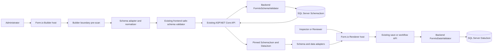

# Form.io Builder and Renderer Integration Design

## 1. Document status

- Status: proposed design; implementation is not authorized by this document.
- Audit baseline: commit `290e11d2deaabbe762a068c76c0343c5b467464b`.
- Research date: 2026-10-23.
- Scope: frontend Form.io Builder/Renderer integration design only.
- Related contracts: `docs/01`, `docs/02`, `docs/03`, `docs/05`, `docs/09`, `docs/10`, and `docs/13`.

This document is the checkpoint that must be reviewed before a compatibility spike. It does not authorize package installation, source changes, a database migration, or a change to any public API.

## 2. Current-state audit

### 2.1 Frontend baseline

The frontend currently uses React 19.2, TypeScript 6.0, Vite 8.3, and Node type declarations 24.x. Neither `package.json` nor `package-lock.json` contains a Form.io package.

The current form experience is a custom implementation:

- `FormSchemaEditor` is a React visual editor with an advanced JSON textarea. It adds, edits, removes, and reorders the seven supported component types.
- `DynamicInspectionForm` renders those seven types with native React controls and emits the existing `DataJson` value shapes.
- `frontend/src/formTemplates/schema.ts` owns frontend schema types, creation defaults, parsing, serialization, UTF-8 size checks, depth/count limits, property allowlists, and fail-closed validation.
- `frontend/src/inspections/draft.ts` hydrates, validates, and serializes existing Inspection `DataJson` without changing the pinned template contract.

The stored schema is Form.io-inspired, but it is not unrestricted Form.io JSON. It is a canonical safe subset with a root object containing only `components`. A stock Form.io Builder emits additional defaults and settings that the current validators deliberately reject. Therefore raw Builder output cannot be persisted directly.

### 2.2 Backend baseline

- SQL Server stores `FormTemplateVersion.SchemaJson` as `nvarchar(max)` with an `ISJSON` constraint.
- `FormIoSchemaValidator` is the authoritative fail-closed schema validator and canonicalizer.
- `FormIoDataValidator` validates Inspection `DataJson` against the exact pinned schema. Draft saves may omit required values; Submit enforces required values.
- The backend accepts only the seven component types and rejects unknown root, component, validation, option, and dangerous properties.
- Schema limits remain 1,048,576 UTF-8 bytes, 200 components, JSON depth 16, and component nesting depth one.
- Inspection creation resolves the latest Published version of an Active template and pins its `FormTemplateVersionId`.
- Existing revisions and submitted data remain immutable according to the Inspection workflow contract.

### 2.3 Existing API and lifecycle

The eight Form Template endpoints remain unchanged:

1. `GET /api/form-templates`
2. `GET /api/form-templates/{id}/versions`
3. `GET /api/form-templates/{id}/versions/{versionNumber}`
4. `POST /api/form-templates`
5. `PUT /api/form-templates/{id}/versions/{versionNumber}`
6. `POST /api/form-templates/{id}/versions/{versionNumber}/publish`
7. `POST /api/form-templates/{id}/versions`
8. `POST /api/form-templates/{id}/deactivate`

The lifecycle remains:

```text
Draft -> Published
```

- A template is created with Draft version 1.
- At most one Draft exists per template.
- Draft updates use `rowVersion` optimistic concurrency.
- Published versions are immutable and read-only.
- New Inspections use only the latest Published version of an Active template.
- Existing Inspections stay pinned to their original version.
- Deactivation blocks new activity but does not erase historical reads.

### 2.4 Existing regression coverage

Current tests already cover:

- schema allowlists, all seven component types, unsafe/unknown properties, duplicate keys, depth, count, and UTF-8 size;
- custom renderer value handling, required messages, read-only state, and safe text rendering;
- Form Template create/update/publish/new-version/deactivate, roles, concurrency, and database constraints;
- Inspection lookup/create/save/submit/review/recheck, pinned schemas, DataJson validation, row versions, revisions, and history;
- frontend 409 behavior that preserves unsaved edits and offers reload rather than automatic retry.

These tests are migration acceptance criteria, not disposable tests to be rewritten around Form.io behavior.

## 3. Goals

The intended integration will:

- provide the Form.io visual Builder for Administrator Draft authoring;
- provide the Form.io Renderer for Inspection data entry and read-only history;
- keep ASP.NET Core as the only application API, authorization boundary, and authoritative validator;
- keep SQL Server as the store for canonical `SchemaJson` and Inspection `DataJson`;
- preserve every existing template lifecycle, versioning, concurrency, pinning, revision, and role rule;
- preserve readability of all existing schemas and Inspection data;
- expose only the existing seven safe component types and safe settings;
- permit fast rollback to the custom editor/renderer until parity is proven.

## 4. Out of scope

This phase does not include:

- Form.io Server, Form.io Enterprise Server, Form.io Portal, hosted Form.io projects, or Form.io authentication;
- browser reads or writes to a Form.io service;
- Form.io actions, submissions API, resources, roles, JWT, or file storage;
- new Form Template or Inspection endpoints;
- database schema changes or migrations;
- new component types, nested layout components, wizards, PDF forms, or premium components;
- custom JavaScript, calculated values, conditional logic, custom validation, arbitrary HTML, files, remote data, or external requests;
- changes to Published versions or historical revisions;
- removal of the custom editor or renderer before the compatibility and regression gates pass.

## 5. Package research and candidate decision

### 5.1 Official candidate

The candidate pair to test, not yet to install, is:

| Package | Stable version checked | Intended use | Official compatibility evidence | Remaining risk |
| --- | --- | --- | --- | --- |
| `@formio/react` | `6.2.2` | React wrappers for Builder and Renderer | Peer dependencies are `react >=17` and `react-dom >=17`; the official README explicitly gives Vite guidance for React 18 and 19 | Built with TypeScript 5.7; no explicit TypeScript 6, Vite 8, or Node 24 support matrix |
| `@formio/js` | `5.7.0` | Core Form.io Builder/Renderer engine required by the React integration | Official package provides Builder, Renderer, types, CJS exports, and browser assets | Large dependency/CSS surface; published package must be proven with Vite 8 and the project CSP/security constraints |

Only stable releases are candidates. No release candidate, development tag, legacy `formiojs` package, Form.io Server package, or unverified community wrapper is accepted.

### 5.2 Compatibility assessment

- **React 19:** supported by the React package peer range; the official changelog records the React 19 upgrade and the README has React 18/19 Vite guidance.
- **TypeScript 6:** not explicitly guaranteed. `@formio/react` is currently built with TypeScript 5.7 and `@formio/js` with TypeScript 5.3. Consumer type declarations must compile under this project's strict TypeScript 6 settings during the spike.
- **Vite 8:** the official React README documents Vite usage but does not state a tested Vite 8 range. The candidate must pass dependency optimization, development HMR, production bundling, and deep-route reload tests.
- **Node 24:** neither candidate declares a usable Node engine guarantee in the inspected manifests. Installation, tests, and production build must run under the project's Node 24 baseline.

This is sufficient to select a spike candidate, not sufficient to approve production adoption.

### 5.3 License and dependency considerations

Both candidate repositories and package manifests identify the packages as MIT licensed. A production decision still requires a generated license inventory of every transitive dependency and retention of required notices.

`@formio/js` currently declares a broad runtime dependency graph that includes Bootstrap, Choices.js, DOMPurify, Dragula, JSON Logic, Quill, Moment, Tippy, polyfills, masking libraries, storage helpers, and other utilities. Even though only seven controls are enabled, installing the package may bring code used by unsupported features. The spike must therefore measure:

- exact installed dependency tree and licenses;
- `npm audit` results;
- production JavaScript and CSS bundle deltas;
- whether tree-shaking removes unused modules;
- whether any dependency performs network, storage, dynamic code, or unsafe DOM behavior by default;
- whether CSP can prohibit eval-like behavior without breaking the accepted subset.

### 5.4 Official research sources

- [Form.io React repository and Vite guidance](https://github.com/formio/react)
- [`@formio/react` package manifest](https://github.com/formio/react/blob/main/package.json)
- [`@formio/react` release history](https://github.com/formio/react/blob/main/CHANGELOG.md)
- [`@formio/react` on npm](https://www.npmjs.com/package/@formio/react)
- [Form.io JavaScript repository](https://github.com/formio/formio.js)
- [`@formio/js` package manifest](https://github.com/formio/formio.js/blob/main/package.json)
- [`@formio/js` on npm](https://www.npmjs.com/package/@formio/js)
- [Official Form Builder documentation](https://help.form.io/dev/form-development/form-builder)
- [Official Form JSON documentation](https://help.form.io/form-building/form-json)
- [Official documentation on executable customizations](https://help.form.io/dev/javascript-evaluator/protected-evaluator)

## 6. Target architecture



### 6.1 Ownership boundaries

- Form.io owns only interactive Builder/Renderer presentation in the browser.
- React page components own routing, loading, error states, dirty state, confirmations, role-aware actions, and API orchestration.
- Existing frontend API clients communicate only with ASP.NET Core.
- ASP.NET Core owns authentication, authorization, lifecycle, concurrency, schema/data validation, canonicalization, and persistence.
- SQL Server remains the system of record.
- The browser receives no Form.io Server URL, token, project identifier, access key, or direct persistence configuration.

### 6.2 No Form.io Server

The open-source frontend libraries can render local JSON and host a Builder without loading a schema from a Form.io URL. This integration must always pass in-memory schema/submission objects and handle saves with the existing API clients.

Do not provide `src`, `url`, Form.io project configuration, Form.io authentication context, or a Form.io submission endpoint. Network tests must prove that the page calls only the existing application origin and approved static assets. Production assets must be bundled locally; no CDN dependency is allowed.

## 7. Canonical schema contract

### 7.1 Canonical root

The persisted document remains:

```json
{
  "components": []
}
```

No `title`, `display`, `name`, `path`, actions, server URL, or Form.io project metadata is stored in `SchemaJson`.

### 7.2 Supported component types

The allowlist remains exactly:

| UI label | Canonical type |
| --- | --- |
| Text Field | `textfield` |
| Text Area | `textarea` |
| Number | `number` |
| Select | `select` |
| Radio | `radio` |
| Checkbox | `checkbox` |
| Date/Time | `datetime` |

Builder palettes for Basic, Advanced, Data, Layout, Premium, and custom groups must be replaced or disabled so that only these seven entries appear. Hiding palette entries is usability control only; adapter and backend validation remain the security controls.

### 7.3 Property allowlist

Common component properties:

```text
type, key, label, description, placeholder, tooltip, input,
tableView, hidden, disabled, defaultValue, validate
```

Type-specific properties:

| Type | Allowed properties |
| --- | --- |
| `textfield` | `prefix`, `suffix`, `spellcheck` |
| `textarea` | `rows`, `autoExpand`, `spellcheck` |
| `number` | `decimalLimit`, `requireDecimal`, `prefix`, `suffix` |
| `select` | `dataSrc`, `data`, `multiple` |
| `radio` | `values`, `inline` |
| `checkbox` | none beyond common properties |
| `datetime` | `format`, `enableDate`, `enableTime` |

Validation properties:

| Type | Allowed `validate` properties |
| --- | --- |
| Text Field, Text Area | `required`, `minLength`, `maxLength` |
| Number | `required`, `min`, `max`, `integer` |
| Select, Radio, Checkbox | `required` |
| Date/Time | `required`, `minDate`, `maxDate` |

Select uses only `dataSrc: "values"` with local `data.values`. Radio uses only local `values`. Option objects contain only `label` and primitive `value`. Component keys remain case-insensitively unique and follow the existing key format.

### 7.4 Explicitly forbidden features

The Builder UI must remove the related tabs and controls, and both adapters and backend validators must reject their JSON representations:

- custom JavaScript and executable expressions;
- custom validation and JSON Logic;
- calculated/default expressions, logic, actions, events, and conditional expressions;
- arbitrary HTML, content, templates, script URLs, and embedded markup;
- file, signature, resource, nested form, data grid, edit grid, container, columns, panel, tabs, button, and custom components;
- URL/resource data sources, refresh-on remote values, or any external request;
- file data, base64/data URLs, blobs, and storage configuration;
- nested `components` arrays or component nesting beyond the current flat depth;
- object-graph mutation keys `__proto__`, `prototype`, and `constructor` at every level of the JSON tree;
- unknown properties even when Form.io considers them harmless defaults.

Form.io documentation confirms that conditional logic, calculated values, custom defaults, and custom validation can execute user-supplied code. This project does not adopt a protected evaluator in this phase; it prohibits those capabilities entirely.

The raw JSON tree must be scanned recursively before any projection, normalization, cloning, object spread, or merge operation. If `__proto__`, `prototype`, or `constructor` occurs as a property name at any depth, validation fails. These keys must never be silently stripped because doing so would hide a hostile or ambiguous input from the caller and later validation layers.

## 8. Adapter and normalization design

### 8.1 Two representations

The integration must keep two separate representations:

- **Builder view model:** an ephemeral Form.io-compatible object with any mandatory display defaults required to operate the third-party UI.
- **Canonical safe schema:** the existing minimal JSON contract that is sent to ASP.NET Core and stored in SQL Server.

Only the canonical safe schema may cross the API boundary.

### 8.2 Builder output to canonical schema

Normalization is an explicit pipeline:

1. Receive a deep-cloned Builder change payload; never mutate a Form.io-owned instance.
2. Enforce the 1 MiB input ceiling, maximum JSON depth 16, and maximum 200 components before expensive processing.
3. Recursively pre-scan the raw JSON tree before projection. Reject `__proto__`, `prototype`, and `constructor` at every level, as well as forbidden component types, nested components, executable properties, URLs, HTML/script markers, base64/data URLs, resources, and external-source settings. Never silently strip a denied key.
4. Validate component identity and key uniqueness case-insensitively.
5. Project each accepted component onto the exact common and type-specific allowlists.
6. Normalize Form.io defaults into existing canonical forms, including `input: true`, local select/radio options, supported Date/Time formats, booleans, and primitive default values.
7. Remove only a documented set of inert Form.io-generated presentation defaults that the spike proves have no semantic or security effect. Never silently remove a dangerous or unknown executable/network property; reject the schema instead.
8. Serialize deterministically and run the existing frontend validator.
9. Send canonical JSON through the unchanged Form Template API.
10. Treat backend validation/canonicalization as authoritative and display its validation errors without retrying or weakening the payload.

The inert-default projection list is not yet approved. The compatibility spike must capture real Builder output for every allowed component and propose that list for review.

### 8.3 Canonical schema to Builder/Renderer

The reverse adapter must:

- parse using the current fail-closed validator;
- preserve component order, keys, labels, defaults, local options, and validation rules;
- add only ephemeral defaults required by Form.io;
- never persist those expansion defaults unless they survive canonical normalization;
- render an explicit unsupported-schema error rather than guessing if existing JSON is invalid;
- round-trip `canonical -> Form.io view -> canonical` with semantic equality.

### 8.4 Legacy SchemaJson compatibility

Every schema accepted before this integration must remain readable. Published JSON is never rewritten merely because a user opens it. Draft JSON is rewritten only after an authorized edit and successful save.

Compatibility fixtures must be collected from all current seeded and test schemas, plus each supported optional property. The custom editor remains available as rollback/fallback until all fixtures round-trip without component loss, key changes, option changes, validation changes, or date-format changes.

## 9. Inspection DataJson compatibility

### 9.1 Existing value shapes remain canonical

The integration does not introduce a Form.io submission document in storage. Persisted `DataJson` remains the current root key/value object, for example:

```json
{
  "result": "Pass",
  "verified": true
}
```

The frontend may wrap this transiently as `{ data: existingData }` when the Renderer requires a Form.io submission object, but it extracts and validates only `data` before sending the unchanged API DTO.

### 9.2 Read and update compatibility

- Existing primitive strings, numbers, booleans, arrays for supported multiple selections, and ISO Date/Time strings must hydrate without coercive data loss.
- Unknown keys and incompatible value types remain fail-closed.
- Draft save keeps current required-field behavior.
- Submit remains the point at which backend required validation is enforced.
- A Form.io client-side validation result is advisory UX only; it cannot replace `FormIoDataValidator`.
- Existing submitted revisions are read-only and must render using their pinned schema and stored data.
- Renderer events must not create background submissions or external requests.

Round-trip tests must prove `existing DataJson -> Form.io submission -> unchanged DataJson` when the user makes no edit.

Data coercion regression fixtures must additionally prove:

- string `"1"` remains distinct from number `1`;
- string `"true"` remains distinct from boolean `true`;
- a number is never converted to a string;
- Checkbox values remain booleans;
- multiple Select values remain arrays of primitive values with the primitive types and ordering preserved;
- Date/Time values do not shift instant, local meaning, or timezone offset during hydration, editing, serialization, or read-only rendering;
- a no-edit round trip preserves semantic equality, including value types, arrays, null/absence behavior, and supported Date/Time representation.

## 10. Lifecycle, concurrency, and user state

### 10.1 Draft and Published behavior

- Form.io Builder mounts only for the current editable Draft of an Active template and only for Administrator.
- Published versions render in read-only preview mode; Builder controls do not mount.
- Inactive templates and all their versions remain readable but not editable, publishable, or versionable.
- Creating a new Draft continues to allocate `NextVersionNumber` on the server.
- Version history and direct version routes remain unchanged.

### 10.2 Row version and 409 handling

The update request continues to include the last loaded `rowVersion`. On `409 Conflict`:

- keep the local Builder schema and any unsaved Inspection values in memory;
- do not automatically retry or overwrite server state;
- show the current conflict message and a deliberate Reload action;
- warn that Reload discards local changes;
- fetch fresh state only after confirmation;
- do not merge two schemas automatically in this phase.

### 10.3 Unsaved changes

Dirty state is computed from normalized canonical content, not raw Builder output, so Form.io-generated transient defaults do not create false dirty state.

Route changes, browser Back, refresh, version switching, logout, deactivate, publish, and new-version actions must use the existing unsaved-change guard. After a successful save, reset the baseline to the canonical schema returned or accepted by the API.

## 11. Accessibility and UX requirements

The compatibility spike must test rather than assume accessibility:

- Builder palette, component settings, reorder, edit, and delete are keyboard operable.
- Drag-and-drop has an equivalent keyboard/reorder control; if Form.io cannot provide this, retain a custom accessible ordering control.
- Modal focus is trapped correctly, initial focus is sensible, Escape/close behavior is predictable, and focus returns to the invoking component.
- Every rendered field has a programmatic label, description/error association, required indication, and visible focus.
- Errors are summarized and focus moves to the first invalid field without losing entered data.
- Status, Draft/Published, and validation results are not conveyed by color alone.
- Screen-reader announcements cover add/remove/reorder/save/conflict outcomes.
- Zoom at 200%, narrow viewport layout, high contrast, and reduced motion remain usable.
- Labels and options render as text and cannot inject HTML.

The minimum acceptance target is WCAG 2.1 AA for flows in scope, with automated checks supplemented by keyboard and screen-reader review.

## 12. Vite, CSS, assets, and bundle design

- Import Form.io and required Bootstrap/icon styles from installed local packages, never from a CDN.
- Scope or layer third-party CSS under dedicated Builder/Renderer hosts where practical; document unavoidable global selectors.
- Load the Builder only on Administrator template edit routes via dynamic import.
- Evaluate a separately lazy-loaded Renderer chunk for Inspection routes.
- Confirm that Vite 8 resolves the package's CommonJS-oriented exports and TypeScript declarations in development and production.
- Verify HMR mount/unmount cleanup and prevent duplicate event listeners. The upstream React changelog includes listener lifecycle fixes, making cleanup a mandatory regression case.
- Destroy Form.io instances and detach listeners on route change, version change, and component unmount.
- Bundle fonts/icons locally and verify production base paths and deep-route reload.
- Record compressed/uncompressed JavaScript and CSS deltas and establish an approved budget after the spike.
- Confirm no source map or built asset embeds secrets, environment credentials, external Form.io URLs, or raw JWTs.
- Keep the existing application theme readable; do not redesign unrelated Drawing, Inspection, Checklist, or Construction Object pages.

## 13. Security model

Security is defense in depth:

1. Restricted Builder palette and settings reduce accidental unsafe configuration.
2. Raw Builder pre-scan rejects dangerous semantics before projection.
3. The frontend canonical validator rejects unknown or unsafe schema/data.
4. The existing backend validators independently validate fail-closed.
5. Existing API authorization and role checks remain authoritative.
6. CSP and network tests block unexpected external access and executable strings.
7. SQL constraints retain JSON structural protection.

No client-side option, hidden tab, or Form.io validation outcome is a trust boundary. Any adapter ambiguity must fail with a clear error.

## 14. Compatibility spike plan

The next checkpoint, only after approval, should perform these steps without changing the database:

1. Record a clean baseline, create a reversible implementation branch/checkpoint, and add exact stable package versions through the existing lockfile workflow.
2. Capture the resolved dependency tree with `npm ls @formio/react @formio/js` and explain ownership with `npm explain @formio/js`; also capture licenses, vulnerability audit, and package integrity.
3. Compile a minimal isolated Builder and Renderer harness with React 19.2, TypeScript 6.0, Vite 8.3, and Node 24.
4. Prove development startup, HMR, production build, preview, deep routes, and cleanup.
5. Configure a palette containing only the seven types and remove unsafe settings tabs/fields.
6. Capture raw Builder JSON for every allowed component/property and determine the smallest inert-default projection list.
7. Attempt forbidden types/properties by UI, JSON mutation, and crafted API payload; all must be blocked.
8. Run canonical round trips for all existing schema fixtures and DataJson fixtures.
9. Compare the custom and Form.io renderers for values, validation, Date/Time, multiple select, read-only state, and revision history.
10. Test Draft save, publish, new version, deactivation, Inspection create/save/submit/review/recheck, stale `rowVersion`, dirty navigation, and roles.
11. Measure accessibility, bundle/CSS impact, memory/listener cleanup, request behavior, and CSP behavior.
12. Run full frontend/backend/integration regression, audit, format, and repository hygiene gates.
13. Produce a go/no-go report. Do not remove the custom implementation during the spike.

Spike success requires all supported functionality and historical fixtures to pass without API, schema, or database changes. Otherwise the result is no-go or a new design review, not a relaxed validator.

Dependency resolution is an explicit spike gate:

- `npm ls @formio/react @formio/js` must complete without an invalid peer dependency;
- `npm explain @formio/js` must show the intended ownership path;
- no existing dependency may be downgraded to make Form.io install;
- there must be no unnecessary duplicate runtime copy of `@formio/js`;
- `package-lock.json` must pin the reviewed, exact resolved tree and remain reproducible under `npm ci`.

## 15. Test strategy

### 15.1 Unit tests

- raw-schema dangerous-property pre-scan;
- exact allowlist projection for all seven types;
- inert-default stripping versus reject-on-danger behavior;
- canonical serialization, byte/depth/count limits, and case-insensitive keys;
- schema round-trip fixtures;
- DataJson wrapper/extraction and no-edit equality;
- dirty-state comparison based on canonical data;
- cleanup helpers and event deduplication.

### 15.2 Component tests

- seven-item Builder palette and absence of every unsupported group;
- safe property controls only;
- add/edit/remove/reorder, long labels/options, and errors;
- renderer values and changes for all seven types;
- read-only Published/revision views;
- 400/401/403/404/409/500 UX, especially preservation on 409;
- loading/empty/error states, double-submit prevention, and keyboard focus;
- XSS strings render as text.

### 15.3 Backend and integration tests

Existing Form Template and Inspection suites remain unchanged and must pass. Add crafted payload tests for every new Builder-emitted default, forbidden executable/network field, and normalization edge. Confirm the eight Form Template endpoints and all existing Inspection API contracts are identical.

### 15.4 Regression and runtime tests

- open every existing template version and Inspection revision;
- edit and save a legacy Draft without semantic drift;
- create/publish/pin a new version;
- save/submit/review/recheck with existing DataJson behavior;
- role and direct-route matrix;
- browser Back/Forward, refresh, cancellation, and repeated mount/unmount;
- no request loop, listener leak, memory growth, external request, token URL, or console error;
- production build served at the real base path.

### 15.5 Security tests

Craft schemas containing script/data URLs, HTML, templates, custom validation, calculated values, conditions, logic/actions/events, remote Select/resource URLs, files, base64, nested components, prototype-related keys, unknown properties, excessive depth/count/bytes, and duplicate keys. Each layer must fail closed, and the backend must remain authoritative when the frontend is bypassed.

## 16. Rollout and rollback

Rollout is incremental:

1. Compatibility harness only; no production route replacement.
2. Administrator Builder behind an application-configuration feature flag while the custom editor remains available.
3. Read-only Renderer comparison for Published versions and historical revisions.
4. Editable Inspection Renderer after data round-trip and workflow regression pass.
5. Default to Form.io only after runtime/security/accessibility approval.
6. Retire custom code only in a separate approved checkpoint after a defined stabilization period.

The feature flag is controlled only by trusted application configuration at deployment/startup. It must not be enabled or overridden through a query string, browser `localStorage`, session storage, or another user-controlled value, and no user-facing control may change it.

Rollback disables that application-configuration flag and returns to the custom editor/renderer. Because APIs, canonical JSON, and the database stay unchanged, rollback requires no migration. Any schema that cannot be read by both implementations must never be published during staged rollout.

## 17. Architecture decisions

The following ADR-level decisions are accepted for this design:

1. Use Form.io only as frontend Builder/Renderer technology.
2. Do not use Form.io Server or allow direct browser persistence to an external Form.io service.
3. Keep ASP.NET Core API, authorization, validation, lifecycle, and concurrency authoritative.
4. Keep SQL Server `FormTemplateVersion.SchemaJson` and existing Inspection `DataJson` storage.
5. Keep all eight Form Template endpoints and all Inspection contracts unchanged.
6. Keep exactly seven component types and the current property allowlists.
7. Persist canonical safe schema, never raw Builder JSON.
8. Reject dangerous/unknown semantics before projection; do not sanitize executable behavior silently.
9. Preserve Draft/Published immutability, version history, row versions, and Inspection pinning.
10. Require full backward compatibility for existing SchemaJson and DataJson.
11. Keep backend fail-closed validation even when Form.io validates in the browser.
12. Do not create a migration while current JSON columns are sufficient.
13. Keep the custom editor/renderer until compatibility, regression, runtime, security, and accessibility gates pass.
14. Use stable `@formio/react` plus `@formio/js` only if the spike approves the exact resolved versions and dependency tree.

## 18. Actual blockers and open evidence

No database or API blocker is currently identified. The existing columns and contracts can store the canonical subset.

The following are real blockers to implementation approval, to be resolved by the spike:

1. No official compatibility matrix explicitly guarantees TypeScript 6, Vite 8, and Node 24 together.
2. Stock Builder output contains more properties than the current fail-closed contract; the inert-default projection list must be derived and reviewed from actual output.
3. The runtime dependency and CSS surface of `@formio/js` is large relative to seven allowed controls; bundle, vulnerability, license, CSP, and external-behavior checks are required.
4. Accessible keyboard reordering and component-settings modal behavior must be demonstrated.
5. Existing Date/Time and multiple-select value round trips must be proven without coercion.
6. Form.io instance/event cleanup under React 19 routing must pass leak and duplicate-event tests.

Failure of a blocker does not permit bypassing backend validation, widening the component/property allowlist, adopting Form.io Server, or rewriting historical data without a new design decision.

## 19. Definition of Done

The Form.io integration is complete only when:

- the exact stable package versions and resolved tree are approved;
- React 19, TypeScript 6, Vite 8, and Node 24 development and production builds pass;
- only the seven approved components and properties are authorable;
- forbidden executable, HTML, file, base64, remote, resource, nested, and unknown content fails closed;
- raw Builder JSON is normalized to the current canonical safe schema before API submission;
- every existing SchemaJson and DataJson fixture reads and round-trips without semantic loss;
- Draft/Published, one-Draft, rowVersion, version history, deactivation, and Published read-only behavior are unchanged;
- Inspection latest-Published selection, version pinning, revisions, save/submit/review workflows, and roles are unchanged;
- 409 conflicts preserve unsaved content and require explicit reload;
- accessibility acceptance checks pass;
- no browser request reaches Form.io Server, CDN, MinIO, or another unapproved endpoint;
- production CSS/assets/deep routes and the agreed bundle budget pass;
- unit, component, backend, integration, regression, runtime, and security suites pass;
- package/license/vulnerability and secret/artifact scans pass;
- rollback to the custom editor/renderer is tested;
- removal of the custom implementation, if desired, is separately approved after stabilization.
