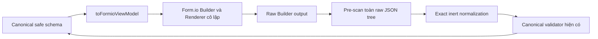

# Kết quả compatibility spike Form.io

> Cập nhật ngày 24/10/2026: phần **Restricted Builder Profile and Same-Origin Asset Result** ngay dưới đây là kết luận cuối cùng cho exact tree `@formio/react@6.2.2` + `@formio/js@5.7.0`. Phần này thay thế mọi đề xuất tiếp tục spike 5.7.0 ở các phần lịch sử bên dưới.

## Restricted Builder Profile and Same-Origin Asset Result

### Kết luận cuối cùng

**FINAL NO-GO cho `@formio/react@6.2.2` + `@formio/js@5.7.0`.** Không thực hiện thêm spike Form.io 5.7.0 và không đưa package tree này vào production.

Checkpoint dừng đúng tại dependency gate bắt buộc trước khi cài package. Date/Time renderer chính, không chỉ stock component editor, cần Flatpickr. Runtime tree hiện tại không chứa Flatpickr; vì vậy không thể vừa dùng đủ bảy component, vừa giữ `script-src 'self'`, vừa không gọi CDN nếu không bổ sung một dependency/asset local. Không tự cài package, không sao chép file từ CDN và không mở `cdn.form.io` trong CSP.

Kết luận này cũng giữ nguyên các blocker đã đo ở checkpoint no-eval: stock editor yêu cầu Ace, stock conditional fields phát warning evaluator hàng loạt và output toàn form không cung cấp raw plain-JSON boundary phù hợp với yêu cầu pre-scan trước clone.

### Restricted editor customization analysis

Source và declaration của package xác nhận có public customization seam:

- `Components.setComponent(name, componentClass)` và `Components.addComponent(...)` được export và khai báo type;
- `WebformBuilder.editComponent(...)` lấy class từ `Components.components[type]` rồi gọi public static `ComponentClass.editForm(overrides)`;
- do đó về kỹ thuật có thể đăng ký subclass cho bảy type và trả về edit form tối giản, thay vì mount stock tabs hoặc ẩn chúng bằng CSS;
- đường JSON editor stock mới tạo textarea `editor: "ace"`; `Component.addAce(...)` sau đó gọi `Formio.requireLibrary("ace", ...)` tới CDN mặc định.

Restricted edit forms chưa được triển khai. Việc làm nửa chừng sáu component rồi bỏ Date/Time sẽ không đáp ứng điều kiện bắt buộc “đủ bảy component”. Vì dependency gate của Date/Time đã fail trước implementation, checkpoint dừng trước khi thay đổi harness, test hoặc package tree. Ace elimination vì vậy chỉ được xác nhận là một customization path khả thi từ source, chưa được tuyên bố là runtime pass.

### Plain-schema boundary và `widget.timezone`

Các public source được đối chiếu cho kết quả sau:

| Nguồn | Raw trước pre-scan | Mutation/runtime metadata | Kết luận |
|---|---|---|---|
| React `FormBuilder.onChange` | Không | Wrapper gọi `@ungap/structured-clone` trên `builder.instance.form` trước khi gọi consumer | Không được dùng làm security boundary vì clone xảy ra trước raw-tree scan |
| React `onSaveComponent` | Có payload component vừa save trước lệnh clone của `onChange` | Chỉ là một component; không phải authoritative full form cho delete/reorder và các component còn lại | Không đủ làm full-schema boundary |
| `onBuilderReady` / underlying `builder.instance.form` | Có thể đọc nhưng đã thuộc runtime mutable graph | Component constructor mutates component object trong form | Không phải immutable canonical output |
| Schema truyền vào trước mount | Plain JSON do adapter tạo | Form.io clone ở React wrapper rồi runtime tiếp tục mutate clone đó | An toàn làm input, không phải output sau edit |
| Schema sau Builder/Renderer mount | Không còn thuần JSON theo contract | DateTime gắn runtime `widget` metadata | Adapter phải tiếp tục fail-closed |

Nguồn mutation chính xác trong `@formio/js@5.7.0`:

1. `Component.mergeSchema(component)` dùng `defaultsDeep` trực tiếp trên object component.
2. Constructor `DateTimeComponent` tính `timezone = this.component.timezone || this.options.timezone`.
3. Constructor này gán lại `this.component.widget` thành object calendar có own enumerable property `timezone`.
4. Với schema hiện tại không truyền runtime timezone, giá trị đó là `undefined`: `typeof` là `undefined`, không có constructor/prototype/own keys và không phải JSON value. Object `widget` bao quanh vẫn là plain object, nhưng chứa own property non-JSON này.

Không có bằng chứng property cụ thể này là circular reference, function, class instance hoặc browser object; `undefined` đã đủ để raw-tree scan từ chối. Không được dùng `JSON.stringify` để âm thầm bỏ property, không whitelist path `widget.timezone`, không cho adapter nhận class/runtime graph và không đưa `structuredClone` lên trước security scan.

### Flatpickr same-origin analysis

Đường gây request đã được xác định trực tiếp trong package source:

- `DateTimeComponent` chuyển component sang calendar widget;
- `CalendarWidget.attach()` luôn gọi `Formio.requireLibrary` cho `flatpickr.min.css` và `flatpickr.min.js` từ `Formio.cdn["flatpickr-formio"]`;
- đây là dependency của main Date/Time input; việc loại stock Date/Time editor fields không loại được request;
- locale chỉ tạo request bổ sung khi locale khác `en`; nó không phải nguyên nhân của hai request chính;
- package đặt CDN version là `4.6.13-formio.3`.

`Formio.requireLibrary` là public typed mechanism. Nó kiểm tra global property trước; nếu `window.flatpickr` đã tồn tại thì resolve mà không inject script. CDN object cũng có public override/base URL API. Tuy nhiên các API này chỉ chọn hoặc nhận library đã có, không cung cấp implementation hay asset local.

Resolved application tree không có `flatpickr` hoặc `flatpickr-formio`. Cả `@formio/js@5.7.0` và `@formio/core@2.9.0` chỉ khai báo `flatpickr` trong `devDependencies`, nên npm không cài nó cho consumer. Không có local JS/CSS hợp lệ để Vite bundle hoặc self-host.

Dependency nhỏ nhất cần một checkpoint phê duyệt riêng nếu từng xem xét lại quyết định là:

| Thuộc tính | Giá trị đã xác minh |
|---|---|
| Package phù hợp exact CDN fork | `flatpickr-formio@4.6.13-formio.3` |
| License | MIT |
| Runtime dependencies | 0 |
| Main/module/style | `dist/flatpickr.js`; `dist/esm/index.js`; `dist/flatpickr.css` |
| Registry unpacked size | 1,099,854 bytes, 273 files |
| Tác động bundle | Thêm JS calendar và CSS vào isolated Form.io asset; minified/gzip delta phải được đo bằng production build sau khi được phép cài, chưa được suy đoán là số liệu pass |

Metadata trên chỉ phục vụ báo cáo quyết định. Package không được thêm vào `package.json`/lockfile trong checkpoint này.

### Gate result và quyết định quản lý

| Điều kiện GO | Kết quả cuối |
|---|---|
| Đủ bảy component | Fail: Date/Time thiếu local runtime dependency |
| Restricted editor chỉ chứa safe properties | Chưa chạy; dừng tại dependency gate |
| Ace không load | Chưa chứng minh runtime; stock path đã biết vẫn load Ace |
| Date/Time không gọi CDN | Fail |
| Không external network | Fail ở exact tree hiện tại |
| Không evaluator warning nghiêm trọng | Fail ở stock editor đã đo trước đó |
| Public plain full-schema boundary trước clone | Fail |
| Safe Canonical Adapter chấp nhận output không nới contract | Fail ở runtime-mutated full form |
| Builder → canonical → Renderer → DataJson đủ bảy type | Fail/incomplete |
| CSP giữ nguyên | Pass; không nới CSP |
| Visual/accessibility | Không chạy theo quy tắc vì end-to-end Save chưa đạt |
| Full quality gate sau implementation | Không chạy theo quy tắc dừng trước dependency install; quality gate no-eval gần nhất vẫn được ghi ở phần lịch sử |

Không có source production, backend validator, migration, database, `FormSchemaEditor` hoặc `DynamicInspectionForm` nào bị sửa. Staging vẫn phải để trống.

Quyết định đề xuất cho quản lý:

1. Giữ custom `FormSchemaEditor` và `DynamicInspectionForm` hiện tại.
2. Tiếp tục dùng canonical schema an toàn tương thích một phần với Form.io, với backend validation fail-closed.
3. Không tiếp tục spike `@formio/js@5.7.0`, không thêm `unsafe-eval` và không mở Form.io CDN.
4. Chỉ đánh giá package/version hoặc sản phẩm khác trong một quyết định kiến trúc mới; không tự nâng/hạ package trong worktree hiện tại.

### Final Production Decision

1. Không đưa package Form.io vào production dependency tree.
2. Không sử dụng Form.io Server hoặc Form.io Cloud.
3. Không nới CSP, không thêm `unsafe-eval` và không cho phép external Form.io CDN.
4. Không thay đổi backend schema, API hoặc security contract; backend validation tiếp tục fail-closed.
5. Production tiếp tục sử dụng custom `FormSchemaEditor` và `DynamicInspectionForm` hiện có.
6. Duy trì canonical safe schema tương thích một phần với Form.io ở mức dữ liệu, không lưu raw Form.io runtime schema.
7. Package/version mới chỉ có thể được đánh giá lại trong một checkpoint kiến trúc và compatibility riêng được phê duyệt.
8. Elsa Workflow hoàn toàn độc lập với quyết định Form.io này.

Quyết định không tạo migration, không thay đổi hoặc apply database và không tác động dữ liệu hiện có.

## No-eval CSP Compatibility

### Kết luận

**NO-GO cho production rollout.** No-eval loại bỏ đúng lỗi `Function(...)`/`unsafe-eval` trước đây và cho phép Builder cùng Renderer render ban đầu dưới `script-src 'self'`. Tuy nhiên nó không làm exact package tree hiện tại tương thích đầy đủ với CSP và contract của dự án:

1. Date/Time tự yêu cầu Flatpickr JS/CSS từ `https://cdn.form.io`; CSP chặn request này.
2. Mở component editor tự yêu cầu Ace từ `https://cdn.form.io`; CSP chặn request này.
3. Stock component editor dựa vào conditional/evaluation nội bộ. No-eval phát hơn 100 cảnh báo `No evaluations allowed for this renderer.` trong một luồng add/edit/save và làm form cấu hình hiển thị nhiều trường ngoài safe subset.
4. Save Text Field sau khi đổi label, key và required không đi qua Safe Canonical Adapter: stock runtime output chứa non-JSON value tại `$.components[7].widget.timezone`, nên adapter fail-closed đúng thiết kế.

Do đó các điều kiện “không CSP violation”, “không Form.io CDN”, “đủ bảy component hoạt động”, “save qua adapter” và “không warning nghiêm trọng” đều chưa đạt. Không thêm `unsafe-eval`, không nới CSP, không đổi package/version và không dùng `@formio/protected-eval` trong checkpoint này.

### Public API và bootstrap

- Exact tree: `@formio/react@6.2.2` → `@formio/js@5.7.0` → `@formio/core@2.9.0`.
- API dùng là root public export `Utils` từ `@formio/js`; cờ là `Utils.Evaluator.noeval`.
- `@formio/js/lib/cjs/utils/index.d.ts` khai báo `Utils.Evaluator: DefaultEvaluator`; `@formio/core` khai báo `DefaultEvaluator.noeval: boolean`. Không cần internal/private import, global `any`, module augmentation hoặc sửa `node_modules`.
- Đây là mutable singleton/global state. `configureFormioNoEval()` chạy trong isolated entry trước callback lazy import `FormioSpikeHarness`; test xác nhận cờ vẫn `true` sau unmount và không reset về `false` trong cleanup.
- Production `FormSchemaEditor` và `DynamicInspectionForm` không import bootstrap này và không thay đổi.

CSP giữ nguyên chính xác:

```text
default-src 'self'; connect-src 'self'; img-src 'self' data:; font-src 'self' data:; script-src 'self'; style-src 'self' 'unsafe-inline'
```

Không monkey-patch `eval`, `Function` hoặc browser security. Edge thật không ghi nhận `EvalError`, `unsafe-eval` hay template `TypeError`; thay vào đó CSP log ghi đúng các external asset bị chặn nêu trên.

### Browser runtime và bảy component

Microsoft Edge 155 headless chạy production-like preview với CSP thật và feature flag từ application/build configuration.

| Component | Palette | Renderer ban đầu | Data semantics/adapter | No-eval finding |
|---|---:|---:|---|---|
| Text Field | Có | Có | Automated round-trip đạt | Add và modal mở được; stock runtime output sau Save chứa non-JSON widget state nên bị fail-closed |
| Text Area | Có | Có | String/Unicode/null/missing đạt | Không có executable feature trong canonical subset |
| Number | Có | Có | Integer, decimal và `0` giữ kiểu | Không có lỗi eval trong render ban đầu |
| Select | Có | Có | Primitive và multiple array giữ kiểu | Local options đạt ở adapter; chưa thể nghiệm thu stock editor save vì toàn form bị reject |
| Radio | Có | Có | Primitive giữ kiểu | Local options đạt ở adapter; chưa thể nghiệm thu stock editor save vì toàn form bị reject |
| Checkbox | Có | Có | `false`/`true` giữ boolean | Không có lỗi eval trong render ban đầu |
| Date/Time | Có | Có input ban đầu | ISO 8601/timezone round-trip đạt ở adapter | Calendar không production-ready vì tự tải Flatpickr CDN |

Browser xác nhận `.formbuilder` và `.formio-form` đều tồn tại; palette chỉ có bảy type đã duyệt. Enter trên Text Field mở modal và focus vào `data[label]`. Thay label, key, required rồi Save làm label mới xuất hiện trong working UI, nhưng canonical state không được cập nhật vì adapter trả lỗi fail-closed nêu trên. Vì vậy không được diễn giải UI thay đổi tạm thời này là save thành công.

### Code execution và tính năng bị vô hiệu hóa

| Nhóm | Kết quả |
|---|---|
| `eval`/`Function` từ schema | Không có `EvalError` hoặc `unsafe-eval` trong browser security log; no-eval chặn đường evaluator trước code generation |
| `calculateValue`, custom validation, conditional JavaScript, template tùy chỉnh | Vẫn bị raw-tree pre-scan/adapter reject trước persistence |
| Logic, event/action, URL/resource source, file/base64, custom component | Ngoài safe subset và fail-closed |
| JSON Logic object | Package có thể xử lý object trong evaluator, nhưng canonical allowlist không phát sinh hoặc chấp nhận executable/dynamic logic |
| Stock Builder settings conditions | Bị vô hiệu hóa bởi no-eval; phát cảnh báo hàng loạt và làm settings UI không đáng tin cậy |
| Select/Radio static options | Adapter và renderer hỗ trợ; stock editor end-to-end chưa đạt vì save toàn form fail |
| Date/Time | Renderer tạo input nhưng calendar asset bị CSP chặn; chưa đạt |

Không còn call stack gọi `Function` sau bootstrap. Call stack gây lỗi đầu tiên còn lại thuộc `@formio/js` `CalendarWidget.attach` → `Formio.requireLibrary`, yêu cầu `flatpickr.min.css`/`flatpickr.min.js` từ Form.io CDN. Khi mở editor, đường tương tự yêu cầu `ace.js`.

### Global state, cleanup và accessibility

- No-eval là global singleton; mọi Form.io instance trong cùng JavaScript realm chịu cùng cấu hình. Đây là compatibility risk cần ADR nếu tích hợp production.
- Automated test mount/unmount giữ cờ `true`; StrictMode entry không reset cờ. Listener Escape/focus hiện có vẫn cleanup đúng reference trong bộ test không-noeval.
- Browser add/edit chứng minh keyboard palette và focus đầu modal hoạt động. Escape wrapper đã có test riêng, nhưng full accessibility acceptance không đạt vì settings conditional bị vô hiệu hóa và console warning hàng loạt.
- 1366×768 DPR 1 và 1440×900 DPR 1 render shell, palette và controls, không thấy horizontal overflow toàn trang trong ảnh headless. Lượt DPR 2 chỉ chụp được lazy-loading state; zoom 200% và modal visual không được chấp nhận là pass vì CSP/network/runtime gate đã fail.
- Không có bằng chứng request/render loop. Production route không sử dụng Form.io vẫn tách khỏi isolated entry.

### Bundle và network

No-eval bootstrap phải import public `@formio/js` trước lazy harness. Kết quả isolated build hiện tại:

| Asset | Minified | Gzip |
|---|---:|---:|
| Entry/no-eval Form.io JS | 1,955.70 kB | 545.98 kB |
| Lazy harness JS | 80.27 kB | 20.64 kB |
| Harness CSS | 124.33 kB | 23.88 kB |
| Entry CSS | 1.93 kB | 0.86 kB |

Vite vẫn cảnh báo chunk trên 500 kB. Import bootstrap đã kéo Form.io core vào entry của isolated page thay vì giữ toàn bộ runtime trong lazy harness; đây là performance risk bổ sung, không được che bằng tăng `chunkWarningLimit`.

Browser network ghi nhận local document, JS, CSS và font, nhưng không còn “tất cả request same-origin”: Date/Time thử gọi Flatpickr JS/CSS và component editor thử gọi Ace từ `cdn.form.io`. CSP chặn tải, nhưng việc phát sinh outbound request vẫn vi phạm gate network.

### Trạng thái gate no-eval

Quality gate cuối của checkpoint:

| Kiểm tra | Kết quả |
|---|---|
| `npm ci` | Pass; clean install 188 package, lockfile không đổi |
| No-eval/Form.io spike tests | 4 file, 34/34 pass |
| Frontend regression | 17 file, 134/134 pass |
| Production build | Pass; asset production giữ nguyên và không chứa Form.io chunk |
| Isolated spike build | Pass; giữ large-chunk warning đã ghi nhận |
| Frontend lint | Pass; 9 warning baseline ở Auth/Drawing, không có warning spike mới |
| `npm audit` | 0 vulnerability |
| Package tree | Exact `@formio/react@6.2.2`, `@formio/js@5.7.0`, `jstimezonedetect@1.0.7`; không duplicate/invalid peer |
| Backend build | Pass, 0 warning, 0 error |
| Domain tests | 82/82 pass |
| Application tests | 124/124 pass |
| Integration lần 1 | 36/36 pass, 0 fail, 0 skip |
| Integration lần 2 | 36/36 pass, 0 fail, 0 skip |
| Formatter | Pass |
| NuGet vulnerability | Không có vulnerable package được báo cáo |
| EF pending model | Không có pending model changes |
| Migration status | Không tạo/apply migration; danh sách applied kết thúc ở `20261020133408_AddChecklists` |
| Repository hygiene | `git diff --check`, secret/artifact scan đạt; staging trống |

Hai Integration suite chạy tuần tự trên database riêng `ConstructionInspectionIntegrationTestDb`; không dùng hoặc reset Development database. EF checks chỉ đọc, dùng biến môi trường process tạm và xóa sau khi chạy; không hiển thị secret.

| Gate | Kết quả |
|---|---|
| Public typed API | Pass |
| Bootstrap trước Builder/Renderer | Pass |
| Builder/Renderer initial render dưới `script-src 'self'` | Pass |
| Không `EvalError`/`unsafe-eval` | Pass |
| Đủ bảy palette item và initial controls | Pass |
| Save qua Safe Canonical Adapter | Fail |
| Date/Time hoạt động không external asset | Fail |
| Không CSP violation | Fail |
| Không Form.io Cloud/CDN request | Fail |
| Console không error/warning nghiêm trọng | Fail |
| Visual/accessibility matrix đầy đủ | Fail/incomplete |
| Production rollout | **NO-GO** |

Hướng tiếp theo phải là checkpoint thiết kế riêng; không tự triển khai trong lượt này. Ba lựa chọn an toàn vẫn là: đánh giá package/version khác hỗ trợ CSP và local assets, cô lập Form.io trên admin origin/iframe có risk review riêng, hoặc giữ custom Builder/Renderer hiện tại và chỉ bảo toàn canonical schema tương thích Form.io.

## Bổ sung Safe Canonical Adapter

### Kết luận mới

**NO-GO cho tích hợp production tại checkpoint này.**

Safe Canonical Adapter đã chuyển được raw Builder output mặc định của đủ bảy component sang canonical schema mà không nới backend allowlist. Exact inert defaults chỉ được bỏ khi nằm trong danh sách đã review, khớp deep-equal và tạo diagnostic. Non-default, unknown và dangerous semantics đều fail-closed. DataJson giữ nguyên nghĩa; Escape/focus/listener đã được xử lý trong harness.

Ba gate môi trường/license trước đó đã đóng: `npm ci` tái lập được hai lần, Integration đạt 36/36 hai lần trên Windows host và artifact `jstimezonedetect@1.0.7` chứa MIT `LICENCE.txt`. NO-GO vẫn được giữ vì browser thật chứng minh Form.io 5.7.0 không hoạt động dưới CSP hiện tại: thư viện dùng `Function(...)` để render template, bị `script-src 'self'` chặn do không có `unsafe-eval`. Builder và Renderer không render, nên visual/accessibility runtime gate không thể đạt. Không nới CSP chỉ để làm gate xanh.

Không có Form.io code nào được nối vào production route. `FormSchemaEditor`, `DynamicInspectionForm`, backend validator, API, lifecycle, migration và database không thay đổi.

### Baseline và dependency

- HEAD: `5680a702472ad96689f9fe90a1cf973cb0cd6c5d`.
- Exact packages: `@formio/react@6.2.2`, `@formio/js@5.7.0`.
- Resolved stack: React/ReactDOM `19.3.0`, TypeScript `6.0.3`, Vite `8.3.3`, Node `24.19.0`, npm `11.17.0`.
- `npm ls` và `npm explain` xác nhận một runtime `@formio/js`, không invalid peer, duplicate runtime hoặc downgrade; lockfile pin resolved tree.
- Feature flag chỉ đọc cấu hình build `VITE_ENABLE_FORMIO_SPIKE === "true"`; query string, browser storage và user input không thể bật flag.
- Repository có `origin` từ trước; checkpoint không sử dụng hoặc thay đổi remote.

### Luồng adapter



### Property classification

Nguồn đo là `Components.components[type].builderInfo.schema` của `@formio/js@5.7.0`.

- **C**: canonical property được giữ và validate.
- **I**: inert default chỉ normalize khi deep-equal exact value; luôn có diagnostic.
- **R**: luôn reject hoặc reject khi khác exact default.
- Property không liệt kê là unknown và **R**; không silently strip.

#### Property chung

| Property | Phân loại |
|---|---|
| `type`, `key`, `label`, `description`, `placeholder`, `tooltip`, `input`, `tableView`, `hidden`, `disabled`, `defaultValue`, `validate` | C theo type/validator; `defaultValue:null` do Builder sinh là I |
| `prefix`, `suffix`, `multiple` | C khi component hỗ trợ; nếu không thì I với exact default `""`, `""`, `false` |
| `customClass:""`, `protected:false`, `unique:false`, `persistent:true`, `clearOnHide:true`, `modalEdit:false` | I |
| `errorLabel:""`, `hideLabel:false`, `tabindex:""`, `autofocus:false`, `dbIndex:false`, `validateOn:"change"` | I |
| `allowCalculateOverride:false`, `encrypted:false`, `showCharCount:false`, `showWordCount:false`, `allowMultipleMasks:false` | I |
| `customDefaultValue:""`, `calculateValue:""`, `refreshOn:""`, `redrawOn:""` | I; mọi chuỗi non-empty là R |
| `calculateServer:false` | I; `true` là R |
| `conditional:{show:null,when:null,eq:""}` | I; mọi biến thể khác là R |
| `overlay:{style:"",left:"",top:"",width:"",height:""}` | I; mọi biến thể khác là R |
| `attributes:{}`, `properties:{}`, `serverOverride:{}`, `addons:[]` | I chỉ khi rỗng và đúng loại |
| `validate.custom:""`, `customPrivate:false`, `strictDateValidation:false`, `multiple:false`, `unique:false`, `pattern:""`, `minWords:""`, `maxWords:""`, `step:"any"`, `onlyAvailableItems:false` | I; code hoặc giá trị khác là R |
| `logic`, `actions`, `events`, nested `components`, script/expression, arbitrary HTML, non-empty URL/resource/custom data source | R |
| `__proto__`, `prototype`, `constructor` | R ở mọi cấp với mọi giá trị, trước clone/merge/spread/projection |

#### Text Field

| Property | Phân loại |
|---|---|
| `prefix`, `suffix`, `spellcheck`, `validate.required/minLength/maxLength` | C |
| `dataGridLabel:false`, `labelPosition:"top"`, `widget:{type:"input"}` | I |
| `inputType:"text"`, `inputFormat:"plain"`, `mask:false`, `inputMask:""`, `displayMask:""`, `truncateMultipleSpaces:false` | I |

#### Text Area

| Property | Phân loại |
|---|---|
| `rows`, `autoExpand`, `spellcheck`, `validate.required/minLength/maxLength` | C |
| `dataGridLabel:false`, `labelPosition:"top"`, `widget:{type:"input"}` | I |
| `inputType:"text"`, `inputFormat:"html"`, `mask:false`, `inputMask:""`, `displayMask:""`, `truncateMultipleSpaces:false` | I; không đồng nghĩa cho phép HTML content |
| `fixedSize:true`, `wysiwyg:false`, `editor:""` | I; WYSIWYG/editor khác default là R |

#### Number

| Property | Phân loại |
|---|---|
| `decimalLimit`, `requireDecimal`, `prefix`, `suffix`, `validate.required/min/max/integer` | C |
| `dataGridLabel:false`, `labelPosition:"top"`, `widget:{type:"input"}` | I |

#### Select

| Property | Phân loại |
|---|---|
| `dataSrc:"values"`, `data.values`, `multiple` | C; local options chỉ gồm plain-text label và primitive value |
| `data.json:""`, `data.url:""`, `data.resource:""`, `data.custom:""` | I; non-empty là R |
| `template:"<span>{{ item.label }}</span>"` | I exact; template tùy chỉnh là R |
| `authenticate:false`, `ignoreCache:false`, `clearOnRefresh:false`, `readOnlyValue:false`, `uniqueOptions:false`, `useExactSearch:false` | I |
| `idPath:"id"`, `limit:100`, `valueProperty:""`, `lazyLoad:true`, `filter:""`, `searchEnabled:true`, `searchDebounce:0.3`, `searchField:""`, `minSearch:0`, `selectFields:""`, `selectThreshold:0.3` | I |
| `fuseOptions:{include:"score",threshold:0.3}`, `indexeddb:{filter:{}}`, `customOptions:{}` | I |
| `dataGridLabel:false`, `labelPosition:"top"`, `widget:null` | I |

#### Radio

| Property | Phân loại |
|---|---|
| `values`, `inline` | C; options dùng plain-text label và primitive value |
| `data:{url:""}` | I; non-empty hoặc field khác là R |
| `dataSrc:"values"`, `inputType:"radio"`, `fieldSet:false`, `authenticate:false`, `ignoreCache:false` | I |
| `template:"<span>{{ item.label }}</span>"` | I exact; template tùy chỉnh là R |
| `dataGridLabel:false`, `labelPosition:"top"`, `widget:null` | I |

#### Checkbox

| Property | Phân loại |
|---|---|
| `validate.required` | C |
| `dataGridLabel:true`, `labelPosition:"right"`, `widget:null`, `inputType:"checkbox"`, `value:""`, `name:""` | I |

#### Date/Time

| Property | Phân loại |
|---|---|
| `format`, `enableDate`, `enableTime`, `validate.required/minDate/maxDate` | C; Builder default format được map sang canonical ISO format |
| `useLocaleSettings:false`, `allowInput:true`, `defaultDate:""`, `displayInTimezone:"viewer"`, `timezone:""`, `datepickerMode:"day"`, `customOptions:{}` | I |
| `datePicker` | I với exact display defaults; null bounds là I, literal string bounds được map sang canonical validation |
| `timePicker:{hourStep:1,minuteStep:1,showMeridian:true,readonlyInput:false,mousewheel:true,arrowkeys:true}` | I exact |
| `dataGridLabel:false`, `labelPosition:"top"`, `widget:{type:"input"}` | I |

### Fail-closed, diagnostics và limits

Pre-scan chạy trước mọi clone/merge/spread/projection, chặn accessor, function, symbol, non-plain object, cycle, non-finite number, script URI, script tag, event-handler HTML, base64, blob và ba prototype keys. Adapter giữ limits: depth 16, 200 component, 1,048,576 UTF-8 bytes và unique key case-insensitive.

Mỗi inert property bị loại tạo diagnostic `{ path, property, reason: "reviewed-inert-default" }`. Test chứng minh non-default `calculateValue`, `calculateServer`, `customDefaultValue`, `refreshOn`, `redrawOn`, `conditional`, `validate.custom`, custom template, URL/resource, event/action/logic, custom component, nested unknown và prototype pollution đều bị reject. Adapter không mutate input.

### Semantic round-trip

- Raw defaults thật của đủ bảy component đều normalize được.
- Canonical → working → canonical semantic-equal cho key, label, required, options, multiple, validation và Date/Time bounds.
- String `"1"` khác number `1`; string `"true"` khác boolean `true`.
- Integer, decimal, `0`, `false`, checkbox và primitive Select/Radio giữ đúng kiểu.
- Multiple Select giữ array primitive.
- Date/Time ISO 8601 giữ nguyên timezone và thời điểm.
- Null, missing, empty string và Unicode tiếng Việt không mất nghĩa.
- Draft thiếu required vẫn round-trip; backend tiếp tục quyết định validation lúc Submit.

### Accessibility, cleanup và network

- Palette focusable; Enter mở editor.
- Escape chỉ đóng Form.io component editor và trả focus về palette item; không tác động modal khác.
- `focusin` và capture `keydown` listeners được cleanup đúng reference; repeated unmount đạt.
- Test instrument `fetch`, XHR, WebSocket, EventSource và `sendBeacon`; không có outbound request hoặc request loop.
- `keyboardBuilder` có ở runtime nhưng thiếu trong anonymous `FormBuilderProps['options']` declaration. Không có named interface an toàn để module-augment; dùng intersection type cục bộ thay vì redeclare module hoặc sửa `node_modules`.

### Bundle

Production bundle không đổi: app CSS `32.03 kB` (`5.52 kB` gzip), app JS `420.95 kB` (`121.14 kB` gzip), Drawing Viewer `448.38 kB` (`135.16 kB` gzip).

Lazy spike bundle:

| Asset | Minified | Gzip |
|---|---:|---:|
| Entry shell JS | 223.24 kB | 70.13 kB |
| Lazy Form.io harness JS | 1,811.63 kB | 495.62 kB |
| Harness CSS | 124.33 kB | 23.88 kB |
| Entry CSS | 1.93 kB | 0.86 kB |

Vite vẫn cảnh báo lazy chunk lớn hơn 500 kB minified. Gzip hiện dưới 500 kB nhưng rất sát ngưỡng, còn raw chunk là 1.81 MB. Production rollout sau này phải giữ lazy route/import và cần quản lý chấp thuận performance budget.

### License

**RESOLVED cho artifact chính xác đang sử dụng.**

- Dependency path: project → `@formio/js@5.7.0` → `jstimezonedetect@1.0.7`.
- `npm pack jstimezonedetect@1.0.7 --dry-run --json` xác nhận tarball có đúng bảy file, gồm `LICENCE.txt` 1,177 bytes.
- `LICENCE.txt` ghi rõ MIT License và copyright; `dist/jstz.js` có MIT license header tương ứng.
- Registry metadata liên kết repository `https://github.com/pellepim/jstimezonedetect.git`, git head `0508acd36d5243a9215ee99ac2cb0d723c2fef4e`.
- Artifact shasum `54bc13ff9960a6510288665cc9596244e21bd29d`; integrity khớp package-lock/registry.
- `package.json` không có trường `license`, giải thích vì sao trang tổng hợp hiển thị `none`; bằng chứng license nằm trực tiếp trong artifact publish, không dựa vào package/version khác hoặc nguồn thứ ba.

### Quality gate mới nhất

| Gate | Kết quả |
|---|---|
| `npm ci` | Pass hai clean install liên tiếp sau khi dừng đúng Vite preview tree; mỗi lượt 188 package, 0 vulnerability |
| Lockfile reproducibility | Pass; SHA-256 trước/sau hai lượt giống nhau, không mutation |
| `npm ls` / `npm explain` | Pass; exact versions, một runtime, không invalid peer/downgrade |
| Spike tests | 3 files, 33/33 pass |
| Frontend regression | 17 files, 134/134 pass |
| Frontend lint | Pass; không warning spike; còn 9 warning baseline Auth/Drawing |
| Production build | Pass; production assets không đổi |
| Isolated spike build | Pass; large-chunk warning đã ghi nhận |
| npm audit | 0 vulnerability |
| Backend build | Pass, 0 warning/error |
| Domain tests | 82/82 pass |
| Application tests | 124/124 pass |
| Integration lượt 1 | 36/36 pass, 0 fail, 0 skip trên Windows host |
| Integration lượt 2 | 36/36 pass, 0 fail, 0 skip ngay sau lượt 1 |
| dotnet format | Pass |
| NuGet vulnerability | Không project nào có vulnerable package |
| EF pending model | Không có pending model changes |
| Migration status | Pass; applied list kết thúc ở `20261020133408_AddChecklists` |
| Browser visual/runtime | Fail; CSP chặn Form.io template evaluator, Builder/Renderer không render |
| Browser network | Không outbound Form.io/CDN; spike chỉ tải asset từ cùng origin |

SQL service preflight: `MSSQLSERVER` Running, PID 9412, CreationDate `2026-10-21T13:56:06+07:00`, RAM khả dụng khoảng 987 MiB, .NET runtime 10.0.8 x64. Read-only kết nối tới `ConstructionInspectionDb` và `ConstructionInspectionIntegrationTestDb` đều đạt. Lỗi TLS trước đó chỉ xảy ra trong sandbox trước assertion; không thay connection security, retry, timeout hoặc source. Hai lượt chính thức chạy ngoài sandbox trên Windows host.

### Browser visual, performance và network QA

Browser thật: Microsoft Edge headless, production preview local.

| Case | Kết quả |
|---|---|
| 1366×768, DPR 1 | Khung trang không overflow nhưng Builder/Renderer trống do CSP error |
| 1440×900, DPR 1 | Cùng kết quả; không horizontal overflow |
| 1440×900, DPR 2 | Cùng kết quả; typography/container không tràn nhưng controls không render |
| Browser zoom 200% | Không thể nghiệm thu controls/modal vì runtime đã fail trước interaction |
| Palette/modal/7 components | Không thể nghiệm thu trong browser thật |
| Escape/focus/listener | Automated harness test đạt; browser runtime không thể tới modal |

Console/runtime evidence:

- `EvalError`: evaluating a string as JavaScript vi phạm CSP vì `unsafe-eval` không được cho phép.
- Sau đó có template-related `TypeError`; `.formbuilder`, `.formio-form` và palette đều không tồn tại.
- Không sửa CSP và không thêm `unsafe-eval` trong checkpoint.

Spike navigation hoàn tất khoảng 59 ms trong một local run; entry shell và lazy chunk đã tải nhưng Builder không đạt interactive state, vì vậy không báo TTI giả. Route có 5 subresource (entry JS/CSS, lazy JS/CSS và favicon), tất cả cùng origin. Lazy Form.io chunk transfer khoảng 491,991 bytes trong run này. Production `/login` có `formioLoaded:false`, chứng minh route không dùng Form.io không tải lazy chunk. Automated instrumentation cũng xác nhận không có fetch/XHR/WebSocket/EventSource/sendBeacon outbound hoặc request loop.

### Readiness status

| Gate | Adapter technical readiness | Production rollout readiness |
|---|---|---|
| Adapter security | Ready | Ready |
| DataJson semantics | Ready | Ready |
| `npm ci` reproducibility | Ready | Ready |
| Integration | Ready | Ready |
| Exact artifact license | Resolved | Resolved |
| Bundle isolation | Ready | Risk acceptance còn thiếu |
| Visual/accessibility runtime | Automated checks ready | Blocked bởi CSP/runtime incompatibility |
| Network behavior | Ready | Ready |

### Rủi ro còn lại và điều kiện GO

Adapter, DataJson, fail-closed và accessibility đã đạt trong harness. Trước GO vẫn phải:

1. quản lý quyết định có chấp nhận CSP `unsafe-eval` hay không; mặc định hiện tại là không chấp nhận;
2. nếu không chấp nhận, đánh giá Form.io package/version hoặc renderer/builder khác trong spike riêng, không nới backend contract;
3. chỉ chạy lại visual/accessibility matrix sau khi có phương án không vi phạm CSP được duyệt;
4. duyệt performance budget cho lazy chunk 1.81 MB raw/495.62 kB gzip;
5. chỉ triển khai production trong checkpoint riêng, vẫn giữ backend fail-closed và rollback không migration.

---

## Báo cáo spike ban đầu (được phần bổ sung ở trên thay thế khi có khác biệt)

## 1. Kết luận

**NO-GO cho tích hợp production ở trạng thái hiện tại.**

Hai package được yêu cầu có thể cài, compile và mount trên stack hiện tại. Production frontend cũng không bị regression khi spike được tách thành entry riêng. Tuy nhiên, raw schema mà Form.io Builder 5.7.0 phát ra cho cả bảy component luôn chứa các thuộc tính bị contract an toàn hiện tại cấm, gồm `calculateValue`, `conditional`, `customDefaultValue`, `refreshOn`, `redrawOn`, custom validation và, với Select/Radio, HTML template. Adapter fail-closed đúng theo docs/14 vì vậy phải từ chối raw output này. Builder có thể hiển thị nhưng chưa thể lưu thay đổi thành canonical safe schema mà không thay đổi quyết định bảo mật hoặc xây một lớp builder schema riêng.

Ngoài blocker schema, modal chỉnh sửa không đóng bằng phím Escape trong phép thử DOM và bundle spike lớn. Chưa thay `FormSchemaEditor` hoặc `DynamicInspectionForm` production.

## 2. Baseline và phạm vi

- HEAD lúc bắt đầu: `5680a702472ad96689f9fe90a1cf973cb0cd6c5d` (`docs: design Form.io integration`).
- Working tree và staging sạch lúc bắt đầu.
- Repository đã có remote `origin`. Đây là khác biệt so với giả định “không có remote” trong yêu cầu; spike không sửa remote và không push.
- Node `24.19.0`; npm `11.17.0`.
- Resolved stack: React/ReactDOM `19.3.0`, TypeScript `6.0.3`, Vite `8.3.3`.
- Không sửa backend source, API, tám endpoint Form Template, lifecycle, migration hoặc database.
- Harness là entry/build riêng; không có production route tới harness.
- Feature flag `VITE_ENABLE_FORMIO_SPIKE` là build/application configuration, mặc định tắt. Không đọc query string, `localStorage` hoặc `sessionStorage` để bật flag.

## 3. Package và dependency

### 3.1 Version thực tế

| Package | Version | Khai báo | License | Peer compatibility |
|---|---:|---|---|---|
| `@formio/react` | `6.2.2` | exact | MIT | `react >=17`, `react-dom >=17` |
| `@formio/js` | `5.7.0` | exact | MIT | Không khai báo peer dependency |

`npm ls @formio/react @formio/js --all` và `npm explain @formio/js` xác nhận chỉ có một runtime `@formio/js@5.7.0`, là direct dependency. Không có invalid peer dependency.

So sánh lockfile trước/sau cho thấy 73 package được thêm, không package nào bị xóa hoặc đổi version. Vì vậy không có dependency downgrade. Toàn bộ package có `resolved` đều có integrity trong lockfile. `npm ci` tái tạo được đúng dependency tree.

### 3.2 License và package hygiene

Phân bố license của 73 package mới:

| License | Số package |
|---|---:|
| MIT | 55 |
| ISC | 4 |
| Apache-2.0 | 2 |
| BSD-3-Clause | 2 |
| WTFPL | 2 |
| Unlicense | 2 |
| Unlicence | 1 |
| BSD | 1 |
| BSD-2-Clause | 1 |
| CC0-1.0 | 1 |
| MPL-2.0 OR Apache-2.0 | 1 |
| Không khai báo | 1 |

Không phát hiện GPL, AGPL, SSPL hoặc BUSL. `jstimezonedetect@1.0.7` không khai báo license trong package metadata và cần legal review trước production. npm cũng cảnh báo `lodash.isequal@4.5.0` đã deprecated và postinstall của `core-js@3.51.0` chưa nằm trong allow-scripts policy; spike không tự cho phép script.

`npm audit` sau cài đặt: 0 vulnerability.

## 4. Isolated harness

Harness dùng trực tiếp `FormBuilder` và `Form` từ `@formio/react` và chứng minh:

- Builder và renderer thật mount được.
- Palette chỉ có `textfield`, `textarea`, `number`, `select`, `radio`, `checkbox`, `datetime`.
- Các group Basic, Advanced, Data, Layout, Premium và Resource bị tắt.
- File, Content, HTML, Button, Resource, Container, Panel, Columns, DataGrid và EditGrid không xuất hiện.
- Renderer có read-only mode.
- Repeated mount/unmount ba lần hoàn tất và không tạo fetch request.
- `keyboardBuilder: true` làm palette item focusable và Enter mở editor.
- `keyboardBuilder` hoạt động trong runtime 5.7.0 nhưng bị thiếu trong TypeScript declaration của package; harness dùng intersection type cục bộ và không patch package.
- Add/edit/remove/reorder có trong Builder API/UI. Tuy nhiên thay đổi chưa thể qua adapter do blocker raw schema; không thể xem đây là workflow lưu production đạt yêu cầu.
- Builder luôn gọi `loadProject()` nội bộ và phát warning `Missing projectId`; khi không cấu hình project URL không quan sát thấy fetch ra ngoài. Warning vẫn là finding cần loại bỏ hoặc kiểm soát trước rollout.

Harness không chứa Form.io Server URL, MinIO URL, JWT hoặc API production. Runtime preview trả HTTP 200 cho entry và local JS asset. Build chỉ phát sinh local JS, CSS và hai font icon; không phát sinh external asset.

## 5. Raw Builder property matrix

Ma trận được lấy trực tiếp từ `Components.components[type].builderInfo.schema` của `@formio/js@5.7.0`.

| Component | Canonical giữ lại | Inert metadata có thể bỏ khi đúng giá trị đo được | Thuộc tính raw phải reject |
|---|---|---|---|
| Text Field | type, key, label, description, placeholder, defaultValue, validate required/minLength/maxLength, prefix, suffix, spellcheck | presentation/persistence defaults như customClass rỗng, persistent true, labelPosition top, attributes rỗng, addons rỗng | customDefaultValue, calculateValue, calculateServer, conditional, refreshOn, redrawOn, custom validation |
| Text Area | common safe fields, rows, autoExpand, spellcheck | presentation/persistence defaults và editor/wysiwyg inert defaults | executable/calculated/conditional fields và unknown editor semantics |
| Number | common safe fields, decimalLimit, requireDecimal, prefix, suffix, validate min/max/integer | presentation/persistence defaults | executable/calculated/conditional fields |
| Select | common safe fields, local `data.values`, dataSrc values, multiple | search/display defaults chỉ khi khớp exact measured value | `template` chứa HTML, `data.url`, `data.resource`, `data.custom`, refresh/calculation/conditional fields |
| Radio | common safe fields, local values, inline | presentation/persistence defaults | `template` chứa HTML và executable/calculated/conditional fields |
| Checkbox | common safe fields và validate required | presentation/persistence defaults | executable/calculated/conditional fields |
| Date/Time | common safe fields, format, enableDate, enableTime, minDate/maxDate | date presentation defaults như timezone rỗng và datepickerMode day | executable/calculated/conditional fields |

Điểm quyết định: các trường trong cột reject tồn tại ngay trong schema mặc định, kể cả khi giá trị là chuỗi rỗng hoặc object điều kiện mặc định. Docs/14 yêu cầu dangerous semantics phải reject và không silently strip. Do đó không được đưa chúng vào danh sách inert chỉ để Builder lưu được.

## 6. Adapter và security findings

Adapter spike thực hiện pre-scan raw tree trước clone, merge, spread hoặc projection. Nó fail-closed với:

- `__proto__`, `prototype`, `constructor` ở mọi cấp;
- function, accessor, object không thuần JSON, cycle, number không hữu hạn;
- script URI, HTML, base64 và blob;
- custom validation, calculated value, conditional logic, action/event;
- URL/resource source;
- nested components và component ngoài bảy loại;
- property lạ hoặc inert property có giá trị khác exact value đã đo;
- duplicate key không phân biệt hoa thường, giới hạn depth/count/UTF-8 bytes.

Adapter chỉ xuất root `{ "components": [...] }`, sau đó gọi validator production hiện tại. Crafted unsafe schemas đều bị reject thay vì bị silently strip. Backend contract không được nới trong spike.

XSS text fixture không tạo script element trong production renderer hiện tại. Harness CSP giới hạn `default-src`, `connect-src`, `script-src` về `self`; font/image data URI chỉ áp dụng cho asset hiển thị. Schema adapter vẫn cấm data/base64/blob trong schema và DataJson boundary.

## 7. Round-trip

Automated tests đạt cho fixture chứa đủ bảy component:

- canonical schema → Form.io view model → canonical schema semantic-equal;
- schema cũ thuộc safe subset vẫn đọc được qua validator/adapter;
- string `"1"` khác number `1`;
- string `"true"` khác boolean `true`;
- number không đổi thành string;
- checkbox giữ boolean;
- Select/Radio giữ primitive string/number/boolean;
- Multiple Select giữ array primitive;
- Date/Time giữ nguyên chuỗi có timezone `+07:00`;
- no-edit DataJson round-trip semantic-equal và không mutate input;
- Draft thiếu required vẫn qua data adapter; validation khi Submit tiếp tục thuộc backend.

Không thay lifecycle Draft/Published, rowVersion, history hoặc Inspection pinning.

## 8. Accessibility và UX

- Khi bật `keyboardBuilder`, bảy palette item có `tabindex="0"`; Enter mở component editor.
- Modal đưa focus vào trường đầu tiên.
- Escape không đóng modal trong phép thử của version này. Đây là accessibility blocker cần wrapper/fix có test focus trap, Escape và restore focus.
- Form.io có keyboard move API khi `keyboardBuilder` bật, nhưng end-to-end reorder chưa thể được chấp nhận vì adapter từ chối output sau chỉnh sửa.
- Spike chưa có browser automation để xác minh hình ảnh tại 1366×768, 1440×900 và zoom 200%. Build riêng bảo đảm CSS Form.io/Bootstrap không đi vào production bundle, nhưng visual QA thật vẫn là gate bắt buộc trước rollout.
- Không quan sát request loop trong mount/unmount test; không có bằng chứng heap-level đủ để tuyên bố không memory leak dài hạn.

## 9. Bundle và build

### 9.1 Production bundle

Production build trước và sau spike giống nhau:

| Asset | Baseline | Sau spike | Delta |
|---|---:|---:|---:|
| App CSS | 32.03 kB / 5.52 kB gzip | 32.03 kB / 5.52 kB gzip | 0 |
| App JS | 420.95 kB / 121.14 kB gzip | 420.95 kB / 121.14 kB gzip | 0 |
| Drawing Viewer JS | 448.38 kB / 135.16 kB gzip | 448.38 kB / 135.16 kB gzip | 0 |

### 9.2 Isolated Form.io bundle

| Asset | Size | Gzip |
|---|---:|---:|
| Form.io JS | 2,028.18 kB | 563.02 kB |
| Form.io CSS | 126.26 kB | 24.62 kB |
| Bootstrap icon fonts | 134.04 kB + 180.28 kB | Không ghi gzip |

Vite cảnh báo chunk lớn hơn 500 kB. Nếu production integration được duyệt sau này, lazy route/import, explicit chunking và performance budget là bắt buộc.

## 10. Verification results

| Gate | Kết quả |
|---|---|
| Baseline frontend tests | 134/134 pass |
| Frontend regression (`npm test`) | 17 files, 134/134 pass; file-level serialization tránh starvation của Drawing async test sau khi dependency tree nặng hơn |
| Form.io spike (`npm run test:formio-spike`) | 3 files, 23/23 pass; chạy tuần tự để tránh package nặng gây starvation cho test cũ |
| Frontend lint | Pass; 9 warning baseline ở Auth/Drawing, không có warning spike |
| Production build | Pass, bundle chính không đổi |
| Isolated spike build | Pass, có large-chunk warning |
| npm audit | 0 vulnerability |
| npm ci reproducibility | Pass |
| Backend build | Pass, 0 warning, 0 error |
| Domain tests | 82/82 pass |
| Application tests | 124/124 pass |
| Integration tests | 5/36 pass, 31 fail do cùng lỗi SQL/TLS môi trường |
| NuGet vulnerability | Không project nào có vulnerable package |
| EF pending model | Không có pending model changes |

Integration failure được phân loại là môi trường: SQL Server yêu cầu encryption nhưng runtime báo máy không hỗ trợ. Không có assertion nghiệp vụ Form.io thất bại; không retry, không tăng timeout và không sửa connection/package để che lỗi.

## 11. Blocker trước production

1. Chốt cách tạo một raw schema không chứa các property bị deny. Phương án an toàn ưu tiên là custom builder component definitions/edit forms chỉ phát sinh canonical safe subset, không nới backend allowlist.
2. Giữ pre-scan và fail-closed projection; không coi các trường executable/HTML là inert chỉ vì giá trị mặc định rỗng.
3. Khắc phục hoặc bọc modal để Escape, focus trap và restore focus đạt accessibility test.
4. Chứng minh add/edit/remove/reorder end-to-end sau khi canonical adapter chấp nhận output.
5. Chạy browser visual QA ở hai viewport và zoom 200%, gồm CSS shell isolation.
6. Loại bỏ/kiểm soát warning project settings và chứng minh không có request Form.io Cloud bằng browser network capture.
7. Lazy-load Builder, code-split bundle và đặt performance budget.
8. Legal review `jstimezonedetect` không khai báo license và review policy cho `core-js` postinstall.
9. Chạy lại 36 integration tests khi SQL/TLS environment ổn định.

## 12. File thay đổi trong spike

- `frontend/package.json`
- `frontend/package-lock.json`
- `frontend/.gitignore`
- `frontend/formio-spike.html`
- `frontend/vite.formio-spike.config.ts`
- `frontend/vite.formio-spike.test.config.ts`
- `frontend/vite.config.ts`
- `frontend/src/spikes/formio/config.ts`
- `frontend/src/spikes/formio/schemaAdapter.ts`
- `frontend/src/spikes/formio/FormioSpikeHarness.tsx`
- `frontend/src/spikes/formio/formioSpike.css`
- `frontend/src/spikes/formio/main.tsx`
- `frontend/src/spikes/formio/schemaAdapter.test.ts`
- `frontend/src/spikes/formio/rawBuilderSamples.test.ts`
- `frontend/src/spikes/formio/FormioSpikeHarness.test.tsx`
- `docs/15-formio-compatibility-spike-result.md`

`dist`, `dist-formio-spike`, coverage và test output không được track. Không có backend source, migration, database, production Form Template/Inspection component hoặc API contract nào thay đổi.

## 13. Bước tiếp theo đề xuất

Dừng để review NO-GO. Nếu được phê duyệt một checkpoint tiếp theo, chỉ làm prototype custom restricted builder definitions và modal accessibility wrapper trong harness, sau đó lặp lại raw matrix, round-trip, network, browser visual QA và full regression. Chưa thay production editor/renderer cho đến khi tất cả blocker trên được đóng.
