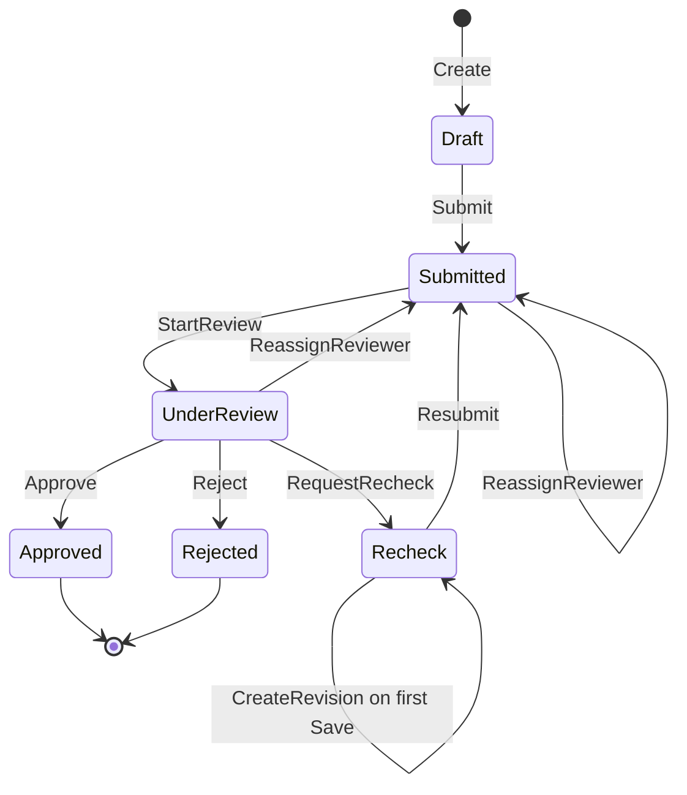
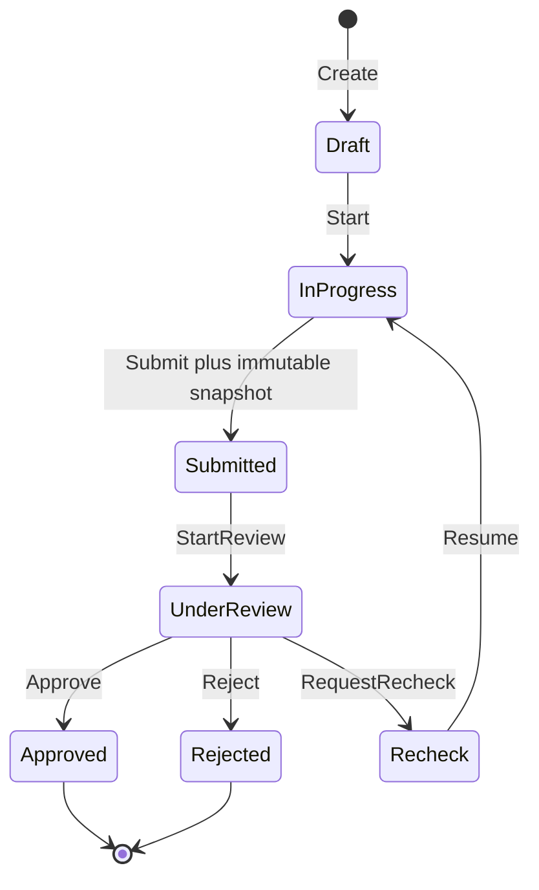
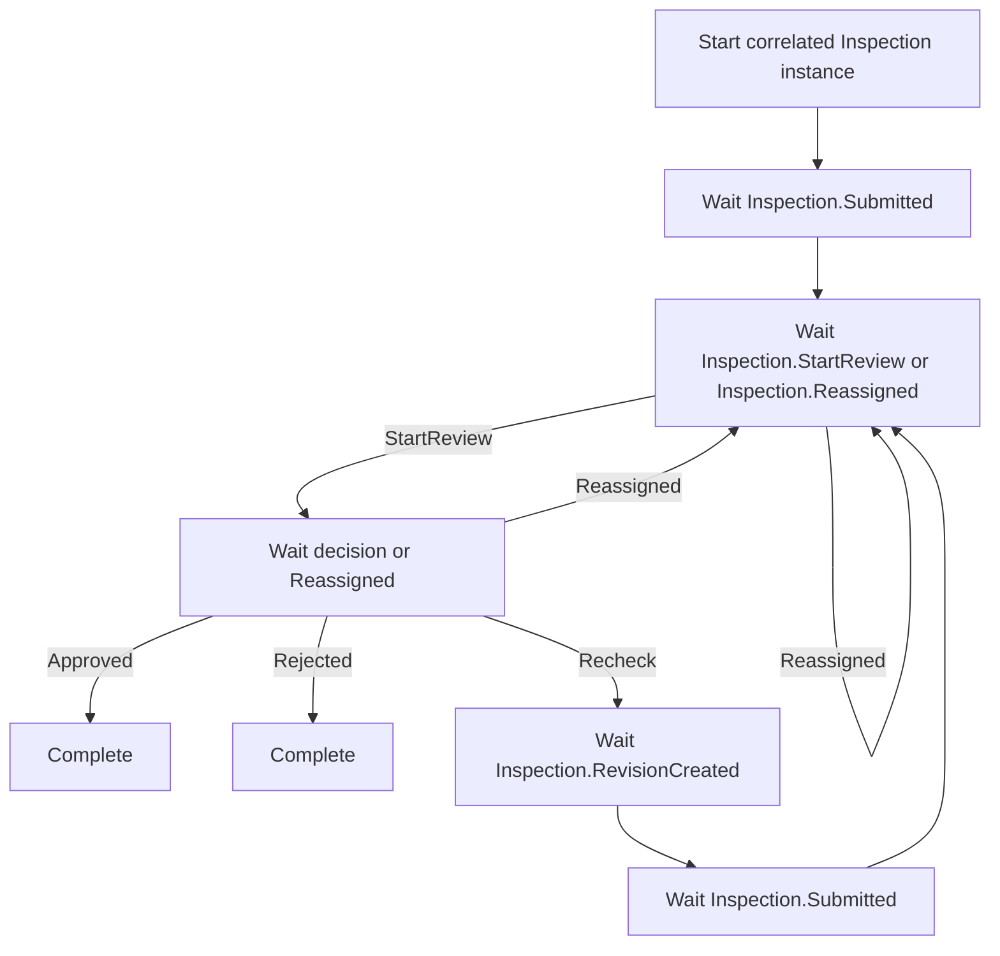
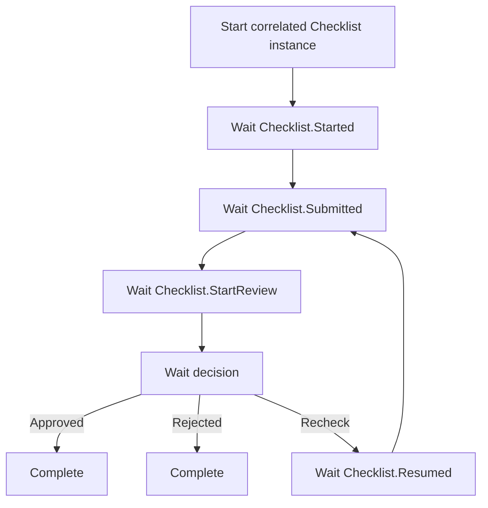
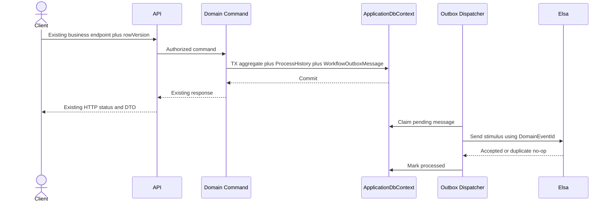

# Elsa Workflow integration design

## 1. Mục đích và phạm vi

Tài liệu này thiết kế cách đánh giá và tích hợp Elsa Workflows vào `ConstructionInspectionTraining` mà không thay đổi nguồn sự thật nghiệp vụ hiện tại. Baseline implementation là commit `7ea3bd774c2a35a46249a49cb174b101098dcfc2`.

Checkpoint này chỉ tạo tài liệu. Không cài package, không sửa source production, không tạo migration, không thay đổi database, không chạy compatibility spike và không thay đổi Git remote.

Mục tiêu:

- Giữ nguyên Domain invariant, authorization, scope, optimistic concurrency và API contract.
- Giữ `BusinessProcess` là trạng thái nghiệp vụ và `ProcessHistory` là audit nghiệp vụ append-only.
- Dùng Elsa trước hết để chứng minh khả năng orchestration, suspend/resume, correlation và vận hành workflow dài hạn.
- Có đường rollout và rollback không làm gián đoạn workflow hiện tại.

Ngoài phạm vi:

- Elsa Studio, Elsa Identity, Elsa Server riêng và Elsa generic REST API.
- Workflow definition do người dùng tự chỉnh sửa trong MVP.
- HTTP activity, arbitrary signal endpoint, timer/SLA, notification và external connector.
- Thay endpoint Inspection/Checklist, thay response DTO hoặc thay status code.
- Migration, outbox implementation, production persistence hoặc deployment.

## 2. Nguồn và nguyên tắc audit

Đã đối chiếu `AGENTS.md`, `README.md`, `docs/01–05`, `docs/09`, `docs/10`, `docs/12–15`, Domain/Application/Infrastructure/API source và integration test infrastructure.

Source tại baseline là nguồn chính xác khi tài liệu cũ khác implementation. Ví dụ, `docs/03` mô tả 11 API Inspection ở một thiết kế sớm, trong khi controller hiện tại có 15 route; `docs/10` và source mới phản ánh workflow/reviewer/history đầy đủ hơn.

Kiến trúc hiện tại:

- Domain giữ aggregate và transition rule; không phụ thuộc Infrastructure.
- Application command kiểm tra role, ownership/assignment, state và rowVersion rồi điều phối transaction.
- Infrastructure dùng EF Core/SQL Server, `UPDLOCK, HOLDLOCK` và rowversion.
- Controller chỉ bind DTO, áp coarse role gate và gửi MediatR request.
- Query chỉ đọc, áp scope trước projection; command mới thay đổi dữ liệu.

## 3. Inventory implementation baseline

### 3.1 Inspection state machine



Quy tắc đang chạy:

- Inspector tạo, lưu Draft, Submit và resubmit Inspection của chính mình.
- Lần Submit đầu chọn active Reviewer; resubmit phải giữ Reviewer đã gán.
- Chỉ assigned active Reviewer, không phải creator, được Start Review và ra quyết định.
- Manager hoặc Administrator được reassign khi `Submitted` hoặc `UnderReview`; reassign từ `UnderReview` quay về `Submitted`.
- `Approved` và `Rejected` là terminal.
- Revision đã Submit bất biến. Save đầu tiên sau Recheck cấp số từ `NextRevisionNumber`, tạo revision mới và đổi `CurrentSubmissionId`; không dùng `MAX + 1`.
- Không tự retry request dùng rowVersion cũ.

### 3.2 Inspection endpoint inventory

Controller hiện có 15 route. Elsa không được thay đổi route, payload hay status của bất kỳ route nào.

| Method và route | Loại | Actor chính |
|---|---|---|
| `GET /api/inspections` | Query | Inspector own, Reviewer assigned, Manager/Admin read scope |
| `GET /api/inspections/form-template-options` | Query | Inspector |
| `GET /api/inspections/reviewer-options` | Query | Inspector, Manager, Administrator |
| `GET /api/inspections/{id}` | Query | Actor trong read scope |
| `POST /api/inspections` | Command | Inspector |
| `PUT /api/inspections/{id}/draft` | Command | Creator Inspector |
| `POST /api/inspections/{id}/submit` | Transition | Creator Inspector |
| `POST /api/inspections/{id}/start-review` | Transition | Assigned Reviewer |
| `POST /api/inspections/{id}/approve` | Transition | Assigned Reviewer |
| `POST /api/inspections/{id}/reject` | Transition | Assigned Reviewer |
| `POST /api/inspections/{id}/recheck` | Transition | Assigned Reviewer |
| `POST /api/inspections/{id}/reassign-reviewer` | Transition | Manager, Administrator |
| `GET /api/inspections/{id}/history` | Query | Actor trong read scope |
| `GET /api/inspections/{id}/revisions` | Query | Actor trong read scope |
| `GET /api/inspections/{id}/revisions/{revisionNumber}` | Query | Actor trong read scope |

### 3.3 Checklist state machine



Quy tắc đang chạy:

- Creator Inspector tạo, Start/Resume, cập nhật item/link và Submit.
- Checklist có `NextSubmissionNumber`; mỗi Submit tạo immutable `ChecklistSubmission`, item snapshots và Inspection-link snapshots.
- Item `Fail` yêu cầu ít nhất một linked Inspection cùng Construction Object trước Submit.
- Cấu trúc item bất biến sau lần Submit đầu; sau Recheck phải Resume rồi mới sửa result/note/link và resubmit.
- Resubmit giữ Reviewer; Checklist không có reassign endpoint trong UC23–UC30.
- Object inactive sau Create không chặn workflow hiện hữu, nhưng chặn Create mới và thay đổi link set.
- Assigned active Reviewer Start Review và quyết định; terminal giống Inspection.

### 3.4 Checklist endpoint inventory

Checklist controller có đúng 14 route:

| Method và route | Loại | Actor chính |
|---|---|---|
| `GET /api/checklists` | Query | Actor trong read scope |
| `GET /api/checklists/{id}` | Query | Actor trong read scope |
| `POST /api/checklists` | Command | Inspector |
| `POST /api/checklists/{id}/start` | Transition | Creator Inspector |
| `PUT /api/checklists/{id}/items` | Command | Creator Inspector |
| `PUT /api/checklists/{id}/inspections` | Command | Creator Inspector |
| `POST /api/checklists/{id}/submit` | Transition | Creator Inspector |
| `POST /api/checklists/{id}/start-review` | Transition | Assigned Reviewer |
| `POST /api/checklists/{id}/approve` | Transition | Assigned Reviewer |
| `POST /api/checklists/{id}/reject` | Transition | Assigned Reviewer |
| `POST /api/checklists/{id}/recheck` | Transition | Assigned Reviewer |
| `GET /api/checklists/{id}/history` | Query | Actor trong read scope |
| `GET /api/checklists/{id}/submissions` | Query | Actor trong read scope |
| `GET /api/checklists/{id}/submissions/{submissionNumber}` | Query | Actor trong read scope |

Manager và Administrator đọc được Checklist nhưng không thay Inspector/Reviewer thực hiện transition.

### 3.5 Concurrency, transaction và locking

Ba loại rowVersion nghiệp vụ cần bảo toàn là:

1. Aggregate rowVersion: `Inspection.RowVersion` hoặc `Checklist.RowVersion`.
2. Current mutable child rowVersion: `InspectionSubmission.RowVersion`; với Checklist authoring là từng `ChecklistItem.RowVersion` khi item tồn tại.
3. Workflow rowVersion: `BusinessProcess.RowVersion`.

Contract cụ thể không ép mọi endpoint gửi cả ba loại:

- Inspection Submit và Save Draft kiểm tra Inspection + current Submission + Process.
- Inspection reviewer decisions chỉ cần Process; reassign cần Inspection + Process.
- Checklist Start/link/Submit dùng Checklist + Process; update items thêm rowVersion của từng existing item; reviewer decisions dùng Process.
- Immutable Checklist submission snapshots không có public mutation hoặc rowVersion.

`EfUnitOfWork.ExecuteInTransactionAsync` mở một SQL transaction và commit sau operation. Repository write-load dùng `UPDLOCK, HOLDLOCK`; EF rowversion là optimistic guard cuối. `SaveChangesAsync` map `DbUpdateConcurrencyException` thành `409` và không retry business command.

Atomic boundary hiện tại bao gồm aggregate changes, current submission/items/link changes, reviewer assignment, status transition, immutable snapshot khi có và đúng một `ProcessHistory`. Checklist Submit có hai lần `SaveChangesAsync` trong cùng transaction để insert snapshot trước khi đặt circular `CurrentSubmissionId`; bất kỳ lỗi nào vẫn rollback toàn bộ transaction.

### 3.6 Business audit và snapshot

`ProcessHistory` không có public mutation API. Action hiện tại:

- Inspection: `Create`, `Submit`, `StartReview`, `Approve`, `Reject`, `RequestRecheck`, `ReassignReviewer`, `CreateRevision`.
- Checklist: `Create`, `Start`, `UpdateInspectionLinks`, `Submit`, `StartReview`, `Approve`, `Reject`, `RequestRecheck`, `Resume`.

History giữ from/to status, actor, UTC timestamp, note/reason, submission reference phù hợp và reviewer trước/sau khi reassign. Inspection history không tham chiếu Checklist submission và ngược lại.

`InspectionSubmission` là revision; revision Submit bất biến. `ChecklistSubmission`, `ChecklistSubmissionItem` và `ChecklistSubmissionInspection` là immutable snapshot của đúng lần Submit. Elsa execution log không được dùng để tái tạo hoặc thay thế các record này.

### 3.7 HTTP behavior cần giữ nguyên

| HTTP | Baseline behavior |
|---:|---|
| 400 | DTO/FluentValidation/domain input sai, reason thiếu, JSON/type sai |
| 401 | Thiếu hoặc sai JWT do authentication middleware |
| 403 | Resource nhìn thấy nhưng actor sai role/capability |
| 404 | Không tồn tại hoặc ngoài object-level read scope để tránh enumeration |
| 409 | State sai, stale rowVersion, double transition, reviewer/lifecycle conflict |

`GlobalExceptionHandler` trả ProblemDetails có stable code và `traceId`; không lộ stack trace, SQL, JWT hoặc secret. Elsa không được bypass exception mapping này.

### 3.8 Regression baseline bắt buộc

Các test hiện tại cần tiếp tục đạt nguyên trạng:

- Domain: Inspection transition/terminal/reason/reassign/revision; Checklist lifecycle/terminal/owner isolation/snapshot/counter/status mapping.
- Application: role/scope, pinned schema, reviewer eligibility, cả ba concurrency token, history, reassign, first-save revision; Checklist atomic create/start/items/links/submit/snapshot/reviewer workflow.
- Integration Inspection: auth/scope, lookups, atomic create/save, concurrent number allocation, Submit validation, concurrent decisions, Recheck revision, concurrent first save, reassign audit và DB constraints.
- Integration Checklist: DB contract, role/scope/object active, item authoring/concurrency, happy-path approval và Fail/Recheck/resubmit với hai immutable snapshots.
- Assembly-level integration parallelization đang tắt; reset database có static lock và exact safety guard `ConstructionInspectionIntegrationTestDb`.

## 4. Elsa 3.9.0 assessment

### 4.1 Kết quả nghiên cứu chính thức

- `Elsa` 3.9.0 là stable release trên NuGet.org, license MIT, phát hành theo aligned 3.9.0 train.
- Package cung cấp asset `net10.0`; NuGet đánh dấu tương thích .NET 10. ASP.NET Core host có thể đăng ký embedded runtime qua `AddElsa`.
- Elsa phân tách Workflow Management và Workflow Runtime. Runtime cung cấp workflow instance, bookmarks, stimuli, inbox và execution records/logs.
- Code-first workflow và custom activity được hỗ trợ. Blocking custom activity tạo bookmark; stimulus có thể resume workflow theo bookmark/correlation.
- Correlation ID là string do caller gán; Elsa không bảo đảm uniqueness, nên ứng dụng phải định nghĩa và bảo vệ semantics.
- Elsa 3.9 có workflow OpenTelemetry instrumentation và operational improvements, nhưng không cần bật module quan sát bổ sung trong MVP.
- SQL Server provider của dòng 3.9 là `Elsa.Persistence.EFCore.SqlServer`, không phải package legacy `Elsa.EntityFrameworkCore.SqlServer` đã dừng ở dòng cũ.

Nguồn chính thức:

- [Elsa 3.9.0 NuGet](https://www.nuget.org/packages/Elsa/3.9.0)
- [Elsa Workflows Runtime 3.9.0](https://www.nuget.org/packages/Elsa.Workflows.Runtime/3.9.0)
- [Elsa Workflows Management 3.9.0](https://www.nuget.org/packages/Elsa.Workflows.Management/3.9.0)
- [Elsa 3 architecture](https://docs.elsaworkflows.io/guides/architecture)
- [Custom activities and bookmarks](https://docs.elsaworkflows.io/extensibility/custom-activities)
- [Correlation ID](https://docs.elsaworkflows.io/getting-started/concepts/correlation-id)
- [SQL Server persistence](https://docs.elsaworkflows.io/guides/persistence/sql-server)
- [Elsa EF Core migrations](https://docs.elsaworkflows.io/guides/persistence/ef-migrations)
- [Elsa 3.9.0 release notes](https://github.com/elsa-workflows/elsa-core/releases/tag/3.9.0)

### 4.2 Dependency proposal tối thiểu

Không package nào được cài trong checkpoint này.

| Giai đoạn | Direct package candidate | Version | Lý do |
|---|---|---:|---|
| Isolated in-memory spike | `Elsa` | `3.9.0` exact | Một direct bundle đã phụ thuộc Core, Management và Runtime cùng version; giảm nguy cơ khai báo trực tiếp trùng lặp |
| Production SQL proposal | `Elsa` | `3.9.0` exact | Embedded runtime/code-first definition |
| Production SQL proposal | `Elsa.Persistence.EFCore.SqlServer` | `3.9.0` exact | EF Core SQL Server stores/migrations cho Management và Runtime |

Spike phải dùng lock/restore tree để xác minh `Elsa`, `Elsa.Workflows.Core`, `Elsa.Workflows.Management`, `Elsa.Workflows.Runtime` đều resolve chính xác 3.9.0, không duplicate runtime và không package downgrade.

Package/module loại khỏi MVP:

| Package/module | Lý do loại |
|---|---|
| `Elsa.Studio*` | Không có visual workflow authoring/operations UI trong MVP |
| `Elsa.Identity*`, default authentication | JWT/Identity hiện tại tiếp tục là security boundary |
| `Elsa.Workflows.Api`, `Elsa.Server.Api` | Không expose generic definition/instance/execution API |
| `Elsa.Http` | Không có HTTP trigger/activity use case; tránh arbitrary outbound/inbound surface |
| JavaScript, C#, Liquid, Python expression modules | Workflow code-first cố định; không cho executable expression do người dùng cung cấp |
| Scheduling/timer modules | SLA/notification không nằm trong Elsa MVP |
| Distributed runtime/transport | Chưa có multi-node use case trong compatibility spike |
| OpenTelemetry diagnostics UI/modules | Chưa cần cho proof đầu; chỉ đánh giá sau khi core runtime đạt |

### 4.3 Gate bắt buộc trong compatibility spike

- Restore stable NuGet.org packages duy nhất, exact 3.9.0, không preview/RC/Feedz.
- `dotnet list package --include-transitive`, `--vulnerable` và `--outdated`.
- Kiểm tra license của toàn bộ transitive tree; Elsa packages là MIT nhưng transitive vẫn phải audit riêng.
- Kiểm tra NU1605/NU1608, duplicate assembly, compile warning và startup warning.
- Xác minh EF Core compatibility: project hiện dùng EF Core SQL Server `10.0.12`; provider Elsa 3.9 và transitive Microsoft packages không được hạ version hoặc ép incompatible range.
- Đo package count/size, restore tree, backend build time, test time và API startup impact.
- Không sửa version package hiện có để làm spike pass nếu chưa có compatibility analysis.

## 5. Chọn nguồn sự thật

| Phương án | Mô tả | Lợi ích | Rủi ro | Kết luận |
|---|---|---|---|---|
| A. Elsa là source duy nhất | Elsa quyết định state; BusinessProcess là projection | Một workflow engine trung tâm | Migration khó, dual authorization, rollback phức tạp, mất atomic domain/history semantics, concurrency contract dễ lệch | Không chọn trong MVP |
| B. Domain source + Elsa orchestration | Domain command vẫn validate/mutate; Elsa chờ/resume và điều phối qua event | Có orchestration dài hạn nhưng giữ invariant/API | Cần outbox, idempotency, recovery và mapping instance | Mục tiêu sau shadow proof |
| C. Elsa shadow/mirror | Domain workflow chạy nguyên; Elsa chỉ nhận event và phản chiếu | Rủi ro thấp, đo compatibility/replay/divergence | Chưa tạo business value orchestration trực tiếp | Chọn cho phase đầu |

Khuyến nghị: E0 isolated compatibility, E1 phương án C, sau khi đạt restart/replay/concurrency mới chuyển có kiểm soát sang B cho Inspection. Không chọn A.

Các nguồn sự thật không trùng vai trò:

- `BusinessProcess`: business state duy nhất được API/query/domain sử dụng.
- `ProcessHistory`: business audit append-only duy nhất dùng cho người dùng và compliance.
- Elsa workflow instance: orchestration state, bookmark và recovery state.
- Elsa execution log: operational diagnostic; không thay ProcessHistory.

Nếu Elsa state khác Domain state, domain thắng. Shadow monitor ghi divergence an toàn và không tự sửa Domain.

## 6. Code-first Inspection workflow

### 6.1 Definition riêng

Đề xuất definition code-first `InspectionLifecycleWorkflow`, version pin bởi deployment. Instance correlate bằng:

```text
WorkflowCorrelationId = "inspection:" + InspectionId.ToString("D")
```

Prefix ngăn va chạm với Checklist. Mapping layer phải bảo đảm tối đa một active instance cho cùng entity/definition; không dựa vào Elsa correlation uniqueness mặc định.

### 6.2 Orchestration flow



Trình tự domain vẫn xảy ra trước stimulus. Elsa không tự chuyển status. Ví dụ API Approve gọi domain command; transaction commit `Approved` + history + outbox; dispatcher sau commit gửi event để Elsa kết thúc instance.

### 6.3 Bookmark/stimulus contract

| Stimulus name | Domain action nguồn | Expected business state sau commit | Dữ liệu bổ sung tối thiểu |
|---|---|---|---|
| `Inspection.Created` | Create | Draft | InspectionId, ProcessId |
| `Inspection.Submitted` | Submit/resubmit | Submitted | SubmissionId, RevisionNumber, ReviewerUserId |
| `Inspection.StartReview` | Start Review | UnderReview | SubmissionId, ReviewerUserId |
| `Inspection.Approved` | Approve | Approved | SubmissionId |
| `Inspection.Rejected` | Reject | Rejected | SubmissionId |
| `Inspection.RecheckRequested` | Request Recheck | Recheck | SubmissionId |
| `Inspection.RevisionCreated` | first Save after Recheck | Recheck | new SubmissionId, RevisionNumber |
| `Inspection.ReviewerReassigned` | Reassign | Submitted | PreviousReviewerUserId, NewReviewerUserId |

Mỗi event envelope chỉ chứa:

- `DomainEventId` làm idempotency key.
- `EntityType`, aggregate ID và ProcessId.
- SubmissionId/revision number khi cần chọn đúng cycle.
- ActorUserId và reviewer trước/sau khi cần orchestration audit.
- `OccurredAt` UTC.
- Expected business state và, nếu cần, encoded concurrency/version snapshot không mang dữ liệu nghiệp vụ nhạy cảm.

Không chứa DataJson, SchemaJson, full submission, JWT, password, signing key, connection string, MinIO credential hoặc arbitrary user content. Reason/comment vẫn ở ProcessHistory; chỉ đưa vào Elsa nếu một activity thực sự cần trong phase sau và đã có redaction policy.

### 6.4 Edge behavior

- Duplicate stimulus: inbox/idempotency check theo DomainEventId trả no-op.
- Out-of-order stimulus: không advance bookmark; giữ/retry có giới hạn hoặc đánh error để đối soát.
- Stale event: so expected domain state/version với read model; ghi ignored/stale result, không gọi command lại.
- Missing instance: shadow mode có thể recreate/replay từ ordered domain events; controlled mode chuyển message sang error state và cảnh báo, không mutate Domain ngầm.
- Reassign ở `Submitted` giữ workflow tại wait StartReview; reassign ở `UnderReview` quay về cùng wait đó.
- Approved/Rejected không tạo bookmark mới.

## 7. Code-first Checklist workflow

Checklist có definition độc lập `ChecklistLifecycleWorkflow`; không dùng một definition generic chung với Inspection vì có `InProgress`, Resume, immutable submission snapshots và link invariant riêng.

```text
WorkflowCorrelationId = "checklist:" + ChecklistId.ToString("D")
```



Stimulus: `Checklist.Created`, `Checklist.Started`, `Checklist.InspectionLinksUpdated`, `Checklist.Submitted`, `Checklist.StartReview`, `Checklist.Approved`, `Checklist.Rejected`, `Checklist.RecheckRequested`, `Checklist.Resumed`.

`Checklist.Submitted` chỉ phát sau khi immutable submission/item/link snapshots và `CurrentSubmissionId` đã commit. Elsa không cấp `NextSubmissionNumber`, không kiểm tra Fail/link, không thay structure rule và không tạo snapshot. Checklist chỉ triển khai sau khi Inspection chứng minh persistence restart/replay/concurrency.

## 8. Reliable delivery và dual-write

Domain database và Elsa store là hai transaction resource riêng. Thiết kế không dùng hoặc tuyên bố distributed transaction/ACID xuyên hai database.

### 8.1 Transactional outbox



Luồng bắt buộc:

1. Domain command validate state, role, assignment và rowVersion.
2. Aggregate, ProcessHistory và `WorkflowOutboxMessage` được ghi trong cùng `ApplicationDbContext` transaction.
3. Commit domain transaction trước khi trả success hiện tại.
4. Background dispatcher claim message theo batch/lease, không giữ domain transaction trong lúc gọi Elsa.
5. Elsa inbox/processed-event guard xử lý DomainEventId idempotently.
6. Success đánh `ProcessedAt`; failure tăng attempt và đặt `NextAttemptAt`.
7. Hết retry budget chuyển `Failed/DeadLetter`, giữ last safe error metadata để vận hành.
8. Cancellation/shutdown trả message đang xử lý về retryable state nếu chưa xác nhận thành công.

HTTP response không phụ thuộc Elsa trong shadow mode. Ở controlled orchestration, domain transition vẫn commit trước; Elsa outage tạo outbox lag chứ không rollback một transaction đã commit.

### 8.2 Outbox/inbox proposal

`WorkflowOutboxMessages` proposal, chưa migration:

- `Id`/`DomainEventId` unique.
- `EntityType`, `EntityId`, `ProcessId`, `EventType`.
- Minimal JSON payload và `OccurredAt` UTC.
- `Status`, `AttemptCount`, `NextAttemptAt`, `ProcessedAt`.
- `LockedUntil`, `LastErrorCode`, `CreatedAt`, rowVersion.

Không lưu raw exception/stack chứa payload nhạy cảm. Payload có schema version.

Elsa side cần inbox hoặc processed-event record unique theo DomainEventId, kể cả khi Elsa runtime inbox đã hỗ trợ delivery; spike phải chứng minh semantics thật trước khi quyết định dùng built-in hay adapter riêng.

Retry dùng bounded exponential backoff có jitter, ví dụ 5 lần trong giới hạn vận hành đã cấu hình; không retry vô hạn và không dùng retry để che domain conflict. Dead-letter cần metric/alert và chỉ được replay theo runbook vận hành.

### 8.3 Operations và retention đã chốt

- MVP không có replay API hoặc replay UI.
- Business role Administrator không mặc nhiên có quyền replay workflow event hoặc dead-letter.
- Replay chỉ do deployment/system operator thực hiện theo runbook có kiểm soát và audit vận hành.
- Processed outbox message được giữ 30 ngày kể từ `ProcessedAt`, sau đó mới đủ điều kiện cleanup.
- Dead-letter được giữ 90 ngày hoặc đến khi được xử lý, lấy mốc muộn hơn; không cleanup message chưa được xử lý chỉ vì đã đủ 90 ngày.
- Pending/retry message không bị retention job xóa.
- `ProcessHistory`, Inspection revision và Checklist submission snapshot tuân theo business audit policy; retention của outbox/Elsa operational data không được xóa hoặc rút ngắn dữ liệu nghiệp vụ này.

## 9. Correlation mapping proposal

Không thêm Elsa field vào `Inspection`, `Checklist` hoặc `BusinessProcess`. Nếu shadow/controlled mode cần lookup chắc chắn, dùng integration table riêng:

| Column | Mục đích |
|---|---|
| `Id` | Technical primary key |
| `EntityType` | `Inspection` hoặc `Checklist` |
| `EntityId` | Aggregate ID |
| `ElsaWorkflowInstanceId` | Elsa runtime instance |
| `ElsaDefinitionId` | Code-first definition stable ID |
| `ElsaDefinitionVersion` | Deployed definition version |
| `WorkflowCorrelationId` | Prefixed aggregate correlation |
| `Status` | Integration mapping status, không phải business status |
| `CreatedAt`, `UpdatedAt` | UTC integration audit |
| `WorkflowStartedAt`, `WorkflowLastSyncedAt` | Operational timestamps nếu thật sự cần |
| `RowVersion` | Concurrent dispatcher/recovery guard |

Unique đề xuất: `(EntityType, EntityId, ElsaDefinitionId)` và `ElsaWorkflowInstanceId`. Đây là proposal, chưa có migration. Chỉ thêm cột sau spike nếu query/recovery chứng minh cần; không tự thêm toàn bộ field dự phòng.

## 10. Persistence strategy

| Phương án | Ưu điểm | Rủi ro | Dùng khi |
|---|---|---|---|
| In-memory | Nhanh, không migration/database change | Mất instance/bookmark khi restart; không chứng minh recovery production | Chỉ E0 compatibility/unit test |
| Elsa tables trong `ConstructionInspectionDb` | Một database/deployment | Coupling schema/migration/backup, rollback khó, tăng blast radius | Không khuyến nghị |
| Database riêng `ConstructionInspectionElsaDb` | Cô lập operational store, cleanup/rollback/retention riêng | Không có transaction chung với domain; bắt buộc outbox | **Accepted cho production** |

Production cấu hình cả `ManagementElsaDbContext` và `RuntimeElsaDbContext` vào database riêng `ConstructionInspectionElsaDb`, nhưng giữ hai context/migration history đúng module. Không gộp chúng vào `ApplicationDbContext`.

Không automatic migration on startup. Deployment phải review/apply Elsa migration cho từng context trước khi host mới nhận traffic. Không dùng `ConstructionInspectionDb` hoặc `ConstructionInspectionIntegrationTestDb` làm disposable spike store.

E0 in-memory phải ghi rõ limitation: process restart mất workflow instance/bookmark; do đó E0 không được dùng làm evidence cho persistence/recovery hoặc production readiness.

## 11. Security và API boundary

- Không gọi `MapWorkflowsApi`, không thêm Elsa Studio/API/Identity và không expose definition CRUD, instance control, arbitrary execution hoặc arbitrary stimulus.
- Existing JWT, `ApplicationRoles`, object scope và ProblemDetails tiếp tục là boundary duy nhất từ browser.
- Stimulus chỉ được tạo bởi internal application/integration service từ committed outbox message.
- Custom activity không nhận `HttpContext`, raw JWT hoặc user-controlled service locator; nếu cần gọi nghiệp vụ ở E2 phải gọi explicit Application command và Domain vẫn revalidate mọi invariant.
- Không đặt DataJson, SchemaJson, secret hoặc credential trong Elsa variables, bookmark payload, execution log, telemetry tag hoặc error message.
- Giữ CSP và không thêm frontend asset/script.
- Feature flag `Workflow:Elsa:Enabled` chỉ đọc từ trusted application configuration, mặc định `false`; không query string, localStorage/sessionStorage, header hay user toggle.
- Tắt flag phải trả hệ thống về workflow hiện tại mà không cần migration rollback. Dispatcher ngừng claim message mới có kiểm soát; message tồn đọng được giữ theo retention đã chốt và chỉ deployment/system operator được xử lý theo runbook.

## 12. Compatibility spike kế tiếp

Spike sau khi tài liệu được duyệt phải isolated:

1. Pin `Elsa` exact `3.9.0`; không persistence provider, Studio, API, Identity hoặc HTTP activity.
2. In-memory Management/Runtime; không connection string, migration hay database change.
3. Một code-first Inspection definition: Start → wait Submitted → wait StartReview → Approved.
4. Nếu core path đạt, thêm Recheck → RevisionCreated → Resubmit loop.
5. Correlate bằng prefixed InspectionId.
6. Dùng fake custom activities/event source; không gọi production repository, command handler hay endpoint.
7. Unit test start, suspend/bookmark, resume, duplicate/out-of-order stimulus, terminal và feature flag off.
8. Không add production endpoint; không thay production workflow hoặc DI path khi flag off.
9. Đo resolved package tree, vulnerabilities/licenses, build warnings, binary size, startup time và memory delta.
10. Chạy toàn bộ Domain/Application/Integration/frontend baseline regression.

Spike thất bại nếu package tree có downgrade/incompatible dependency, runtime yêu cầu API/Identity không cần thiết, no-op flag vẫn ảnh hưởng startup, hoặc bookmark/correlation không thể test deterministic.

## 13. Rollout và rollback

Lộ trình E0 → E1 → E2 đã được **Accepted**. E3 chỉ bắt đầu sau khi Inspection đạt gate; E4 vẫn ngoài MVP.

### Phase E0 — Compatibility

- Isolated in-memory spike, không business impact.
- Exit gate: compile, deterministic bookmark tests, package/security audit và full regression.

### Phase E1 — Shadow mode

- Domain workflow hiện tại xử lý request và trả response.
- Transactional outbox gửi event sang Elsa.
- Elsa phản chiếu lifecycle; activity không được mutate Domain.
- Monitor lag, duplicate, replay và divergence giữa BusinessProcess/Elsa.
- Rollback: tắt feature flag/dispatcher; domain không bị ảnh hưởng.

### Phase E2 — Controlled orchestration

- Bật theo environment; quyết định Inspection vào E2 trước Checklist đã được **Accepted**.
- Elsa resume sau committed domain event.
- Chỉ custom activity đã allowlist mới gọi explicit Application command; Domain vẫn kiểm tra state, actor/assignment và rowVersion.
- Không thay public API. Canary/rollback bằng trusted flag.

### Phase E3 — Checklist

- Chỉ bắt đầu sau Inspection đạt restart, replay, missing-instance và concurrency test với persistent Elsa database.
- Definition riêng, giữ immutable Checklist snapshots.

### Phase E4 — Optional operations UI

- Chỉ đánh giá Elsa Studio hoặc custom read-only admin status page sau MVP.
- Cần security/deployment audit riêng; không tự expose management endpoints.

## 14. Test strategy

### 14.1 Workflow unit/component

- Start đúng definition và correlation; duplicate start không tạo active instance thứ hai.
- Bookmark suspend/resume đúng stimulus/payload hash.
- Inspection Approved/Rejected terminal, Recheck loop và Reassign quay về wait StartReview.
- Checklist Start/Submit/Review/Recheck/Resume loop và terminal.
- Duplicate stimulus no-op; out-of-order/stale stimulus không advance.
- Missing instance, malformed payload và wrong entity type fail closed.
- Không variable/log nào có DataJson, JWT, secret hoặc credential pattern.

### 14.2 Outbox/integration

- Domain state + ProcessHistory + outbox atomic; injected failure rollback cả ba.
- Domain commit thành công nhưng Elsa unavailable: HTTP/domain state giữ đúng, outbox retry sau.
- Retry/backoff bounded; deployment/system operator replay dead-letter theo runbook phải idempotent và không có public API/UI.
- DomainEventId unique ở outbox/inbox; crash giữa Elsa accept và mark processed không duplicate business effect.
- Graceful shutdown không mất/nhân đôi claimed message.
- UTC clock, retention và cleanup không xóa pending/dead-letter chưa xử lý.
- Restart với SQL persistence phục hồi instance/bookmark; in-memory test phải chứng minh mất state đúng limitation.

### 14.3 Security/concurrency/regression

- Wrong reviewer, creator self-review, wrong role và outside scope vẫn trả 401/403/404 như baseline.
- Stale aggregate/submission/item/process token vẫn trả 409, không Elsa retry.
- Concurrent Approve/Reject/Recheck/Reassign chỉ một domain command commit.
- ProcessHistory có đúng một business entry; Elsa duplicate không append thêm.
- Feature flag off không đăng ký/publicize API và production workflow hành xử như baseline.
- Rollback flag không cần database migration.
- Tất cả Inspection và Checklist tests tại mục 3.8, plus full backend/frontend suite, tiếp tục đạt.

## 15. Observability và vận hành

MVP dùng structured application metrics/logs tối thiểu:

- Outbox pending/oldest age/retry/dead-letter count.
- Elsa start/resume/suspend/complete/fault count.
- Correlation bằng entity type/ID, DomainEventId, Elsa instance ID và trace ID; không tag payload nhạy cảm.
- Divergence counter giữa business state và expected orchestration state.

Elsa execution records/logs phục vụ troubleshooting, có retention riêng và không được trình bày như audit nghiệp vụ. Processed outbox retention là 30 ngày; dead-letter retention là 90 ngày hoặc đến khi xử lý, lấy mốc muộn hơn. Các mốc này không ảnh hưởng `ProcessHistory` hoặc immutable revision/submission snapshots. OpenTelemetry chỉ bật sau khi spike xác minh package/configuration, redaction, cardinality và sink; không phải MVP requirement.

## 16. ADR trạng thái Accepted

| ADR | Trạng thái | Quyết định | Lý do/điều kiện |
|---|---|---|---|
| ELSA-001 | Accepted | Domain là source of truth; Elsa là orchestrator | Giữ invariant, authorization, API và concurrency |
| ELSA-002 | Accepted | Inspection triển khai trước Checklist | Inspection vào E2 trước; Checklist chỉ bắt đầu sau khi Inspection đạt recovery/concurrency gate |
| ELSA-003 | Accepted | Code-first workflow, chưa dùng Studio | Definition reviewable/versioned cùng source; Elsa Studio không thuộc MVP |
| ELSA-004 | Accepted | Không expose Elsa generic API | Giảm attack surface và tránh bypass app authorization |
| ELSA-005 | Accepted | Compatibility spike dùng in-memory | Không migration/database impact; chấp nhận mất state khi restart |
| ELSA-006 | Accepted | Production dùng database riêng `ConstructionInspectionElsaDb` | Cô lập operational store và migration/retention |
| ELSA-007 | Accepted | Reliable delivery dùng transactional outbox | Không có distributed transaction; replay chỉ do deployment/system operator theo runbook, không có MVP API/UI |
| ELSA-008 | Accepted | `DomainEventId` là idempotency key | Chống duplicate dispatch/resume/operator replay |
| ELSA-009 | Accepted | BusinessProcess/ProcessHistory không bị thay thế | Business state/audit khác orchestration state/log; retention Elsa không ảnh hưởng business audit |
| ELSA-010 | Accepted | Feature flag default false, config-only | Safe rollout E0 → E1 → E2 và rollback, không user-controlled |
| ELSA-011 | Accepted | Không automatic migration on startup | Migration Elsa được review/apply theo deployment |
| ELSA-012 | Accepted | Không lưu DataJson/JWT/secret trong Elsa | Data minimization và giảm log/persistence exposure |
| ELSA-013 | Accepted | Không SLA/Notification trong Elsa MVP | Không mở rộng scope trước core reliability proof |
| ELSA-014 | Accepted | Không thay endpoint contract hiện tại | Backward compatibility và regression safety |

## 17. Quyết định quản lý đã chốt

1. Rollout E0 → E1 shadow → E2 controlled orchestration: **Accepted**.
2. Production Elsa dùng database riêng `ConstructionInspectionElsaDb`: **Accepted**.
3. MVP không có replay API/UI; business role Administrator không mặc nhiên có quyền replay; chỉ deployment/system operator thực hiện theo runbook. Processed outbox giữ 30 ngày. Dead-letter giữ 90 ngày hoặc đến khi xử lý, lấy mốc muộn hơn. `ProcessHistory` không bị retention Elsa ảnh hưởng: **Accepted**.
4. Inspection vào E2 trước Checklist: **Accepted**.

Không còn câu hỏi quản lý mở hoặc blocker thiết kế cho isolated in-memory compatibility spike. Production persistence/outbox chưa được phép triển khai ở checkpoint tài liệu này.

## 18. Definition of Done cho checkpoint thiết kế

- Baseline source, endpoints, state machines, rowVersions, transaction, history và snapshots được inventory theo implementation.
- Elsa 3.9.0 stable, .NET 10, runtime/management, persistence, bookmarks/stimuli, correlation, custom activities và observability được đánh giá từ nguồn chính thức.
- Có dependency proposal tối thiểu và danh sách package/module loại.
- Nguồn sự thật chọn C trước, B sau; không chọn A trong MVP.
- Inspection/Checklist có definition, correlation và stimulus contract riêng.
- Dual-write được giải bằng proposed transactional outbox/inbox/idempotency, không tuyên bố distributed transaction.
- Persistence production đề xuất database riêng, hai Elsa DbContext và không auto migration.
- Security giữ nguyên JWT/API/role/scope/status code; feature flag config-only, default false.
- Có compatibility spike, rollout/rollback, test strategy, observability và ADR Proposed.
- Chỉ file tài liệu này thay đổi; staging trống; không package/source/migration/database/remote bị thay đổi.
