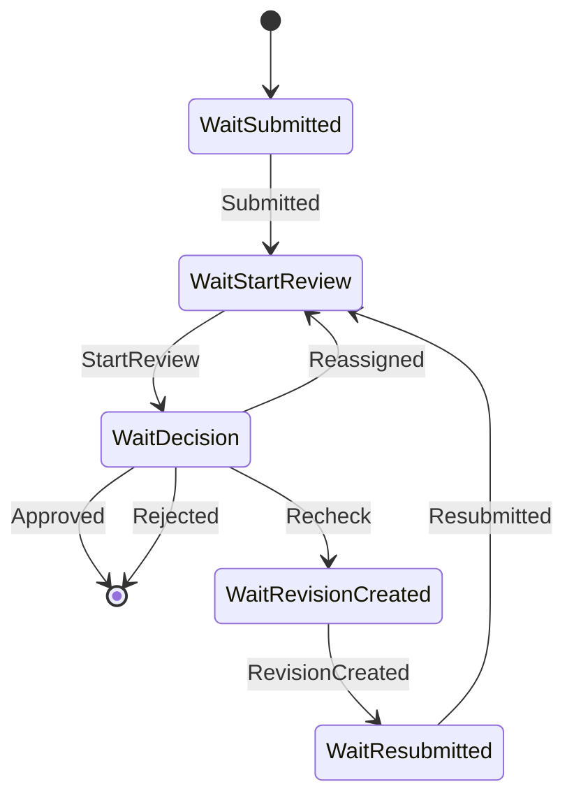

# Elsa E0 Compatibility Spike Result

## 1. Kết luận

- **Elsa E0 technical result: GO.**
- **E1 shadow-mode admission: GO.**
- **Production rollout: NOT YET APPROVED.**
- **E2 controlled orchestration: NOT YET APPROVED.**

Elsa E0 đạt các tiêu chí kỹ thuật: package `Elsa` 3.9.0 restore/build sạch trên .NET 10, code-first workflow có thể start, suspend, resume, correlate, loop Recheck và kết thúc qua bookmark/stimulus; 20/20 spike tests đạt và runtime smoke cô lập đạt. Frontend vulnerability từng chặn full repository gate đã được khắc phục tại commit `7e44584aefb5a5d20467e9725dfbbedeb279ff85` (`chore(deps): remediate frontend test vulnerability`), và `npm audit` hiện trả 0 vulnerability.

E0 không phải production-ready. E0 vẫn dùng in-memory store và không chứng minh restart recovery, distributed concurrency, transactional outbox, durable idempotency, production persistence hoặc production operations.

## 2. Baseline

- Baseline commit: `909d4514ed12361e454b325d07262a62341be8ca` (`docs: design Elsa workflow integration`).
- Worktree và staging sạch trước spike.
- SDK: .NET SDK 10.0.300; MSBuild 18.6.3.
- Runtime dùng khi test: Microsoft.NETCore.App 10.0.8 và Microsoft.AspNetCore.App 10.0.8, Windows x64.
- Target framework production và spike: `net10.0`.
- NuGet source giữ nguyên: `nuget.org` và `Microsoft Visual Studio Offline Packages`; không thêm feed.
- Repository dùng package version trực tiếp trong từng `.csproj`, không có Central Package Management.
- Baseline production package không bị sửa.

## 3. Phạm vi spike

Spike nằm ngoài production solution:

```text
backend/spikes/ConstructionInspection.ElsaSpike/
├── src/ConstructionInspection.ElsaSpike/
└── tests/ConstructionInspection.ElsaSpike.Tests/
```

Project runtime không reference Application, Infrastructure, API hoặc production repository. Project không dùng `ApplicationDbContext`, SQL Server, MinIO, JWT, DataJson, SchemaJson, user secret, migration, HTTP endpoint hay listener.

Test project chỉ dùng các package test đã pin theo baseline repository:

- `Microsoft.NET.Test.Sdk` 17.14.1.
- `xunit` 2.9.3.
- `xunit.runner.visualstudio` 3.1.4.
- `coverlet.collector` 6.0.4.

## 4. Package và dependency tree

Runtime project có đúng một direct package:

```text
Elsa requested 3.9.0, resolved 3.9.0
```

Resolved tree có 1 direct package và 86 transitive packages trên `net10.0`.

Artifact `Elsa` 3.9.0 có license expression `MIT`, repository metadata trỏ tới `elsa-workflows/elsa-core`, và chứa asset `lib/net10.0/Elsa.dll`. Hai lần restore liên tiếp đều trả `All projects are up-to-date for restore`.

Toàn bộ package có prefix Elsa resolve đồng nhất 3.9.0:

- `Elsa`.
- `Elsa.Api.Common`.
- `Elsa.Caching`.
- `Elsa.Common`.
- `Elsa.Expressions`.
- `Elsa.Features`.
- `Elsa.KeyValues`.
- `Elsa.Mediator`.
- `Elsa.Tenants`.
- `Elsa.Workflows.Core`.
- `Elsa.Workflows.Management`.
- `Elsa.Workflows.Runtime`.

Không có mixed Elsa version, direct package downgrade hoặc vulnerable package trong spike. `dotnet list package --outdated --include-transitive` có liệt kê các bản mới hơn của dependency transitively resolved, nhưng không phải downgrade và checkpoint không override dependency tree của Elsa.

Meta package `Elsa` có dependency surface lớn hơn core path cần cho E0. Ngoài Core/Management/Runtime, tree còn kéo `Elsa.Api.Common`, CShells, FastEndpoints, NSwag, JwtBearer, JSON/schema và compression packages. Spike không map API và không khởi động web server, nhưng bề mặt transitively resolved này phải được cân nhắc lại trước E1; checkpoint này không tự đổi từ meta package sang các package con.

Các module bị loại khỏi direct references đúng yêu cầu: Studio, Identity, HTTP activities, SQL Server persistence, UserTasks, scheduling, email, webhook, JavaScript và Python expression packages.

## 5. .NET 10 và startup/DI

- Restore có native `net10.0` asset.
- Build runtime và test project đạt, 0 warning, 0 error.
- `Host.CreateApplicationBuilder` cùng `AddElsa`, `AddActivity<T>` và `AddWorkflow<T>` khởi tạo DI thành công.
- Không cần thay `Directory.Build.props`, production package version hoặc solution.
- Runtime smoke quan sát khoảng 872 ms tổng thời gian start + ba workflow path và khoảng 66.8 MiB working set tại cuối process.
- Debug output của runtime project gồm 92 file, tổng khoảng 12.1 MiB. Đây chỉ là số đo local Debug, không phải production deployment sizing.

## 6. Code-first workflow

Definition `inspection-lifecycle-e0` dùng `WorkflowBase` và một custom blocking activity trong spike:



Spike không mutate `BusinessProcess`, không ghi `ProcessHistory`, không gọi production command/repository và không thay public API.

## 7. Bookmark, stimulus và correlation

Public API/import thực tế dùng từ Elsa 3.9.0:

- `Elsa.Workflows.Activity`.
- `Elsa.Workflows.ActivityExecutionContext`.
- `Elsa.Workflows.Models.CreateBookmarkArgs`.
- `ActivityExecutionContext.CreateBookmark(CreateBookmarkArgs)`.
- `Elsa.Workflows.Runtime.IStimulusSender.SendAsync(...)`.
- `Elsa.Workflows.Runtime.StimulusMetadata`.
- `Elsa.Workflows.Runtime.IWorkflowRuntime.CreateClientAsync(...)`.
- `Elsa.Workflows.Runtime.IWorkflowClient.CreateAndRunInstanceAsync(...)`.

Bookmark dùng `AutoBurn = true`, `AutoComplete = false` và callback public activity execution contract. Activity tự complete chỉ ở Approved/Rejected. Khi callback tạo wait tiếp theo, bookmark cũ được clear và bookmark mới được lưu.

Stimulus là cặp `{ EventType, InspectionId }`. `IStimulusSender` nhận đúng `Bookmark.Name` do Elsa tạo; spike không suy đoán activity type name từ CLR type. Correlation ID là `InspectionId.ToString("D")`, không có prefix hoặc dữ liệu tùy ý. Metadata scope đồng thời theo `WorkflowInstanceId` và correlation ID nên workflow khác không bị resume nhầm.

Payload tối thiểu chỉ gồm `DomainEventId`, `InspectionId`, fake `ProcessId`, `EventType`, fake `ActorUserId`, optional revision number và `OccurredAt`. Test serialization xác nhận không có JWT, DataJson, password, secret hoặc connection string field.

## 8. Duplicate, out-of-order và concurrency

In-memory Elsa không được coi là durable inbox. Spike boundary dùng `DomainEventId` làm idempotency key trong process và serialize dispatch theo Inspection bằng `SemaphoreSlim`:

- Hai resume đồng thời cùng DomainEventId: một `Processed`, một `Duplicate`.
- Hai decision đồng thời với DomainEventId khác nhau trên cùng bookmark: một `Processed`, một `NoMatchingBookmark` sau AutoBurn.
- Probe xác nhận callback/decision chỉ execute một lần; workflow chỉ complete một lần.
- Event sai InspectionId không ảnh hưởng instance khác.
- Event out-of-order không được gửi vào Elsa queue; boundary trả `NoMatchingBookmark` và state không đổi.
- Unknown event trả `UnknownEvent`.
- Approved/Rejected không còn business bookmark.
- CancellationToken được truyền qua start, state lookup, semaphore wait và `IStimulusSender`; test có token cancelable đi đến callback và token đã cancel tạo `OperationCanceledException`.

Đây chỉ chứng minh hành vi single-process in-memory. Nó không chứng minh distributed lock, multi-node race, durable idempotency hoặc exactly-once delivery production.

## 9. Spike tests

Kết quả: **20 passed, 0 failed, 0 skipped**.

Các behavior được chứng minh:

1. Start workflow thành công và correlation canonical.
2. Suspend tại Submitted.
3. Sai InspectionId không resume.
4. Submitted resume đúng instance.
5. Suspend tại StartReview.
6. StartReview mở đúng bốn decision bookmark.
7. Approve kết thúc.
8. Reject kết thúc.
9. Recheck tạo loop.
10. RevisionCreated + Resubmitted quay lại StartReview.
11. Reassigned từ UnderReview quay lại StartReview.
12. Hai Inspection song song không cross-resume.
13. Concurrent duplicate DomainEventId chỉ execute một lần.
14. Concurrent duplicate decision chỉ complete một lần.
15. Out-of-order event không advance.
16. Unknown event fail-closed.
17. Cancellation được truyền.
18. Payload không có dữ liệu nhạy cảm bị cấm.
19. Terminal không còn business bookmark.
20. Host in-memory mới không recover instance của host trước.

## 10. Runtime smoke cô lập

Process riêng chạy ba workflow:

- Workflow A: Submitted -> StartReview -> Approved, kết thúc `Finished`, 0 bookmark.
- Workflow B: chỉ start, giữ `Suspended` tại Submitted, 1 bookmark.
- Workflow C: Submitted -> StartReview -> Recheck -> RevisionCreated -> Resubmitted -> StartReview -> Approved, kết thúc `Finished`, 0 bookmark.

Process exit code 0. Sau khi process dừng không còn process spike hoặc TCP listener. Smoke không gọi SQL Server, MinIO hoặc production API và không in payload nhạy cảm.

## 11. Baseline regression

### Backend

| Gate | Kết quả |
|---|---|
| `dotnet tool restore` | Đạt; `dotnet-ef` 10.0.12 |
| `dotnet restore` | Đạt |
| Production build | Đạt; 0 warning, 0 error |
| Domain tests | 82/82, 0 skip |
| Application tests | 124/124, 0 skip |
| Integration tests | 36/36, 0 skip trên Windows host |
| Formatter production + spike | Đạt |
| NuGet vulnerability production | Không có advisory |
| NuGet vulnerability spike | Không có advisory |
| EF pending model | Không có model change |
| Migration status | Tới `20261020133408_AddChecklists`, không có pending migration được hiển thị |

Lần chạy Integration trong sandbox ban đầu có 5 pass/31 fail do SQL Client không thể dùng encryption/TLS với SQL Server từ sandbox. Chạy lại cùng binary trên Windows host đạt 36/36; không sửa connection string, retry, timeout hoặc assertion.

### Frontend

| Gate | Kết quả |
|---|---|
| `npm ci` | Đạt; lockfile không đổi |
| Tests | 134/134 |
| Production build | Đạt |
| Lint | Exit 0; còn 9 warning baseline trong Drawing/Auth, không phát sinh từ spike |
| `npm audit` | Đạt; 0 vulnerability |

Dependency trước remediation:

```text
jsdom 30.1.2 -> undici 8.11.2
```

Dependency sau remediation:

```text
jsdom 30.1.3 -> undici 8.12.3
```

Ba advisory đã đóng:

- `GHSA-xjj6-f33q-929c` / `CVE-2026-109869` — High.
- `GHSA-4qv8-2p9j-2685` / `CVE-2026-109924` — Moderate.
- `GHSA-f72v-6w45-q472` / `CVE-2026-109841` — Moderate.

`GHSA-qq8j-7v2v-3rwp` không phải blocker của `undici` 8.11.2 vì advisory đó đã được vá tại 8.11.2. Remediation không dùng `overrides`, không sửa `package.json` và chỉ cập nhật resolved dependency tree trong `package-lock.json`.

## 12. In-memory limitation

Toàn bộ workflow instance, bookmark, DomainEventId guard và mapping instance của E0 mất khi process restart. Test thứ 20 chứng minh host mới không recover instance cũ. E0 không dùng durability giả và không được dùng làm evidence cho:

- restart recovery;
- durable inbox/outbox;
- dead-letter/replay;
- database migration;
- multi-node concurrency;
- production persistence hoặc E2 controlled orchestration.

E1 vẫn phải dùng Domain transactional outbox và durable idempotency design trong docs/16; không được sao chép in-memory dictionary/semaphore thành giải pháp production.

## 13. Security surface

- Không map Elsa API, Studio, Identity hoặc HTTP bookmark endpoint.
- Không có controller, public resume URL, listener hoặc browser integration.
- Không dùng reflection, private/internal Elsa API hoặc global service provider.
- Custom activity chỉ dùng public `ActivityExecutionContext` API và DI scope do Elsa cung cấp.
- Không có secret, credential, JWT, DataJson hoặc SchemaJson trong input/bookmark/log.
- Không có database, migration, connection string hoặc persistence provider trong spike.
- Meta package vẫn kéo API-related assemblies transitively; đây là dependency surface cần review trước E1 dù chưa được expose.

## 14. Admission status và điều kiện E1

| Gate | E0 | E1 Shadow | E2/Production |
|---|---|---|---|
| Package compatibility | Pass | Pass | Chưa đủ |
| net10.0 | Pass | Pass | Chưa đủ |
| Bookmark/resume | Pass | Pass | Cần durable test |
| Correlation | Pass | Pass | Cần SQL recovery |
| Concurrency | Pass in-memory | Được phép thử | Chưa đủ production |
| npm audit | Pass | Pass | Pass hiện tại |
| Elsa persistence | In-memory only | Chưa có | Chưa đạt |
| Transactional outbox | Chưa có | Phải triển khai | Chưa đạt |
| Domain mutation | Không | Không | Chưa phê duyệt |
| Production rollout | Không | Shadow only | Không |

E1 shadow mode được phép bắt đầu trong checkpoint riêng với các điều kiện:

- E1 phải dùng transactional outbox, durable idempotency và shadow comparison.
- E1 không được mutate `BusinessProcess` hoặc `ProcessHistory`.
- Feature flag do cấu hình kiểm soát và mặc định tắt.
- E1 chưa dùng `ConstructionInspectionElsaDb`; persistence phải được thiết kế và duyệt riêng.
- Không expose Elsa API, Studio hoặc Identity.
- Không sao chép in-memory dictionary/semaphore của E0 thành giải pháp production.
- E2 và production rollout vẫn chưa được phê duyệt.
