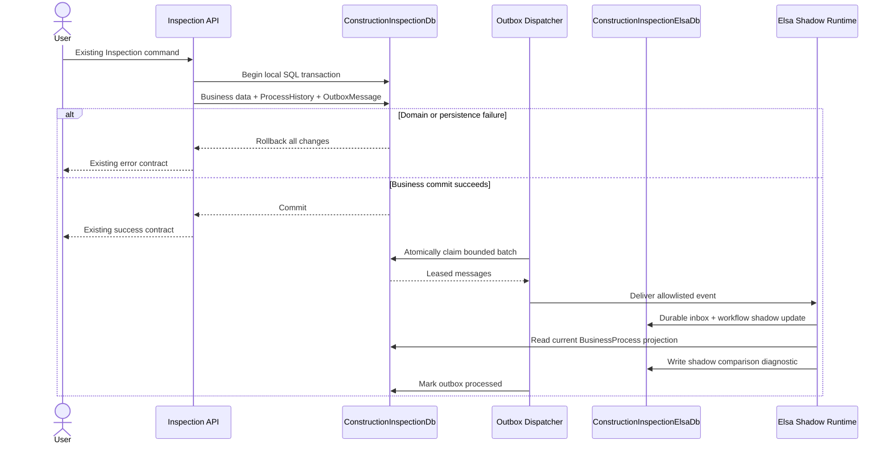

# Thiết kế Elsa E1 Shadow Mode

> **Status note — superseded for rollout:** Thiết kế lịch sử trong tài liệu này đã được kiểm chứng tiếp bởi `docs/19-elsa-e1-sql-persistence-spike-result.md` và `docs/20-elsa-workflow-owned-receipt-spike-result.md`. Kết luận rollout cuối nằm ở docs/20: `E1-ADR-006` bị **Rejected cho Elsa 3.9.0**, E1 production source là **NO-GO** và E2 controlled orchestration là **NO-GO**. Không triển khai thêm Elsa production checkpoint từ thiết kế này.

## 1. Trạng thái tài liệu

- Mục tiêu: chốt kiến trúc Elsa E1 ở chế độ shadow/mirror cho workflow Inspection trước khi sửa source production.
- Baseline Git: `45660a34d6ea4bc24ae59432b951ba9fcc61811b` (`chore(workflows): validate Elsa E0 compatibility`).
- Kết quả E0: GO về khả năng biểu diễn state machine bằng Elsa 3.9 trên .NET 10; kết quả này chưa chứng minh persistence, outbox, multi-instance dispatcher hoặc vận hành production.
- E1 chỉ quan sát và đối chiếu. `Inspection`, `BusinessProcess`, `ProcessHistory` và transaction SQL hiện tại tiếp tục là nguồn sự thật duy nhất.
- E2 controlled orchestration và production rollout không được phê duyệt; docs/20 đã chốt NO-GO cho cả E1 và E2 với Elsa 3.9.0.
- Checkpoint này không cài package, không sửa production source, không tạo migration và không thay đổi database hoặc frontend.

Các tài liệu nền đã được đối chiếu: `docs/09`, `docs/10`, `docs/12`, `docs/13`, `docs/16`, `docs/17`, source và tests E0, aggregate/process hiện tại, handlers Inspection, `IUnitOfWork`, `EfUnitOfWork`, `ApplicationDbContext`, configuration và composition root.

### 1.1 Baseline kỹ thuật đã xác minh

- Migration mới nhất: `20261020133408_AddChecklists`.
- EF Core không có pending model changes.
- Inspection hiện có 15 route: 5 route Core/support query và 10 route workflow/history.
- Các command thay đổi trạng thái chạy trong `IUnitOfWork.ExecuteInTransactionAsync`; business data và `ProcessHistory` được lưu trong local SQL transaction của `ConstructionInspectionDb`.
- `BusinessProcess` dùng `rowversion`, chứa đúng một owner Inspection hoặc Checklist và là nguồn status nghiệp vụ.
- `ProcessHistory` append-only; Inspection history tham chiếu `InspectionSubmission`, không tham chiếu Checklist submission.
- Hiện không có `BackgroundService`, `IHostedService`, `AddHealthChecks` hoặc `MapHealthChecks` trong production source. E1 không được dựa vào một convention chưa tồn tại.
- E0 dùng in-memory runtime và `AutoBurn`; do đó E1 bắt buộc bổ sung persistence và idempotency bền vững trước khi được coi là production-like.

## 2. Mục tiêu và ngoài phạm vi

### 2.1 Mục tiêu E1

1. Ghi một integration event cùng transaction với mỗi thay đổi Inspection cần mirror.
2. Giao event ít nhất một lần tới Elsa mà không kéo dài transaction nghiệp vụ.
3. Duy trì một workflow instance shadow bền vững cho mỗi Inspection.
4. So sánh state shadow với `BusinessProcess` sau mỗi event và ghi diagnostic an toàn.
5. Chứng minh duplicate, out-of-order, restart, retry, dead-letter và multi-dispatcher hoạt động fail-closed.
6. Cho phép tắt toàn bộ E1 bằng trusted configuration mà không đổi hành vi nghiệp vụ baseline.

### 2.2 Ngoài phạm vi

- Elsa không điều khiển transition, authorization, domain validation, reviewer assignment hoặc HTTP response.
- Không mirror Checklist trong E1.
- Không notification, SLA, scheduler, replay UI, Elsa Studio, Elsa Identity hoặc generic Elsa API.
- Không workflow definition do người dùng tạo và không unsafe scripting activity.
- Không gọi ngược mutation endpoint của API.
- Không distributed transaction giữa hai database.
- Không tự chạy migration khi API khởi động.
- Không thay frontend và không mở route nghiệp vụ mới cho business user.

## 3. Nguồn sự thật và ranh giới kiến trúc

Nguồn sự thật theo thứ tự ràng buộc:

1. Domain aggregate xác nhận invariant, role và transition hợp lệ.
2. `BusinessProcess.Status` là status nghiệp vụ hiện hành.
3. `ProcessHistory` là audit nghiệp vụ append-only.
4. Transaction SQL trong `ConstructionInspectionDb` quyết định business commit.
5. Outbox chỉ là bản ghi tích hợp phát sinh từ business commit.
6. Elsa state, inbox và shadow comparison là dữ liệu vận hành dẫn xuất; chúng không được dùng để sửa hoặc thay thế dữ liệu từ bước 1–4.

Elsa tuyệt đối không được:

- cập nhật `Inspection`, `InspectionSubmission`, reviewer hoặc `BusinessProcess`;
- ghi `ProcessHistory` nghiệp vụ;
- quyết định role, scope, rowVersion hoặc hợp lệ của transition;
- làm request nghiệp vụ thất bại sau khi business transaction đã commit;
- làm thay đổi status code, response body hoặc route hiện tại;
- phát lệnh mutation ngược vào API.



Không có đường Elsa → business mutation trong sơ đồ.

## 4. Feature flag

Key duy nhất cho E1:

```text
Workflow:Elsa:Enabled
```

Quy tắc:

- Mặc định `false` trong source-controlled configuration.
- Chỉ bind từ trusted application configuration; dùng options validation và không đọc query string, cookie, `localStorage` hoặc `sessionStorage`.
- Business user, kể cả Administrator, không có quyền thay đổi flag.
- Khi `false`, handler không tạo E1 outbox event và dispatcher không chạy. Transaction, response, authorization và performance path phải tương đương baseline trước E1.
- Schema outbox/Elsa có thể đã được triển khai nhưng không tạo side effect khi flag tắt.
- Khi chuyển từ `false` sang `true`, chỉ event phát sinh sau thời điểm bật được mirror. Không tự backfill lịch sử; backfill/replay là một quyết định vận hành riêng.
- Tắt flag là emergency rollback logic. Pending outbox và dữ liệu Elsa vẫn được giữ nguyên để điều tra.

Việc cùng một flag kiểm soát cả emission và dispatch tránh hàng đợi được tạo âm thầm khi E1 bị tắt. Nếu vận hành cần “capture nhưng chưa dispatch”, phải thêm một ADR/config riêng ở checkpoint triển khai; không ngầm thay đổi semantics của flag này.

## 5. Transactional outbox trong ConstructionInspectionDb

### 5.1 Bảng đề xuất `WorkflowOutboxMessages`

| Cột | Kiểu logic | Null | Quy tắc |
|---|---|---:|---|
| `Id` | `Guid` | Không | PK server-generated |
| `DomainEventId` | `Guid` | Không | Idempotency key bất biến |
| `AggregateType` | `varchar(32)` | Không | E1 allowlist chỉ `Inspection` |
| `AggregateId` | `Guid` | Không | `InspectionId` |
| `EventType` | `varchar(80)` | Không | Allowlist server-owned |
| `SchemaVersion` | `smallint` | Không | Bắt đầu `1`, lớn hơn 0 |
| `PayloadJson` | `nvarchar(max)` | Không | JSON hợp lệ, giới hạn 16 KiB UTF-8 ở application |
| `OccurredAtUtc` | `datetime2(7)` | Không | Cùng `IClock.UtcNow` với transition/history |
| `AvailableAtUtc` | `datetime2(7)` | Không | Thời điểm sớm nhất được claim |
| `AttemptCount` | `int` | Không | Mặc định 0, không âm |
| `LastAttemptAtUtc` | `datetime2(7)` | Có | Lần delivery gần nhất |
| `ProcessedAtUtc` | `datetime2(7)` | Có | Thành công hoặc duplicate đã được xác nhận an toàn |
| `FailedAtUtc` | `datetime2(7)` | Có | Permanent/dead-letter timestamp |
| `ErrorCode` | `varchar(80)` | Có | Mã ổn định, không chứa raw exception/payload |
| `LockedUntilUtc` | `datetime2(7)` | Có | Lease expiry |
| `LockedBy` | `varchar(128)` | Có | Stable dispatcher instance ID, không chứa credential |
| `RowVersion` | SQL `rowversion` | Không | Concurrency token |

Constraint/index:

- PK trên `Id`.
- Unique index `UX_WorkflowOutboxMessages_DomainEventId` trên `DomainEventId`.
- Claim index có thứ tự `(ProcessedAtUtc, FailedAtUtc, AvailableAtUtc, LockedUntilUtc, OccurredAtUtc, Id)`; filtered index có thể dùng nếu SQL plan được đo xác nhận.
- Check `ISJSON(PayloadJson) = 1`.
- Check `AttemptCount >= 0`, `SchemaVersion > 0`.
- Check không đồng thời có cả `ProcessedAtUtc` và `FailedAtUtc`.
- Không FK tới Inspection: outbox là integration log và không được cascade-delete. Application đã không hard delete Inspection trong MVP.

### 5.2 Atomic write

- Handler tạo `DomainEventId` và payload từ server-owned state sau khi transition hợp lệ.
- Business mutation, `ProcessHistory` và outbox được add trước `SaveChangesAsync` cuối trong cùng callback `ExecuteInTransactionAsync`.
- Đối với Create Inspection đang có hai lần `SaveChangesAsync` trong một local transaction, event `InspectionCreated` chỉ được add sau khi foundation/process/history đã tồn tại và trước lần save cuối; rollback ở bất kỳ bước nào rollback cả record nghiệp vụ và outbox.
- Với revision, event chỉ được add khi một revision mới thực sự được tạo; save Draft thông thường không phát event.
- Unique `DomainEventId` chống double insert của cùng event. Nó không biến command HTTP thành idempotent và không thay đổi contract retry hiện tại.
- Elsa hoặc dispatcher không được gọi bên trong business transaction.

### 5.3 Safe claim/lease nhiều dispatcher

Claim là một transaction SQL ngắn:

1. Chọn tối đa `BatchSize` message chưa processed/dead-letter, đã đến `AvailableAtUtc`, và không có lease hoặc lease đã hết hạn.
2. Dùng SQL Server `UPDLOCK`, `READPAST`, `ROWLOCK` với thứ tự ổn định `AvailableAtUtc`, `OccurredAtUtc`, `Id`.
3. Trong cùng statement/transaction, cập nhật `LockedBy`, `LockedUntilUtc`, tăng `AttemptCount`, đặt `LastAttemptAtUtc` và trả batch đã claim.
4. Commit claim transaction trước khi gọi Elsa.
5. Sau delivery, update processed/retry/dead-letter chỉ khi `LockedBy` vẫn thuộc instance và lease chưa bị consumer khác chiếm lại. `RowVersion` hỗ trợ phát hiện stale completion.

Yêu cầu vận hành:

- `BatchSize` hữu hạn và configurable; đề xuất mặc định 20.
- Lease configurable; đề xuất mặc định 60 giây và phải dài hơn timeout delivery bình thường.
- Dispatcher không gia hạn lease vô hạn. Nếu cần heartbeat cho event dài, giới hạn số lần và chứng minh ownership.
- Hết lease cho phép instance khác claim lại; duplicate được xử lý bởi durable inbox phía Elsa.
- Cancellation dừng claim mới, cho message đang xử lý một grace period hữu hạn, rồi để lease phục hồi.
- Không giữ SQL transaction trong khi gọi Elsa hoặc shadow comparison.
- Không retry vô hạn.

Các giá trị batch/lease là đề xuất cần đo ở E1.1 và được quản lý chấp nhận trước production-like rollout.

## 6. Event contract Inspection E1

### 6.1 Envelope canonical version 1

```json
{
  "schemaVersion": 1,
  "domainEventId": "guid",
  "eventType": "Inspection.Created",
  "aggregateType": "Inspection",
  "aggregateId": "inspection-guid",
  "businessProcessId": "process-guid",
  "occurredAtUtc": "UTC timestamp",
  "actorUserId": "user-guid",
  "fromStatus": null,
  "toStatus": "Draft",
  "submissionId": "submission-guid",
  "revisionNumber": 1,
  "previousReviewerUserId": null,
  "newReviewerUserId": null
}
```

Serialization rules:

- Field không cần cho event được để `null` hoặc bỏ theo một canonical serializer policy duy nhất; policy phải được contract-test.
- `eventType`, `aggregateType`, status và schema version lấy từ enum/constant server-owned, không lấy từ client.
- GUID dùng canonical `D` format; timestamp UTC ISO 8601 round-trip.
- Payload tối đa 16 KiB UTF-8 trước khi insert.
- Không có JWT, password, secret, connection string, `DataJson`, Form Schema, title, description, comment hoặc reason.
- Reviewer IDs chỉ xuất hiện với Submit/Reassign; submission/revision chỉ xuất hiện khi workflow cần xác định revision hiện hành.
- Deserializer fail-closed khi thiếu field bắt buộc, sai schema version, unknown property hoặc unknown enum/event type.

### 6.2 Inventory và semantics

| EventType | Nguồn command | Business status trước → sau | Elsa action/bookmark | Instance | Duplicate | Out-of-order/terminal | Payload bổ sung tối thiểu |
|---|---|---|---|---|---|---|---|
| `Inspection.Created` | `CreateInspectionCommand` | `null → Draft` | Start code-first workflow; chờ `Inspection.Submitted` | Tạo mới, correlation bằng InspectionId | Inbox no-op; không tạo instance thứ hai | Nếu instance đã có: duplicate; nếu aggregate terminal nhưng thiếu create: dead-letter | submissionId, revisionNumber |
| `Inspection.Submitted` | `SubmitInspectionCommand` lần đầu | `Draft → Submitted` | Resume bookmark `Inspection.Submitted`; chờ `Inspection.StartReview` hoặc reassignment | Resume | Inbox no-op | Thiếu instance/bookmark: fail-closed; terminal: dead-letter | submissionId, revisionNumber, newReviewerUserId |
| `Inspection.StartReview` | `StartInspectionReviewCommand` | `Submitted → UnderReview` | Resume `Inspection.StartReview`; chờ approve/reject/recheck/reassign | Resume | Inbox no-op | Sai bookmark/status: dead-letter | submissionId, revisionNumber |
| `Inspection.Approved` | `ApproveInspectionCommand` | `UnderReview → Approved` | Resume `Inspection.Approved`; complete terminal | Resume rồi complete | Inbox no-op | Instance chưa UnderReview hoặc đã terminal khác: dead-letter | submissionId, revisionNumber |
| `Inspection.Rejected` | `RejectInspectionCommand` | `UnderReview → Rejected` | Resume `Inspection.Rejected`; complete terminal | Resume rồi complete | Inbox no-op | Instance chưa UnderReview hoặc đã terminal khác: dead-letter | submissionId, revisionNumber |
| `Inspection.RecheckRequested` | `RequestInspectionRecheckCommand` | `UnderReview → Recheck` | Resume `Inspection.RecheckRequested`; chờ revision/resubmit | Resume | Inbox no-op | Sai bookmark/terminal: dead-letter | submissionId, revisionNumber |
| `Inspection.RevisionCreated` | `SaveInspectionDraftCommand` khi tạo revision | `Recheck → Recheck` | Resume `Inspection.RevisionCreated`; cập nhật shadow revision; chờ resubmit | Resume | Inbox no-op | Không ở Recheck hoặc revision không tiến: dead-letter | new submissionId, revisionNumber |
| `Inspection.Resubmitted` | `SubmitInspectionCommand` sau Recheck | `Recheck → Submitted` | Resume `Inspection.Resubmitted`; chờ start review/reassign | Resume | Inbox no-op | Thiếu revision mới/sai bookmark/terminal: dead-letter | submissionId, revisionNumber |
| `Inspection.ReviewerReassigned` | `ReassignInspectionReviewerCommand` | `Submitted → Submitted` hoặc `UnderReview → Submitted` | Resume `Inspection.ReviewerReassigned`; trở về chờ start review | Resume | Inbox no-op | Status khác Submitted/UnderReview hoặc terminal: dead-letter | submissionId, revisionNumber, previous/newReviewerUserId |

Lưu ý tương thích:

- `ProcessHistory.Action` hiện vẫn là các giá trị ổn định như `Submit`, `StartReview`, `RequestRecheck`, `CreateRevision`, `ReassignReviewer`. E1 event name là contract tích hợp riêng, không đổi history/API.
- `Inspection.Resubmitted` được phân biệt bằng status trước transition là `Recheck`; không tin cờ từ client.
- Reassign từ `UnderReview` quay về `Submitted`, đúng behavior domain hiện tại.
- Approved và Rejected là terminal. Event sau terminal không mở lại workflow.
- Không có event cho Save Draft bình thường vì không thay đổi process orchestration.
- E1 không phát hoặc xử lý event Checklist.

## 7. Durable idempotency phía Elsa/shadow

`AutoBurn` của bookmark chỉ là một lớp bảo vệ runtime và không đủ sau restart hoặc concurrent delivery. E1 dùng hai lớp bền vững trong `ConstructionInspectionElsaDb`.

### 7.1 `WorkflowInboxMessages`

| Cột | Mục đích |
|---|---|
| `DomainEventId` | PK/unique idempotency key |
| `AggregateType`, `AggregateId`, `EventType`, `SchemaVersion` | Identity/contract allowlist |
| `PayloadHash` | SHA-256 canonical payload để phát hiện cùng ID nhưng khác payload |
| `ReceivedAtUtc`, `ProcessedAtUtc` | Audit |
| `Outcome` | `Processing`, `Processed`, `Duplicate`, `Rejected` |
| `ErrorCode` | Stable non-sensitive code |
| `WorkflowInstanceId` | Mapping tới instance shadow |
| `RowVersion` | Concurrency |

- Unique constraint trên `DomainEventId` bảo đảm concurrent duplicate chỉ một consumer thắng.
- Cùng `DomainEventId` nhưng hash khác là security/integrity failure, không được coi là duplicate hợp lệ.
- Duplicate hợp lệ là no-op đối với workflow, được đếm metric và ghi audit tối thiểu.
- Inbox không bị xóa khi restart và dùng cùng SQL Server provider với Elsa persistence.

### 7.2 Atomicity cần chứng minh trước implementation

Điều kiện bắt buộc: insert/claim inbox và mutation Elsa workflow phải commit trong cùng local transaction của `ConstructionInspectionElsaDb`, hoặc Elsa workflow phải tự ghi một processed marker unique trong cùng persistence transaction với state change. Nếu Elsa 3.9 SQL Server provider không cho phép enlist/transaction boundary này bằng public API được hỗ trợ, E1 source là NO-GO cho đến khi có một compatibility spike persistence riêng.

Không được mô phỏng atomicity bằng:

- in-memory dictionary/cache;
- check-then-insert không có unique constraint;
- đánh dấu inbox processed trước Elsa rồi bỏ qua failure;
- distributed transaction với `ConstructionInspectionDb`;
- swallow duplicate/exception không có diagnostic.

Crash sau Elsa commit nhưng trước khi outbox được mark processed dẫn đến redelivery. Durable inbox phải trả outcome “already processed” để dispatcher mark outbox processed an toàn mà không resume workflow lần hai.

### 7.3 Correlation và mapping

`WorkflowInstanceMappings` nằm trong Elsa DB:

| Field | Quy tắc |
|---|---|
| `AggregateType` | E1 chỉ `Inspection` |
| `AggregateId` | InspectionId |
| `WorkflowDefinitionKey` | Code-first definition allowlist |
| `WorkflowDefinitionVersion` | Pinned version |
| `WorkflowInstanceId` | Elsa instance ID |
| `CreatedByDomainEventId` | Event tạo instance |
| `CreatedAtUtc` | UTC |
| `RowVersion` | Concurrency |

Unique `(AggregateType, AggregateId, WorkflowDefinitionKey)` ngăn tạo hai instance active cho cùng Inspection/definition. Workflow version được pin khi instance được tạo; deploy definition mới không tự chuyển instance cũ.

## 8. Elsa persistence và database ownership

### 8.1 ConstructionInspectionDb

Chứa:

- business aggregate/process/history hiện tại;
- `WorkflowOutboxMessages`;
- không chứa Elsa runtime tables;
- không chứa shadow comparison nếu không cần business reporting.

### 8.2 ConstructionInspectionElsaDb

Chứa:

- Elsa runtime persistence bắt buộc cho instances, bookmarks và execution state;
- Elsa management persistence chỉ khi public/supported Elsa API thực sự cần để lưu code-first definition/version metadata;
- `WorkflowInboxMessages`;
- `WorkflowInstanceMappings`;
- `WorkflowShadowComparisons`;
- operational replay audit nếu công cụ operator được duyệt ở checkpoint sau.

Không có distributed transaction giữa hai database. Transactional outbox là cầu nối at-least-once. Eventual consistency và lag là trạng thái vận hành được đo, không phải business failure.

### 8.3 Migration và credential boundary

- Không auto-migrate Elsa hoặc application database khi API startup.
- Migration là bước deployment có kiểm soát, review SQL trước apply và dùng credential migration riêng.
- Runtime credential của API chỉ có quyền cần cho business tables/outbox. Credential dispatcher chỉ có quyền claim/update outbox và quyền tối thiểu trên Elsa DB cần để gọi persistence.
- Không cấp `db_owner`, quyền tạo/drop schema hoặc quyền cross-database cho runtime credential.
- Nếu dispatcher được host chung API ở E1 Development, vẫn cấu hình hai connection riêng và principle of least privilege; production topology phải được duyệt riêng.
- Tên package persistence, migration command và bảng Elsa nội bộ chỉ được chốt sau compatibility/deployment spike với tài liệu Elsa 3.9 chính thức. Tài liệu này không suy đoán command chưa được chứng minh.

## 9. Shadow comparison

### 9.1 Record đề xuất `WorkflowShadowComparisons`

| Field | Mục đích |
|---|---|
| `Id` | PK |
| `InspectionId` | Correlation business, không FK cross-database |
| `WorkflowInstanceId` | Instance shadow |
| `DomainBusinessStatus` | Status đọc từ `BusinessProcess` sau event |
| `ElsaOrchestrationStatus` | State semantic do code-first workflow project |
| `ExpectedDomainStatus` | `toStatus` của event |
| `LastDomainEventId` | Event tạo comparison |
| `LastProcessedAtUtc` | UTC |
| `Result` | `Match` hoặc `Mismatch` |
| `MismatchCode` | Allowlist bên dưới |
| `DiagnosticCode` | Mã phụ không nhạy cảm |
| `RowVersion` | Concurrency |

Mismatch code allowlist:

- `MissingWorkflowInstance`
- `MissingBookmark`
- `UnexpectedBookmark`
- `StateMismatch`
- `DuplicateEvent`
- `OutOfOrderEvent`
- `TerminalStateMismatch`
- `ProcessingFailure`

Quy tắc:

- Sau khi Elsa xử lý hoặc từ chối event, comparer đọc snapshot `BusinessProcess` hiện tại bằng query chỉ đọc và so với state semantic của instance.
- Comparison chỉ ghi diagnostic trong Elsa DB; không update domain, không append business history và không tự replay.
- Nếu business đã tiến xa hơn event đang xử lý, comparer phân loại `OutOfOrderEvent` thay vì cố tua Elsa.
- Diagnostic không chứa `DataJson`, SchemaJson, JWT, secret, title, description, comment hay reason.
- Metric chỉ dùng aggregate counters/gauges: backlog, oldest age, processed, retry, dead-letter và mismatch theo code. Không dùng user ID/Inspection ID làm metric label.

## 10. Retry, dead-letter và replay

### 10.1 Error taxonomy

Transient:

- network timeout/cancellation không do shutdown;
- Elsa DB temporarily unavailable;
- SQL deadlock/transient provider error;
- lease lost trước khi delivery hoàn tất.

Permanent:

- malformed/oversize payload;
- unknown schema version, aggregate type hoặc event type;
- payload hash conflict cho cùng DomainEventId;
- out-of-order hoặc terminal-state violation;
- missing workflow/bookmark không thể hợp lệ theo current state;
- invariant/persistence configuration không tương thích.

### 10.2 Backoff và dead-letter

- Retry transient error bằng bounded exponential backoff có jitter.
- Đề xuất: tối đa 5 lần delivery, base delay 5 giây, cap 5 phút. Giá trị phải configurable và được test bằng fake clock; không dùng sleep trong tests.
- Permanent error hoặc transient error vượt max attempt đặt `FailedAtUtc` và stable `ErrorCode`; message không còn được automatic claim.
- Processed outbox retention: 30 ngày.
- Dead-letter retention: 90 ngày hoặc đến khi resolved, lấy mốc muộn hơn.
- `ProcessHistory` tuân theo business audit policy và không bị Elsa/outbox retention tác động.

### 10.3 Replay

- E1 không có public replay API hoặc UI.
- Business Administrator không mặc nhiên có quyền replay.
- Replay chỉ dành cho deployment/system operator qua protected command/CLI ở checkpoint sau.
- Replay giữ nguyên `DomainEventId`; durable inbox vì thế mặc định trả duplicate/no-op. Muốn reprocess một permanent failure phải có thao tác “resolve/reset processing outcome” được audit trước, không tạo ID mới để lách idempotency.
- Audit replay tối thiểu: operator identity, timestamp UTC, reason, DomainEventId, previous error code và outcome. Không lưu credential/raw payload.
- Không tự replay khi phát hiện mismatch.

## 11. Failure matrix

| Tình huống | Business result | Outbox result | Elsa result | Recovery | Operator |
|---|---|---|---|---|---|
| Business transaction rollback | Không commit | Insert rollback | Không event | Client xử lý theo API hiện tại | Không |
| Outbox insert fail | Toàn transaction fail/rollback | Không record | Không event | Existing error; sửa DB rồi retry command theo contract hiện tại | Có nếu hạ tầng lỗi kéo dài |
| API crash trước commit | Không xác định tới khi SQL kết thúc; atomic rollback/commit | Cùng kết quả transaction | Chưa delivery | Client tra cứu/retry theo contract; không suy đoán từ timeout | Có nếu crash lặp lại |
| API crash sau commit trước response | Business đã commit | Event đã commit | Chưa hoặc sẽ delivery | Dispatcher xử lý; client có rủi ro duplicate business như baseline | Không mặc định |
| Elsa unavailable | Business thành công | Pending/retry | Không tiến | Bounded retry; dead-letter nếu vượt ngưỡng | Có khi dead-letter/SLA vận hành |
| Elsa DB unavailable | Business thành công | Pending/retry | Không persist | Bounded retry | Có khi kéo dài |
| Dispatcher crash trước delivery | Business không đổi | Lease pending | Không tiến | Lease hết hạn, dispatcher khác claim | Không |
| Dispatcher crash sau delivery trước mark processed | Business không đổi | Message được redeliver | Có thể đã tiến | Durable inbox trả duplicate/no-op, sau đó mark processed | Không nếu idempotency đúng |
| Duplicate delivery | Business không đổi | Một message/attempt bổ sung | Chỉ lần đầu có hiệu lực | Unique inbox + payload hash | Chỉ khi hash conflict |
| Out-of-order delivery | Business không đổi | Dead-letter | Không tự tua state | Diagnostic `OutOfOrderEvent`; điều tra/replay có kiểm soát | Có |
| Concurrent dispatcher | Business không đổi | Một owner claim; hoặc redelivery sau lease | Inbox chỉ cho một effect | Atomic claim + unique inbox | Không |
| Lease expiry khi worker còn chạy | Business không đổi | Có thể consumer khác claim | Có thể duplicate | Inbox idempotency; stale worker không được mark bằng lost lease | Có nếu thường xuyên |
| Malformed payload | Business không đổi | Dead-letter `MalformedPayload` | Không deserialize/execute | Fix producer/record; operational resolution | Có |
| Unknown event type/schema | Business không đổi | Dead-letter | Fail-closed | Deploy compatible allowlist hoặc sửa producer | Có |
| Missing workflow instance | Business không đổi | Dead-letter hoặc mismatch theo event | Không tự create trừ `Inspection.Created` | Diagnostic và operator investigation | Có |
| Missing/unexpected bookmark | Business không đổi | Dead-letter | Không resume arbitrary activity | Diagnostic và controlled resolution | Có |
| Shadow state mismatch | Business không đổi | Event có thể processed | Shadow được giữ để điều tra | Ghi mismatch; không sửa domain/replay tự động | Có |
| Terminal event gửi lại | Business không đổi | Duplicate được processed; event khác dead-letter | Không mở lại workflow | Inbox no-op hoặc `TerminalStateMismatch` | Có nếu event khác |
| Feature flag off | Business y hệt baseline | Không tạo/claim mới | Không side effect | Bật lại theo rollout; pending cũ được giữ | Không |
| Graceful shutdown/cancellation | Business không đổi | Không claim mới; message chưa xong giữ lease | Không partial effect hoặc inbox quyết định duplicate | Grace period rồi lease recovery | Không |
| Comparison read lỗi | Business không đổi | Delivery Elsa có thể đã thành công | State đã persist | Retry comparison idempotently; không resume Elsa lần hai | Có nếu kéo dài |

## 12. Security và operational boundary

- Không expose Elsa Studio, Elsa Identity, generic management/runtime API hoặc arbitrary stimulus endpoint.
- Chỉ dispatcher nội bộ gọi adapter typed với event allowlist; không nhận activity/workflow name từ client.
- Chỉ code-first workflow đã review được đăng ký. Không custom JavaScript, dynamic expression hoặc unsafe scripting activity.
- Payload JSON deserialize bằng strict allowlist, giới hạn 16 KiB UTF-8, max depth hữu hạn và reject unknown property/type/version.
- Không gửi/log JWT, credentials, connection string, `DataJson`, SchemaJson, comment/reason hoặc raw exception có dữ liệu nhạy cảm.
- Structured log dùng DomainEventId, EventType, attempt, outcome/error code; InspectionId chỉ dùng khi policy log cho phép và không làm metric label.
- Secrets/connection strings nằm trong User Secrets ở Development và secret store ở môi trường triển khai; không nằm trong repository.
- API không cấp business user quyền xem inbox/outbox payload hoặc thao tác replay.
- Health của shadow là degraded diagnostic riêng; Elsa failure không làm readiness/business endpoint unhealthy trong E1. Chính sách deployment tương lai có thể đổi sau ADR mới.

### 12.1 Health/metrics đề xuất

Vì baseline chưa có health-check convention, E1 cần thêm convention có kiểm soát thay vì chen logic vào controller:

- Liveness API: chỉ xác nhận process sống, không phụ thuộc Elsa.
- Business readiness: giữ tiêu chí business dependencies hiện tại; không fail chỉ vì shadow lỗi.
- Shadow health nội bộ: flag state, dispatcher heartbeat, pending count, oldest pending age, retry/dead-letter/mismatch count và Elsa DB connectivity.
- Không trả payload, user ID, Inspection ID hoặc exception detail ra public response.
- Metrics cardinality thấp và có alert threshold do operations chốt ở E1.2.

## 13. Hosting và dispatcher lifecycle

Baseline chưa có `BackgroundService`. Đề xuất E1.1:

- Một typed `BackgroundService` mỏng điều phối claim/delivery qua scoped services; không chứa business transition.
- Host chỉ đăng ký khi `Workflow:Elsa:Enabled=true`.
- Mỗi vòng tạo DI scope mới, claim batch hữu hạn, truyền `CancellationToken` xuyên suốt và không dùng busy loop.
- Delay giữa các empty poll là configurable/cancellable; failure loop có bounded backoff.
- Startup không apply migration và không chặn API business chỉ vì Elsa unavailable.
- Shutdown dừng claim, chờ grace period hữu hạn và không xóa lease thủ công nếu không chắc delivery outcome.

Việc host dispatcher chung API chỉ được dùng cho Development/demo E1 nếu resource test đạt. Production-like staging phải có ADR chốt một trong hai:

1. hosted service trong API với scale/multi-instance đã test; hoặc
2. worker process riêng dùng cùng code/credentials tối thiểu.

Không được giả định single instance để bỏ claim/lease hoặc durable inbox.

## 14. Test strategy

### 14.1 Domain/Application

- Mỗi transition thành công tạo đúng một event đúng loại và before/after status.
- Create, first submit, resubmit, revision và reassign phân biệt đúng bằng server state.
- Transaction rollback không để lại event.
- Payload canonical/minimal, đúng size và không chứa `DataJson`, SchemaJson, JWT, secret, comment/reason.
- Unknown/client-controlled event type không thể được tạo.
- Flag false không tạo outbox và business result giống baseline.
- Authorization, ownership, reviewer eligibility, rowVersion và exception/status code không đổi.
- Checklist commands không tạo Elsa event.

### 14.2 Infrastructure/outbox

- Atomic business + history + outbox commit trên SQL Server.
- Unique DomainEventId và cùng ID/khác payload bị reject.
- Hai/nhiều dispatcher claim không trùng message đồng thời.
- Lease expiry recovery và stale owner không mark processed.
- Batch order ổn định, giới hạn batch và cancellation hoạt động.
- Retry/backoff dùng fake clock; transient/permanent taxonomy và dead-letter chính xác.
- Graceful shutdown và restart không mất message.
- Retention chỉ xóa eligible processed/dead-letter record, không chạm business history.

### 14.3 Elsa/shadow

- `Inspection.Created` tạo đúng một durable instance/mapping.
- Mỗi event resume đúng bookmark; sai bookmark fail-closed.
- Duplicate và concurrent duplicate chỉ một effect.
- Out-of-order, malformed, unknown type/version và terminal replay được phân loại đúng.
- Reassign ở Submitted và UnderReview; recheck → revision → resubmit.
- Approved/Rejected terminal không mở lại sau restart.
- Restart Elsa/dispatcher vẫn giữ inbox, mapping, bookmark và idempotency.
- Elsa unavailable rồi phục hồi xử lý pending đúng thứ tự hợp lệ.
- Shadow match và tám mismatch code được test; mismatch không mutate business.
- Crash injection tại các boundary: trước/sau inbox insert, trước/sau Elsa persist, trước mark outbox processed.

### 14.4 Regression/runtime

- Toàn bộ 15 Inspection routes, JSON shape và HTTP status hiện tại không đổi.
- Domain/Application/Integration baseline vẫn đạt; integration chạy tuần tự trên database test riêng.
- Checklist workflow không bị ảnh hưởng.
- Frontend tests/build không đổi và không có frontend diff.
- Flag false cho kết quả business và query plan path tương đương baseline.
- Flag true nhưng Elsa down: business command vẫn commit/trả response bình thường, outbox retry đúng.
- Multi-instance runtime test dùng SQL Server thật cho claim/lease, unique constraints và restart persistence.

### 14.5 Security tests

- Strict deserialization, unknown property/type/version, oversize/depth và malformed JSON.
- Secret/payload leakage scan trên logs, outbox và diagnostics.
- Không public Elsa/stimulus/replay endpoint.
- Runtime credential không thể migrate/drop hoặc truy cập ngoài schema/quyền cần thiết.
- Workflow definition/activity allowlist không nhận input tùy ý.

## 15. Rollout và rollback

### 15.1 Rollout

| Giai đoạn | Phạm vi | Gate thoát |
|---|---|---|
| E1.0 | Deploy reviewed application outbox schema và Elsa DB schema; production packages/source chỉ sau approval; flag false | Migration SQL reviewed, rollback plan, least privilege, baseline regression |
| E1.1 | Bật dispatcher + Elsa shadow trong Development | Full event flow, durable duplicate/restart, no business regression |
| E1.2 | Inject mismatch/failure, đo lag/backlog, thử recovery/dead-letter | Failure matrix, alert/health threshold và runbook đạt |
| E1.3 | Controlled demo/staging shadow | Observation window không có unexplained mismatch; operator runbook đạt |
| E2 | Chưa thuộc phạm vi | Cần phê duyệt mới; E1 đạt không tự động cấp GO E2 |

### 15.2 Rollback

1. Đặt `Workflow:Elsa:Enabled=false` bằng trusted configuration và restart/rollout theo runbook.
2. Business workflow tiếp tục dùng Domain/BusinessProcess/ProcessHistory hiện tại.
3. Không xóa business data, outbox, inbox, comparison hoặc Elsa database.
4. Pending/failed outbox được giữ để điều tra hoặc replay có kiểm soát.
5. Không drop schema trong emergency rollback; schema rollback chỉ qua deployment được review và chịu giới hạn khi đã có dữ liệu.
6. Không cần rollback frontend.

## 16. Migration proposal — chưa tạo migration

### 16.1 A. ConstructionInspectionDb

Migration application đề xuất:

- tạo `WorkflowOutboxMessages`;
- tạo PK, unique DomainEventId, claim index, JSON/check constraints và rowversion;
- không sửa bảng Inspection/BusinessProcess/ProcessHistory hiện tại;
- không tạo shadow diagnostic table ở application DB trong E1. Diagnostic là operational data và thuộc Elsa DB.

Ownership: repository/application migration do team hiện tại tạo, review SQL script và apply bằng deployment credential. Migration phải tách biệt rõ với Elsa schema deployment.

### 16.2 B. ConstructionInspectionElsaDb

Deployment đề xuất:

- Elsa runtime persistence schema;
- management persistence chỉ nếu compatibility checkpoint chứng minh cần thiết;
- application-owned integration tables `WorkflowInboxMessages`, `WorkflowInstanceMappings`, `WorkflowShadowComparisons` và future replay audit;
- unique/index/concurrency constraints như mục 7–9.

Ownership: Elsa provider migration/tooling theo tài liệu chính thức của version đã pin; application-owned integration tables có migration project/script riêng cho Elsa DB. Không dùng `ApplicationDbContext` để vô tình quản lý cả hai database.

### 16.3 Deployment order

1. Backup/restore drill và xác nhận hai target database chính xác.
2. Apply Elsa DB runtime/integration schema bằng migration credential.
3. Apply outbox migration vào `ConstructionInspectionDb`.
4. Deploy source với flag false.
5. Chạy migration/pending-model checks và regression.
6. Cấp runtime least-privilege credentials.
7. Bật flag chỉ ở Development theo E1.1.

Rollback limitation: migration đã ghi event/state không được rollback bằng drop table. Emergency rollback là tắt flag; schema/data được giữ. Down migration chỉ dùng khi chưa có dữ liệu hoặc có kế hoạch archive/reconciliation được duyệt.

## 17. Performance và capacity guardrails

- Command path khi flag false không serialize/insert outbox.
- Khi flag true, thêm đúng một insert outbox cho mỗi event trong local transaction; payload nhỏ hơn hoặc bằng 16 KiB.
- Claim batch hữu hạn, index-backed và không scan payload.
- Không dùng per-message unbounded parallelism. Concurrency tổng, batch và poll interval configurable.
- Comparison query chỉ đọc đúng Inspection/BusinessProcess cần thiết; không tải `DataJson`/SchemaJson.
- Theo dõi pending count, oldest age, processing latency, retry/dead-letter/mismatch và lease expiry.
- Load test phải chứng minh dispatcher không gây lock escalation hoặc tăng đáng kể latency business trước E1.3.

## 18. ADR E1 cần quản lý chốt

Có đúng 12 ADR E1. Bảng quyết định đầy đủ, gồm vấn đề, lựa chọn, lý do, trạng thái và blocker, nằm tại mục 22 để người quản lý có thể duyệt từng quyết định. Quyết định kế thừa nguyên vẹn ADR đã Accepted trong `docs/16` được đánh dấu `Accepted`; chi tiết mới hoặc thay đổi vận hành vẫn là `Requires Management Approval`; giả thuyết cần spike chứng minh giữ trạng thái `Proposed`.

## 19. GO/NO-GO trước implementation

| Nhóm | Điều kiện GO | Hiện tại |
|---|---|---|
| Architecture | Source-of-truth, one-way shadow boundary và Inspection-only được duyệt | Chờ E1-ADR-001 |
| Transaction | Business/history/outbox atomic trong một local SQL transaction | Thiết kế đủ; cần test khi triển khai |
| Idempotency | Unique DomainEventId và inbox/Elsa effect atomic được chứng minh | **NO-GO kỹ thuật cho production source cho tới persistence spike** |
| Persistence | Elsa SQL Server provider/version/tooling/migration command được xác minh chính thức | Chưa xác minh ở E0 |
| Failure recovery | Claim/lease, retry, dead-letter, crash matrix và replay boundary được duyệt | Chờ ADR-004/007/008 |
| Security | Private typed adapter, strict payload, least privilege, no secrets/business payload | Thiết kế đủ; cần security tests |
| Observability | Comparison codes, low-cardinality metrics và independent health được duyệt | Chờ ADR-009 |
| Performance | Batch/lease/poll/load thresholds được đo | Chưa đo; gate E1.2/E1.3 |
| Regression | 15 Inspection routes, Checklist và frontend không đổi; flag false baseline | Bắt buộc trong source checkpoint |
| Operations | Controlled migrations, retention, shutdown và operator runbook | Chờ ADR-007/010/012 |

### 19.1 Kết luận checkpoint

- **GO để quản lý review thiết kế và thực hiện một persistence compatibility spike giới hạn** nhằm chứng minh transaction/idempotency trong `ConstructionInspectionElsaDb` và tooling migration chính thức.
- **Chưa GO để triển khai E1 production source/migration** cho đến khi E1-ADR-001 đến E1-ADR-012 được chốt theo bảng và E1-ADR-006 vượt technical gate.
- Không có quyền tự động chuyển sang E2. E2 vẫn là NO-GO cho tới một phê duyệt độc lập sau khi E1.3 đạt.

## 20. Definition of Done cho E1

- Tất cả ADR E1 bắt buộc đã Accepted.
- Elsa persistence compatibility spike chứng minh durable instance/bookmark, unique inbox và atomic single-effect sau crash/restart.
- Hai migration/database deployment plan được review, không auto-migrate và không cross-database transaction.
- Flag false giữ hành vi baseline; flag true tạo atomic outbox nhưng Elsa failure không làm business request thất bại.
- Chín event mirror đúng workflow, duplicate/out-of-order/terminal fail-closed.
- Multi-dispatcher, lease expiry, bounded retry, dead-letter, cancellation và graceful shutdown đạt test SQL Server thật.
- Shadow comparison ghi match/mismatch an toàn, không mutate domain và không lộ dữ liệu nhạy cảm.
- Full Domain/Application/Integration/frontend regression và 15 Inspection route contract đạt.
- Runtime smoke Development và controlled staging observation đạt, có runbook rollback/operator.
- Không có unresolved High/Critical vulnerability, secret, tracked artifact hoặc pending EF model change.
- Chỉ sau các điều kiện trên mới được đề xuất checkpoint E2 riêng.

## 21. Checkpoint kế tiếp duy nhất

Checkpoint kế tiếp chỉ là:

```text
Elsa E1 SQL Persistence Compatibility Spike
```

Phạm vi được phép:

- Tạo project isolated dưới `backend/spikes` và không add vào production solution.
- Pin và xác minh package Elsa SQL Server exact `3.9.0`, gồm resolved tree, compatibility, vulnerability, license và migration tooling chính thức.
- Dùng một database thử nghiệm riêng; tên database phải được allowlist/safety guard chính xác trước mọi thao tác tạo, reset hoặc apply schema.
- Chứng minh durable workflow instance/bookmark, inbox unique theo `DomainEventId`, single-effect idempotency, concurrent duplicate, process restart và recovery sau crash boundary.
- Chứng minh hoặc bác bỏ khả năng làm inbox effect và Elsa state mutation atomic trong một local transaction của database thử nghiệm bằng public API được hỗ trợ.
- Ghi rõ package, command và schema thực tế quan sát được; không suy đoán từ package hoặc API cũ.

Không được phép trong checkpoint đó:

- sửa production solution, production source, package hoặc configuration;
- tạo application migration hoặc sửa `ApplicationDbContext`;
- apply bất kỳ thay đổi nào vào `ConstructionInspectionDb` hoặc `ConstructionInspectionIntegrationTestDb`;
- triển khai outbox dispatcher production, hosted service production hoặc public endpoint;
- dùng Development database làm disposable spike store;
- triển khai E1 production source hoặc E2 controlled orchestration;
- stage/commit ngoài phạm vi spike được phê duyệt riêng.

Spike phải dừng và báo blocker nếu không thể xác minh database target bằng safety guard, package exact 3.9.0 không tương thích, hoặc không chứng minh được durable single-effect bằng supported public API.

## 22. Bảng tổng hợp 12 ADR E1

| ADR ID | Vấn đề | Lựa chọn đề xuất | Lý do | Trạng thái | Bị chặn nếu chưa duyệt/chứng minh |
|---|---|---|---|---|---|
| `E1-ADR-001` | Ai sở hữu business state và E1 áp dụng aggregate nào | E1 chỉ mirror Inspection; Domain, `BusinessProcess`, `ProcessHistory` và SQL transaction là nguồn sự thật; Elsa không mutate business | Giữ invariant, authorization, concurrency, audit và 15 route hiện tại | Accepted | Không được mở E1 cho Checklist hoặc cho Elsa điều khiển business state |
| `E1-ADR-002` | Semantics bật/tắt shadow mode | `Workflow:Elsa:Enabled` mặc định false, config-only, đồng thời kiểm soát emission và dispatch; không backfill tự động | Tắt flag trả đúng baseline và tránh backlog được tạo âm thầm | Requires Management Approval | Không được thêm flag/DI path hoặc phát outbox production |
| `E1-ADR-003` | Vị trí dữ liệu integration | Outbox ở `ConstructionInspectionDb`; Elsa runtime/inbox/mapping/comparison ở `ConstructionInspectionElsaDb`; không distributed transaction | Atomic với business commit nhưng cô lập operational persistence | Accepted | Không được đề xuất migration ngoài đúng database ownership |
| `E1-ADR-004` | Delivery và cạnh tranh nhiều dispatcher | At-least-once với atomic claim/lease, batch hữu hạn và durable `DomainEventId` idempotency | Không mất message, phục hồi crash và tránh xử lý đồng thời | Requires Management Approval | Không được triển khai dispatcher production |
| `E1-ADR-005` | Contract event E1 | Dùng chín event version 1 tại mục 6 với strict allowlist và minimal payload | Đồng nhất domain transition với bookmark, không lộ dữ liệu nghiệp vụ | Requires Management Approval | Không được đóng băng event DTO hoặc phát event production |
| `E1-ADR-006` | Atomic single-effect phía Elsa | Inbox effect và Elsa state mutation phải atomic trong một local transaction Elsa DB bằng supported public API | Workflow-owned receipt spike ở docs/20 chứng minh fault sau property mutation có thể persist receipt/state trong khi activity incident; fault sớm hơn cũng không cho resend an toàn | **Rejected for Elsa 3.9.0** | E1 production source và E2 controlled orchestration đều NO-GO; không mở thêm Elsa production implementation checkpoint |
| `E1-ADR-007` | Retry và retention | Tối đa 5 lần, base 5 giây, cap 5 phút; processed giữ 30 ngày; dead-letter giữ 90 ngày hoặc đến resolved | Bounded recovery, capacity kiểm soát và giữ bằng chứng vận hành | Requires Management Approval | Không được triển khai retry/dead-letter cleanup production |
| `E1-ADR-008` | Divergence và replay | Không auto-repair/replay; chỉ system/deployment operator dùng protected CLI sau này; replay giữ `DomainEventId` | Không bypass idempotency hoặc để shadow sửa nguồn sự thật | Requires Management Approval | Không được xây replay tool hoặc tự sửa mismatch |
| `E1-ADR-009` | Ảnh hưởng health của shadow tới API | Shadow có health riêng ở trạng thái degraded; Elsa failure không làm business API unhealthy | E1 không được làm gián đoạn nghiệp vụ đã commit | Requires Management Approval | Không được chốt health/readiness policy production |
| `E1-ADR-010` | Topology dispatcher | Development có thể host dispatcher trong API; staging/production phải chọn API hosted service hoặc worker riêng qua ADR sau | Baseline chưa có `BackgroundService`; cần đo scale, credential và shutdown | Requires Management Approval | Không được rollout E1.3 hoặc production topology |
| `E1-ADR-011` | Elsa persistence modules | Runtime persistence bắt buộc; management persistence chỉ thêm khi official provider evidence chứng minh cần | Tránh package/schema thừa và không suy đoán tooling | Proposed | Không được chốt production package/migration commands trước spike |
| `E1-ADR-012` | Cách triển khai schema | Không auto-migrate startup; migration của hai database là deployment step có kiểm soát | Giới hạn quyền runtime và blast radius | Accepted | Không được thêm startup migration hoặc cấp DDL cho runtime credential |
