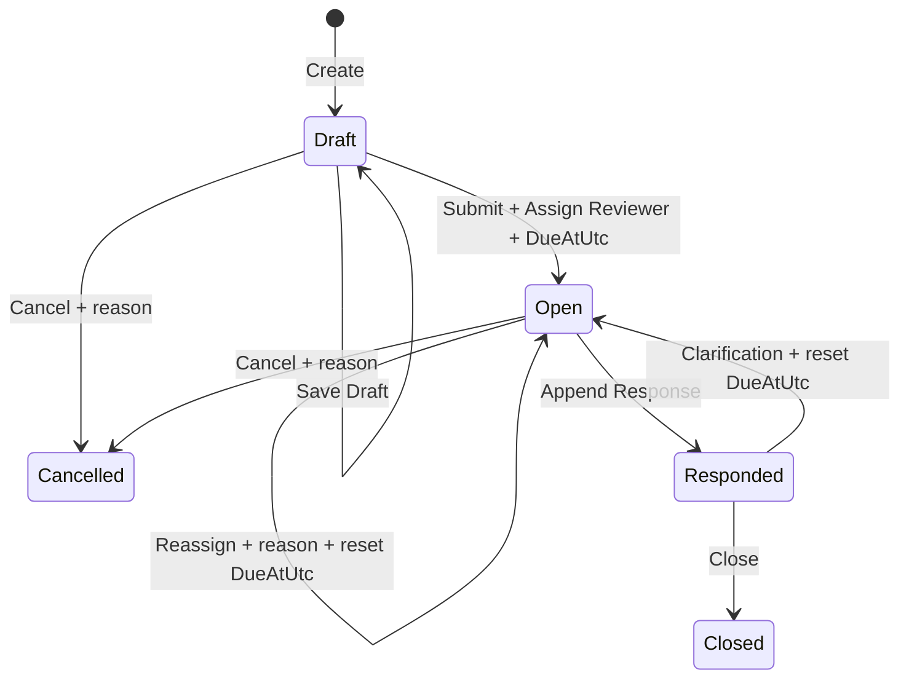
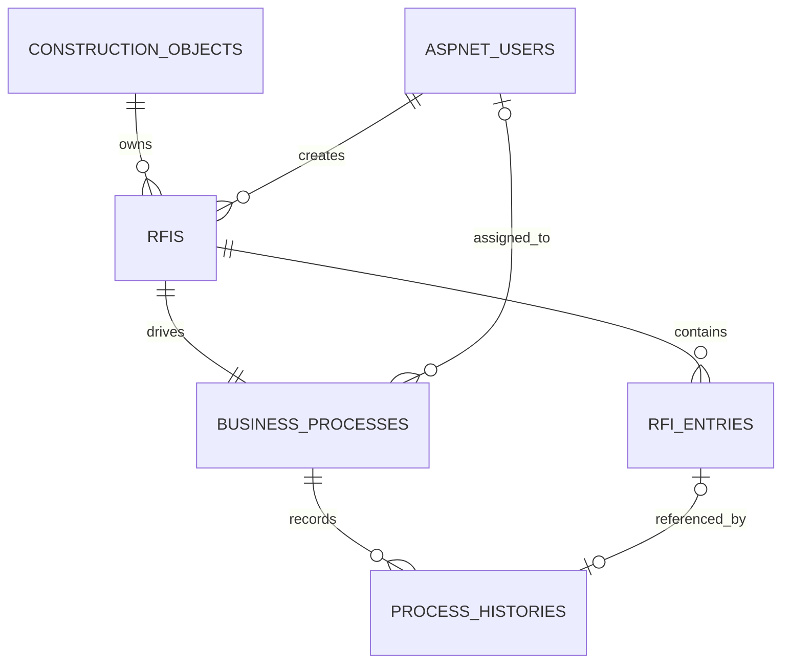
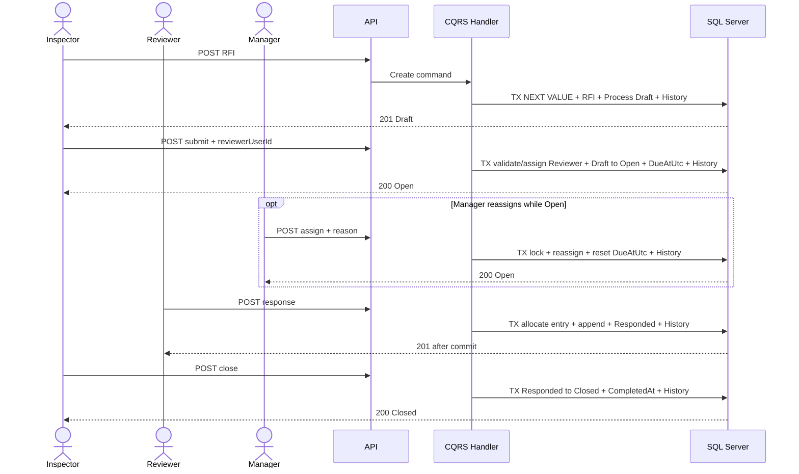

# Thiết kế RFI UC31–UC39 vertical slice

## 1. Trạng thái và phạm vi

Tài liệu này phân tích và đề xuất contract cho UC31–UC39. Đây chưa phải phê duyệt triển khai. Không có source, package, migration, database hoặc frontend nào được thay đổi trong checkpoint này.

RFI là hồ sơ làm rõ thông tin kỹ thuật gắn với đúng một Construction Object. Workflow production tiếp tục dùng Domain, `BusinessProcess` và append-only `ProcessHistory`; không dùng Elsa. Tổng scope sản phẩm vẫn đúng 43 UC.

Ngoài phạm vi checkpoint: UC40–UC42 Notification, UC43 Dashboard, attachment, link Inspection/Drawing/Mapping, SLA scheduler, realtime, email, reopen, delete và Elsa.

## 2. Baseline audit

- Production API hiện có 54 endpoint: Auth 2, Checklist 14, Construction Object 5, Drawing Mapping 6, Drawing 4, Form Template 8 và Inspection 15.
- `BusinessProcess` hiện có hai owner vật lý nullable `InspectionId`/`ChecklistId`, exact-one-owner check constraint và filtered unique index cho từng owner.
- `ProcessEntityType` chỉ có Inspection/Checklist; `ProcessStatus` chưa có Open/Responded/Closed/Cancelled.
- `ProcessHistory` lưu assignment trước/sau, Inspection submission hoặc Checklist submission và chưa có RFI entry pointer.
- Tất cả workflow write hiện dùng CQRS, `IUnitOfWork`, rowversion, `ProblemDetails`, DTO và SQL transaction.
- Construction Object inactive chặn hồ sơ mới nhưng không làm mất hồ sơ lịch sử.
- Migration production cuối là `20261020133408_AddChecklists`; baseline không có pending model change.
- Elsa đã đóng tại docs/20; không có Elsa production dependency hoặc database.

## 3. Mapping chính xác UC31–UC39

| UC | Tên Use Case | Actor | Tiền điều kiện | Hành động chính | Dữ liệu đầu vào | Trạng thái trước/sau | Quyền truy cập | Alternative flow | API/UI dự kiến | Acceptance criteria |
|---|---|---|---|---|---|---|---|---|---|---|
| UC31 | Xem danh sách RFI | Actor có quyền | Đăng nhập và có scope | Xem, tìm và lọc danh sách | Page/size, search, status, object, assignee, overdue và sort whitelist | Không đổi trạng thái | Own với Inspector, current assigned với Reviewer, full scope với Manager/Administrator | Detail ngoài scope trả 404; list không rò row | `GET /api/rfis`, `/rfis` | Phân trang ổn định; chỉ trả metadata trong scope |
| UC32 | Tạo và lưu Draft RFI | Inspector | Construction Object active và trong scope | Tạo RFI hoặc cập nhật Draft | Object, subject, question và rowVersions khi sửa | Không có → Draft; Draft → Draft | Creator Inspector | Object inactive/missing; stale rowVersion | `POST /api/rfis`, `PUT /api/rfis/{id}/draft`, `/rfis/new` | Number do server cấp; chưa có assignee; process Draft; create history |
| UC33 | Submit RFI | Người tạo | Draft hợp lệ; chọn active Reviewer khác creator | Gửi RFI và giao Reviewer | responderUserId và RFI/process rowVersion | Draft → Open | Creator Inspector | Reviewer inactive/sai role/trùng creator; invalid state hoặc stale rowVersion | `POST /api/rfis/{id}/submit` | Assignment và DueAtUtc = thời điểm mở +72 giờ; transition/history cùng transaction |
| UC34 | Giao lại người phản hồi | Manager | Open; Reviewer mới active, đúng role và khác creator/current Reviewer | Reassign responder | responderUserId, reason và rowVersions | Open → Open | Manager | Same/inactive user; race với response | `POST /api/rfis/{id}/assign` | Lưu assignee cũ/mới; reset DueAtUtc +72 giờ; history cùng transaction |
| UC35 | Phản hồi RFI | Người được giao | Open và đúng assignee | Append câu trả lời | responseText và RFI/process rowVersion | Open → Responded | Assigned active Reviewer | Chưa assign, sai actor hoặc stale rowVersion | `POST /api/rfis/{id}/responses` | Entry bất biến; response, status và history commit nguyên tử |
| UC36 | Yêu cầu làm rõ thêm | Người tạo | Responded | Append yêu cầu làm rõ | Content/reason và rowVersions | Responded → Open | Creator Inspector | Sai creator, terminal hoặc stale rowVersion | `POST /api/rfis/{id}/request-clarification` | Giữ Reviewer hiện tại; reset DueAtUtc +72 giờ; không ghi đè response cũ |
| UC37 | Đóng RFI | Người tạo | Responded | Xác nhận câu trả lời và đóng | Optional closing comment và rowVersions | Responded → Closed | Creator Inspector | Sai creator, invalid state hoặc stale rowVersion | `POST /api/rfis/{id}/close` | CompletedAt được ghi; RFI chuyển read-only |
| UC38 | Hủy RFI | Người tạo | Draft hoặc Open | Hủy hồ sơ | Reason bắt buộc và rowVersions | Draft/Open → Cancelled | Creator Inspector | Responded/terminal hoặc stale rowVersion | `POST /api/rfis/{id}/cancel` | CompletedAt và history được ghi; không hard delete |
| UC39 | Xem lịch sử RFI | Actor liên quan | Có read scope | Xem process history và entry chain | Page/size | Không đổi trạng thái | Creator, current assigned Reviewer hoặc Manager/Administrator full scope | Ngoài scope trả 404; Reviewer cũ mất scope sau reassign | `GET /api/rfis/{id}/history`, `/rfis/{id}` | Timeline ổn định; entry cũ bất biến; không lộ nội dung ngoài scope |

UC31–UC39 không có Start Processing/Start Review, Approve, Reject hoặc Reopen. Không tự thêm các transition này.

## 4. Mâu thuẫn và điểm chưa chốt

| Nguồn | Contract | Mâu thuẫn/khoảng trống | Đề xuất cuối | Cần quản lý |
|---|---|---|---|---|
| docs/01 UC33–34 | Submit và assignment là hai UC | Không nói assign trước hay sau Submit | Inspector chọn Reviewer khi Submit; Manager chỉ reassign khi Open | Không — Accepted |
| docs/01 actor UC34/38 | “Actor có quyền” | Không định danh role | Manager reassign; creator cancel own Draft/Open; Administrator chỉ full read | Không — Accepted |
| docs/01/02 | Notification cùng transition | UC40–42 chưa triển khai và ngoài slice | Không tạo Notification trong UC31–39; UC40–42 Deferred | Không — Accepted |
| docs/01/02 | DueAt creator hoặc SLA 72h | Không có scheduler/notification | Server cấp DueAtUtc theo 72 calendar hours mỗi lần vào Open | Không — Accepted |
| docs/02 | `EntityType + EntityId` logical owner | Implementation dùng nullable physical FK | Mở rộng pattern implementation hiện tại bằng `RfiId`, không quay về logical FK | Không, nếu chọn phương án A |
| docs/02 | Response append-only | Clarification cũng “không ghi đè phản hồi cũ” nhưng schema chỉ response | Dùng append-only `RfiEntries` với EntryType là Response hoặc ClarificationRequest | Không — Accepted |
| docs/01 | Administrator quản trị nền | Không chốt full RFI read | Administrator full read/list/detail/history nhưng không mutation | Không — Accepted |
| docs/04 | Object inactive chặn RFI mới | Chưa nói hồ sơ Open hiện hữu | Chặn create mới; hồ sơ đã tồn tại tiếp tục workflow; không cascade cancel | Không — Accepted |

## 5. State machine đề xuất



- Draft chỉ creator được sửa subject/question/due date.
- Submit chỉ creator; không có Start Review/Start Response.
- Draft chưa có assignee. Submit bắt buộc creator chọn một active Reviewer khác creator.
- Responder chỉ append response khi Open và đang là assignee hiện hành; Reviewer cũ mất read scope sau reassign.
- Response và clarification entry bất biến; không có current-answer update.
- Closed/Cancelled terminal và read-only; không reopen.
- Manager chỉ reassign khi Open, bắt buộc reason, không chọn lại Reviewer hiện tại và không assign creator. Reassign giữ Open và cấp DueAtUtc mới.
- Request Clarification giữ Reviewer hiện tại, chuyển Responded → Open và cấp DueAtUtc mới.
- Save Draft không append history; Create, Submit, Assign/Reassign, Respond, RequestClarification, Close và Cancel có history.
- Không Withdraw/Delete. Cancel là transition duy nhất thay thế.
- RFI đã tồn tại vẫn hoàn tất khi Construction Object inactive; create mới bị chặn.

Nếu mở rộng `ProcessStatus`, mapper phải là `switch` tường minh giữa `RfiStatus` và `ProcessStatus`; unknown hoặc status thuộc module khác phải throw fail-closed. Không cast enum trực tiếp.

## 6. Data model đề xuất

### 6.1 `Rfis`

| Column | SQL type | Null | Rule |
|---|---|---:|---|
| Id | uniqueidentifier | No | PK, application Guid |
| Number | nvarchar(50) | No | Unique, server generated |
| ConstructionObjectId | uniqueidentifier | No | FK NoAction |
| Subject | nvarchar(200) | No | Trimmed, 1–200 chars |
| Question | nvarchar(max) | No | Plain text, 1–32,768 UTF-8 bytes |
| CreatedByUserId | uniqueidentifier | No | Identity FK NoAction |
| NextEntryNumber | int | No | Khởi tạo 1, CHECK > 0; cấp entry không dùng MAX + 1 |
| CreatedAt | datetime2(7) | No | UTC |
| UpdatedAt | datetime2(7) | Yes | Draft edit UTC |
| UpdatedByUserId | uniqueidentifier | Yes | Identity FK NoAction |
| RowVersion | rowversion | No | Aggregate concurrency |

Indexes: unique Number; `(ConstructionObjectId, CreatedAt DESC, Id)`; `(CreatedByUserId, CreatedAt DESC, Id)`. Không lưu status hoặc assignment trùng với BusinessProcess.

`DueAtUtc` và current assignment thuộc `BusinessProcess`, không nhận từ client và không lưu trùng trong `Rfis`. Mỗi lần chuyển sang Open, server đặt `DueAtUtc = UtcNow + 72 calendar hours`.

### 6.2 `RfiEntries`

Tên bảng phản ánh đúng việc lưu cả response và clarification request.

| Column | SQL type | Null | Rule |
|---|---|---:|---|
| Id | uniqueidentifier | No | PK |
| RfiId | uniqueidentifier | No | FK Rfis NoAction |
| EntryNumber | int | No | > 0, unique per RFI |
| EntryType | varchar(30) | No | Response/ClarificationRequest |
| Content | nvarchar(max) | No | Plain text, 1–32,768 UTF-8 bytes |
| CreatedByUserId | uniqueidentifier | No | Identity FK NoAction |
| CreatedAtUtc | datetime2(7) | No | UTC |

Unique `(RfiId, EntryNumber)`; index `(RfiId, EntryNumber ASC, Id ASC)` để detail có stable ordering. Không rowversion vì entry bất biến và không có update API. EntryNumber được cấp từ `Rfis.NextEntryNumber` trong transaction/lock; không dùng `MAX + 1`. Không thêm `CurrentEntryId` vì lifecycle status và ordered immutable entries đã xác định entry mới nhất.

### 6.3 Process/history

- `BusinessProcesses`: thêm nullable `RfiId`, `ProcessEntityType.Rfi`, status Open/Responded/Closed/Cancelled, filtered unique `RfiId IS NOT NULL` và exact-one-owner constraint cho ba owner.
- `ProcessHistories`: thêm nullable `RfiEntryId` để history Respond/RequestClarification pin đúng immutable entry. Check constraint bảo đảm chỉ RFI process dùng pointer này; Inspection/Checklist columns giữ nguyên.
- Assignment dùng `BusinessProcess.AssignedToUserId`; old/new assignee tiếp tục dùng hai audit columns hiện có.
- `ProcessStatus` có thể mở rộng union values nhưng mọi aggregate phải dùng factory/transition và mapper riêng.
- Tất cả FK nghiệp vụ `NO ACTION`; không hard delete.

### 6.4 ER đề xuất



Sơ đồ chỉ mô tả quan hệ chính. Các FK đến Identity đều là scalar `Guid` trong Domain và `NO ACTION` trong SQL; không tạo Domain User song song với ASP.NET Core Identity.

### 6.5 Number

Chọn SQL Server sequence `RfiNumberSequence`, format server-side `RFI-{UTC_YEAR}-{SEQUENCE:000000}`. Không dùng `MAX + 1`, không nhận Number từ client, unique index là backstop. Gap được chấp nhận.

### 6.6 Links, content và attachment

- Một RFI thuộc đúng một Construction Object.
- UC31–39 không yêu cầu link Inspection, DrawingDocument hoặc DrawingObjectMapping; không tạo bảng link/snapshot/mapping ID.
- Question/response là plain text render bằng text node; không rich text, HTML hoặc Markdown trong MVP.
- Attachment không xuất hiện trong UC31–39: **Deferred**. Không thêm MinIO dependency, endpoint upload, metadata table hoặc thay Drawing storage contract.

## 7. BusinessProcess strategy

| Tiêu chí | A — thêm RfiId | B — process riêng RFI |
|---|---|---|
| Kiến trúc | Nhất quán Inspection/Checklist hiện tại | Tạo hai mô hình workflow/history |
| Migration | Sửa constraint/status + nullable FK/index | Bảng và query mới, ít chạm constraint cũ |
| Query/dashboard | Một nguồn process | Union/adapter phức tạp |
| Authorization/history | Tái dùng conventions/factory | Dễ diverge |
| Regression risk | Cần backfill-safe constraint replacement | Ít chạm bảng cũ nhưng duplication dài hạn cao |
| Extensibility | Owner thứ ba rõ ràng; exact-one constraint dài hơn | Mỗi module tự chủ nhưng phân mảnh |

**Khuyến nghị A.** Mở rộng đúng pattern physical owner đã được Checklist chứng minh. Migration phải drop/recreate constraint trong cùng deployment, thêm nullable RfiId không backfill rows cũ, rồi chứng minh mọi Inspection/Checklist row cũ vẫn đúng một owner. Domain thêm `CreateForRfi`, `EnsureRfiProcess` và transition riêng; không dùng constructor cho invalid owner.

## 8. Authorization matrix đề xuất

`401` anonymous; capability sai `403`; resource ngoài scope `404`; validation `400`; stale/invalid transition `409`; request body vượt limit `413`.

| Capability | Anonymous | Inspector | Reviewer | Manager | Administrator |
|---|---|---|---|---|---|
| Create | 401 | Yes | 403 | 403 | 403 |
| List/detail own | 401 | Yes | Current assigned only | Full | Full |
| List/detail assigned | 401 | Own only | Current assigned only | Full | Full |
| Full read | 401 | No | No | Yes | Yes |
| Edit Draft | 401 | Creator | 403 | 403 | 403 |
| Submit và chọn Reviewer | 401 | Creator | 403 | 403 | 403 |
| Respond | 401 | 403 | Current assigned responder | 403 | 403 |
| Responder lookup | 401 | Yes | 403 | Yes | 403 |
| Reassign | 401 | 403 | 403 | Open only | 403 |
| Clarification/close | 401 | Creator | 403 | 403 | 403 |
| Cancel | 401 | Creator Draft/Open | 403 | 403 | 403 |
| Read history | 401 | Own | Current assigned | Full | Full |
| Attachment | Deferred | Deferred | Deferred | Deferred | Deferred |

Responder phải là active user có role Reviewer và không được là creator. Manager chỉ reassign, không Respond/Close/Cancel thay actor nghiệp vụ. Administrator có full read/list/detail/history để hỗ trợ quản trị nhưng không có mutation. Sau reassign, Reviewer cũ không còn current-assigned scope và nhận 404 khi truy cập RFI đó nếu không có scope khác.

## 9. API contract — 12 endpoint

Mọi request DTO dùng `JsonUnmappedMemberHandling.Disallow`, CancellationToken xuyên suốt và response chỉ trả DTO.

| # | Method/route | UC/actor | Request chính | Response/status | Transaction/rowVersion |
|---:|---|---|---|---|---|
| 1 | GET `/api/rfis` | UC31 scoped users | page 1, size 20≤100, search≤200, status, objectId, assignedToMe, overdue, sort | 200 paged metadata; 400/401/403 | AsNoTracking, stable Id tie-break; cancellation |
| 2 | GET `/api/rfis/responder-options` | Inspector/Manager | page 1, size 20≤100, search≤200 | 200 page of `userId`, `displayName`; 400/401/403 | Active Reviewer only; stable displayName/Id order; cancellation |
| 3 | GET `/api/rfis/{id:guid}` | UC31/39 related | — | 200 detail incl. content/current process/entry chain; 401/403/404 | Read only; cancellation |
| 4 | POST `/api/rfis` | UC32 Inspector | objectId, subject, question | 201 + Location; 400/401/403/404/409/413 | TX Number + RFI + Process Draft + initial history |
| 5 | PUT `/api/rfis/{id:guid}/draft` | UC32 creator | subject, question, rfiRowVersion, processRowVersion | 200 + new versions | TX; Draft only |
| 6 | POST `/api/rfis/{id:guid}/submit` | UC33 creator | responderUserId, rfiRowVersion, processRowVersion | 200 Open | TX validate Reviewer + assign + DueAtUtc + process + history |
| 7 | POST `/api/rfis/{id:guid}/assign` | UC34 Manager | responderUserId, reason, rfiRowVersion, processRowVersion | 200 assignment/versions | TX RFI/process lock + history; Open only; reset DueAtUtc |
| 8 | POST `/api/rfis/{id:guid}/responses` | UC35 current assignee | responseText, rfiRowVersion, processRowVersion | 201 immutable entry + Responded | TX allocate EntryNumber + insert + history |
| 9 | POST `/api/rfis/{id:guid}/request-clarification` | UC36 creator | content/reason, rfiRowVersion, processRowVersion | 201 immutable entry + Open | TX keep assignee + reset DueAtUtc + history |
| 10 | POST `/api/rfis/{id:guid}/close` | UC37 creator | optional comment≤2000, rfiRowVersion, processRowVersion | 200 Closed | TX CompletedAt + history |
| 11 | POST `/api/rfis/{id:guid}/cancel` | UC38 creator | required reason, rfiRowVersion, processRowVersion | 200 Cancelled | Draft/Open only; TX CompletedAt + history |
| 12 | GET `/api/rfis/{id:guid}/history` | UC39 related | page/size | 200 timeline containing process events and referenced entry metadata | Read-only projection; cancellation |

`/responder-options` là static route và phải được map trước/không xung đột với `{id:guid}`. Reviewer và Administrator không có lookup capability nên nhận 403. List DTO không chứa Question/entry content. Detail trả full plain-text content. History có stable order `(performedAt, id)`. Không generic transition endpoint, delete/reactivate/reopen route hoặc client-owned status/number/actor.

## 10. DTO và validation

```text
RfiListItemDto: id, number, subject, object metadata, status, creator,
assignee, dueAtUtc, isOverdue, createdAt, updatedAt, rowVersion, processRowVersion

RfiDetailDto: list fields + question + ordered immutable entries + permissions
RfiWorkflowResultDto: id, status, assignedToUserId, dueAtUtc, completedAt,
rowVersion, processRowVersion, optional created entry

RfiResponderOptionDto: userId, displayName
```

Limits:

- Subject 1–200 chars; question and response/clarification each 1–32,768 UTF-8 bytes.
- Reassign/cancel/clarification reason and close comment maximum 2,000 chars; cancel/reassign reason is required.
- Search maximum 200 chars; pageSize 1–100.
- Request limit chosen above canonical JSON payload with headroom, proposed 128 KiB; application still validates each UTF-8 field and maps oversized request to 413.
- Reject unknown/server-owned JSON properties, empty Guid, invalid enum/status, inactive Construction Object at create, inactive/non-Reviewer responder, creator/current Reviewer as new responder, cross-scope IDs and stale Base64 rowVersion.
- Client không được gửi DueAtUtc. Server cấp đúng 72 calendar hours từ thời điểm Submit, Reassign hoặc Request Clarification đưa process vào/giữ Open.
- No HTML/script execution: store and render plain text; never use `dangerouslySetInnerHTML`.
- Do not log question/response/reason, JWT, rowVersion, StorageKey or URL. Log stable IDs, result code and traceId only.

## 11. Transaction and concurrency



- Lock owner/process in stable order with SQL transaction; compare client rowVersions after lock.
- Concurrent Submit/double transition: one commit, loser 409; no retry.
- Concurrent response: only one Open→Responded can commit. Unique entry number is backstop.
- Submit validates and assigns the Reviewer in the same transaction that opens the RFI and sets DueAtUtc.
- Reassign vs response: both contend on process rowversion/lock; one wins, loser 409. Reassign resets DueAtUtc and preserves Open.
- Request Clarification appends an entry, preserves current Reviewer and resets DueAtUtc in one transaction.
- History insert failure rolls back state, assignment, entry number and response.
- Response DTO is returned only after commit.
- No current-response pointer is required: status plus ordered append-only entries identifies latest response. Therefore no circular FK like Inspection `CurrentSubmissionId`.

## 12. Migration proposal only

Proposed migration name: `AddRfis`.

1. Create `RfiNumberSequence` starting 1/increment 1.
2. Create `Rfis` and `RfiEntries` with constraints/indexes above, including `NextEntryNumber` initialized to 1 and unique `(RfiId, EntryNumber)`.
3. Add nullable `BusinessProcesses.RfiId`; add FK NoAction and filtered unique index.
4. Expand `CK_BusinessProcesses_EntityType`, status allowlist and exact-one-owner constraint to three owners.
5. Add nullable `ProcessHistories.RfiEntryId`, FK NoAction, index and owner/reference consistency check where feasible.
6. Expand entity, status and action constraints without changing existing numeric values for Inspection/Checklist.
7. Preserve all Inspection/Checklist rows and process/history unchanged. No backfill is needed because RfiId is null for existing rows; pre/post SQL verifies exact-one-owner counts and existing process/history totals.
8. Use `NO ACTION` for every business FK. Do not delete/drop business data.
9. Do not add Notifications, attachment/storage tables or RFI link tables.

After source implementation and before migration generation, EF should report pending changes exactly for this proposal. After reviewed migration is created, pending-model check must be clean; SQL script must be reviewed before apply.

## 13. Test strategy

### Domain

- Create/Draft edit, all legal/illegal transitions and terminal immutability.
- Owner/entity-type invariant for three process owners; cross-module transition rejection.
- Explicit status mapper completeness/fail-closed.
- Assignment/reassignment, responder authorization and self-assignment policy.
- Immutable response chain, entry number and UTF-8 limits.
- Number format and UTC audit/completion invariants.

### Application

- Role/ownership/assignment/object scope and inactive object behavior.
- DTO unknown fields, validation, 400/401/403/404/409/413 mapping.
- RowVersion parsing and stale RFI/process conflicts.
- Transaction rollback and CancellationToken propagation.
- List filter/sort/pagination projection; no large content in list.

### Integration

- Schema, sequence, checks, filtered unique indexes and all NoAction FKs.
- 12 endpoint contracts, including responder lookup, and complete role matrix.
- Concurrent submit, response, reassign-vs-response and terminal action.
- Immutable response/history, rollback on forced persistence error.
- Object inactive: create blocked, existing workflow continues.
- Number sequence concurrency and no `MAX + 1`.
- Regression Inspection/Checklist owner constraints, transitions and history.
- Payload byte boundary and XSS-safe content round trip.

### Frontend and runtime

- Protected `/rfis`, `/rfis/new`, `/rfis/{id}`; role action matrix.
- List/loading/empty/error, form validation, conflict retains content with reload option.
- Unsaved-change guard, request cancellation on navigation, deep link/refresh.
- Keyboard focus, labelled controls, status text not color-only, 1366–1440 responsive layout.
- Runtime smoke: create→submit with Reviewer→respond→close; clarification loop; cancel; Manager reassign; 401/403/404/409 and stale/concurrent request; no JWT/storage data leakage.

## 14. UI design

- `/rfis`: metadata table/cards with search, status/object/assignment/overdue filters and server pagination.
- `/rfis/new`: active Construction Object lookup and plain-text subject/question form; Draft chưa chọn Reviewer hoặc DueAtUtc.
- `/rfis/{id}`: header/status, question, current assignment, append-only conversation, action panel and history timeline. Submit dialog dùng paged `/api/rfis/responder-options`; Manager dùng cùng lookup khi reassign.
- 409 never discards local draft/response; show conflict, preserve fields and offer explicit reload.
- Abort obsolete GET when route/filter changes; no automatic retry of mutation.
- Role/state drives visible actions but backend remains authoritative.

## 15. Rollout plan

1. Management resolves ADRs below and contract is updated.
2. Implement Domain/Application/Infrastructure/API plus unit tests; stop before migration.
3. Generate `AddRfis`, review migration and SQL, then explicitly approve apply to Development.
4. Run isolated SQL integration and regression gates.
5. Implement frontend routes/UI and accessibility tests.
6. Run end-to-end UAT using the approved role matrix and lifecycle.

Rollback before database apply is source revert. After apply, disable/hide RFI feature and preserve tables/history; do not drop production data automatically.

## 16. ADR đã được quản lý chấp nhận

| ADR | Quyết định cuối | Lý do/trade-off | Trạng thái |
|---|---|---|---|
| RFI-001 | Lifecycle Draft→Open→Responded→Closed; Draft/Open→Cancelled; clarification Responded→Open; terminal không reopen | Tối thiểu đúng UC; không Start Review/Reject/Delete/generic transition | Accepted |
| RFI-002 | Inspector chọn active Reviewer khác creator khi Submit; Reviewer hiện hành xử lý | Separation rõ; cần responder lookup | Accepted |
| RFI-003 | Administrator full read/list/detail/history, không mutation | Hỗ trợ quản trị mà không chiếm quyền actor nghiệp vụ | Accepted |
| RFI-004 | Manager full read và reassign khi Open; không respond/close/cancel | Manager điều phối, creator xác nhận câu trả lời | Accepted |
| RFI-005 | Attachment Deferred | Giữ slice nhỏ; không thêm MinIO dependency | Accepted |
| RFI-006 | Link Inspection Deferred | Có thể thêm bằng future link table | Accepted |
| RFI-007 | Link Drawing/Mapping Deferred | Không lưu viewport/mapping context trong MVP | Accepted |
| RFI-008 | `RfiEntries` append-only, không mutation | Audit mạnh; tăng số row có chủ đích | Accepted |
| RFI-009 | SLA 72 calendar hours do server cấp mỗi lần vào Open | Dễ dự đoán; chưa có reminder/escalation | Accepted |
| RFI-010 | Notification Deferred sang UC40–UC42 | Không mở scope RFI MVP | Accepted |
| RFI-011 | Chỉ clarification Responded→Open; Closed/Cancelled không reopen/recheck | Đúng UC36 và terminal contract | Accepted |
| RFI-012 | Object inactive chặn create; RFI cũ tiếp tục, không cascade cancel | Không làm workflow hiện hữu mắc kẹt | Accepted |
| RFI-013 | Subject 200 ký tự; question/entry 32 KiB UTF-8; reason 2.000 ký tự; request 128 KiB | Đủ nội dung kỹ thuật và có abuse boundary | Accepted |
| RFI-014 | `RFI-{UTC_YEAR}-{SEQUENCE:000000}` bằng SQL sequence; gap accepted | Server-owned, không `MAX + 1` | Accepted |
| RFI-015 | Generalize BusinessProcess bằng nullable RfiId và exact-one-owner | Nhất quán/query tốt; migration constraint cần regression gate | Accepted |
| RFI-016 | Submit bắt buộc responderUserId; assignment và Open trong cùng transaction | Không tồn tại Open RFI không người xử lý | Accepted |
| RFI-017 | Creator cancel own Draft/Open với reason bắt buộc; không cancel sau Responded | Quyền rõ ràng; Manager/Admin không can thiệp | Accepted |
| RFI-018 | Clarification là immutable `RfiEntry`; giữ Reviewer và reset DueAtUtc | Không ghi đè; timeline đầy đủ | Accepted |

Toàn bộ 18 ADR đã được quản lý chấp nhận. Không còn ADR Proposed hoặc blocker quyết định trước checkpoint backend source.

## 17. Definition of Done tương lai

- UC31–UC39 được map đúng, không thay tổng 43 UC.
- 12 endpoint, lifecycle, role/scope và rowVersion đúng contract đã duyệt.
- RFI number server-side sequence; response/history append-only.
- Exactly-one-owner ba module được chứng minh ở Domain và SQL mà không regression Inspection/Checklist.
- Không attachment/MinIO/link/Notification ngoài scope đã duyệt.
- Backend, migration, integration, frontend, runtime smoke và security gates đạt.
- Không lộ secret/JWT/storage information; không hard delete; không Elsa.
